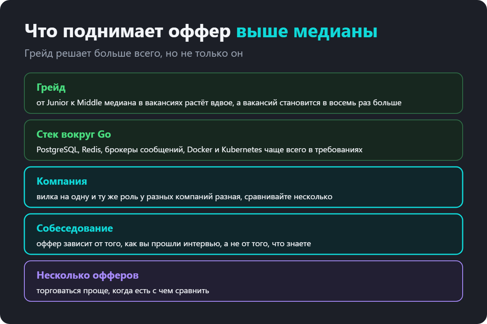

В отчётах Хабр Карьеры Go стабильно оказывается среди самых высокооплачиваемых языков в российском IT. Поэтому вопрос «сколько платят Go-разработчику» задают и те, кто выбирает первый язык, и те, кто думает перейти с PHP, Python или Java.

Если открыть поиск, цифры будут расходиться вдвое. Где-то медиана 150 тысяч, где-то 320. Разберёмся, откуда берутся эти числа, сколько реально платят по грейдам и что нужно, чтобы получить оффер выше медианы. Все цифры ниже со ссылками на источник и датой, рынок меняется, и старые данные легко принять за свежие.

Медиана зарплаты Go-разработчика
По отчёту Хабр Карьеры за вторую половину 2025 года медианная зарплата Go-разработчиков составила 320 000 ₽ на руки. За полгода она выросла на 4%.

Пара цифр для сравнения из того же отчёта. Медиана всех IT-специалистов в Москве 230 000 ₽, в Санкт-Петербурге 200 000 ₽, в регионах 159 166 ₽. То есть медианный Go-разработчик получает больше, чем медианный айтишник в Москве.

Отчёт построен на 52 123 анкетах, которые заполнили сами специалисты. Суммы указаны на руки, после вычета налогов.

Почему цифры расходятся вдвое
Если искать «зарплата golang», легко найти и 150 тысяч, и 320. Обе цифры могут быть честными, просто они считают разное.

Анкеты и вакансии. Хабр Карьера собирает анкеты работающих специалистов. Агрегаторы вроде hh.ru считают по вакансиям. Вакансии показывают, что работодатель готов предложить сегодня, и в них зарплату часто не указывают вовсе. Анкеты показывают, сколько люди получают на самом деле, включая тех, кто давно работает и успел вырасти.

Состав грейдов. Медиана по всем Go-разработчикам сильно сдвинута вверх, потому что среди них много Middle и Senior. Junior на Go мало, о причинах ниже. Поэтому общая медиана не говорит, сколько получит человек на первой работе.

На руки или до вычета налога. Хабр считает на руки, многие вакансии указывают сумму до вычета налога. Разница от 13% и больше, в зависимости от ставки НДФЛ.

Вилки по грейдам
Хабр Карьера показывает зарплаты по грейдам только авторизованным пользователям. Поэтому возьмём другой открытый источник, разбор вакансий Go-разработчиков на Хабре за июль 2025. Автор собрал вакансии с hh.ru, getmatch и Хабр Карьеры и посчитал медианы по тем, где сумма указана.

Почему для Junior почти нет вакансий
Самая важная цифра в том же разборе не про деньги, а про количество вакансий.
В июле 2025 на трёх площадках вместе нашлось 9 вакансий для Junior, 76 для Middle и 392 для Senior. Go в России в основном язык высоконагруженного бэкенда и инфраструктуры. Компании берут на него людей, которые уже умеют писать продакшен-код, и редко готовы учить с нуля.

Отсюда практический вывод. Цель «стать Junior на Go» почти не работает. Рабочая цель это выйти на рынок с уровнем, который проходит собеседование на Middle, даже если коммерческого опыта на Go ещё мало. Именно поэтому разница между «знаю синтаксис» и «понимаю, как Go устроен» решает так много.

Удалёнка
В том же разборе 57% вакансий Middle предлагали удалённую работу, а среди вакансий Senior только 11% требовали работать в офисе. Для Go-разработчика из региона это значит, что московская вилка вполне достижима без переезда.

Что влияет на сумму оффера

Грейд. Решает больше всего. От Junior к Middle медиана в вакансиях растёт вдвое, а вакансий становится в восемь раз больше.

Стек вокруг Go. Сам язык это меньшая часть требований. В вакансиях Middle и Senior чаще всего встречаются PostgreSQL, Redis, брокеры сообщений, Docker и Kubernetes, REST API и микросервисы. Знать Go без этого окружения недостаточно.

Компания. На одну и ту же роль у разных компаний разные вилки. Поэтому имеет смысл ходить на несколько собеседований параллельно, а не соглашаться на первое предложение.

Собеседование. Оффер зависит не от того, сколько вы знаете, а от того, как это увидел интервьюер. Кандидат, который уверенно объясняет устройство слайсов и каналов и пишет код с тестами, получает предложение по верхней границе вилки.

Несколько офферов. Торговаться проще, когда есть с чем сравнить. Второй оффер на руках обычно поднимает первый сильнее любых аргументов.

самый реалистичный вход в Go в 2026 году. Опыт программирования плюс системная подготовка к собеседованию на Middle.

Сколько длится путь до первого оффера
Зависит от стартовой точки.

С опытом в другом языке путь занимает обычно от двух с половиной до пяти месяцев, как в историях выше. Основная работа в том, чтобы понять Go изнутри, добрать стек и научиться проходить собеседования.
С нуля путь длиннее. В нашем роадмапе это 12 недель до уровня Junior и 18 недель до уровня Middle при ежедневных занятиях. Плюс поиск работы.

Как выйти на оффер выше медианы
Целиться в Middle, а не в Junior. Вакансий в восемь раз больше, а медиана вдвое выше.
Знать Go изнутри. Слайсы, map, интерфейсы, горутины, каналы, context, сборщик мусора. На этом строится теоретическая часть собеседования.
Добрать окружение. PostgreSQL, Redis, брокер сообщений, Docker. Один pet-проект, где всё это работает вместе, сильнее десяти учебных задач.
Писать код с тестами. На live coding и в тестовых заданиях это сразу выделяет.
Ходить на несколько собеседований параллельно. И торговаться, когда появится второй оффер.
Частые вопросы
Сколько зарабатывает Go-разработчик в 2026?

Медиана по отчёту Хабр Карьеры за вторую половину 2025 года 320 000 ₽ на руки. Это медиана по всем грейдам, у Junior заметно меньше, у Senior больше.

Сколько получает Junior на Go?

Открытых данных мало. В разборе вакансий за июль 2025 медиана около 90 000 ₽, но всего по двум вакансиям с указанной суммой. Важнее то, что вакансий для Junior на Go очень мало.

Сколько получает Middle Go-разработчик?

По вакансиям июля 2025 медиана около 200 000 ₽. Реальные офферы при хорошем собеседовании бывают заметно выше. Наши ученики получали от 270 до 420 тысяч на руки.

Можно ли устроиться на Go без опыта?

Можно, но сложнее, чем на многих других языках. Вакансий для Junior единицы. Реалистичнее готовиться сразу к уровню Middle или заходить в Go из другого языка.

Можно ли работать на Go удалённо?

Да. В разборе вакансий за июль 2025 удалёнку предлагали 57% вакансий Middle, а офис требовали только 11% вакансий Senior.

Почему на hh.ru медиана ниже, чем на Хабре?

hh.ru считает по вакансиям, где зарплату часто не указывают и где много начальных позиций. Хабр Карьера считает по анкетам работающих специалистов, среди которых больше опытных.

Если хотите понять, на какой уровень вы готовы выйти сейчас, начните с диагностики. Она за 12 минут покажет сильные стороны и три темы, которые стоит закрыть перед собеседованием.
