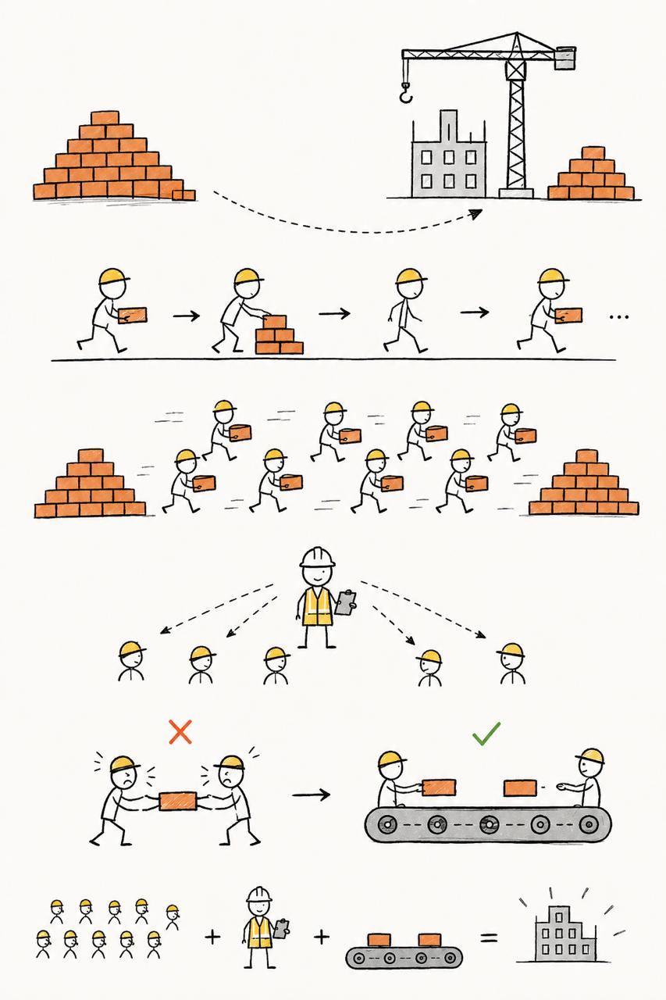

Goroutines



Представь стройку. Тебе надо перетаскать тысячу кирпичей с одного места в другое

Вариант первый, один работник

Ты нанял одного грузчика. Он берет кирпич, несет, возвращается, берет следующий. Все по очереди. Пока не перетаскает все, дело не сдвинется. Это обычный последовательный код, одна задача за другой

Вариант второй, горутины

Ты нанял сто грузчиков и они таскают кирпичи одновременно. Работа идет в сто раз бодрее. Вот это и есть горутины, много мелких работников, которые трудятся параллельно

Самое крутое в Go это то, насколько грузчики дешевые. Обычный поток в системе это как нанять дорогого специалиста с кучей требований. А горутина это как позвать студента за еду. Можешь нанять хоть сто тысяч, системе не больно)))

Кто всем управляет

На стройке есть бригадир, который раздает задачи и следит кто чем занят. В Go эту роль играет планировщик. Сам решает какой грузчик когда работает и распределяет их по реальным рабочим местам

А как они не мешают друг другу

Представь что два грузчика тянут один кирпич. Будет бардак. Чтобы такого не было, в Go есть каналы. Это как конвейер, по которому грузчики аккуратно передают кирпичи друг другу, без драк и путаницы

Вот и вся база по горутинам. Много дешевых работников, умный бригадир и конвейер чтобы не толкаться

Если такой формат заходит, ставь ❤️. Соберу серию по всем сложным темам Go

---

📦 Обработка ошибок в горутинах: безопасное управление ошибками через каналы

❓ Как обрабатывать ошибки в горутинах?

Обработка ошибок в горутинах требует передачи ошибок через каналы и их корректной обработки в основном потоке.


```go
func Worker(input <-chan int, result chan<- int, errChan chan<- error) {
    for value := range input {
        if value == 0 {
            errChan <- fmt.Errorf("ошибка: значение равно 0")
            continue
        }
        result <- 10 / value
    }
}


func main() {
    input := make(chan int)
    result := make(chan int)
    errChan := make(chan error)

    go Worker(input, result, errChan)

    go func() {
        for i := -2; i <= 2; i++ {
            input <- i
        }
        close(input)
    }()

    for {
        select {
        case res := <-result:
            fmt.Println("Результат:", res)
        case err := <-errChan:
            fmt.Println("Ошибка:", err)
        case <-time.After(1 * time.Second):
            fmt.Println("Завершение работы")
            return
        }
    }
}
```

⚠️ Преимущества:

- Безопасная обработка ошибок.
- Отделение логики обработки ошибок от основной логики.
- Удобство использования каналов для передачи ошибок.

❗ Ограничения:

- Требует аккуратного управления каналами.
- Может быть избыточным для простых задач.
