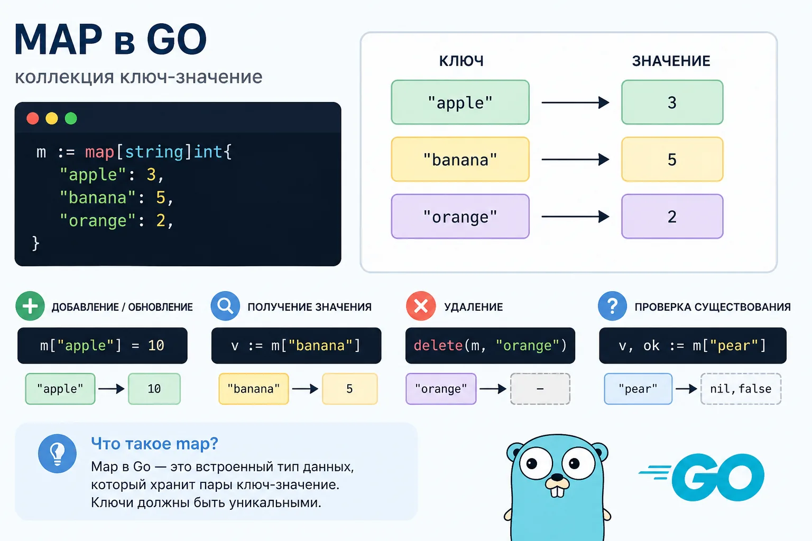
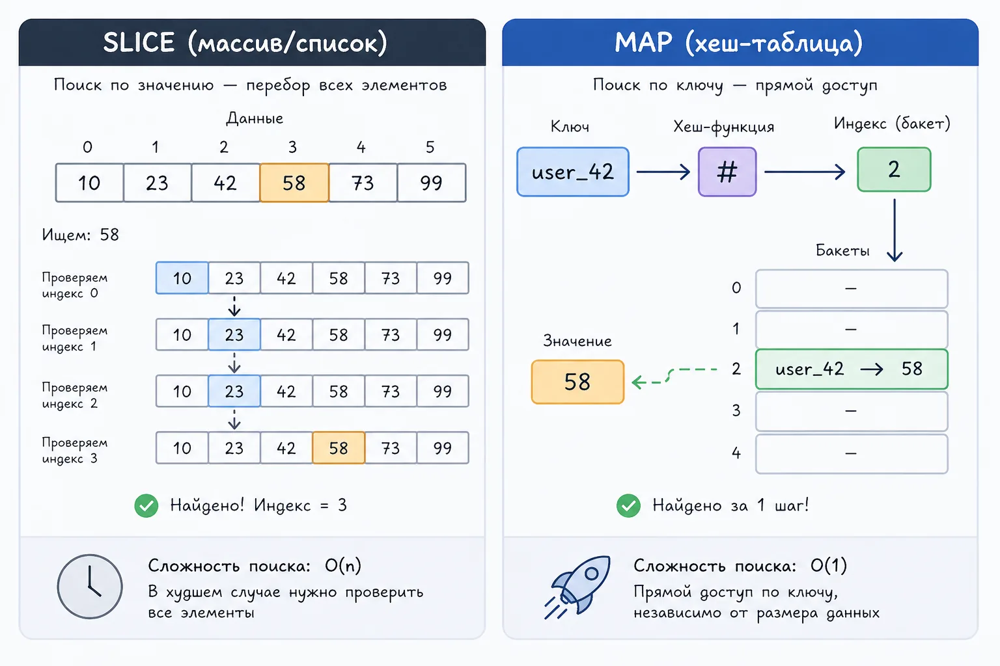
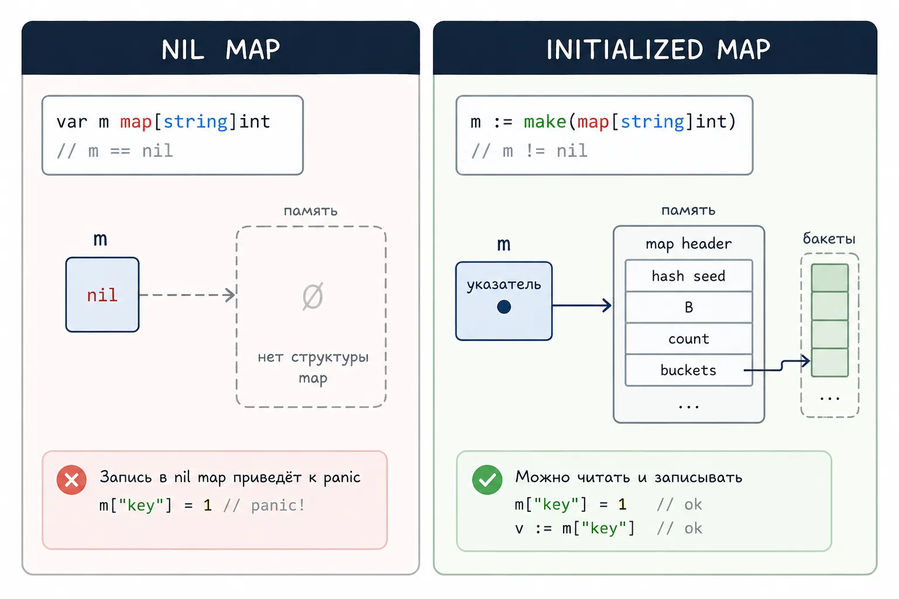
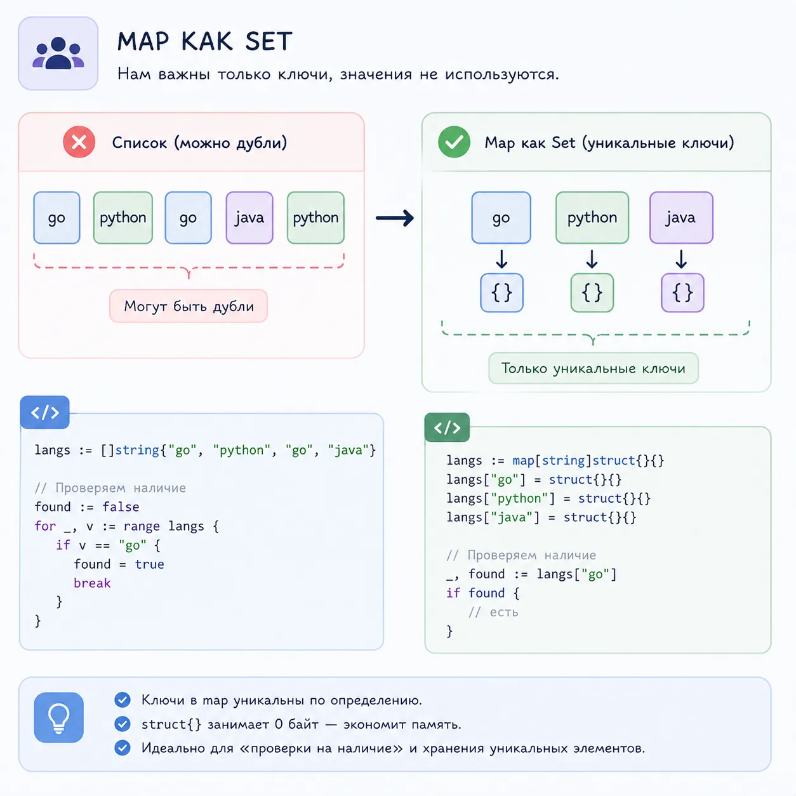
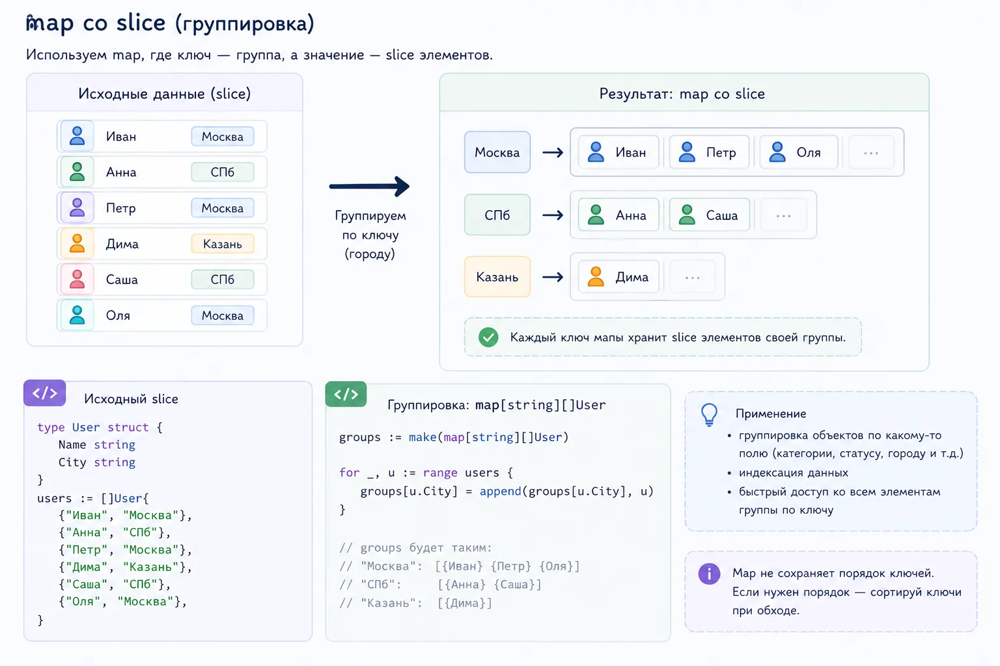
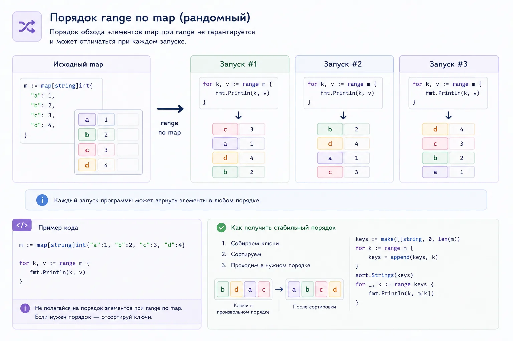
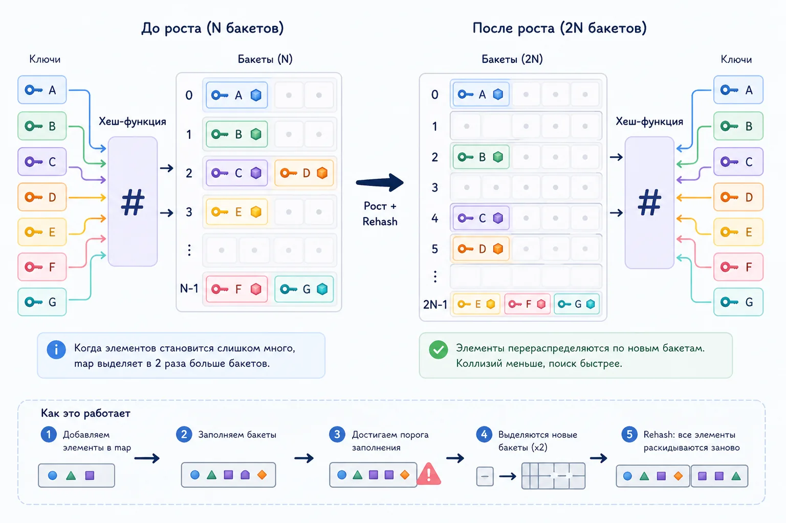
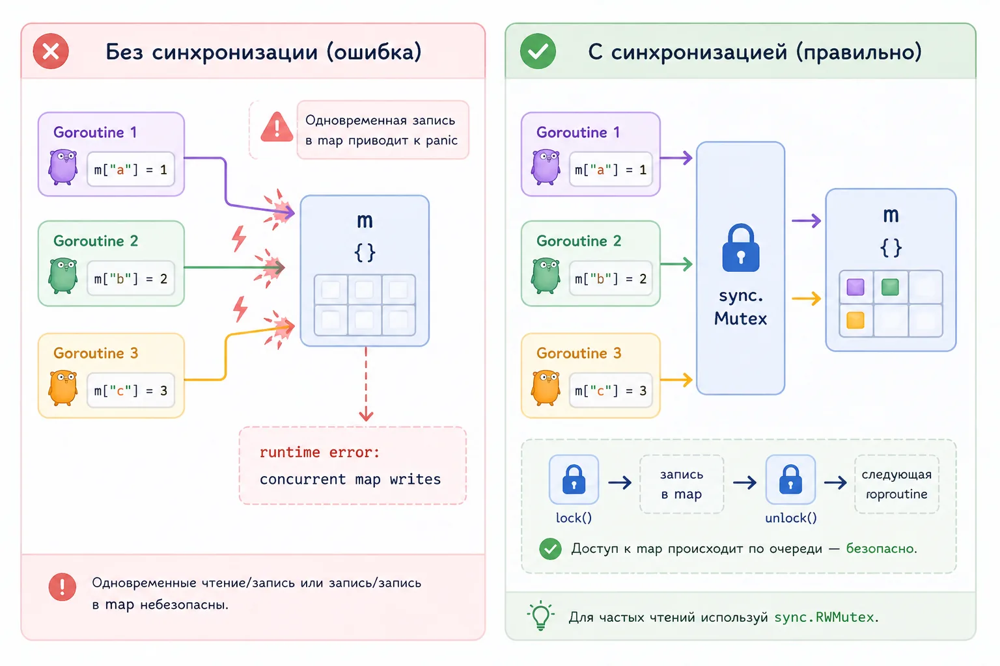
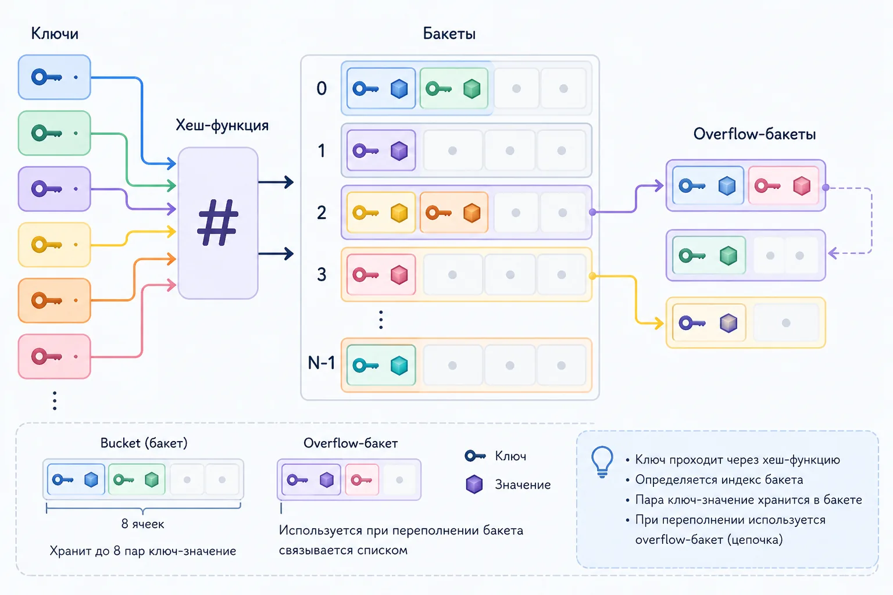

### Карты. Map
Карта в Go - тип данных. встроенный хэш или словарь. Используют пары ключ-значение для хранения данных.
Ключи сопоставимого типа – примитивные типы (строки, целые числа), определяется языком, а не создается путем объединения других типов.
Значения любым типом данных.

Для быстрого поиска значений по индексу (ключу).
Для хранения связанных данных.

Сохранить карту пользователей, проиндексированную по ID пользователя, со значением объект пользователя.

```go
sammy := map[string]string{"name": "Sammy", "animal": "shark", "color": "blue", "location": "ocean"}

fmt.Println(sammy["color"])
```



Map в Go — это структура данных, где каждое значение лежит по своему ключу.

Проще на примере. Представь, у тебя есть список пользователей:

[]User{...}
Чтобы найти пользователя по ID, тебе придётся пройтись по всему списку.

А теперь представь, что ты заранее разложил их так:

users := map[int]string{
    1: "Niyaz",
    2: "Mark",
}
Теперь ты просто пишешь users[1] и сразу получаешь нужное значение.

То есть map решает конкретную задачу: быстро получить данные по ключу без перебора.

В отличие от slice, где доступ идёт по индексу, в map важен не порядок, а сам ключ. Ты не перебираешь данные, а сразу обращаешься к нужному значению.

Простой пример:

users := map[int]string{
    1: "Niyaz",
    2: "Mark",
}

fmt.Println(users[1]) // Niyaz



Map в Go обычно проходят быстро. Объявили map[string]int, положили значение по ключу, прочитали, удалили через delete и пошли дальше. На первых задачах кажется, что тема простая.

Проблемы начинаются позже.

Сначала ловишь panic: assignment to entry in nil map. Потом не понимаешь, почему range каждый раз отдаёт ключи в разном порядке. Потом кто-то на собеседовании спрашивает, почему нельзя взять адрес &m[key]. А потом в проде прилетает fatal error: concurrent map writes, и становится понятно, что map в Golang простая только снаружи.

В этой статье разберём map нормально: от базового синтаксиса до внутреннего устройства, роста, buckets, tophash, конкурентного доступа, sync.Map, копирования map и изменений в Go 1.24.

Статья подойдёт тем, кто изучает Golang с нуля, готовится к собеседованию по Go или уже пишет backend и хочет наконец закрыть тему мап без каши в голове.

Что такое map в Go
map в Go — это встроенная структура данных для хранения пар ключ-значение. По смыслу она похожа на hash table, dictionary или associative array в других языках.

Пример:

ages := map[string]int{
    "Niyaz": 30,
    "Mark":  24,
}

fmt.Println(ages["Niyaz"]) // 30
Ключом здесь выступает строка, значением — число. По ключу можно быстро получить значение, обновить его или удалить.

Общий вид типа:

map[KeyType]ValueType
Например:

map[string]int
map[int]string
map[string][]int
map[UserID]User
map[Point]bool
Ключ KeyType должен быть сравнимым типом. Значение ValueType может быть почти любым: числом, строкой, структурой, слайсом, другой map, указателем, интерфейсом.

Зачем нужны map в Golang
Map используют там, где нужно быстро находить данные по ключу.

Типичные случаи:

посчитать частоту слов в строке

хранить пользователей по ID

сделать set через map[string]bool или map[string]struct{}

сгруппировать элементы по признаку

хранить кеш

построить индекс для быстрого поиска

собрать данные из slice в map для дальнейшей обработки

Пример подсчёта слов:

words := []string{"go", "map", "go", "slice", "map", "go"}
counts := make(map[string]int)

for _, word := range words {
    counts[word]++
}

fmt.Println(counts) // map[go:3 map:2 slice:1]
Здесь работает важная особенность Go map: если ключа ещё нет, чтение вернёт zero value для типа значения. Для int это 0, поэтому counts[word]++ работает даже для нового слова.

Как создать map в Go
Есть три основных способа создать map.

Через make
Самый частый вариант:

m := make(map[string]int)

m["go"] = 1
fmt.Println(m["go"])
make создаёт и инициализирует внутреннюю hash table. После этого в map можно писать.

Такой запрос часто ищут как golang make map, new map in golang, новая map в golang.

Через литерал
Если значения известны заранее, удобнее использовать map literal:

statusCodes := map[int]string{
    200: "OK",
    404: "Not Found",
    500: "Internal Server Error",
}
Можно создать и пустую map:

m := map[string]int{}
Она уже инициализирована, в неё можно писать.

С hint по размеру
Если заранее понятно, сколько примерно элементов будет в map, можно передать hint:

users := make(map[int]User, 10_000)
Это не точная длина, а подсказка рантайму. Go заранее выделит больше места, чтобы map реже росла при вставках.

Важно не путать:

len(users) // количество элементов, а не capacity
У map нет cap, как у slice. Второй аргумент в make(map[K]V, n) — именно hint, а не длина.

nil map в Go: почему читать можно, а писать нельзя
Zero value для map — nil.

var m map[string]int
fmt.Println(m == nil) // true



Из nil map можно читать:

var m map[string]int

fmt.Println(m["missing"]) // 0
fmt.Println(len(m))        // 0

for k, v := range m {
    fmt.Println(k, v)      // не выполнится ни разу
}
Но писать в nil map нельзя:

var m map[string]int
m["go"] = 1 // panic: assignment to entry in nil map
Это одна из самых частых ошибок у новичков.

Правильно:

m := make(map[string]int)
m["go"] = 1
Или так:

m := map[string]int{}
m["go"] = 1
Запомнить можно просто: nil map ведёт себя как пустая при чтении, но не готова к записи.

Как получить значение из map: golang map get
Чтение значения делается через квадратные скобки:

score := users["alex"]
Если ключ есть, вернётся значение. Если ключа нет, Go вернёт zero value типа значения.

m := map[string]int{
    "a": 10,
}

fmt.Println(m["a"]) // 10
fmt.Println(m["b"]) // 0
И здесь появляется нюанс. Как понять, ключа нет или ключ есть, но значение равно zero value?

Например:

scores := map[string]int{
    "alex": 0,
}

fmt.Println(scores["alex"]) // 0
fmt.Println(scores["mark"]) // 0
В обоих случаях 0, но смысл разный.

Для этого есть форма с ok:

value, ok := scores["alex"]
if ok {
    fmt.Println("key exists", value)
} else {
    fmt.Println("key not found")
}
Если значение не нужно, а нужно только проверить ключ:

_, ok := scores["alex"]
Это базовый паттерн для golang map get и проверки ключей.

Как добавить и обновить значение в map
Добавление и обновление выглядят одинаково:

m := make(map[string]int)

m["go"] = 1     // добавили
m["go"] = 2     // обновили
Если ключа не было, он появится. Если был — значение заменится.

Для счётчиков часто используют инкремент:

views := make(map[string]int)
views["/blog/go-map"]++
Если ключа не было, чтение вернёт 0, потом ++ сделает 1.

golang map delete: как удалить ключ
Для удаления есть встроенная функция delete:

delete(m, "go")
Если ключа нет, ничего не произойдёт. Ошибки не будет.

m := map[string]int{
    "go": 1,
}

delete(m, "missing") // ok
delete работает и с nil map:

var m map[string]int
delete(m, "go") // ok
Удаление не гарантирует немедленного возврата памяти операционной системе. Если map была большой, а потом из неё удалили почти всё, память может остаться за внутренними структурами. Для таких случаев иногда проще создать новую map и переложить туда нужные данные.

len для map
len(m) возвращает количество пар ключ-значение:

m := map[string]int{
    "a": 1,
    "b": 2,
}

fmt.Println(len(m)) // 2
Для nil map len вернёт 0.

var m map[string]int
fmt.Println(len(m)) // 0
Какие типы можно использовать как ключ map
Ключ map должен быть comparable, то есть его можно сравнить через ==.

Можно использовать:

string
int, int64, uint64 и другие числа
bool
указатели
каналы
структуры, если все их поля сравнимы
массивы, если элементы сравнимы
Нельзя использовать как ключ:

slice
map
function
struct, если внутри есть slice, map или function
Такой код не скомпилируется:

m := make(map[[]int]string) // invalid map key type []int
Slice нельзя сравнить через ==, кроме сравнения с nil, поэтому он не может быть ключом.

golang map struct: структура как ключ
Struct можно использовать как ключ, если все поля сравнимы.

Это удобно, когда ключ состоит из нескольких частей.

Плохой вариант через вложенную map:

hits := make(map[string]map[string]int)
Для записи придётся проверять внутреннюю map:

func addHit(hits map[string]map[string]int, path, country string) {
    if hits[path] == nil {
        hits[path] = make(map[string]int)
    }
    hits[path][country]++
}
Более аккуратный вариант — struct key:

type HitKey struct {
    Path    string
    Country string
}

hits := make(map[HitKey]int)

hits[HitKey{Path: "/blog", Country: "ru"}]++
Код проще, меньше проверок, меньше вложенности.

Такой подход часто используют для составных индексов: пользователь + день, путь + страна, сервис + статус, товар + склад.

map как set в Go
В Go нет отдельного встроенного типа set, но его легко сделать через map.

Вариант через bool:

seen := make(map[string]bool)

seen["go"] = true

if seen["go"] {
    fmt.Println("already seen")
}



Вариант через пустую структуру:

seen := make(map[string]struct{})

seen["go"] = struct{}{}

if _, ok := seen["go"]; ok {
    fmt.Println("already seen")
}
struct{}{} не занимает памяти под значение, поэтому для больших set часто используют именно map[T]struct{}.

map со slice в значении
Один из самых удобных паттернов — map[string][]T.

Например, сгруппируем пользователей по городу:

type User struct {
    Name string
    City string
}

users := []User{
    {Name: "Niyaz", City: "Kazan"},
    {Name: "Mark", City: "Moscow"},
    {Name: "Ilya", City: "Kazan"},
}

byCity := make(map[string][]User)

for _, user := range users {
    byCity[user.City] = append(byCity[user.City], user)
}



Здесь не нужно проверять, есть ли уже ключ user.City. Если ключа нет, byCity[user.City] вернёт nil slice, а append к nil slice работает нормально.

Это нормальный, идиоматичный Go.

golang map values: как получить все значения map
В Go нет встроенной функции values(m), как в некоторых языках. Значения собирают вручную.

m := map[string]int{
    "a": 1,
    "b": 2,
}

values := make([]int, 0, len(m))
for _, v := range m {
    values = append(values, v)
}

fmt.Println(values)
Порядок значений будет случайным, потому что порядок обхода map не гарантирован.

Если нужен стабильный порядок, сначала собери и отсортируй ключи.

golang map to slice: как превратить map в slice
Чаще всего map превращают в slice для сортировки, вывода или передачи дальше.

Например, нужно получить отсортированный список ключей:

m := map[string]int{
    "b": 2,
    "a": 1,
    "c": 3,
}

keys := make([]string, 0, len(m))
for k := range m {
    keys = append(keys, k)
}

sort.Strings(keys)

for _, k := range keys {
    fmt.Println(k, m[k])
}
Если нужно собрать slice структуру:

type Pair struct {
    Key   string
    Value int
}

pairs := make([]Pair, 0, len(m))
for k, v := range m {
    pairs = append(pairs, Pair{Key: k, Value: v})
}
Это нормальный способ сделать golang map to slice без магии.

Порядок range по map не гарантирован
Одна из частых ловушек: range по map не обязан возвращать ключи в том порядке, в котором ты их добавлял.

m := map[string]int{
    "a": 1,
    "b": 2,
    "c": 3,
}

for k, v := range m {
    fmt.Println(k, v)
}



Порядок может отличаться между запусками и даже между разными обходами.

Нельзя писать код, который зависит от порядка map. Если порядок нужен, используй отдельный slice ключей и сортировку.

keys := make([]string, 0, len(m))
for k := range m {
    keys = append(keys, k)
}

sort.Strings(keys)

for _, k := range keys {
    fmt.Println(k, m[k])
}
Это важно и для тестов. Если тест сравнивает вывод map как строку, он может случайно падать.

Map передаётся в функцию: что реально происходит
Map часто называют reference type. На практике важно понимать точнее: значение map содержит ссылку на внутреннюю структуру runtime.

Если передать map в функцию и изменить элемент, изменение будет видно снаружи:

func update(m map[string]int) {
    m["go"] = 10
}

func main() {
    m := map[string]int{"go": 1}
    update(m)
    fmt.Println(m["go"]) // 10
}
Но если внутри функции присвоить параметру новую map, внешняя переменная не изменится:

func replace(m map[string]int) {
    m = map[string]int{"go": 100}
}

func main() {
    m := map[string]int{"go": 1}
    replace(m)
    fmt.Println(m["go"]) // 1
}
В Go всё передаётся по значению. Просто значение map внутри содержит ссылку на общую внутреннюю структуру.

Как скопировать map в Golang
Простое присваивание не копирует данные:

m1 := map[string]int{"a": 1}
m2 := m1

m2["a"] = 100
fmt.Println(m1["a"]) // 100
m1 и m2 смотрят на одну и ту же map.

Чтобы сделать копию, нужно пройтись циклом:

func cloneMap(src map[string]int) map[string]int {
    dst := make(map[string]int, len(src))
    for k, v := range src {
        dst[k] = v
    }
    return dst
}
Если значения — slice, map или указатели, это будет поверхностная копия.

Пример:

src := map[string][]int{
    "a": {1, 2, 3},
}

dst := make(map[string][]int, len(src))
for k, v := range src {
    dst[k] = v
}

dst["a"][0] = 100
fmt.Println(src["a"][0]) // 100
Чтобы полностью скопировать map[string][]int, нужно копировать ещё и slice:

dst := make(map[string][]int, len(src))
for k, v := range src {
    copied := make([]int, len(v))
    copy(copied, v)
    dst[k] = copied
}
Это как раз ответ на частый запрос golang — как скопировать map slice interface.

Если в значениях лежат interface{}, структура копирования зависит от реального типа внутри интерфейса. Универсального безопасного deep copy в Go нет без рефлексии или ручной логики под конкретные типы.

Можно ли сравнивать map
Map можно сравнивать только с nil.

var m map[string]int
fmt.Println(m == nil) // true
Так нельзя:

m1 := map[string]int{"a": 1}
m2 := map[string]int{"a": 1}

fmt.Println(m1 == m2) // compile error
Для сравнения содержимого можно использовать reflect.DeepEqual:

fmt.Println(reflect.DeepEqual(m1, m2))
Но в production-коде часто лучше написать явное сравнение. Так понятнее, быстрее и легче контролировать нюансы.

Например:

func equalMaps(a, b map[string]int) bool {
    if len(a) != len(b) {
        return false
    }

    for k, av := range a {
        bv, ok := b[k]
        if !ok || av != bv {
            return false
        }
    }

    return true
}
Почему нельзя взять адрес значения map
Такой код не скомпилируется:

m := map[string]int{"a": 1}
p := &m["a"] // invalid operation
Причина в устройстве map. Элементы внутри map могут переезжать при росте. Если бы Go разрешил взять адрес значения, этот указатель мог бы стать невалидным.

Если нужен указатель, храни указатели как значения:

type User struct {
    Name string
}

users := map[int]*User{
    1: {Name: "Niyaz"},
}

users[1].Name = "Niyaz Updated"
Либо достань значение, измени и запиши обратно:

m := map[string]User{
    "a": {Name: "old"},
}

u := m["a"]
u.Name = "new"
m["a"] = u
Map внутри struct
Частая ошибка — структура с map-полем без конструктора.

type Cache struct {
    items map[string]string
}

var c Cache
c.items["a"] = "b" // panic
Поле items равно nil, потому что zero value для map — nil.

Правильно:

func NewCache() *Cache {
    return &Cache{
        items: make(map[string]string),
    }
}
Или лениво инициализировать перед записью:

func (c *Cache) Set(k, v string) {
    if c.items == nil {
        c.items = make(map[string]string)
    }
    c.items[k] = v
}
Если структура с map должна быть готова к использованию после var c Cache, нужно предусмотреть такую инициализацию в методах.

До Go 1.24 классическая реализация map строилась вокруг buckets.

Упрощённо:

map хранит заголовок hmap
внутри есть количество элементов
есть указатель на массив buckets
каждый bucket хранит до 8 пар ключ-значение
если bucket переполняется, появляются overflow buckets
При доступе по ключу Go считает hash ключа. Часть бит используется, чтобы выбрать bucket. Другая часть помогает быстро отсеивать неподходящие слоты внутри bucket.

Для ускорения используется tophash: короткий фрагмент хеша, который хранится рядом со слотами. Сначала Go сравнивает tophash, и только если он совпал, сравнивает полный ключ.

Это быстрее, чем каждый раз сравнивать строки или структуры полностью.

Схема чтения примерно такая:

посчитать hash ключа
найти bucket
пройти по слотам bucket
сравнить tophash
при совпадении сравнить ключ полностью
если не нашли, идти в overflow bucket
если нигде нет — вернуть zero value
Снаружи это выглядит как обычный m[key], но внутри происходит довольно много работы.

Как растёт map в Go



Map растёт, когда ей становится тесно.

Причины роста:

слишком высокий load factor
слишком много overflow buckets
Если элементов становится много, Go выделяет новый массив buckets. В старой реализации рост был инкрементальным: map не переносила все элементы сразу, а постепенно эвакуировала buckets во время последующих операций.

Это нужно, чтобы не получить большую паузу на переносе данных.

Практический вывод простой: если ты заранее знаешь примерный размер map, передавай hint.

m := make(map[string]int, len(items))


На больших объёмах это может заметно снизить количество перераспределений и ускорить заполнение.

Что изменилось в map в Go 1.24
В Go 1.24 реализация map внутри рантайма была серьёзно переработана и перешла к подходу на базе Swiss tables.

Для обычного разработчика важный момент такой: синтаксис и поведение map не поменялись.

По-прежнему:

range не гарантирует порядок
nil map можно читать, но нельзя писать
map не безопасна для конкурентной записи
ключ должен быть comparable
нельзя взять адрес m[key]
Изменения внутри направлены на производительность: более компактное хранение, меньше лишних переходов по памяти, быстрее lookup на больших map.

Если ты пишешь обычный код, специально ничего менять не нужно. Но если у тебя hot path, большие кеши, индексы или map на сотни тысяч элементов, после апгрейда Go есть смысл перепрогнать бенчмарки.

Ещё один момент: если ты анализируешь pprof и завязан на внутренние имена runtime-функций, после новых версий Go профили могут выглядеть иначе.

Map и конкурентность: почему concurrent map writes падает
Обычная map в Go не thread-safe.

Такой код опасен:

m := make(map[string]int)

for i := 0; i < 10; i++ {
    go func(i int) {
        m[fmt.Sprint(i)] = i
    }(i)
}
При конкурентной записи можно получить:

fatal error: concurrent map writes
Чтение одновременно с записью тоже небезопасно.

Правильный вариант — защищать map через mutex.



type SafeCounter struct {
    mu sync.RWMutex
    m  map[string]int
}

func NewSafeCounter() *SafeCounter {
    return &SafeCounter{
        m: make(map[string]int),
    }
}

func (c *SafeCounter) Inc(key string) {
    c.mu.Lock()
    defer c.mu.Unlock()

    c.m[key]++
}

func (c *SafeCounter) Get(key string) int {
    c.mu.RLock()
    defer c.mu.RUnlock()

    return c.m[key]
}
RWMutex позволяет нескольким goroutines читать одновременно, но запись идёт эксклюзивно.

golang sync map: когда использовать sync.Map
В Go есть sync.Map, но это не замена обычной map на каждый день.

Она полезна в специфичных сценариях:

много goroutines читают данные
записи редкие
ключи живут долго
кеш постепенно наполняется и потом в основном читается
разные goroutines работают с разными ключами
Пример:

var cache sync.Map

cache.Store("go", 1)

value, ok := cache.Load("go")
if ok {
    fmt.Println(value)
}

cache.Delete("go")
Минусы sync.Map:

теряется типобезопасность, значения имеют тип any
код становится менее очевидным
не всегда быстрее обычной map с mutex
сложнее контролировать инварианты
Для большинства случаев в бизнес-логике лучше обычная map + sync.RWMutex.

sync.Map стоит брать, когда ты понимаешь профиль нагрузки и можешь объяснить, почему обычной map с mutex недостаточно.

map[string]interface{} и map[string]any
В Go часто встречается:

var data map[string]interface{}
или с Go 1.18:

var data map[string]any
any — это alias для interface{}.

Такой тип часто используют для динамического JSON:

var payload map[string]any
err := json.Unmarshal(body, &payload)
Но злоупотреблять этим не стоит. Ты теряешь типы и начинаешь проверять всё руками:

name, ok := payload["name"].(string)
if !ok {
    return errors.New("name must be string")
}
Если структура данных известна, лучше описать struct.

type CreateUserRequest struct {
    Name string `json:"name"`
    Age  int    `json:"age"`
}
map[string]any удобна на границах системы, где данные правда динамические. Внутри бизнес-логики она часто превращается в источник ошибок.

golang strings map: map для строк и rune
Иногда ищут golang strings map, имея в виду обработку строк через map.

Например, посчитать символы:

s := "golang"
counts := make(map[rune]int)

for _, r := range s {
    counts[r]++
}

fmt.Println(counts)
Важно использовать rune, а не byte, если строка может содержать кириллицу или другие unicode-символы.

s := "привет"
for _, r := range s {
    fmt.Println(string(r))
}
Map хорошо подходит для задач на строки: частоты, уникальные символы, индексы, группировки, анаграммы.

Пример группировки слов по отсортированным буквам:

func sortString(s string) string {
    r := []rune(s)
    sort.Slice(r, func(i, j int) bool {
        return r[i] < r[j]
    })
    return string(r)
}

func groupAnagrams(words []string) map[string][]string {
    groups := make(map[string][]string)

    for _, word := range words {
        key := sortString(word)
        groups[key] = append(groups[key], word)
    }

    return groups
}
Map vs struct
Map и struct решают разные задачи.

Struct лучше, когда набор полей известен:

type User struct {
    ID   int
    Name string
    Age  int
}
Map лучше, когда ключи динамические:

settings := map[string]string{
    "theme": "dark",
    "lang":  "ru",
}
Не стоит использовать map вместо struct только потому, что так быстрее набросать.

Плохо:

user := map[string]any{
    "id":   1,
    "name": "Niyaz",
    "age":  30,
}
Если это доменная модель, лучше struct. Компилятор будет помогать, IDE будет подсказывать, код будет проще читать.

Map vs slice
Slice хорош, когда важен порядок и доступ по индексу.

Map хороша, когда важен быстрый доступ по ключу.

Пример: есть список пользователей, и нужно часто искать по ID.

Через slice:

func findUser(users []User, id int) (User, bool) {
    for _, user := range users {
        if user.ID == id {
            return user, true
        }
    }
    return User{}, false
}
Это O(n).

Через map:

usersByID := make(map[int]User)
for _, user := range users {
    usersByID[user.ID] = user
}

user, ok := usersByID[42]
Поиск в среднем O(1).

Но map не сохраняет порядок. Если нужен и порядок, и быстрый поиск, часто используют обе структуры: slice для порядка, map для индекса.

Golang maps cheatsheet
Короткая шпаргалка по map в Go.

Создать map:

m := make(map[string]int)
Создать с начальными значениями:

m := map[string]int{"a": 1, "b": 2}
Создать с hint:

m := make(map[string]int, 1000)
Добавить или обновить:

m["a"] = 10
Получить:

v := m["a"]
Проверить наличие ключа:

v, ok := m["a"]
Удалить:

delete(m, "a")
Длина:

len(m)
Обход:

for k, v := range m {
    fmt.Println(k, v)
}
Собрать ключи:

keys := make([]string, 0, len(m))
for k := range m {
    keys = append(keys, k)
}
Скопировать map:

dst := make(map[string]int, len(src))
for k, v := range src {
    dst[k] = v
}
Защитить map от конкурентного доступа:

type SafeMap struct {
    mu sync.RWMutex
    m  map[string]int
}
Частые ошибки с map в Go
Запись в nil map
var m map[string]int
m["a"] = 1 // panic
Исправление:

m := make(map[string]int)
Ожидание стабильного порядка range
for k := range m {
    fmt.Println(k)
}
Порядок не гарантирован. Нужен порядок — сортируй ключи.

Конкурентная запись без mutex
go func() { m["a"] = 1 }()
go func() { m["b"] = 2 }()
Нужен sync.Mutex, sync.RWMutex или sync.Map.

Простое присваивание вместо копии
m2 := m1
Это не копия данных. Это ещё одна ссылка на ту же map.

Использование map[string]any вместо struct
Если структура известна заранее, используй struct. Map с any оставь для динамических данных.

Попытка взять адрес элемента
&m["a"] // нельзя
Храни указатели в map или доставай значение, меняй и записывай обратно.

Что спрашивают про map на собеседовании по Go
На собеседованиях по Golang map любят не за синтаксис. Синтаксис простой. Проверяют нюансы.

Частые вопросы:

Что такое map в Go?
Как создать map через make?
Чем nil map отличается от пустой map?
Что будет при чтении из nil map?
Что будет при записи в nil map?
Как проверить, есть ли ключ?
Почему порядок range по map случайный?
Какие типы можно использовать как ключ?
Почему slice нельзя использовать как ключ?
Можно ли сравнивать map?
Почему нельзя взять адрес m[key]?
Что будет при concurrent map writes?
Когда использовать sync.Map?
Как скопировать map?
Как получить keys или values из map?
Как работает map под капотом?
Что изменилось в Go 1.24?
Если можешь ответить на эти вопросы с примерами, тема map у тебя закрыта намного лучше, чем у большинства.

Заключение
Map в Go — одна из самых полезных структур данных, но в ней много нюансов.

На уровне синтаксиса всё просто: make, m[key], delete, range. На уровне реальной разработки появляются детали: nil map, zero value, случайный порядок обхода, сравнимые ключи, копирование, конкурентный доступ, рост под капотом и поведение после удаления.

Главное, что стоит запомнить:

nil map можно читать, но нельзя писать
ключ должен быть comparable
порядок range не гарантирован
map нельзя безопасно писать из нескольких goroutines без синхронизации
простое присваивание не копирует map
для больших map полезен hint в make
sync.Map нужен не всегда
struct key часто лучше вложенных map
после Go 1.24 внутренняя реализация изменилась, но внешнее поведение осталось прежним
Если ты готовишься к собеседованию по Go, map нужно понимать не как набор команд, а как структуру с понятным поведением и ограничениями. Именно на этих ограничениях чаще всего и проверяют глубину.




---

### Я инженер, и передо мной стоит задача реализовать тип map
(исходный код go/src/runtime/map.go версии 1.18)

map - стуктура данных, умеет выполнять:
- Insert(key)
- Remove(key)
- LookUp(key) - поиск элемента

Операции должны выполняться в среднем за константное время - скорость их выполнения не должна зависить от кол-ва имеющихся данных.

- Простая реализация, через перебор

```go
type entry struct {
    key string
    value int
}

type simpleMap []entry

func lookUp(m simpleMap, key string) int { // O(n) - линейное время - скорость её работы зависит от количество элементов, и зависит линейно. Медленная
    for _, e := range m {
        if e.key == key {
            return e.value
        }
    }

    return 0
}
```

- Как сделать лучше? Разбить данные на группы с фиксированным размером - buckets. Теперь нужно при поиске по ключу перебрать значения в конкретном бакете, а не во всей выборке.

Условие: 4 человека в каждом бакете. Если данных накапливает много, добавляем кол-во бакетов - разбиваем на более мелкие группы; всё ещё будет 4 чел. в каждом бакете.
Количество элементов перебираемых при каждом поиске фиксированно - O(1), константно и не зависит от количества элементов.

Если хранить не имена людей, а ссылки на сайты - все попадут в один бакет H-N (начинаются на одну букву), такой бакет бесполезен - снова O(n) линейное время поиска.

- Идея бакетов понравилась, но чтобы она работала, нужно придумать равномерный способ распределения по ним. В этом поможет Хэш-функция - преобразование, применяемое к ключу и на выходе дающее номер бакета.

bucket = hash(key)

Хэш-функция соответствовать требованиям:
- равномерность - все записи равномерна распределены по бакетам
- быстрота - O(1)
- детерминированность - для того же ключа возвращять тот же номер бакета
- криптоустойчивость - не должна позволять злоумышленнику подобрать ключи так, чтобы все данные попали в один бакет (случай со ссылками).
Чем сложнее Хэш-функция, тем сложнее подобрать ключи, тем безопаснее программа.

buckets + hash-func = hash-table

```go
v = m[k]
// Скомпилируется в:
v = runtime.lookup(m, k) // пакет runtime
// Сигнатура:
func<K,V> lookup(m map[K]V, k K) V
```

Сигнатура говорит о том, что нужны Дженерики - у ключа и у значения могут быть разные типы данных, заранее не знаем какой тип получим.

Но в реализации map Generics или interface не используются.
Как обошлись без дженериков и интерфейсов, в случае когда функция принимает на вход данные неопределённого типа?

- все операции выполняются с помощью unsafe.Pointers. Он может указывать на что-угодно, указываемая ячейка может относится к любому типу.
- понять что там лежит и как с этим работать. Нужна для работы Мета-информация о типе хранится в type descriptor - структура хранящая необходимую инфу.
type descriptor предоставляет операции (и инфу о них) hash, equal, copy.
Чтобы работать со значением, нужно понимать как взять от него hash-func, она может отличаться у разных типов; как сравнивать значения типа; как копировать.

```go
type _type struct {
    size uinptr // размер значения
    // Функции:
    equal func(unsafe.Pointer, unsafe.Pointer) bool
    hash func(unsafe.Pointer, uinptr) uinptr
    ...
}

type mapType struct {
    // Инфа о key и val с которыми работает map этого типа
    key *_type
    value *_type
    ...
}
```

В каждой map всегда определён дискриптор типа и для ключа и для значения.

uintptr — это встроенный беззнаковый целочисленный тип данных в Go, размер которого достаточен для хранения любого адреса в памяти (32 бита на 32-битных системах и 64 бита на 64-битных).

```go
type maptype strutct {
    typ _type
    key *_type
    elem *_type
    bucket *_type

    // func for hashing keys (ptr to key, seed) -> hash
    hasher func(unsafe.Pointer, uintptr) uintptr
    keysize uint8
    elemsize uint8
    bucketsize uint16
    flags uint32
}

// Дескриптор типа:
type _type struct {
    size uintptr
    ptrdata uintptr
    hash uint32
    tflag tflag
    align uint8
    fieldAlign uint8
    kind uint8

    equal func(unsafe.Pointer, unsafe.Pointer) bool

    gcdata *byte
    str nameOff
    ptrToThis typeOff
}
```

Учитывая полученную инфу, как будет выглядеть компиляция:

```go
v = m[k]
```

Внутри map работаем только с unsafe.Pointer. Ключ скомпилурется в:

```go
pk := unsafe.Pointer(&k) // укаазетль на ключ конвертируем в unsafe.Pointer

func lookup(t *mapType, m *mapHeader, k unsafe.Pointer) unsafe.Pointer

pv := runtime.lookup(typeOf(m), m, pk) // получаем указатель

v = *(*V)pv // приводим unsafe.Pointer к указателю на нужным тип данных, затем берём его значение - разименование
```

Аналогичные преобразование происходят с другими операциями (вставка, удаление)

```go
v := m["k"] ->
func mapaccess1(t *maptype, h *hmap, k unsafe.Pointer) unsafe.Pointer // получение, поиск значения (lookup)

v, ok := m["k"] ->
func mapaccess2(t *maptype, h *hmap, k unsafe.Pointer) (unsafe.Pointer, bool) // флаг, что в map что-то хранилось по такому ключу
```

Для двух этих операций получения значения, под капотам отдельные функции.

```go
m["k"] = 9001 ->
func mapassign(t *maptype, h *hmap, k unsafe.Pointer) unsafe.Pointer // сохранение значения

delete(m, "k") ->
func mapdelete(t *maptype, h *hmap, k unsafe.Pointer)
```

Map в Go состоит из 2 частей:
1) Header: хранит общую инфу про map
```go
[ - Map -
  [ Size ] - размер, кол-во элементов в map
  [ Log(bickets count) ] - кол-во бакетов, хранящиеся в виде логорифма. 1) Логорифм позволяет хранить более маленькое число - экономи на памяти. 2) Ускоряет побитовые операции, которые проводим с этим параметром.
  [ *Buckets ] - указаетль на вторую часть map - список бакетов
  [ Hash seed ] - позволяет выполнить условие безопастности, котрое предъявляли map ранее. Усложняет подбор ключей, чтобы заполнить одни бакеты больше чем другие.
]
```

3) Список бакетов
```go
| LOB Hash | LOB Hash | LOB Hash |
| Bucket   | Bucket   | Bucket   |
```

Low oreder bits - соотвествует каждому бакету. Помогают искать бакеты из предоставленной хэш-функции.

Low oreder bits (LOB)

```go
Hash(key) = 5461
```

к ключу применяем хэш-функцию и на выходе получаем число.
число очень большое, а бакетов например всего 4 шт.
Как сопоставить это число бакету?

```go
5461 % 4 = 1 // номер бакета
```

Для ускорения вычислений операция % выполняет побитово.

```go
Hash(key) = 1010101010101 // приводим число к двоичному виду
```

Потребуется логорифм от количества бакетов из заголовка map.

```go
Log_2(buckets) // log по основанию 2.т.е.:
2^n = buckets
2^2 = 4 // кол-во бакетов
```

Остатку от деления будут соответствовать 2 бита младшего порядка

```go
10101010101 01
```

Если кол-во бакето = 8, то Log был бы = 3

```go
2^3 = 8
```

Тогда для получения остатка от деления, понадобилось не 2, а 3 младших бита

```go
LOB(Hash) = 01 // число полученное от остатка от деления
```

#### Структура бакета

```go
0    1    2    3    4    5    6    7
HOB  HOB  HOB  HOB  HOB  empty     empty
Hash Hash Hash Hash Hash      empty

Key                 Value
Key                 Value
Key                 Value
Key                 Value
          ...
```

8 слотов для старших битов хэша. Процедура их получения эквивалента младшим битам.
Суть этих значений - быстро проверить наличие ключа в текущем бакете. Вместа того чтобы сразу перебирать все ключи и сравнивать с искомым, сначала пройдёмся по этим слотам, это сравнение будет быстрее.

Если соотвествия найти не удалось, значит ключа точно нет в этом бакете, и соответственно в текущей map (После того как уже по % найдён нужный бакет, если значение есть в map, то оно в нём).
Если же подходящий слот нашёлся - полноценно сравниваем каждый ключ - операция более тяжеловесная.

Кол-во слотов = 8, в каждом бакете может хранится не более 8 значений - это правило.

Реальный вид бакета:

```go
0    1    2    3    4    5    6    7
HOB  HOB  HOB  HOB  HOB  empty     empty
Hash Hash Hash Hash Hash      empty

K K K K K [] [] [] V V V V V [] [] []
```

Ключи и значения хранятся в виде обычного списка. Пустые слоты [] если записей < 8.
Порядок расположения (ключи скопом в начале, значения в конце) преднамеренный разработчиками.

Порядок связан с выравниванием типов (type alignment) - для экономии памяти.

Загловок map в исходном кода Go

```go
type hmap struct {
    count int // кол-во всех элементов
    flags uint8
    // кол-во всех бакетов:
    B uint8  // log_2 of # of buckets (can hold up to loadFactor * 2^B items)
    noverflow uint16
    hash0 uint32 // hash seed

    buckets unsafe.Pointer // ссылка на список самих бакетов
    oldbuckets unsafe.Pointer
    nevacuate uintptr

    extra *mapextra
}
```

Основной сценарий func mapaccess1 (как работает поиск значений в map по ключу):

```go
// lookup (псевдоним для урока) - ищет значения в map:
func mapaccess1(t *maptype, h *hmap, key unsafe.Pointer) unsafe.Pointer {
    if raceenabled && h != nil { // состояние гонки
        callerpc := getcallerpc()
        pc := abi.FucnPCABIInternal(mapaccess1)
        racereadpc(unsafe.Pointer(h), callerpc, pc)
        raceReadObjectPC(t.key, key, callerpc, pc)
    }
    if msanenabled && h != nil {
        msanread(key, t.key.size)
    }
    if asanenabled && h != nil {
        asanread(key, t.key.size)
    }
    // Начнём разбор отсюда отсюда
    if h == nil || h.count { // если map пуста h(заголовок)
        if t.hashMightPanic() {
            t.hasher(key, 0)
        }
        return unsafe.Pointer(&zeroVal[0]) // сразу прерываем выполнение функции
    }
    if h.flags&hashWriting != 0 {
        throw("concurrent map read and map write")
    }
    hash := t.hasher(key, uintptr(h.hash0)) // получение хэша от переданного хэша. функция hasher из типа mapType
    m := bucketMask(h.B) // функция для получения маски, вычисляющей LOB

    // получили указатель на ячуйку в памяти - 1232 (просто число), оно соответ. первому бакету из набора (с номером 0). Чтобы получить доступ к след. бакету: перепрыгнуть от начала текущего бакета 0[........] в конец 0[........]1[........]
    // t.bucketsize - [........]
    // hash&m - 0, 1, 2... номера бакетов, полученные через %
    // Знаем через сколько бакетов нужно перепрыгнуть и какой у них размер.
    b := (*bmap)(add(h.buckets, (hash&m)*uintptr(t.bucketsize))) // аналог, эмуляция ссылочной арифметики: получаем ссылку на начало массива бакетов h.buckets. применяем битовую маску &m для получения остатка от hash (lower bits hash). умножаем на размер бакета t.bucketsize.
    if c := h.oldbuckets; c != nil {
        if !h.sameSizeGrow() {
            m >>= 1
        }
        oldb := (*bmap)(add(c, (hash&m)*uintptr(t.bucketsize)))
        if !evacuated(oldb) {
            b = oldb
        }
    }
    top := tophash(hash) // High order bits (HOB) - старшие биты хэша. Помогают быстро проверить наличие ключа в бакете
  bucketloop:
    for ; b != nil; b = b.overflow(t) {
        for i := unitptr(0); i < bucketCnt; i++ { // перебор всех записей в бакете
            if b.tophash[i] != top { // сначала сравнивается HOB каждого из значений. Если соответ. не найдено - пропускаем итерацию
                if b.tophash[i] == emptyRest {
                    break bucketloop
                }
                continue
            }
            // Если значение найдено:
            k := add(unsafe.Pointer(b), dataOffest+i*uintptr(t.keysize)) // вычисляем адрес в памяти, который соответствует нашему ключу. получили ключ
            if t.indirectkey() {
                k = *((*unsafe.Pointer)(k))
            }
            if t.key.equal(key, k) { // сравниваем ключ, соответствующий текущей записи с ключём, переданным в функцию. функция equal хранится в дескрипторе типа этого хэша
                // если сравнение успешно, выполняется таже самая "ссылочная арифметика", помогает получить значение, соответствующее искомому ключу.
                e := add(unsafe.Pointer(b), dataOffest+bucketCnt*uintptr(t.keysize)+i*uintptr(t.elemsize))
                if t.inirectelem() {
                    e = *((*unsafe.Pointer)(e))
                }
                return e // возвращаем это значение
            }
        }
    }
    return unsafe.Pointer(&zeroVal[0]) // если ничего не нашли - в бакете ничего нету. возвращаем zero value
}
```

uintptr(t.bucketsize) - значение размера бакета, просто приведённое к типу uintptr (приведение типов, как int(x)).
В Go выражение uintptr(x) работает в двух случаях:
1. Если x — это указатель (unsafe.Pointer), получаем адрес.
2. Если x — обычное число (uint16, как в исходниках runtime/map.go у t.bucketsize), меняем его тип на uintptr, чтобы дальше использовать в адресной арифметике. Значение остаётся тем же.

Не затронутое в func mapaccess1 выше либо относится к конкурентному доступу, либо к операциями переполнения (описано ниже).

#### bucketMask

```go
// return 1<<b - 1, optimized for code generation.
func bucketMask(b uint8) uintptr {
    return bucketShift(b) - 1
}
```

сдвиг 1 на степень 2 (тот самый log). суть этой операции:
например кол-во бакетов = 4, log(4) = 2 = b. 1 в двоичном виде 000001 << 2 = 000100. 000100 - 1 = 000011. получили битовую маску.
Маски нужны, чтобы получать кусочек от двоичного числа. есть число соответ. хэш-функции 10101010110, хотим получить из него последние 2 бита.
Чтобы это сделать воспользуемся битовой маской у которой все разряды = 0, кроме тех, которые мы хотим получить. Если выполнить операцию:
10101010110
AND
000011
на выходе получим 2 последних бита изначального числа (1 AND X всегда = X, где X = 0/1)

#### add

```go
func add(p unsafe.Pointer, x uintptr) unsafe.Pointer {
    return unsafe.Pointer(uintptr(p) + x)
}
```

ссылочной арифметике в Go нет.
преобразуем unsafe.Pointer в тип uintptr (обычное число), прибавляем к нему необходимый сдвиг, возвращяем снова в unsafe.Pointer

#### tophash

```go
func tophash(hash uintptr) uint8 {
    top := uint8(hash >> (goarch.PtrSize*8 - 8)) // Получаем 8 старших битов хэша
    if top < minTopHash {
        top += minTopHash
    }
    return top
}
```

### Переполнение бакета

В каждом бакете хранится не больше 8 значений.

```go
0    1    2    3    4    5    6    7
HOB  HOB  HOB  HOB  HOB  HOB  HOB  HOB
Hash Hash Hash Hash Hash Hash Hash Hash
K K K K K K K K      V V V V V V V V
             overflow
```

Если возникла ситуация, что в бакет нужно положить 9 значение: создаётся новый пустой бакет и ссылка на него сохраняется в изначальном бакете. 9 значений сохраняется в новом бакете.

За это отвечает пропущенные func mapaccess1 блоки кода.

overflow бакета не желателен - вычисляния становятся медленными.
Идея, что размер бакета всегда фиксирован и за счёт этого
достигаем O(1) константной скорости выполнения всех операций.
Если бакеты резиновые, то операции уже будут не очень константные. В крайнем случае (все данные попали в один бакет) - получаем простой обход, а это линейное время O(n)

С проблемой переполнения связан особый способ роста map.
Например слайс растёт в тот момент, когда полностью переполнен - добавление элемента, который уже не влазиет - становиться тригером для выделения памяти под новый slice. С mapми не так.
Если забивать map до отказа, будет всё больше переполняемых бакетов (распределение не до конца равномерное), операции будут медленными.


В какой же момент будет выделена память под новую map?
Если loadFactor (степень заполнения map) будет слишком большая, то мы получаем слишком много переполненных бакетов. Если фактор будет маленьким, то переполненных бакетов будет меньше, но будем тратить лишнюю память.
Параметры зависящие от loadFactor:

```
- %overflow   = percentage of buckets which have an overflow bucket
- bytes/entry = ooverhead bytes used per key/elem pair
- hitprobe    = # of entries to check when looking up a present key
- missprobe   = # of entries to check when looking up an absent key
```

Для создания тригера для роста map выбрана строка:

```go
...
loadFactor  %overflow   bytes/entry    hitprobe    missprobe
6.50        20.90       10.79          4.25        6.50
...
```

Память под new map выделяется в момент когда % заполнения всех бакетов в среднем = 6.5 (в каждом бакете в среднем лежит по 6.5 значений). В этот момент происходит эвакуация данных.

#### Эвакуация данных из бакета

Создаётся новый список бакетов ровно x2 больше пред. и данные из старых бакетов будут скопированы в новые.
Это не быстрый процесс. Память выделяется, но она не инициализурется сразу.
Если переносить данные сразу после выделения памяти, то некоторые операции внезапно начинали бы работать медленно.

Поэтому операции переноса выполняются в моменты выполнения сохранения или удаления ключей из map, то есть инкриментально.

```go
                                New Bucket
| LOB Hash | LOB Hash | LOB Hash | | LOB Hash | LOB Hash | LOB Hash |
| Bucket   | Bucket   | Bucket   | | Bucket   | Bucket   | Bucket   |
        |         |
   copy   |       | copy
            |     |
Old bucket    |   |
| LOB Hash | LOB Hash  | LOB Hash |
| Bucket   | Evacuated | Bucket   |
```

В ходе этого процесса данные равномерно распределяются по новым бакетам.
Избежали пауз в выполнени операций, но теперь они будут рабоать медленние - в момент эвакуации нужно смотреть в двух местах - в старых и новых бакетах.
Способ избежать таких проблем - выделять память под нужное кол-во элементов в map зарание.
Если заранее знаем, что в map будет 1000 записей, то так и говорим компилятору:

```go
m := make(map[int]int, 1000) // размер
```

В sliceе память аллоцируется аналогично

аллокация — процесс выделения области оперативной памяти для хранения данных (переменных, объектов, структур) (с получением адреса этого участка для дальнейшей работы) во время выполнения программы.

В случае объявления с размером, при заполнении map эвакуации не произойдёт и код будет работать быстрее.

С процессом эвакуации связано след. ограничение языка: не можем взять указатель на элемент map.

```go
el := &m[123]
```

Если берём ссылку на какой-то бакет, если произойдёт эвакуация данных, эта ссылка уже не будет актуальной, данные будут уже в другом бакете (ячейке памяти).

В какой-то моменты всё же можем получить значение на элемент map: func mapaccess1 возвращяет unsafe.Pointer (указатель) - это указатель на значение, хранящиеся в map. Фишка, что этот указатель сразу разименовывается - получается значение на которое он указывает и сам указатель удаляется. Эти действия происходят гарантированно ДО эвакуации.


Порядок обхода map всегда случайный. Сложно реализовать map в которой все ключи будут как-то упорядочены, т.к. итератор, перебирающий значения ходит по бакетам (по старым и по новым (если происходила эвакуация)).
Порядок следвоания элементов зависит от большого кол-ва факторов:
- как хэш функция использовалась
- размер map
- происходили ли эвакуации
- ...

Чтобы не привязываться к этой организации, которая ещё и может меняться при новой версии языка, разработчики:

```go
func mapiterintit(t *maptype, h *hmap, it *hiter) { // отвечает за инициализацию итератора, соверщающего обход по значениям map
    if raceenabled && h != nil {
        callerpc := getcallerpc()
        recereadpc(unsafe.Pointer(h), callerpc, abi.FuncPCABIInternal(mapiterinit))
    }

    it.t = t
    if h == nil || h.count == 0 :

    if unsafe.Sizeof(hiter{})/goarch.PtrSize != 12 {
        throw("hash_iter size incorrect")
    }

    it.h = h

    it.B = h.B
    it. buckets = h.buckets
    if t.bucket.ptrdat == 0 {
        h.createOverflow()
        it.overflow = h.extra.overflow
        it.oldoverflow = h.extra.oldoverflow
    }

    // decide where to start
    r := uintptr(fastrand()) // fastrand отвечает за решение с какого места начнётся обход map. не случайность. чётко решение разработчиков. запускают генератор случайных чисел и порядок обхода map каждый раз будет разным.
    if h.B > 31-bucketCntBits {
        r += uintptr(fastrand()) << 31
    }
    it.startBucket = r & bucketMask(h.B)
    it.offset = uint8(r >> h.B & (bucketCnt - 1))

    it.bucket = it.startBucket

    if old := h.flags; old&(iterator|oldIterator) != iterator|oldIterator {
        atomic.Or8(&h.flags, iterator|oldIterator)
    }
}
```

```go
m[1]=2
m[123]=5
m[3]=8

fmt.Println(m) // map[1:2 3:8 123:5]
```

Всегда возвращяет отсортированный список значений в map.
Ключи упорядочены по возрастанию. Количество запусков программы не меняет порядок.
map сортируется внутри самой функции Println. В её сигнатуре есть switch-case, которые если видит map - сортирует её fmtsort.Sort(f)

Сортировка классическая.

```go
key := make([]reflect.Value, 0, n)
value := make([]reflect.Value, 0, n)
```

берёт sliceы ключей и значений, сортирует slice, возвращяет результат.

Итоги:
- Зачем заранее аллоцировать под map память. Почему это будет ускорять код
- Почему порядок обхода случайный
- Как растёт map, в какой момент. Что такое эвакуация данных. Как это связано со след. пунктом
- Почему нельзя взять указатель на элемент map
