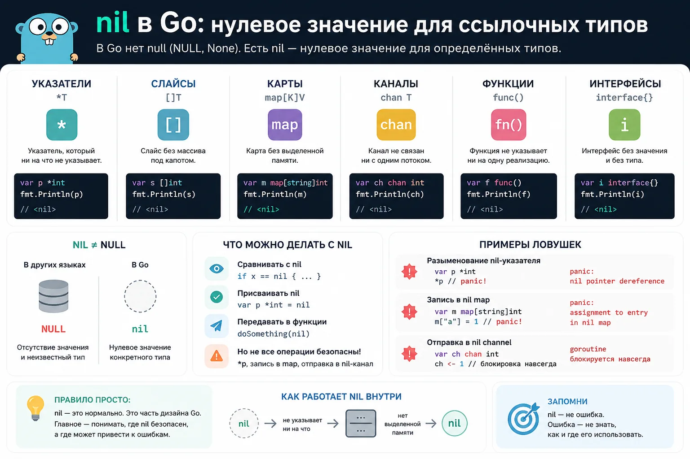
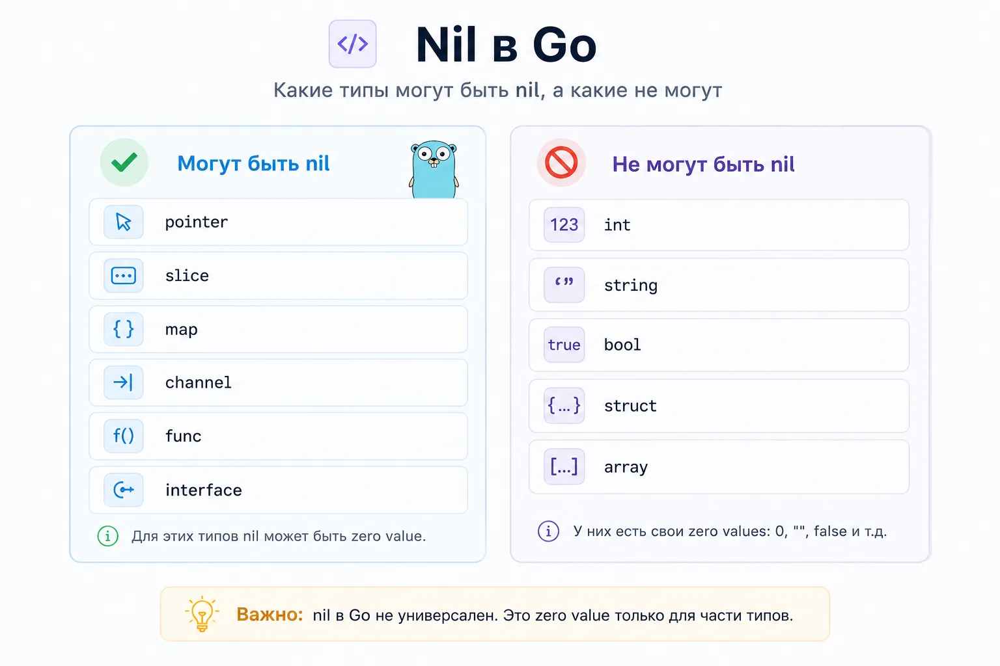
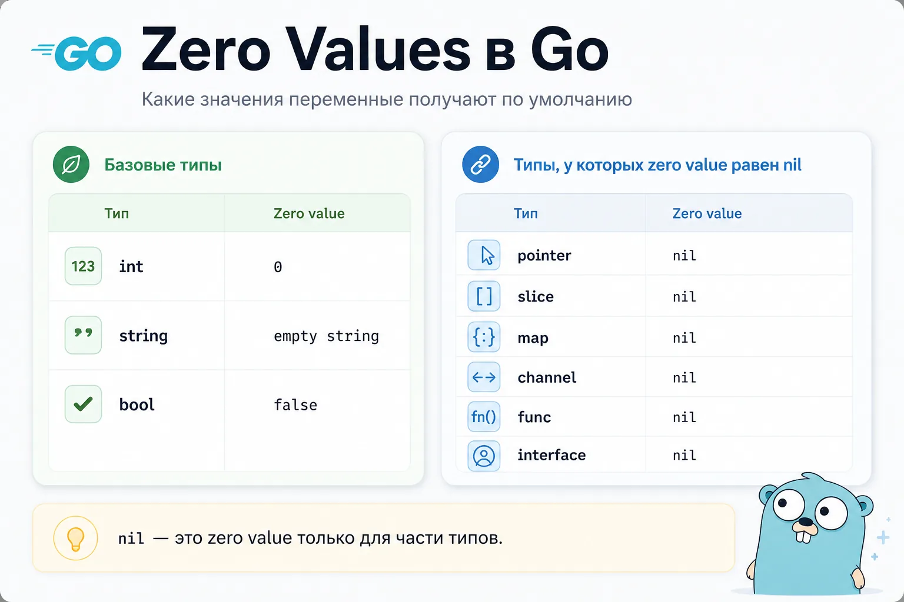
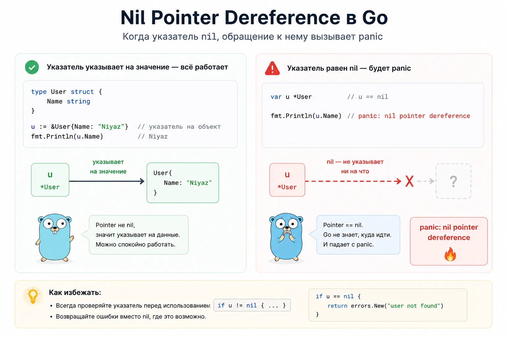
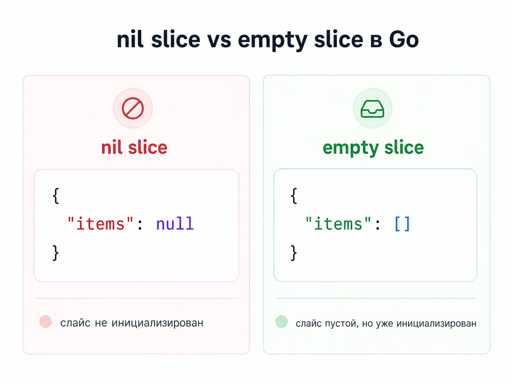
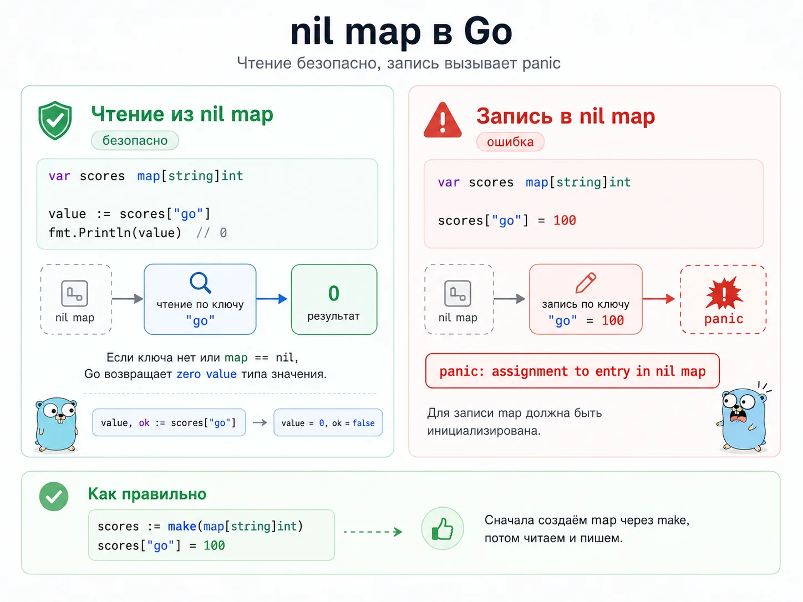
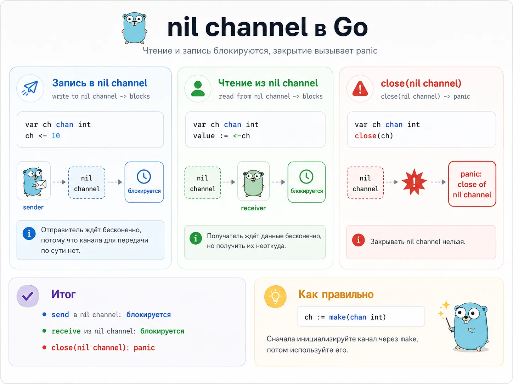
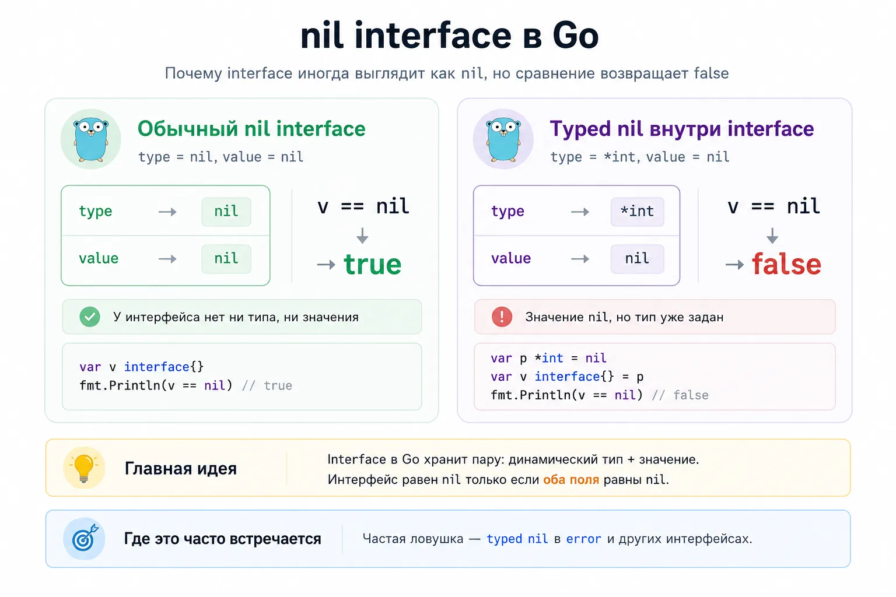
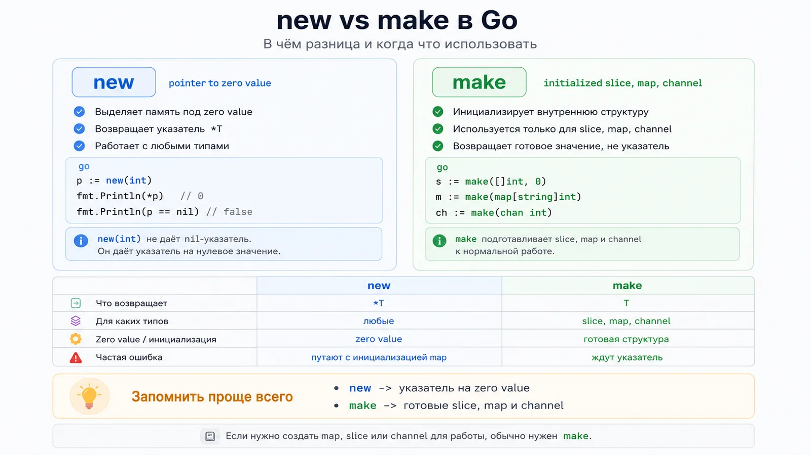
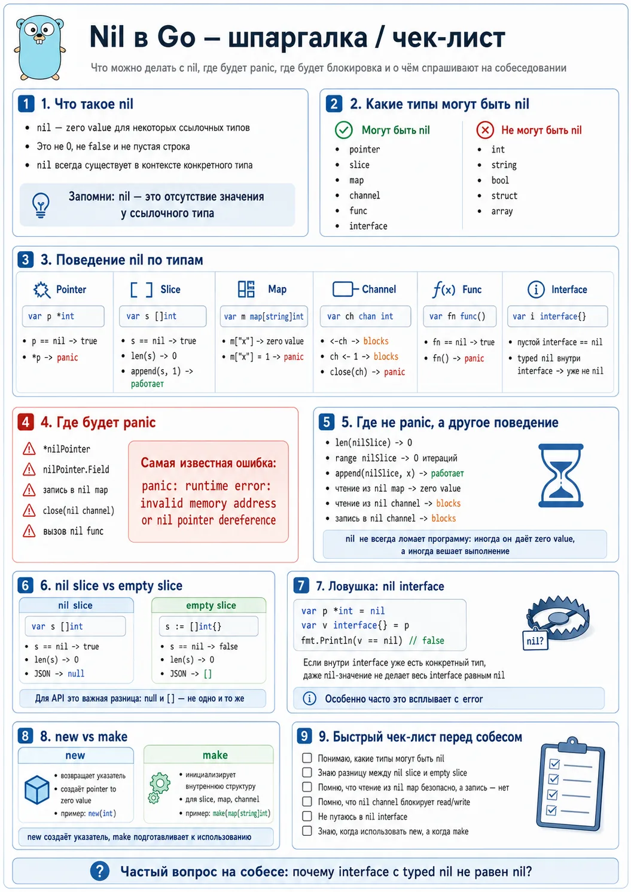

что такое nil, почему в Go нет null и где чаще всего ошибаются разработчики

Если вы пришли в Go из Java, C#, JavaScript или Python, то довольно быстро столкнётесь с вопросом: А где здесь null? В одних языках есть null, в других NULL, в Python есть None, а в Go постоянно встречается загадочное слово nil.

Причём уже через несколько дней изучения языка начинают появляться странные ситуации:

программа падает с nil pointer dereference
интерфейс выглядит как nil, но сравнение возвращает false
запись в nil map вызывает panic
nil slice работает нормально
nil channel неожиданно блокирует goroutine навсегда
Для новичка это выглядит как набор несвязанных исключений. На самом деле за всем этим стоит довольно логичная модель, которую важно понять один раз. После этого большая часть ошибок с nil становится очевидной.

В этой статье разберём:

что такое nil в Go
чем nil отличается от null
что такое нулевые значения (zero values)
почему одни типы могут быть nil, а другие нет
какие ошибки чаще всего встречаются на практике
что любят спрашивать на Go-собеседованиях

Что такое nil в Go

Проще всего воспринимать nil как специальное значение, означающее: здесь пока нет объекта.

Но важно понимать:

nil — это не отдельный тип данных, это нулевое значение, которое может использоваться только для определённых типов.

Например:

var ptr *int
fmt.Println(ptr)
Результат:

<nil>
Мы создали указатель, но он пока ни на что не указывает. Поэтому его значение равно nil.

То же самое будет и здесь:

var users []string
var cache map[string]int
var ch chan int
var fn func()
var v interface{}
Все переменные тоже будут иметь значение nil.

Но вот очень важная мысль, которую надо вбить себе в голову сразу: nil в Go не является универсальным значением для всех типов. Нельзя взять любой тип и присвоить ему nil.

type User struct {
Name string
}

var user *User
fmt.Println(user.Name)
Какие типы могут быть nil
В Go значение nil могут иметь только ссылочные типы.

К ним относятся:

указатели
срезы
карты
каналы
функции
интерфейсы
var p *int
var s []int
var m map[string]int
var ch chan int
var fn func()
var v interface{}
Во всех случаях zero value будет nil. Если переменная одного из этих типов создана, но не инициализирована, её значение будет nil.

Какие типы не могут быть nil
А вот эти типы не могут быть nil:

int
float64
bool
string
struct
array
Попробуем:

var age int = nil
Компилятор сразу выдаст ошибку. Почему?

Потому что у этих типов уже есть собственные нулевые значения.

Для int это: 0
Для float64: 0.0
Для bool: false
Для string: ""
То есть Go заставляет вас быть честным с типами. Если значение может отсутствовать, это должно быть видно уже в самом типе.

Поэтому разработчикам Go не понадобилось вводить аналог null для каждого типа данных.

Почему var x = nil не компилируется
Вот классическая ловушка:

var x = nil
Компилятор ругнётся. Причина простая: у nil нет собственного типа по умолчанию. Компилятор не понимает, что именно вы хотели получить: указатель, срез, канал, map или интерфейс.

То есть nil всегда нужен контекст.

Правильно так:

var x *int = nil
var y []string = nil
var z map[string]int = nil
Или так:

var x *int
var y []string
var z map[string]int
Во втором варианте Go сам поставит zero value, то есть nil.

Можно ли назвать переменную nil
Технически в Go nil не ключевое слово, а предопределённый идентификатор. Это значит, что такой код можно написать:

func main() {
nil := 123
fmt.Println(nil)
}
Но делать так не надо никогда. Это чистый способ сломать читаемость и запутать и себя, и других.

Если увидели такой код в реальном проекте, это не хитрый стиль, это лажа.

Nil и нулевые значения (Zero Values)

Чтобы нормально понять nil, нужно сначала понять, как в Go устроены нулевые значения, они же zero values. Go любая переменная сразу после объявления уже содержит какое-то корректное значение.

Например:

var age int
var active bool
var name string
Здесь будет:

age == 0
active == false
name == ""
А у ссылочных типов нулевым значением как раз и будет nil:

var ptr *int
var users []string
var cache map[string]int
Во всех этих случаях zero value равен nil.

То есть короткая формула такая:

nil — это zero value, но только для части типов

Именно отсюда растут почти все странности вокруг него.

Почему это вообще удобно
Одна из сильных сторон Go в том, что у переменных сразу есть рабочее состояние по умолчанию.

Например:

var count int
count++
fmt.Println(count) // 1
Или пустая строка:

var s string
s += "go"
fmt.Println(s) // go
С nil похожая история. Некоторые nil-значения уже полезны и безопасны, некоторые нет. И разница зависит от типа.

Zero value на примере структуры
type User struct {
ID int
Name string
Email *string
}
var u User
fmt.Printf("%+v", u)
Результат будет примерно таким:

{ID:0 Name: Email:<nil>}
Что произошло:

ID получил 0
Name получил ""
Email получил nil
Это очень важно в реальных API и структурах данных. Например, пустой email и отсутствие email, это не одно и то же состояние.

var empty string = ""
var missing *string = nil
В первом случае email есть, но он пустой. Во втором его нет вообще.

Почему в Go нет привычного null
В Go создатели языка специально сделали упор не на один универсальный null, а на нулевые значения каждого типа.

Поэтому:

число получает 0
строка получает ""
bool получает false
указатель получает nil
Из-за этого код местами становится чуть менее «магическим». Тип сам подсказывает, возможно ли отсутствие значения вообще.

Где бывает nil: pointer, slice, map, channel, func, interface
Вот здесь новички чаще всего косячат и думают, что nil везде ведёт себя одинаково. Не одинаково вообще.

У pointer, slice, map, channel, func и interface одно и то же значение nil, но работать с ним можно по-разному.

Очень коротко:

nil pointer нельзя разыменовывать
nil slice можно len, range и append
nil map можно читать, но нельзя писать
nil channel блокирует чтение и запись
nil func нельзя вызывать
nil interface может оказаться не совсем nil
Сейчас разберём каждый случай отдельно. Это и есть та часть, на которой люди либо начинают понимать Go, либо ещё сильнее злятся на него.

Nil pointer и panic

Самая известная ошибка по теме выглядит так:

panic: runtime error: invalid memory address or nil pointer dereference
Простейший пример:

var age *int
fmt.Println(*age)
Здесь age равен nil. Когда мы пишем *age, мы говорим: сходи по адресу, который лежит внутри указателя, и достань значение. Но адреса нет.

В результате программа падает.

Почему это происходит
Указатель не хранит само число. Он хранит адрес, где это число лежит.

Если адрес отсутствует, указатель равен nil.

Разыменование *ptr без адреса, это попытка прочитать память по пустому месту. Runtime такое не разрешает.

Как защититься
Базовый способ:

if age != nil {
fmt.Println(*age)
}
Но на практике удобнее использовать ранний выход:

func PrintAge(age *int) {
if age == nil {
fmt.Println("Возраст не указан")
return
}
fmt.Println(*age)
}
Panic возникает не только на *ptr
Иногда новичок думает, что разыменование происходит только если явно написана звёздочка. Но это не так.

type User struct {
Name string
}
var user *User
fmt.Println(user.Name)
Хотя вы не писали *user, разыменование всё равно произошло неявно, потому что доступ к полю через указатель требует обращения к самому объекту.

Живой пример из API
Очень частая история в реальной работе:

type UpdateUserRequest struct {
Name *string `json:"name"`
Age *int `json:"age"`
}
Если написать так:

fmt.Println(*req.Name)
а поле name не пришло в JSON, словите ровно тот самый nil pointer dereference.

Правильно:

if req.Name != nil {
fmt.Println(*req.Name)
}
Nil slice vs empty slice
Срезы особенно хорошо показывают, что nil в Go не всегда означает всё плохо.

Вот nil slice:

var a []int
А вот empty slice:

b := []int{}
c := make([]int, 0)
Проверим:

fmt.Println(a == nil) // true
fmt.Println(b == nil) // false
fmt.Println(c == nil) // false
fmt.Println(len(a)) // 0
fmt.Println(len(b)) // 0
fmt.Println(len(c)) // 0
По длине они одинаковы. Но nil-статус разный.

Что можно делать с nil slice
С nil slice можно:

вызывать len
вызывать cap
итерироваться через range
делать append
Пример:

var nums []int
fmt.Println(len(nums)) // 0
nums = append(nums, 10)
nums = append(nums, 20)
fmt.Println(nums) // [10 20]
То есть nil slice вполне рабочий во многих сценариях.

Где разница с empty slice реально важна
В JSON.

type Response struct {
Items []string `json:"items"`
}
Если Items == nil, JSON обычно будет таким:

{"items":null}
Если Items == []string{}:

{"items":[]}
Для фронта и внешнего API это может быть важной разницей. Многие клиенты ждут именно массив, пусть и пустой, а не null.

Практическое правило
Внутри Go-кода nil slice обычно нормален.

Но если вы отдаёте публичный JSON API, часто лучше возвращать именно пустой срез:

Items: []string{}
чтобы наружу уходило [], а не null.

Nil map: читать можно, писать нельзя

Map ведёт себя совсем иначе, чем slice.

var scores map[string]int
Из неё можно читать:

fmt.Println(scores["go"]) // 0
Или так:

value, ok := scores["go"]
fmt.Println(value) // 0
fmt.Println(ok) // false
Итерироваться через range тоже можно. Просто будет 0 итераций.

А вот записывать в nil map нельзя:

scores["go"] = 100
Это вызовет panic:

assignment to entry in nil map
Почему читать можно, а писать нельзя
Потому что для чтения runtime может вернуть zero value типа значения. Это безопасно.

А вот для записи нужна уже реальная внутренняя структура map. Если её нет, писать некуда.

Как правильно
scores := make(map[string]int)
scores["go"] = 100
Пример ошибки
Очень часто в реальном коде:

type Cache struct {
Values map[string]int
}
func main() {
c := Cache{}
c.Values["x"] = 1
}
Кажется, что Cache{} уже готов к работе. Но поле Values внутри равно nil. Поэтому при записи будет panic.

Правильно так:

c := Cache{
Values: make(map[string]int),
}

Nil channel: блокировка навсегда

Каналы ещё опаснее, потому что вместо panic вы часто получаете тихий ступор.

var ch chan int
Если попытаться записать:

ch <- 10
горутина заблокируется.

Если попытаться читать:

value := <-ch
fmt.Println(value)
тоже будет блокировка.

Если попытаться закрыть:

close(ch)
будет panic.

Почему это неприятно
Потому что код не всегда падает сразу и явно. Иногда он просто зависает, и новичок потом сидит и смотрит в экран с мыслью «да что опять не так-то».

Где nil channel реально используется
В конкурентном коде его иногда используют осознанно, чтобы выключить ветку select.

Например, канал можно присвоить в nil, и тогда соответствующий case больше не будет участвовать в выборе.

Это уже более продвинутый паттерн, но на собеседованиях его любят.

Главная ловушка: nil interface
Вот это уже та часть, на которой многие ломаются даже после пары месяцев с Go.

Простой пример:

var v interface{}
fmt.Println(v == nil) // true
Логично. Интерфейс пустой.

Теперь другой пример:

var p *int = nil
var v interface{} = p
fmt.Println(v == nil) // false
На первый взгляд выглядит как баг языка. Но это не баг.

Как interface устроен под капотом
Упрощённо интерфейс хранит пару:

динамический тип
значение
В первом примере внутри:

type = nil
value = nil
Во втором:

type = *int
value = nil
То есть значение внутри nil, но тип уже есть. А значит, сам интерфейс уже не пустой и не равен nil.

Почему это ломает код
Особенно часто ловушка вылезает с error.

type MyError struct{}
func (e *MyError) Error() string {
return "boom"
}
func run() error {
var err *MyError = nil
return err
}
Снаружи:

err := run()
fmt.Println(err == nil)
Результат будет false.

И это один из любимых вопросов на Go-собесах.

Как правильно
Если ошибки нет, возвращать нужно настоящий nil, а не typed nil внутри интерфейса.

func run() error {
return nil
}
Как это объяснить на собеседовании
Нормальный ответ звучит так

Интерфейс равен nil только тогда, когда у него одновременно нет и динамического типа, и значения. Если внутрь положить nil-указатель конкретного типа, значение будет nil, но тип уже задан, значит сам interface не nil.

New vs Make: где тут nil

Эта тема почти всегда идёт рядом с nil, потому что именно здесь многие путают инициализацию.

Что делает new
new(T) выделяет память под zero value типа T и возвращает указатель *T.

Пример:

p := new(int)
fmt.Println(*p) // 0
fmt.Println(p==nil) // false
То есть new(int) не даёт nil-указатель. Он даёт указатель на нулевое значение.

Что делает make
make используется только для:

slice
map
channel
И он создаёт уже готовую внутреннюю структуру для работы.

Например:

s := make([]int, 0)
m := make(map[string]int)
ch := make(chan int)
После этого с ними можно нормально работать.

Почему это важно именно для nil
Сравните:

var m map[string]int
fmt.Println(m == nil) // true
и

m := make(map[string]int)
fmt.Println(m == nil) // false
Во втором случае map уже инициализирована.

То же самое со slice:

var s []int
fmt.Println(s == nil) // true
s2 := make([]int, 0)
fmt.Println(s2 == nil) // false
Простое правило
Запоминалка такая:

new даёт указатель на zero value
make подготавливает slice, map или channel к нормальной работе
Nil в JSON, API и реальных задачах
Чтобы тема не осталась чисто академической, надо проговорить, где nil реально бьёт по рукам в работе.

Nil в JSON
Очень частый кейс:

type User struct {
Name string `json:"name"`
Telegram *string `json:"telegram"`
}
Если в JSON придёт:

{
"name": "Niyaz",
"telegram": null
}
то Telegram станет nil.

Это удобно, потому что позволяет отличать:

поле отсутствует
поле есть, но оно пустое
поле есть и у него конкретное значение
Почему указатели часто используют в DTO
Допустим, есть PATCH-запрос на обновление профиля.

type UpdateUserRequest struct {
Name *string `json:"name"`
Age *int `json:"age"`
}
Если поле равно nil, значит его не передали и обновлять не надо.

Если Age != nil, но внутри 0, значит пользователь сознательно отправил 0.

Это одна из причин, почему указатели в запросах встречаются часто, а в доменных сущностях уже не всегда.

Где лучше не плодить указатели без нужды
Плохая идея:

type User struct {
ID *int
Name *string
Active *bool
}
Такой код быстро превращается в болото из проверок nil. Если поле обязательно по смыслу, чаще лучше обычный тип.

Нормально:

type User struct {
ID int
Name string
Active bool
}
Указатели стоит использовать там, где действительно важно состояние «значение отсутствует».

Частые ошибки новичков и FAQ по собеседованиям
Ошибка 1. Думать, что nil — это просто null из другого языка

Это только очень грубая стартовая аналогия. В Go nil намного жёстче привязан к типам.

Ошибка 2. Не отличать nil slice от empty slice

В обычном коде разницы почти не видно. Но в JSON и при прямой проверке == nil разница важна.

Ошибка 3. Писать в nil map

Это одна из самых частых panic-ошибок на старте.

Ошибка 4. Не проверять pointer перед разыменованием

Итог всегда один: nil pointer dereference.

Ошибка 5. Возвращать typed nil как error

Подлая история, которую реально спрашивают на собеседованиях.

Ошибка 6. Не понимать поведение nil channel

Вместо ожидаемой panic код просто зависает.

Ошибка 7. Тащить указатели во все поля подряд

Не каждое поле обязано быть *string и *int. Иногда это только усложняет код.

FAQ: что любят спрашивать на собеседовании
Что такое nil в Go?

Хороший ответ: это zero value для указателей, срезов, map, channel, function и interface.

Почему var x = nil не компилируется?

Потому что у nil нет собственного типа, и компилятору нужен контекст.

Какие типы могут быть nil?

Указатели, slice, map, channel, func, interface.

Что будет при чтении из nil map?

Вернётся zero value типа значения.

Что будет при записи в nil map?

Panic.

Что можно делать с nil slice?

len, cap, range, append.

Что будет при чтении из nil channel?

Блокировка.

Почему interface с nil-указателем не равен nil?

Потому что внутри интерфейса уже есть динамический тип.

Чем nil slice отличается от empty slice?

У nil slice == nil true, у empty slice false. Но у обоих длина 0.

Чем new отличается от make?

new создаёт zero value и возвращает указатель. make инициализирует slice, map или channel для работы.

Go nil и go null — это одно и то же?

Не совсем. nil в Go частично играет роль null, но работает только у определённых типов и не является универсальным пустым значением для всего подряд.

Что такое go нулевое значение?

Это значение по умолчанию, которое переменная получает сразу после объявления. Для int это 0, для string это "", для указателей, map, slice, channel, func и interface это nil.

Почему nil golang вызывает столько ошибок у новичков?

Потому что в разных типах nil ведёт себя по-разному. Где-то с ним можно работать спокойно, а где-то он приводит к panic или блокировке.

Может ли быть nil у string в Go?

Нет. У string zero value — пустая строка, а не nil.

Может ли быть nil у int в Go?

Нет. У int zero value — 0.

Что значит panic: invalid memory address or nil pointer dereference?

Это означает, что код попытался разыменовать nil-указатель, то есть обратиться по адресу, которого нет.

Чем nil slice отличается от nil map?

nil slice можно безопасно использовать с len, range и append. Из nil map можно безопасно читать, но запись в неё вызывает panic.

Шпаргалка по nil в Golang

nil в Go — это не универсальный ноль и не буквальная копия null.

Это zero value для ссылочных типов:

pointer
slice
map
channel
func
interface
Самое главное, что нужно понять:

nil pointer разыменовывать нельзя
nil slice часто ведёт себя как пустой
nil map можно читать, но нельзя менять
nil channel блокирует чтение и запись
nil func нельзя вызывать
nil interface может быть не совсем nil
typed nil в error — классическая ловушка
Если вы сейчас учите Go, не пытайтесь просто зазубрить список правил. Лучше откройте playground или локальный проект, прогоните руками все короткие примеры из статьи и посмотрите на поведение каждого типа отдельно.
