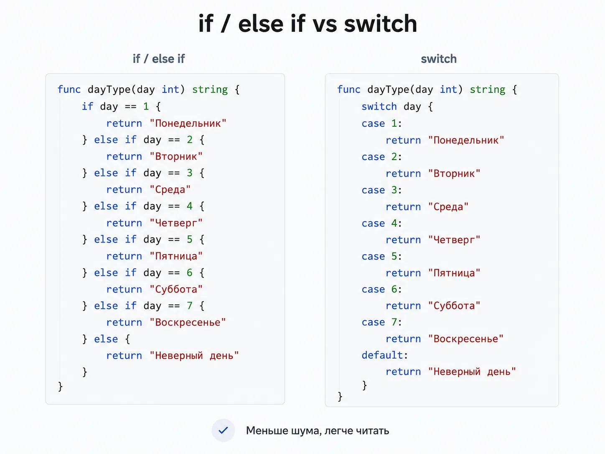
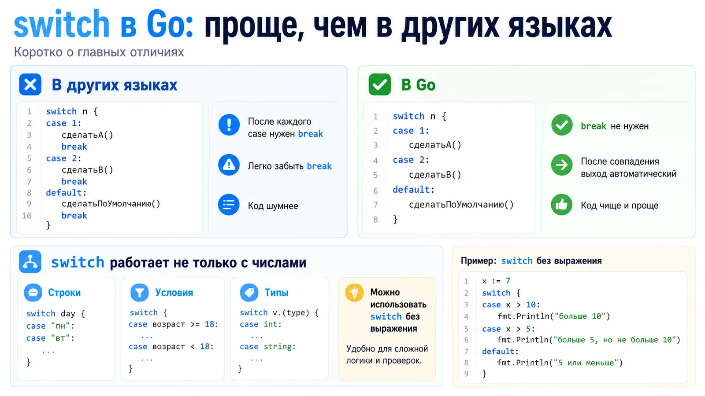
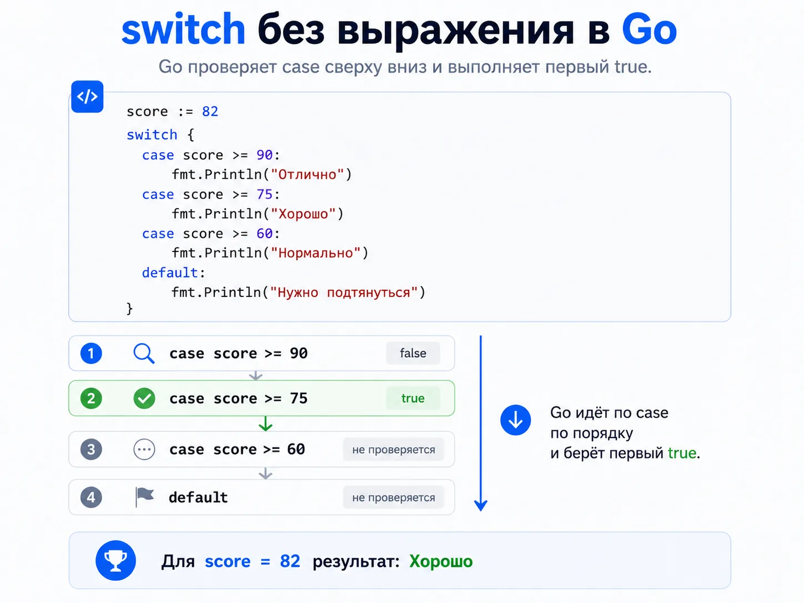
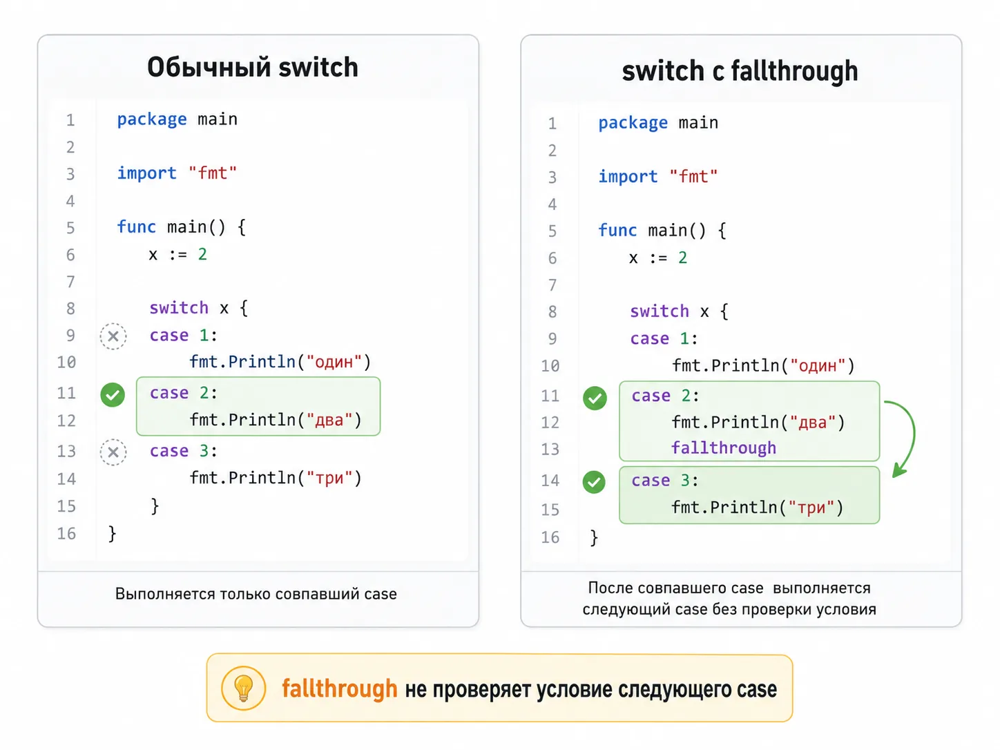
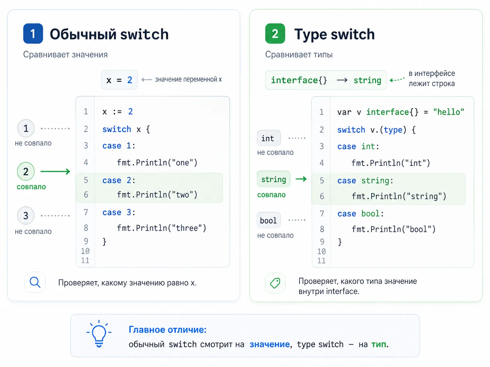
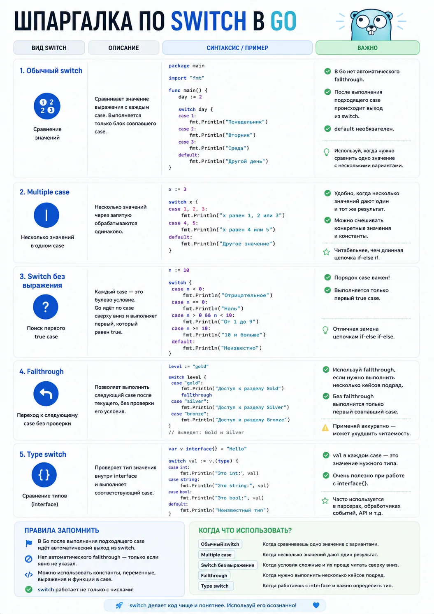

как работает switch, когда он лучше if, и где новички чаще всего ошибаются

Если вы только начали учить Go, конструкция switch почти наверняка покажется вам знакомой. Во многих языках она есть. Но в Go она ведёт себя чуть иначе, и вот это чуть на практике постоянно всплывает и в обучении, и на собеседованиях, и в рабочем коде.

Новичок обычно думает о switch что это просто замена длинной цепочки if else. Частично да. Но только частично.

В Go switch умеет не только сравнивать значения. Он может работать без выражения вообще, может проверять типы через type switch, может объединять несколько значений в одном case, а ещё по умолчанию сам завершает ветку без обязательного break. И вот на этих нюансах люди стабильно спотыкаются.

Кто-то по привычке ищет, куда ставить break. Кто-то не понимает, почему fallthrough срабатывает не так, как ожидалось. Кто-то видит switch { ... } и не сразу понимает, почему это вообще валидный код. А кто-то путается в switch v := x.(type) и начинает бояться interface ещё сильнее, чем раньше.

Эта статья нужна как раз для того, чтобы разобрать тему с нуля. Без академической сухости, но и без упрощений, которые потом ухудшают понимание.

Здесь разберём:

что такое switch в Go
чем golang switch отличается от классического switch в других языках
как работает обычный go switch case
зачем нужен default
как объединять несколько значений в одном case
как работает switch без выражения
зачем нужен break, если Go и так выходит из ветки
что делает fallthrough и почему с ним надо быть аккуратным
как устроен golang switch type
какие ошибки чаще всего делают новички
что реально спрашивают про switch на Go-собеседованиях

Что такое switch в Go
Если совсем просто, switch в Go это конструкция выбора. Она позволяет выполнить один из нескольких блоков кода в зависимости от значения или условия.

Обычно её используют там, где с if else if else код начинает расползаться и хуже читаться.

Например, есть день недели. Можно написать так:

if day == "monday" {
fmt.Println("Начало недели")
} else if day == "friday" {
fmt.Println("Почти выходные")
} else if day == "saturday" || day == "sunday" {
fmt.Println("Выходной")
} else {
fmt.Println("Обычный день")
}
А можно так:

tswitch day {
case "monday":
fmt.Println("Начало недели")
case "friday":
fmt.Println("Почти выходные")
case "saturday", "sunday":
fmt.Println("Выходной")
default:
fmt.Println("Обычный день")
}
Второй вариант компактнее и легче читается. Особенно когда веток становится больше трёх-четырёх.

Важно понять главное:

switch в Go — это не только проверка одного значения на равенство

Он умеет больше. И именно поэтому тема заслуживает отдельного разбора.

Когда switch особенно полезен
Switch хорошо подходит, когда:

у вас много вариантов одного действия
есть несколько возможных значений одной переменной
нужно заменить длинную цепочку if else
нужно проверить набор условий без лишней вложенности
нужно определить тип значения в интерфейсе
Когда лучше оставить if
Не надо пихать switch везде подряд. Если у вас всего одно простое условие, обычный if будет понятнее.

Например:

if age >= 18 {
fmt.Println("Доступ разрешён")
}
Здесь switch не делает код лучше. Он только добавит лишнюю форму.

Базовый синтаксис golang switch case
Начнём с самой простой формы, которую чаще всего имеют в виду, когда ищут golang switch case.

package main
import "fmt"
func main() {
i := 2
switch i {
case 1:
fmt.Println("one")
case 2:
fmt.Println("two")
case 3:
fmt.Println("three")
default:
fmt.Println("unknown")
}
}
Здесь всё работает так:

Go берёт значение переменной i
Последовательно сравнивает его с каждым case
Находит первое совпадение
Выполняет код внутри этого блока
Выходит из switch
Если i == 2, программа выведет:

two
Как читать этот код по шагам
Это важный момент, потому что новичок часто просто смотрит на пример, но не проживает его.

Вот строка:

switch i {
Она говорит: будем смотреть на значение i.

Дальше идёт:

case 1:
Это значит: если i == 1, выполни этот блок.

Потом:

case 2:
Если i == 2, выполни этот блок.

И так далее.

Если совпадения не нашлось, срабатывает:

default:
Это ветка по умолчанию.

Нужно ли ставить фигурные скобки у case
Нет. В Go после case отдельные фигурные скобки не обязательны. Блок определяется самим case.

Правильно так:

switch status {
case 200:
fmt.Println("OK")
case 404:
fmt.Println("Not Found")
}
Что может стоять после switch
После switch может стоять не только переменная, но и вообще любое выражение, которое возвращает значение.

Например:

a := 7
switch a + 2 {
case 9:
fmt.Println("nine")
case 10:
fmt.Println("ten")
}
Здесь Go сначала вычислит a + 2, а уже потом сравнит результат с case.

Почему default почти всегда полезен
Технически default не обязателен. Но на практике он часто нужен.

Он помогает:

обработать неожиданные значения
не оставлять «тихий» путь без результата
сделать поведение кода очевиднее
Пример:

role := "guest"
switch role {
case "admin":
fmt.Println("Полный доступ")
case "editor":
fmt.Println("Можно редактировать")
default:
fmt.Println("Ограниченный доступ")
}
Если убрать default, при новом неожиданном значении код просто ничего не сделает. Иногда это нормально, но часто это плохая идея.

Чем switch в Go отличается от switch в других языках
Вот здесь начинается самое важное. Если у вас был опыт в Java, JavaScript, C, C++ или C#, вы почти наверняка принесёте в Go старые привычки. Некоторые из них будут мешать.

В Go не нужен обязательный break после каждого case
Во многих языках switch по умолчанию проваливается дальше, если не поставить break. В Go наоборот: после первого совпавшего case выполнение останавливается автоматически.

Пример:

x := 2
switch x {
case 1:
fmt.Println("one")
case 2:
fmt.Println("two")
case 3:
fmt.Println("three")
}
Выведется только:

two
Ни three, ни что-то ещё дальше не выполнится.

Это очень удобная особенность, потому что она убирает целый класс случайных багов.

Switch в Go работает не только с числами
Ещё одна важная вещь: switch в Go работает не только с int. Он умеет сравнивать значения разных типов, если сравнение допустимо.

Например, строки:

os := "linux"
switch os {
case "windows":
fmt.Println("Windows")
case "linux":
fmt.Println("Linux")
default:
fmt.Println("Unknown OS")
}
Или, например, time.Weekday():

switch time.Now().Weekday() {
case time.Saturday, time.Sunday:
fmt.Println("It's the weekend")
default:
fmt.Println("It's a weekday")
}
То есть switch в Go это не конструкция только для чисел, это полноценный инструмент ветвления.

В Go можно писать switch вообще без выражения
Это одна из самых полезных фишек языка.

Можно написать так:

x := 10
switch {
case x < 5:
fmt.Println("x меньше 5")
case x < 15:
fmt.Println("x меньше 15")
default:
fmt.Println("x больше или равно 15")
}
Go будет идти по case сверху вниз и искать первый, где условие истинно.

Это очень удобная замена длинному if else if else.

В Go есть type switch
Это отдельная штука, и для новичков она сначала кажется странной. Но в Go она используется регулярно, особенно там, где есть interface.

Default, несколько значений в case и switch без выражения
Это тот набор возможностей, который делает go switch case действительно удобным, а не просто аналогом того, что я уже видел в другом языке.

Несколько значений в одном case
Если для нескольких значений нужно выполнить одинаковое действие, не надо копировать код в несколько case. Их можно перечислить через запятую.

fruit := "apple"
switch fruit {
case "apple", "pear":
fmt.Println("Это фрукт")
case "carrot":
fmt.Println("Это овощ")
default:
fmt.Println("Неизвестный продукт")
}
Это и короче, и чище.

На практике такой приём очень полезен, когда у вас несколько равнозначных статусов, несколько допустимых ролей или несколько вариантов входных значений.

Когда default особенно важен
default это не просто ветка на всякий случай. Часто это защита от молчаливых ошибок.

Пример из жизни:

status := 503
switch status {
case 200:
fmt.Println("Успешно")
case 400:
fmt.Println("Неверный запрос")
case 404:
fmt.Println("Не найдено")
default:
fmt.Println("Неожиданный статус")
}
Если завтра появится новый статус или в код прилетит то, чего вы не ожидали, default не даст программе выглядеть так, будто всё нормально.

Switch без выражения
Теперь разберём одну из самых сильных форм switch в Go.

t := time.Now()
switch {
case t.Hour() < 12:
fmt.Println("До полудня")
default:
fmt.Println("После полудня")
}
Что здесь происходит? После switch ничего не написано. Это значит, что Go будет проверять каждое условие в case как булево выражение.

Проще говоря, это удобная форма для логики вида:

если условие 1
иначе если условие 2
иначе если условие 3
иначе по умолчанию
Почему switch без выражения часто лучше if else if
Вот два варианта одной и той же логики.

Через if else if:

score := 82
if score >= 90 {
fmt.Println("Отлично")
} else if score >= 75 {
fmt.Println("Хорошо")
} else if score >= 60 {
fmt.Println("Нормально")
} else {
fmt.Println("Нужно подтянуться")
}
Через switch:

score := 82
switch {
case score >= 90:
fmt.Println("Отлично")
case score >= 75:
fmt.Println("Хорошо")
case score >= 60:
fmt.Println("Нормально")
default:
fmt.Println("Нужно подтянуться")
}
Во втором варианте структура визуально ровнее. Когда условий много, читать такой код часто проще.

Важный нюанс порядка case
Порядок здесь критичен.

Если вы напишете так:

score := 82
switch {
case score >= 60:
fmt.Println("Нормально")
case score >= 75:
fmt.Println("Хорошо")
case score >= 90:
fmt.Println("Отлично")
}
для 82 сработает уже первый case, потому что 82 >= 60 это true.

То есть до более точных условий Go уже не дойдёт. Это одна из самых частых логических ошибок у новичков.

Break и fallthrough в Go switch
Это один из самых популярных кусочков темы. И один из самых опасных, если просто бездумно копировать примеры.

Зачем нужен break, если Go и так выходит из case
По умолчанию Go действительно сам завершает case после выполнения. Поэтому в простых примерах break не нужен.

Но он всё ещё бывает полезен внутри самого case, если вы хотите выйти из switch раньше по условию.

Пример:

command := "cat"
args := []string{}
switch command {
case "echo":
fmt.Println("echo command")
case "cat":
if len(args) == 0 {
fmt.Println("Usage: cat <filename>")
break
}
fmt.Println("reading file")
default:
fmt.Println("unknown command")
}
Что здесь делает break? Он говорит: внутри этой ветки дальше ничего не выполнять, выйти из switch прямо сейчас.

То есть break в Go чаще нужен не как защита от проваливания в следующий case, а как способ досрочно закончить текущую ветку.

Что делает fallthrough
fallthrough говорит Go: после выполнения текущего case перейти к следующему case, даже если его условие не совпадает.

Пример:

x := 2
switch x {
case 1:
fmt.Println("x = 1")
case 2:
fmt.Println("x = 2")
fallthrough
case 3:
fmt.Println("x = 3")
case 4:
fmt.Println("x = 4")
}
Вывод будет таким:

x = 2
x = 3
Почему? Потому что при x == 2 сработал case 2, а fallthrough заставил Go перейти дальше в case 3, не проверяя, равно ли x тройке.

Самая важная мысль

Fallthrough не проверяет условие следующего case, он просто механически продолжает выполнение следующего блока. Из-за этого новички часто ожидают одно, а получают другое.

Почему с fallthrough надо быть аккуратным
Потому что он легко делает код менее очевидным. Если switch читается как набор независимых веток, то fallthrough ломает это ожидание.

Поэтому в обычной прикладной логике его используют не так уж часто. Чаще он встречается:

в учебных примерах
в низкоуровневом коде
в некоторых оптимизационных или упаковочных сценариях
в вопросах на собеседовании
Fallthrough должен быть последней инструкцией case
Такой код не сработает:

switch x {
case 1:
if x > 0 {
fallthrough
}
fmt.Println("done")
}
Потому что fallthrough должен быть последней инструкцией внутри case.

Когда fallthrough реально оправдан
Например, когда вам нужно намеренно выполнить общий блок следующего case, и это действительно делает код проще.

Но в большинстве бизнесовых задач лучше сначала попробовать обойтись без него.

Часто более читаемо либо:

вынести общий код в функцию
объединить значения через запятую в одном case
перестроить условия

Golang type switch простыми словами
Теперь переходим к теме, которая для новичка часто выглядит страшнее, чем она есть на самом деле.

Когда ищут go switch type, обычно имеют в виду вот такую конструкцию:

func whatAmI(i interface{}) {
switch v := i.(type) {
case bool:
fmt.Println("I'm a bool", v)
case int:
fmt.Println("I'm an int", v)
case string:
fmt.Println("I'm a string", v)
default:
fmt.Printf("Don't know type %T\n", v)
}
}
Что вообще делает type switch
Обычный switch сравнивает значения. Type switch сравнивает типы. То есть вопрос здесь не чему равно значение, а какого типа значение лежит внутри интерфейса.

Почему тут вообще появляется interface
Потому что type switch работает с интерфейсными значениями.

Если упростить, интерфейс в Go может хранить значение разных конкретных типов. И иногда программе нужно понять, что именно ей передали: int, string, bool, что-то ещё.

Вот тут type switch и нужен.

Как читать эту запись
Вот эта строка пугает:

switch v := i.(type) {
Разбираем по кускам.

i — это интерфейсное значение
.(type) — специальная форма, которая допустима только внутри type switch
v := ... — переменная, которая внутри каждой ветки получит уже конкретный тип
То есть в ветке case int: переменная v будет именно типа int, а в ветке case string: она уже будет типа string.

Это очень удобно, потому что внутри ветки можно работать с v уже как с нормальным конкретным типом.

Пример с пошаговым разбором
package main
import "fmt"
func describe(i interface{}) {
switch v := i.(type) {
case int:
fmt.Println("Число:", v*2)
case string:
fmt.Println("Строка длиной:", len(v))
default:
fmt.Printf("Неизвестный тип: %T\n", v)
}
}
func main() {
describe(21)
describe("golang")
describe(true)
}
Что произойдёт:

для 21 сработает ветка case int
для "golang" сработает case string
для true сработает default, потому что ветки case bool у нас нет
Чем type switch отличается от обычного switch
Обычный switch смотрит на значение:

switch x {
case 1:
case 2:
}
Type switch смотрит на тип:

switch x.(type) {
case int:
case string:
}
Важное ограничение

fallthrough в type switch не работает. Это важный нюанс для собеседования.

Где это реально встречается
Чаще всего в:

логике работы с interface{}
универсальных функциях
обработке данных разного формата
отладке
инфраструктурном коде
старом коде, где интерфейсов много
Если вы новичок, не надо пытаться пихать type switch везде ради умного вида. Но понимать его надо.

Частые ошибки новичков
Тема switch кажется простой, но даже здесь есть набор ошибок, которые повторяются снова и снова.

Ошибка 1. Ставить break после каждого case по привычке

После Java, JavaScript или C это почти рефлекс.

Но в Go switch и так выходит после первого совпавшего case. Поэтому такой break чаще просто лишний.

Ошибка 2. Не понимать, что switch без выражения идёт сверху вниз

Если в switch {} первым стоит слишком широкое условие, всё, что ниже, уже может никогда не выполниться.

Ошибка 3. Ожидать, что fallthrough проверит следующий case

Не проверит. Он просто продолжит выполнение следующего блока.

Ошибка 4. Использовать fallthrough там, где код становится менее понятным

Иногда человек видит новую фишку языка и начинает пихать её везде. С fallthrough это особенно вредно.

Ошибка 5. Путать обычный switch и type switch

Один сравнивает значения, другой типы. Это разные инструменты.

Ошибка 6. Делать огромный switch там, где пора выносить логику

Если у вас switch на 100 строк с кучей сложной логики внутри каждого case, проблема уже не в синтаксисе. Пора думать о декомпозиции.

Ошибка 7. Забывать про default там, где неожиданные значения реально возможны

Особенно это опасно в коде, который работает с внешними данными: API, ввод пользователя, конфиги, статусы.

Ошибка 8. Не замечать, что несколько case можно объединить

Иногда код раздувается просто потому, что одинаковое действие повторили в пяти ветках подряд.

Что спрашивают на собеседовании
Это как раз та тема, которую часто считают слишком базовой. А потом в ней же и начинают плавать.

Что такое switch в Go?

Хороший ответ: это конструкция ветвления, которая позволяет выбрать один из нескольких блоков кода по значению выражения, по условию или по типу интерфейсного значения.

Чем switch в Go отличается от switch в Java/C/JavaScript?

Главное отличие: в Go не нужен обязательный break после каждого case, потому что выход из ветки происходит автоматически.

Можно ли использовать switch без выражения?

Да. Такой switch работает как цепочка булевых условий и часто заменяет длинный if else if.

Можно ли писать несколько значений в одном case?

Да, через запятую.

Когда нужен break в Go switch?

Когда вы хотите досрочно выйти из текущего case или из switch, хотя автоматического проваливания в следующий case по умолчанию нет.

Что делает fallthrough?

Заставляет выполнение перейти в следующий case без проверки его условия.

Что такое type switch?

Это форма switch, которая позволяет определить конкретный тип значения внутри интерфейса.

Работает ли fallthrough в type switch?

Нет.

Что лучше: if или switch?

Зависит от задачи. Если условий много и они образуют понятный набор вариантов, switch обычно читается лучше. Если условие одно-два и они простые, if часто понятнее.

Что такое context switch golang?

Вот здесь важно не запутаться. Запрос context switch golang часто относится не к конструкции switch языка, а к переключению контекста выполнения на уровне конкурентности, потоков или планировщика. Это уже другая тема. Она ближе к рантайму, горутинам и конкурентности, а не к switch case как синтаксису языка.

FAQ по switch
Что такое golang switch?

Это конструкция ветвления в Go, которая позволяет выбрать один из нескольких вариантов выполнения кода в зависимости от значения, условия или типа.

Что такое golang switch case?

Это обычная форма switch, где значение после switch сравнивается со значениями в блоках case.

Что такое go switch type?

Это type switch, который проверяет не само значение, а его конкретный тип внутри интерфейса.

Чем switch лучше if else?

Когда вариантов много, switch обычно читается проще и делает код аккуратнее.

Нужен ли break в switch Go?

Обычно нет. Go сам завершает ветку после первого совпадения.

Что делает fallthrough в Go?

Он принудительно продолжает выполнение в следующем case, даже если его условие не совпало.

Можно ли использовать switch без выражения?

Да. Это стандартный и очень полезный паттерн в Go.

Работает ли switch только с int?

Нет. Он может работать со строками, выражениями, результатами функций, типами интерфейсных значений и не только.

Практика: 7 коротких упражнений, чтобы switch реально запомнился
Ниже не просто список задач, а маленький тренажёр. У каждой задачи есть цель, шаблон и короткая проверка себя. Делайте по порядку: так тема закрепляется намного лучше.

Не копируйте код, старайтесь прописывать всё вручную, пока учитесь. Так разберётесь в теме намного глубже.

Упражнение 1. День недели
Что тренируем: обычный switch и несколько значений в одном case.

Задача:
По строке day выведите:

Рабочий день
Выходной
Неизвестный день
Шаблон:

package main
import "fmt"
func main() {
day := "saturday"
switch day {
// ваш код
}
}
Проверьте себя:

при "monday" должно выводиться Рабочий день
при "sunday" должно выводиться Выходной
при "holiday" должно выводиться Неизвестный день
Что важно понять: одинаковую логику не надо дублировать в нескольких case, значения можно объединять через запятую.

Упражнение 2. Оценка по баллам
Что тренируем: switch без выражения.

Задача:
По числу score выведите:

Отлично
Хорошо
Нормально
Слабо
Шаблон:

package main
import "fmt"
func main() {
score := 82
// ваш код
}
Проверьте себя:

95 -> Отлично
82 -> Хорошо
61 -> Нормально
40 -> Слабо
Типичная ошибка: ставить сначала score >= 60, а потом score >= 90. Тогда более точные условия уже не сработают.

Упражнение 3. HTTP-статус
Что тренируем: обычный switch и default.

Задача:
Сделайте switch по коду ответа:

200 -> OK
400 -> Bad Request
404 -> Not Found
всё остальное -> Unknown status
Шаблон:

package main
import "fmt"
func main() {
status := 404
switch status {
case 200:
// ваш код
case 400:
// ваш код
case 404:
// ваш код
default:
// ваш код
}
}
Зачем это полезно: это уже похоже на реальный код, где нужно обрабатывать фиксированный набор значений.

Упражнение 4. Несколько ролей
Что тренируем: grouping в case и читаемую бизнес-логику.

Задача:
Есть строка role. Для admin и owner выведите Полный доступ, для editor — Можно редактировать, для остальных — Ограниченный доступ.

Шаблон:

package main
import "fmt"
func main() {
role := "editor"
switch role {
case "admin", "owner":
// ваш код
case "editor":
// ваш код
default:
// ваш код
}
}
Вывод: именно в таких местах switch часто читается лучше, чем длинный if else if.

Упражнение 5. fallthrough
Что тренируем: понимание самой коварной части темы.

Задача: Сделайте пример, где при значении 2 выполнится и ветка 2, и следующая ветка.

Шаблон:

package main
import "fmt"
func main() {
x := 2
switch x {
case 1:
fmt.Println("one")
case 2:
fmt.Println("two")
// добавьте fallthrough
case 3:
fmt.Println("three")
}
}
Что должно получиться:

two
three
Главная мысль: fallthrough не проверяет следующий case. Он просто заставляет выполнить следующий блок.

Упражнение 6. type switch
Что тренируем: различие между значением и типом.

Задача: Сделайте функцию, которая принимает interface{} и:

для int печатает число, умноженное на 2;
для string печатает длину строки;
для bool печатает булево значение;
для остальных типов печатает неизвестный тип.
Шаблон:

package main
import "fmt"
func describe(v interface{}) {
switch val := v.(type) {
case int:
// ваш код
case string:
// ваш код
case bool:
// ваш код
default:
// ваш код
}
}
func main() {
describe(21)
describe("go")
describe(true)
describe(3.14)
}
Проверьте себя:

21 -> 42
"go" -> 2
true -> булево значение
3.14 -> неизвестный тип
Что важно понять: обычный switch сравнивает значения, а type switch сравнивает типы.

Упражнение 7. Перепишите if else в switch
Что тренируем: чувство уместности.

Задача: Возьмите такой код:

if score >= 90 {
fmt.Println("Отлично")
} else if score >= 75 {
fmt.Println("Хорошо")
} else if score >= 60 {
fmt.Println("Нормально")
} else {
fmt.Println("Слабо")
}
Перепишите его через switch без выражения.

Зачем это делать: это лучший способ почувствовать, где switch реально делает код чище, а где if и так был нормальным.

Шпаргалка по switch case в Golang

На старте кажется, что switch это слишком мелкая конструкция, чтобы уделять ей столько внимания. Но на практике именно из таких вещей и собирается нормальная база.

На собеседованиях по Go редко валят какой-то одной суперэкзотической темой. Чаще проверяют, насколько уверенно человек чувствует себя в простых, но фундаментальных местах языка.

switch — как раз из этой категории.

Если человек:

не понимает, нужен ли break
путается в fallthrough
не знает, что такое switch {}
не может объяснить type switch
Это не катастрофа само по себе, но это сразу показывает, что база ещё сырая.

А сырая база потом начинает вылезать и в более сложных темах: в интерфейсах, в конкурентности, в обработке ошибок, в проектировании кода.
