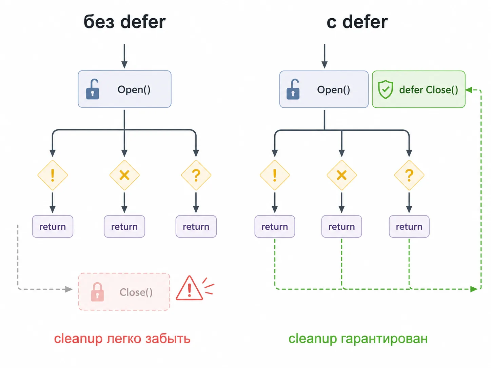
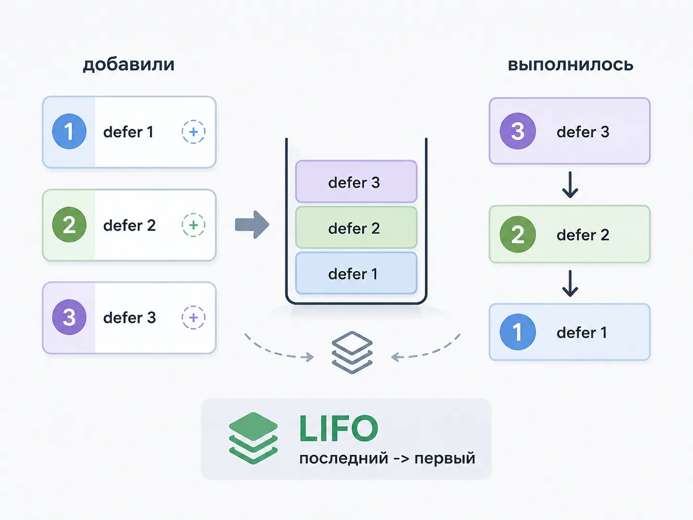
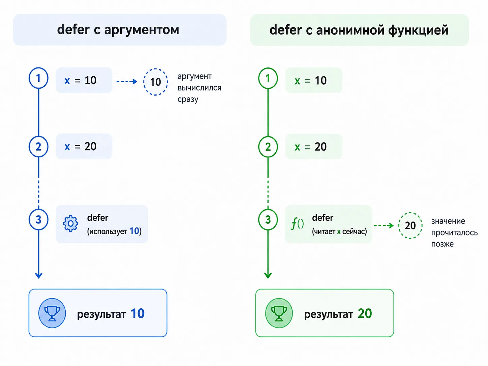
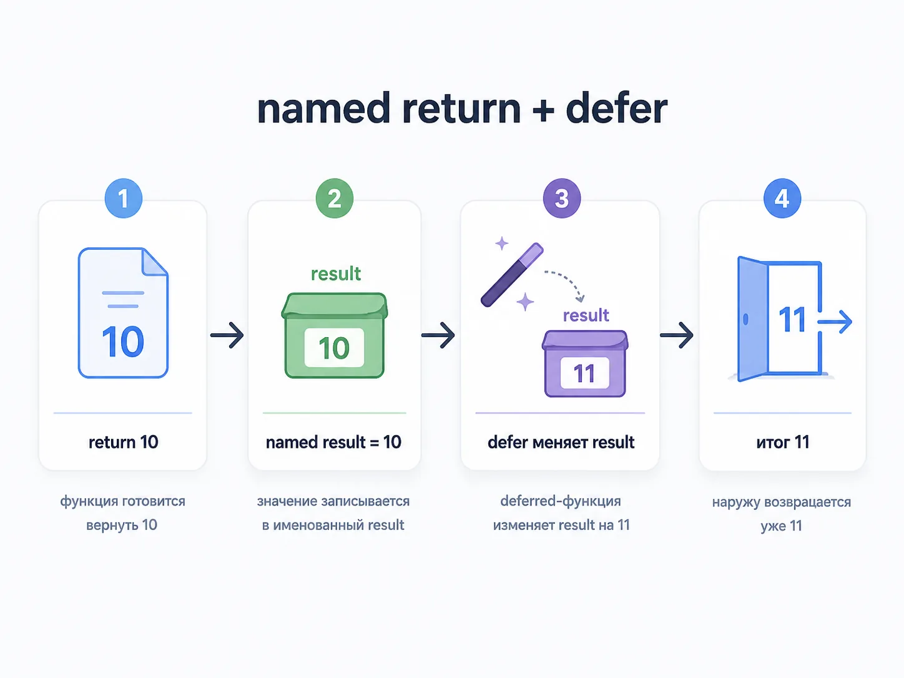
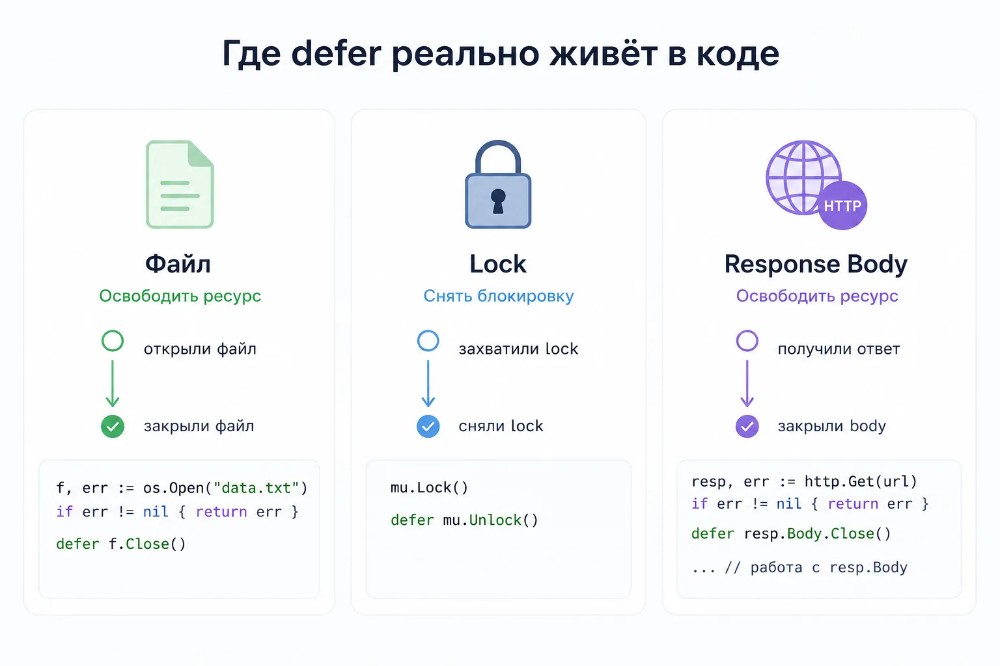
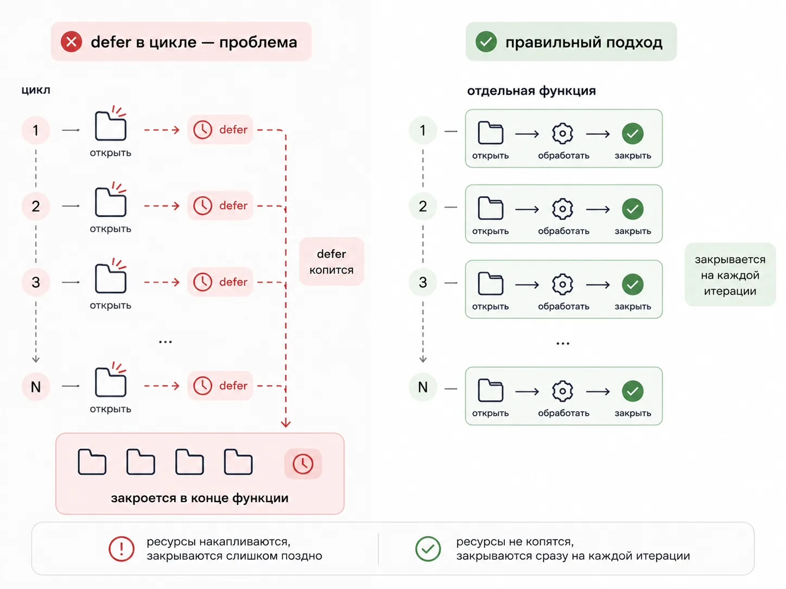
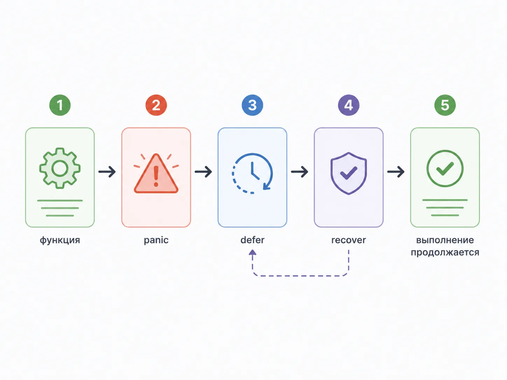
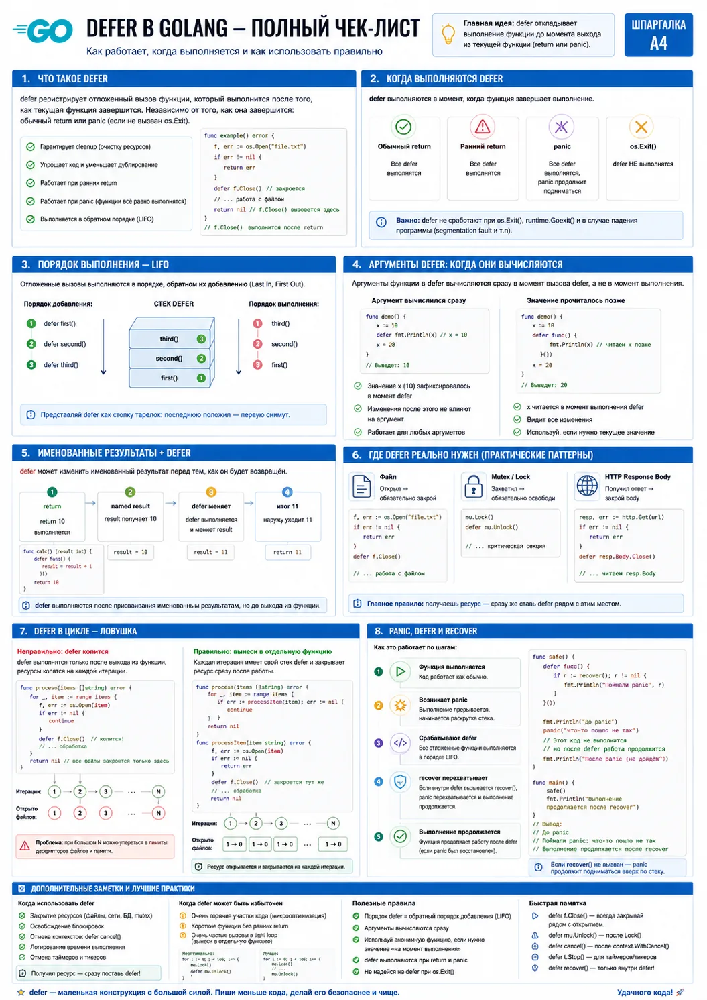

как работает отложенный вызов, где он реально спасает код и на чём чаще всего ошибаются

Если только начал изучать Go, defer сначала выглядит почти слишком удобной штукой.

Видишь строчку и кажется, что тут вообще нечего обсуждать. Ну да, закрыли файл в конце.

defer file.Close()
Но именно на таких местах потом и начинаются вопросы:

когда именно сработает defer
почему он не выполняется в конце if или итерации цикла
почему несколько defer идут в обратном порядке
почему defer fmt.Println(x) и defer func(){ fmt.Println(x) }() ведут себя по-разному
как defer меняет результат функции с named return
почему defer в цикле может привести к лишним открытым ресурсам
как связаны defer, panic и recover()
В реальном коде эта конструкция встречается постоянно: при работе с os.File, mutex, http.Response.Body, sql.Rows, при cleanup, логировании, снятии блокировок, работе с паникой и восстановлении после неё. То есть тема маленькая только по внешнему виду. На практике она очень быстро упирается в жизненный цикл функции, порядок выполнения и аккуратное управление ресурсами.

что такое defer в Go и как на него правильно смотреть
когда именно выполняется отложенный вызов
почему defer работает по принципу LIFO
как defer связан с return
почему аргументы defer вычисляются сразу
как defer ведёт себя с именованными возвращаемыми значениями
где defer реально полезен: Close(), Unlock(), cleanup
почему defer в цикле часто становится ловушкой
как вместе работают panic, defer и recover()

Что такое defer в Go
Если совсем просто, defer в Go это отложенный вызов функции.

Когда ты пишешь:

defer fmt.Println("done")
Go не выполняет этот вызов сразу. Он откладывает его до момента выхода из текущей функции.

Это и есть базовая идея:

defer = выполнить этот вызов перед выходом из функции

Самое важное слово здесь — именно перед выходом из функции.

Не когда-нибудь потом, не в конце блока, не после return в глобальном смысле. А ровно в момент, когда текущая функция завершает свою жизнь.

Первый пример defer
package main
import "fmt"
func main() {
fmt.Println("start")
defer fmt.Println("deferred")
fmt.Println("end")
}
Что выведется:

start
end
deferred
Почему так происходит
Пошагово:

Выполняется fmt.Println("start")
Go видит defer fmt.Println("deferred") и ставит этот вызов в стек отложенных вызовов
Выполняется fmt.Println("end")
Функция main завершает выполнение
Только теперь Go запускает отложенный вызов
Зачем defer вообще нужен
Чаще всего затем, чтобы гарантированно выполнить cleanup:

закрыть файл
снять блокировку mutex
закрыть http.Response.Body
закрыть sql.Rows
освободить ресурсы
выполнить финальный лог
поймать panic через recover()
То есть defer особенно полезен там, где действие нужно выполнить в конце функции независимо от того, по какому пути она завершится.

Почему defer любят в Go-коде
Потому что хороший defer держит рядом две вещи, которые по смыслу должны быть рядом:

захват ресурса
его освобождение
Например, без defer:

f, err := os.Open("data.txt")
if err != nil {
return err
}
// работа с файлом
err = f.Close()
if err != nil {
return err
}
Проблема такого кода в том, что при появлении новых return, веток или ошибок cleanup начинает расползаться по функции. На маленьком примере это ещё не страшно. На живом коде очень быстро появляются ситуации, где один путь закрытие делает, а другой уже нет.

С defer чище:

f, err := os.Open("data.txt")
if err != nil {
return err
}
defer f.Close()
// работа с файлом
Полезная ментальная модель
На defer удобно смотреть так: как только получил ресурс, сразу зафиксируй, как его правильно отпустить.

То есть не потом не забуду закрыть, а сразу привяжи cleanup к точке, где ресурс был захвачен.

Это очень Go-шный стиль мышления. Он делает код не только короче, но и прозрачнее: видно, что у объекта есть жизненный цикл, и видно, где этот жизненный цикл заканчивается.

Когда выполняется defer
Это первый вопрос, который надо прояснить до конца.

defer выполняется не сразу и не в момент, когда Go до него дошёл. Он выполняется при выходе из текущей функции.

Что значит “при выходе из функции”
Это может быть любой из вариантов:

функция дошла до конца
сработал return
случилась panic
Во всех этих сценариях отложенные вызовы всё равно будут запущены.

Пример:

package main
import "fmt"
func demo() {
defer fmt.Println("defer")
fmt.Println("before return")
return
}
func main() {
demo()
}
Вывод:

before return
defer
Defer относится к конкретной функции
Очень важный момент: defer привязан не к блоку if, не к циклу, не к switch и не к фигурным скобкам вообще. Он привязан именно к функции.

Пример:

func main() {
if true {
defer fmt.Println("inside if")
}
fmt.Println("main body")
}
Вывод будет:

main body
inside if
То есть defer, объявленный внутри if, всё равно выполнится только при выходе из main.

Самая частая ошибка понимания
Новичок нередко воспринимает defer как «выполни в конце текущего логического куска».

Но в Golang логический кусок для defer — это не блок, а функция.

Именно поэтому defer так хорошо работает рядом с return, cleanup и panic, но именно поэтому он может оказаться опасным внутри циклов: отложенный вызов не исчезает после итерации, он ждёт конца всей функции.

До этой ловушки мы ещё отдельно дойдём.

Почему defer работает в обратном порядке: LIFO
Если в функции несколько defer, они выполняются в обратном порядке.

Это принцип LIFO: last in, first out. Последний добавленный отложенный вызов выполнится первым.

Пример:

package main
import "fmt"
func main() {
defer fmt.Println("first")
defer fmt.Println("second")
defer fmt.Println("third")
fmt.Println("body")
}
Вывод:

body
third
second
first
Почему это вообще логично
Представьте стек тарелок.

положили первую
сверху вторую
сверху третью
Снимать будете сначала верхнюю.

С defer та же логика: Go складывает отложенные вызовы в стек вызовов, и при завершении функции разворачивает их назад.

Где это реально полезно
Например, когда есть несколько связанных cleanup-действий:

lockA()
defer unlockA()
lockB()
defer unlockB()
При выходе из функции сначала снимется unlockB(), потом unlockA().

Это естественно и безопасно: ресурс освобождается в порядке, обратном захвату.

Самая важная мысль

Несколько defer = обратный порядок выполнения

Defer и return: что выполняется раньше
Вот здесь у новичков очень часто каша.

Надо запомнить такую последовательность:

вычисляется return
выполняются defer
функция окончательно завершает работу
Но это объяснение пока слишком короткое. Давайте разложим понятнее.

package main
import "fmt"
func test() int {
defer fmt.Println("defer")
return 10
}
func main() {
fmt.Println(test())
}
Что будет:

defer
10
Почему вывод именно такой
Когда функция дошла до return 10, значение возврата уже определено. Но перед окончательным выходом из функции Go обязан выполнить все отложенные вызовы.

Поэтому:

результат уже готов
функция ещё не завершена окончательно
defer успевает выполниться
после этого результат уходит наружу
Defer не отменяет return
defer не означает «вернуться попозже». Он означает «сначала выполни cleanup, потом уже окончательно выйди».

Это ключевая причина, почему defer так удобен для освобождения ресурсов и обработки ошибок.

Полезный шаблон мышления
Когда видите return, не думайте что функция уже закончилась.

В Go правильнее думать: return запускает завершение функции, а defer успевает выполниться в этом процессе

Аргументы defer вычисляются сразу
Это одна из самых неприятных ловушек темы.

Новичок часто думает так: раз вызов отложен, значит и аргументы будут вычислены потом.

Нет.

Аргументы defer вычисляются сразу в момент объявления defer, а не в момент выполнения отложенного вызова.

Пример с числом
package main
import "fmt"
func main() {
x := 10
defer fmt.Println(x)
x = 20
}
Что выведется:

10
Хотя x потом стал 20, в defer уже попало старое значение.

Почему так происходит
Когда Go видит:

defer fmt.Println(x)
он сразу вычисляет аргумент x и сохраняет его для будущего вызова. То есть откладывается сам вызов, но не момент вычисления его аргументов.

Где на этом реально ошибаются
На логах, на счётчиках, на диагностике ошибок и на временных переменных.

Например, человек пишет что-то вроде:

defer logDuration(startTime)
и не до конца понимает, что именно уже зафиксировано в аргументах, а что будет вычисляться позже. Именно поэтому в Go часто встречаются либо аккуратные вызовы с уже готовыми аргументами, либо анонимные функции, если нужно дочитать актуальное состояние в самом конце.

Как получить новое значение
Если нужно, чтобы defer увидел уже актуальное состояние переменной, часто используют анонимную функцию.

package main
import "fmt"
func main() {
x := 10
defer func() {
fmt.Println(x)
}()
x = 20
}
Теперь вывод будет:

20
Почему с анонимной функцией уже иначе
Потому что здесь в defer откладывается вызов анонимной функции, а внутри неё чтение x происходит уже позже, перед выходом из функции.

И вот тут появляется ещё одна важная тема: захват переменной.

Захват переменной и defer
Анонимная функция захватывает саму переменную, а не её старое значение на момент объявления.

Из-за этого поведение:

defer fmt.Println(x)
и

defer func() {
fmt.Println(x)
}()
может сильно отличаться.

Это надо не просто запомнить, а реально руками прогнать.

Named return и как defer может менять результат
Теперь переходим к одной из самых интересных частей темы.

Если у функции есть именованные возвращаемые значения, defer может изменить то, что функция в итоге вернёт.

package main
import "fmt"
func test() (result int) {
defer func() {
result++
}()
return 10
}
func main() {
fmt.Println(test())
}
Вывод:

11
Почему не 10
Пошагово:

у функции есть именованный результат result
return 10 присваивает result = 10
перед окончательным выходом срабатывает defer
defer делает result++
наружу возвращается уже 11
Что такое named return простыми словами
Это когда возвращаемое значение имеет имя прямо в сигнатуре функции:

func test() (result int)
Тогда внутри функции переменная result реально существует и живёт до конца функции.

Где это полезно
Такой приём иногда используют для:

аккуратной обработки ошибок
логирования результата
централизованной модификации возвращаемого значения
работы с panic и recover()
Но важно не переборщить.

Когда named return ухудшает читаемость
Если функция простая, именованные возвращаемые значения и хитрые defer-модификации могут только запутать.

Например, такой код новичку читать тяжелее:

func calc() (result int) {
defer func() { result++ }()
return 5
}
чем прямолинейный:

func calc() int {
result := 5
result++
return result
}
Поэтому named return — это не фича ради красоты, а инструмент, который надо использовать аккуратно.

Что спрашивают на собеседовании
Очень любят вопрос вида:

func f() (x int) {
defer func() { x++ }()
return 1
}
И просят сказать, что вернёт функция.

Правильный ответ: 2.

Где defer реально нужен: Close, Unlock, cleanup
Вот тут начинается настоящий практический смысл golang defer.

Закрытие файла
Классический пример:

package main
import (
"os"
)
func readFile() error {
f, err := os.Open("data.txt")
if err != nil {
return err
}
defer f.Close()
// работа с файлом
return nil
}
Почему это хорошо:

файл открылся
сразу рядом написан cleanup
неважно, сколько дальше будет return, файл всё равно закроется
Unlock mutex
mu.Lock()
defer mu.Unlock()
// критическая секция
Это очень частый паттерн в конкурентном коде.

Если не использовать defer, легко словить ситуацию, где функция выйдет раньше, а блокировка останется висеть.

Закрытие http.Response.Body
resp, err := http.Get("https://example.com")
if err != nil {
return err
}
defer resp.Body.Close()
Это почти обязательный шаблон при работе с HTTP-клиентом.

Закрытие sql.Rows
rows, err := db.Query("SELECT id FROM users")
if err != nil {
return err
}
defer rows.Close()
Если забыть про cleanup таких ресурсов, можно получить неприятные проблемы: зависшие соединения, утечки дескрипторов, рост нагрузки, трудноуловимые баги.

Cleanup как стиль мышления
Одна из лучших привычек в Go выглядит так:

открыл ресурс -> сразу подумал, как он будет освобождён

И если освобождение должно произойти в конце функции, defer часто лучший первый кандидат.

Паттерн, который стоит унести в работу
В нормальном Go-коде часто хочется видеть такую последовательность:

захватили ресурс
сразу поставили defer на освобождение
только потом пошли в основную логику
Это мелочь, но она сильно снижает шанс забыть cleanup, когда функция со временем обрастёт новыми ветками, логированием, ранними return и обработкой ошибок.

Но defer не всегда обязателен
Если функция очень короткая и cleanup очевиден без отложенного вызова, defer не всегда даёт выигрыш.

Но в большинстве реальных функций с несколькими ветками он улучшает надёжность и читаемость.

Небольшая история из практики
У новичков это всплывает особенно часто при первых API-проектах. Человек уже умеет читать файл, отправлять HTTP-запрос, делать SQL-запросы, но ещё не привык думать про жизненный цикл функции и освобождение ресурсов. В итоге код вроде работает, а потом начинаются странные подвисания, накопление открытых объектов и баги, которые плохо воспроизводятся.

И вот тут defer становится не просто синтаксисом, а частью нормального инженерного мышления.

Опасная ловушка: defer в цикле
Вот это место очень важно.

defer внутри цикла — не автоматически зло, но очень частая ловушка.

В чём проблема
Посмотрим на код:

for _, name := range files {
f, err := os.Open(name)
if err != nil {
return err
}
defer f.Close()
// работа с файлом
}
На первый взгляд кажется, что файл будет закрываться в конце каждой итерации.

Но нет.

Все defer f.Close() отработают только при выходе из всей функции, а не после каждой итерации.

Почему это опасно
Если файлов много, вы можете долго держать открытыми сразу кучу os.File.

Это уже риск:

утечки дескрипторов
лишней нагрузки на систему
странных ошибок на большом количестве файлов
проблем, которые на маленьких тестах не видны
Когда defer в цикле допустим
Если итераций мало, ресурсы дешёвые, а код очень прозрачен, это ещё может быть терпимо.

Но в большинстве случаев лучше либо закрывать ресурс явно в конце итерации, либо выносить тело итерации в отдельную функцию.

Правильный вариант через отдельную функцию
func processFile(name string) error {
f, err := os.Open(name)
if err != nil {
return err
}
defer f.Close()
// работа с файлом
return nil
}
func main() {
for _, name := range files {
if err := processFile(name); err != nil {
// обработка ошибки
}
}
}
Теперь defer срабатывает в конце каждой обработки файла, потому что каждая итерация живёт в своей функции.

Альтернатива без defer
Иногда проще явно закрыть ресурс:

for _, name := range files {
f, err := os.Open(name)
if err != nil {
return err
}
// работа с файлом
f.Close()
}
Но здесь уже надо быть аккуратным со всеми путями выхода и ошибками.

Практическое правило

Если используешь defer в цикле, сначала спроси себя: точно ли мне нужно ждать конца всей функции?

Panic, recover и defer
Теперь разберём связку, которую очень любят и в статьях, и на собеседованиях.

Почему recover работает именно через defer
recover() имеет смысл только внутри отложенной функции, вызванной через defer.

Пример:

package main
import "fmt"
func safe() {
defer func() {
if r := recover(); r != nil {
fmt.Println("panic recovered:", r)
}
}()
panic("boom")
}
func main() {
safe()
fmt.Println("program continues")
}
Вывод:

panic recovered: boom
program continues
Что здесь происходит пошагово
функция safe ставит отложенный вызов
внутри этого defer лежит recover()
дальше случается panic("boom")
перед падением функции Go запускает все defer
recover() перехватывает панику
программа не падает целиком

Почему recover вне defer не поможет
Такой код бесполезен:

r := recover()
fmt.Println(r)
recover() работает только в нужном контексте: внутри deferred-функции во время раскрутки panic.

Важный практический нюанс
defer сам по себе не «лечит» panic. Он просто даёт точку, где у вас есть шанс отреагировать до окончательного падения функции.

Именно поэтому полезно разделять две мысли:

defer гарантирует, что cleanup всё равно попробует выполниться
recover() даёт возможность перехватить панику, если это допустимо по архитектуре
Где это реально используют
Чаще всего:

в инфраструктурном коде
в middleware
в обвязках воркеров
в библиотеках, где нужно безопасно пережить панику и залогировать её
Чего не надо делать
Не надо превращать recover() в способ маскировать плохой код.

Если у вас повсюду паники, а потом везде стоит recover(), это не устойчивость, это попытка подмести мусор под ковёр.

Нормальный подход такой:

ошибки обрабатываем как ошибки
panic оставляем для действительно аварийных ситуаций
recover() используем там, где нужно защитить систему от полного падения
Производительность: дорогой ли defer
Тут важно не скатиться в крайности.

Нужно ли бояться defer из-за скорости
В обычном прикладном коде — нет.

Для большинства функций defer настолько полезен по читаемости и надёжности, что гоняться за его микроскопическим оверхедом просто не имеет смысла.

Где вопрос производительности всё же может всплывать
В очень горячих местах:

tight loops
высоконагруженные внутренние функции
низкоуровневые куски, которые вызываются огромным количеством раз
Но даже там сначала надо мерить, а не гадать.

Нормальное правило взрослого кода
Сначала пишем понятно и безопасно.

Потом, если реально есть узкое место, меряем и уже после этого решаем, стоит ли убирать defer ради производительности.

Новички часто пытаются оптимизировать defer ещё до того, как научились нормально закрывать ресурсы и не ловить баги. Это неправильный приоритет.

Частые ошибки новичков и вопросы на собеседовании
Ошибка 1. Думать, что defer выполняется в конце любого блока

Нет. Он выполняется в конце функции.

Ошибка 2. Не понимать LIFO

Несколько defer всегда выполняются в обратном порядке.

Ошибка 3. Считать, что аргументы defer вычисляются потом

Нет. Аргументы вычисляются сразу в момент объявления defer.

Ошибка 4. Не различать обычный defer и defer с анонимной функцией

Это особенно часто ломает ожидания, когда переменная меняется позже.

Ошибка 5. Бездумно ставить defer в цикле

Так легко получить утечку дескрипторов или ненужное накопление ресурсов.

Ошибка 6. Плохо понимать named return

Из-за этого люди путаются, почему defer меняет возвращаемое значение.

Ошибка 7. Использовать recover как костыль для плохого кода

recover() — это не универсальная затычка от всех проблем.

Что любят спрашивать на собеседовании
Что такое defer в Go?

Хороший ответ: это механизм отложенного вызова функции, который выполняется перед выходом из текущей функции.

Когда выполняется defer?

При выходе из функции: при обычном завершении, при return и при panic.

В каком порядке выполняются несколько defer?

В обратном порядке, по принципу LIFO.

Когда вычисляются аргументы defer?

Сразу в момент объявления defer.

Может ли defer менять результат функции?

Да, если функция использует именованные возвращаемые значения.

Можно ли использовать defer в цикле?

Можно, но часто это ошибка, потому что cleanup откладывается до конца функции, а не до конца итерации.

Как связаны panic, defer и recover?

При panic Go всё равно запускает defer, а recover() внутри deferred-функции может перехватить панику.

Где defer чаще всего используют в реальной работе?

Для Close(), Unlock(), cleanup-логики и безопасного завершения работы с ресурсами.

Практика: 6 коротких упражнений по defer в Golang
Ниже небольшой практический блок, чтобы статья была не только теорией, но и реальной прокачкой навыка.

Упражнение 1. Один defer
Что тренируем: базовую механику.

Задача: Напишите функцию, которая печатает start, потом ставит defer fmt.Println("done"), потом печатает work.

Проверьте себя:

Вывод должен быть:

start
work
done
Упражнение 2. Несколько defer
Что тренируем: обратный порядок выполнения.

Задача: Поставьте три defer подряд с разными строками.

Проверьте себя:

Последний объявленный defer должен выполниться первым.

Упражнение 3. Аргументы вычисляются сразу
Что тренируем: одну из главных ловушек темы.

Задача: Создайте переменную x := 10, потом defer fmt.Println(x), потом измените x = 20.

Проверьте себя:

Должно вывестись 10, а не 20.

Упражнение 4. Анонимная функция
Что тренируем: захват переменной.

Задача: Повторите прошлый пример, но теперь используйте defer func(){ fmt.Println(x) }().

Проверьте себя:

Теперь должно вывестись 20.

Упражнение 5. Defer и named return
Что тренируем: изменение результата функции.

Задача: Напишите функцию с именованным результатом, где return 5, а в defer результат увеличивается на 1.

Проверьте себя:

Функция должна вернуть 6.

Упражнение 6. Defer в цикле
Что тренируем: самую опасную прикладную ошибку.

Задача: Сделайте цикл, внутри которого несколько раз открывается файл и ставится defer f.Close().

Подумайте:

когда реально закроются файлы;
почему это может быть проблемой;
как переписать код через отдельную функцию.
Шпаргалка по defer в Golang

Мини-шаблоны, которые стоит унести в работу
Закрытие файла:

f, err := os.Open("data.txt")
if err != nil {
return err
}
defer f.Close()
Снятие блокировки:

mu.Lock()
defer mu.Unlock()
Закрытие HTTP body:

resp, err := http.Get(url)
if err != nil {
return err
}
defer resp.Body.Close()
Перехват panic:

defer func() {
if r := recover(); r != nil {
fmt.Println("panic:", r)
}
}()
Как самому проверить, что тема реально улеглась
После практики попробуй без подсказки ответить на пять вопросов:

Когда выполняется defer?
Почему несколько defer идут в обратном порядке?
Когда вычисляются аргументы defer?
Почему defer в цикле может быть проблемой?
Как recover() связан с defer?
Если на всё это отвечаешь спокойно и без угадывания, значит тема усвоена.

Зачем вообще хорошо понимать defer, если он кажется маленькой фишкой
defer — хороший пример темы, которая снаружи выглядит маленькой, а на деле отлично показывает качество базы.

Если человек не до конца понимает:

когда выполняется defer
почему там LIFO
что происходит с аргументами
как он связан с return
почему defer в цикле опасен
