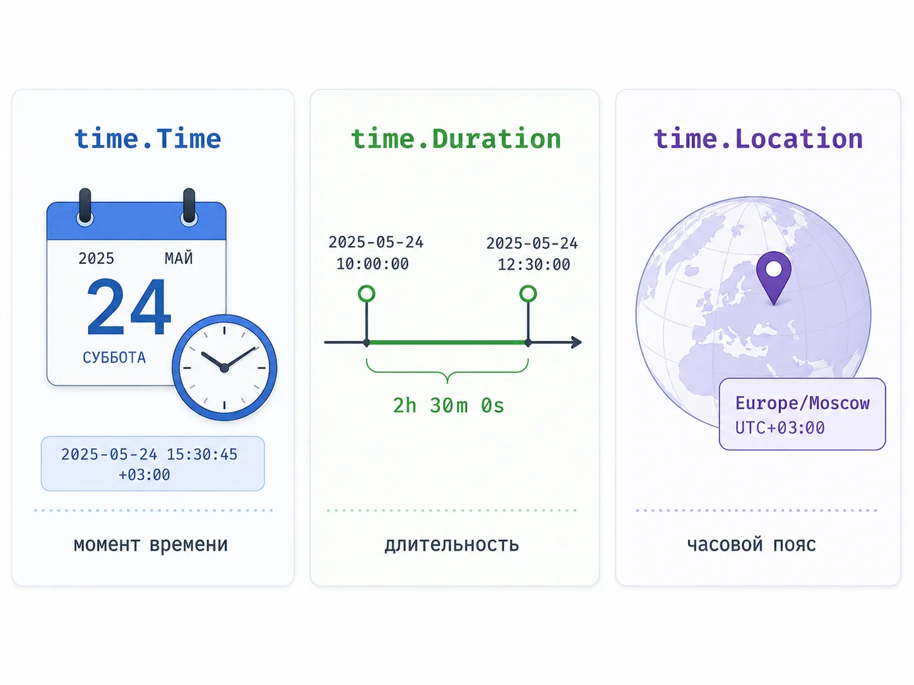
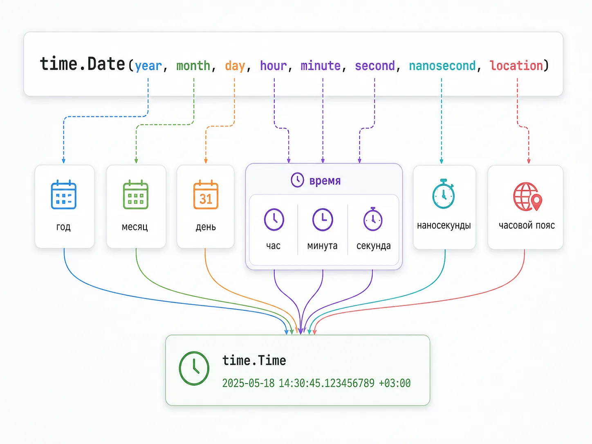
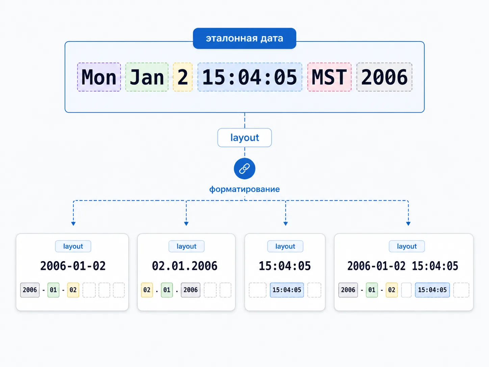
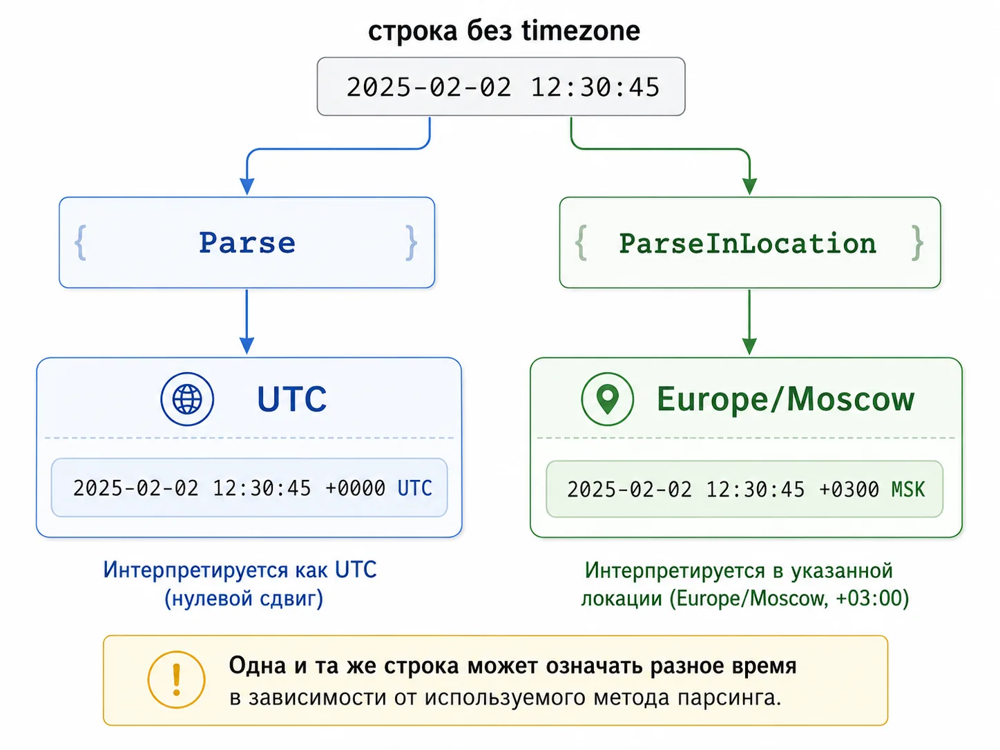
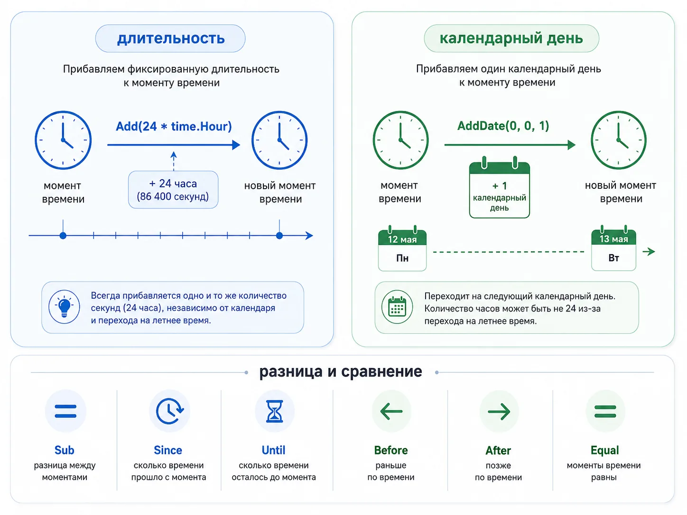
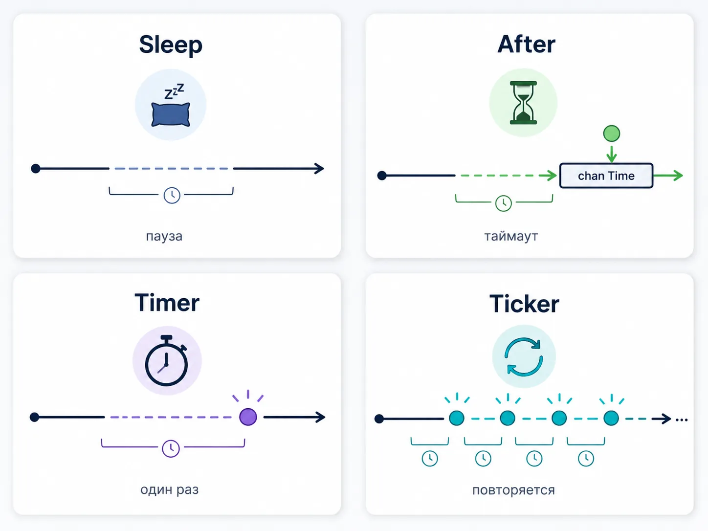
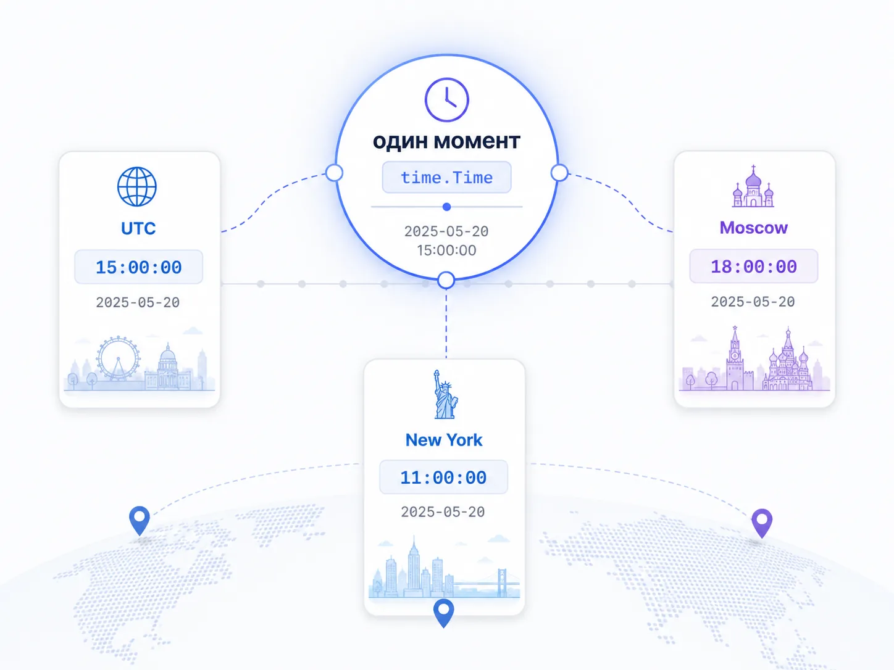
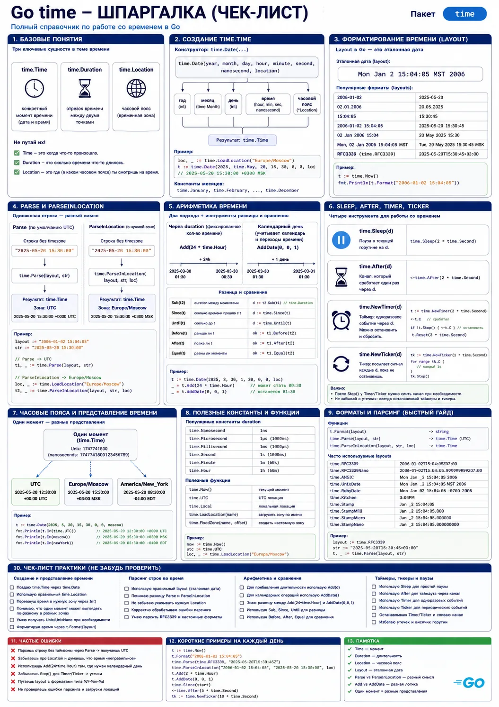

как работать с датой, временем, duration, parse, format и не ловить глупые баги с часовыми поясами

получить текущее время
распарсить дату из строки
красиво отформатировать
подождать пару секунд через Sleep
сравнить две даты
Но именно на этой теме очень быстро начинаются баги, которые не выглядят как что-то серьёзное, а потом жрут часы отладки.

Один разработчик забыл про часовой пояс и получил кривое время в API. Другой перепутал layout в Parse и долго не понимал, почему строка не парсится. Третий использовал time.After в цикле, а потом удивлялся лишней нагрузке. Четвёртый сравнил время не тем способом и словил странное поведение в тестах.

И это нормально. Тема времени почти во всех языках неприятная, а в Go у неё есть ещё свои особенности:

необычный layout 2006-01-02 15:04:05
разница между time.Time, time.Duration и time.Location
отдельные нюансы с Parse и ParseInLocation
вечная боль с UTC, Local и timezon
путаница между Sleep, After, Timer и Ticker
проблемы в JSON, логах, БД и внешних API
В статье разберём:

что такое пакет time в Go и какие типы в нём самые важные
как получить текущее время через time.Now()
как создать дату вручную через time.Date()
как форматировать время через Format()
как парсить строки через Parse() и ParseInLocation()
как работать с time.Duration
как прибавлять и вычитать время через Add, AddDate, Sub
как сравнивать даты через Before, After, Equal
как переводить время в Unix timestamp и обратно
как использовать Sleep, After, Timer, Ticker
как работать с часовыми поясами и не путать UTC и Local

Что такое пакет time в Golang
В Go работа с датой и временем сосредоточена в стандартном пакете time. Это хорошая новость, потому что тебе не нужно тянуть внешние библиотеки ради базовых сценариев. Всё основное уже есть в стандартной библиотеке:

текущее время;
создание даты;
парсинг строки во время;
форматирование времени;
арифметика с датами;
таймеры и тикеры;
работа с часовыми поясами;
Unix timestamp.
Три главных типа, которые нужно понять сразу
Если сильно упростить, у темы времени в Go есть три центральных сущности:

time.Time
time.Duration
time.Location
Что такое time.Time
time.Time — это конкретный момент времени.

Например:

now := time.Now()
fmt.Printf("%T\n", now)
Результат:

time.Time
То есть time.Time — это тип, который хранит дату, время и информацию о временной зоне

Что такое time.Duration
time.Duration — это не дата, а длительность.

Например:

5 секунд
2 минуты
24 часа
150 миллисекунд
Пример:

d := 5 * time.Second
fmt.Printf("%T %v\n", d, d)
Что такое time.Location
time.Location описывает часовую зону.

Например:

UTC
Local
Europe/Moscow
America/New_York
Это отдельная важная часть модели времени, потому что одна и та же дата и время в разных временных зонах могут отображаться по-разному.

time.Time = точка во времени
time.Duration = длина промежутка
time.Location = где мы на это время смотрим

Почему тема времени почти всегда вылезает в реальной работе
Пакет time — это не учебная декоративная тема.

Он вылезает почти везде:

в логах
в дедлайнах и таймаутах
в cron-задачах и scheduler-логике
в API и JSON
в базе данных
в аналитике
в rate limiting
в токенах и сроках действия
в отложенных задачах
в периодических фоновых процессах
Именно поэтому тема golang time полезна не только для собеседования, но и для реального кода почти в любом backend-проекте.

time.Now и текущее время
Первое, что почти все делают при знакомстве с пакетом time, это получают текущее время.

В Go для этого есть:

time.Now()
package main
import (
"fmt"
"time"
)
func main() {
now := time.Now()
fmt.Println(now)
}
Ты увидишь что-то вроде:

2026-06-09 14:32:10.123456789 +0300 EEST m=+0.000123456
Что здесь вообще напечаталось
На старте вывод выглядит страшновато, но на деле он вполне читаемый.

Например:

2026-06-09 14:32:10.123456789 +0300 EEST
Это значит:

2026-06-09 — дата
14:32:10.123456789 — время с наносекундами
+0300 — смещение от UTC
EEST — обозначение временной зоны
Почему текущее время не всегда локальное
Очень важный практический нюанс.

time.Now() возвращает текущее время в системной временной зоне, где запущена программа.

Это может быть:

твой ноутбук
Docker-контейнер
удалённый сервер
CI-среда
cloud-инстанс
И вот здесь начинаются баги. Ты думаешь, что время локальное, а на сервере всё живёт в UTC.

Когда лучше сразу переводить в UTC
Если ты работаешь с:

логами
распределённой системой
базой данных
API между сервисами
аналитикой
кэшами и сроками действия
Часто правильнее сразу мыслить через UTC:

nowUTC := time.Now().UTC()
fmt.Println(nowUTC)
Практическое правило

Хранить и передавать время между системами лучше в UTC. Показывать пользователю — уже в нужной локальной зоне.

Как достать отдельные компоненты текущего времени
Часто нужно не весь объект целиком, а его части.

now := time.Now()
fmt.Println(now.Year())
fmt.Println(now.Month())
fmt.Println(now.Day())
fmt.Println(now.Hour())
fmt.Println(now.Minute())
fmt.Println(now.Second())
fmt.Println(now.Nanosecond())
Это полезно, но тут есть важная рекомендация: если тебе нужен именно красивый вывод даты, чаще лучше форматировать её через Format(), а не руками собирать из кусочков.

Маленький пример из жизни
У учеников на старте часто бывает такая история: они хотят просто показать время в ответе API или в Telegram-боте, берут time.Now(), а потом удивляются, почему на сервере всё показывает не то время. Почти всегда это не баг Go, а просто отсутствие контроля над timezone.

time.Date и создание даты вручную
Иногда тебе не нужно текущее время. Иногда нужно создать конкретную дату руками.

Для этого есть:

time.Date(...)
birthday := time.Date(2024, time.April, 11, 10, 9, 8, 0, time.UTC)
fmt.Println(birthday)
Результат:

2024-04-11 10:09:08 +0000 UTC
Что принимают аргументы time.Date
Сигнатура выглядит большой, но логика простая:

time.Date(year, month, day, hour, min, sec, nsec, loc)
То есть ты передаёшь:

год
месяц
день
часы
минуты
секунды
наносекунды
временную зону
Почему month — не просто число
Можно было бы ожидать, что месяц задаётся числом, но в Go часто используют константы пакета time:

time.January
time.February
time.March
Это делает код чуть понятнее и снижает риск тупо перепутать номер месяца.

Что будет, если передать странные значения
Очень интересная особенность time.Date: она умеет нормализовать значения.

Например:

t := time.Date(2024, time.April, 34, 10, 0, 0, 0, time.UTC)
fmt.Println(t)
Результат будет уже не 34 апреля, а корректно пересчитанная дата.

Это удобно, но с этим не надо играться без нужды. Для учебного понимания полезно знать, для продакшн-кода лучше не передавать мусорные значения, если можно этого избежать.

Когда time.Date полезнее, чем Parse
time.Date особенно удобен, когда:

дата собирается из отдельных чисел
ты сам контролируешь все компоненты
не надо читать её из строки
хочется явно задать timezone
Например, дедлайн на сегодня в 18:00:

now := time.Now()
deadline := time.Date(now.Year(), now.Month(), now.Day(), 18, 0, 0, 0, now.Location())

Практический совет

Если дата приходит из внешнего мира строкой, обычно нужен Parse.

Если дата создаётся внутри программы осознанно по компонентам, обычно лучше Date.

Format: как форматировать дату и время
В Go форматирование времени устроено не как в большинстве языков.

Нет привычного:

YYYY-MM-DD
dd.MM.yyyy
%Y-%m-%d
Вместо этого Go использует эталонную дату:

Mon Jan 2 15:04:05 MST 2006
Именно из неё ты собираешь layout для Format() и Parse().

Базовый пример Format
now := time.Now()
fmt.Println(now.Format("2006-01-02 15:04:05"))
Если текущее время — 9 июня 2026 года, 14:30:45, вывод будет таким:

2026-06-09 14:30:45
Почему именно 2006-01-02 15:04:05
Потому что Go не использует символические шаблоны вроде YYYY и MM.

Он говорит тебе: вот конкретная эталонная дата. Расставь её части в нужном порядке.

2006 = год
01 = месяц
02 = день
15 = часы в 24-часовом формате
04 = минуты
05 = секунды
Самая частая ошибка новичка
Писать вот так:

now.Format("YYYY-MM-DD")
И потом удивляться, почему результат именно строка YYYY-MM-DD, а не дата.

Потому что для Go это просто текст. Он не знает, что ты хотел сказать “год-месяц-день”.

Полезные форматы, которые пригодятся сразу
Дата и время:

now.Format("2006-01-02 15:04:05")
Только дата:

now.Format("2006-01-02")
Только время:

now.Format("15:04:05")
Русский привычный формат:

now.Format("02.01.2006 15:04")
Готовые константы из пакета time
В Go уже есть предопределённые layout-константы.

Например:

fmt.Println(now.Format(time.RFC3339))
fmt.Println(now.Format(time.DateOnly))
fmt.Println(now.Format(time.TimeOnly))
fmt.Println(now.Format(time.DateTime))
fmt.Println(now.Format(time.UnixDate))
Это очень удобно, когда тебе не хочется руками собирать format-строку.

Когда лучше использовать RFC3339
Если время уходит:

во внешний API
в JSON
между сервисами
в БД как строка
в логи, которые потом читают другие системы
очень часто хороший дефолт — это time.RFC3339.

Пример:

fmt.Println(time.Now().UTC().Format(time.RFC3339))
Потому что это стандартный, узнаваемый и безопасный формат.

В работе с учениками и на собеседованиях тема layout почти всегда всплывает как ловушка. Человек в целом понимает, что есть Format, но в голове всё ещё сидит привычка из других языков — использовать YYYY, MM, DD. На этом легко засыпаться даже в простой задаче.

Parse и ParseInLocation: как парсить строки
Если Format() превращает time.Time в строку, то Parse() делает обратное: превращает строку в time.Time.

layout := "2006-01-02 15:04:05"
value := "2026-06-09 14:30:45"
t, err := time.Parse(layout, value)
if err != nil {
fmt.Println("Ошибка:", err)
return
}
fmt.Println(t)
Самое главное правило Parse

layout должен точно повторять структуру входной строки

Если строка выглядит как:

09.06.2026 14:30
то layout должен быть:

"02.01.2006 15:04"
А не какой-нибудь другой.

Пример с русским привычным форматом
layout := "02.01.2006"
value := "09.06.2026"
t, err := time.Parse(layout, value)
if err != nil {
panic(err)
}
fmt.Println(t)
Почему Parse часто даёт UTC, когда ты этого не ждал
Если во входной строке нет timezone, time.Parse() часто создаёт значение во временной зоне UTC.

И вот здесь можно словить баг: визуально дата вроде нормальная, а потом при сравнении, выводе или сериализации всё начинает жить не там, где ты ожидал.

Когда нужен ParseInLocation
Если ты знаешь, что строка без timezone должна трактоваться в конкретной локальной зоне, используй ParseInLocation().

Пример:

loc, err := time.LoadLocation("Europe/Moscow")
if err != nil {
panic(err)
}
layout := "02.01.2006 15:04"
value := "09.06.2026 14:30"
t, err := time.ParseInLocation(layout, value, loc)
if err != nil {
panic(err)
}
fmt.Println(t)
Где это реально важно
Очень часто в бизнес-коде дата приходит вот такой строкой:

2026-06-09 18:00:00
Без указания timezone.

И у тебя есть два разных смысла:

это 18:00 UTC
это 18:00 по Москве
это 18:00 по локальному времени клиента
Без явного решения по timezone тут легко построить тихую ошибку.

Гибкий парсинг нескольких форматов
В реальном коде иногда приходится принимать несколько вариантов строк. Например, API сегодня шлёт RFC3339, завтра — что-то своё.

Тогда можно идти по списку layout:

func parseFlexibleTime(value string) (time.Time, error) {
layouts := []string{
time.RFC3339,
"2006-01-02 15:04:05",
"02.01.2006 15:04",
"2006-01-02",
}
for _, layout := range layouts {
if t, err := time.Parse(layout, value); err == nil {
return t, nil
}
}
return time.Time{}, fmt.Errorf("не удалось распарсить время: %s", value)
}
Это не всегда лучший API-дизайн, но как защитный паттерн иногда очень полезно.

Практическое правило

Если строка пришла с timezone — Parse. Если строка без timezone, но ты знаешь, в какой зоне её понимать — ParseInLocation.

time.Duration, Add, AddDate, Sub, Since, Until
Теперь переходим к той части, где время начинает работать не как строка, а как объект, с которым можно считать.

Что такое time.Duration простыми словами
time.Duration — это длина промежутка времени.

Например:

5 * time.Second
2 * time.Minute
24 * time.Hour
150 * time.Millisecond
Это не дата и не момент времени. Это именно сколько длится.

Базовый пример Duration
d := 2*time.Hour + 30*time.Minute
fmt.Println(d)
fmt.Println(d.Hours())
fmt.Println(d.Minutes())
fmt.Println(d.Seconds())
Add: прибавить длительность
Если у тебя есть time.Time, к нему можно прибавить Duration:

now := time.Now()
future := now.Add(2 * time.Hour)
past := now.Add(-30 * time.Minute)
fmt.Println(future)
fmt.Println(past)
Почему Add не решает всё
Если тебе надо прибавить именно дни, месяцы, годы в календарном смысле, не всегда правильно просто делать 24 * time.Hour.

Из-за timezone, переходов времени и календарной логики правильнее использовать AddDate() там, где речь именно про календарные дни, месяцы и годы.

AddDate: календарная арифметика
now := time.Now()
nextMonth := now.AddDate(0, 1, 0)
nextWeek := now.AddDate(0, 0, 7)
nextYear := now.AddDate(1, 0, 0)
AddDate(years, months, days)

Sub: разница между двумя моментами
Если у тебя есть два time.Time, можно найти разницу:

start := time.Date(2026, time.June, 1, 10, 0, 0, 0, time.UTC)
end := time.Date(2026, time.June, 1, 12, 30, 0, 0, time.UTC)
diff := end.Sub(start)
fmt.Println(diff) // 2h30m0s
Since и Until
Это просто удобные обёртки поверх Sub.

Сколько прошло с момента:

started := time.Now()
time.Sleep(2 * time.Second)
fmt.Println(time.Since(started))
Сколько осталось до момента:

deadline := time.Now().Add(10 * time.Minute)
fmt.Println(time.Until(deadline))
Before, After, Equal
Для сравнения двух дат есть три самых понятных метода:

fmt.Println(t1.Before(t2))
fmt.Println(t1.After(t2))
fmt.Println(t1.Equal(t2))
Это лучше, чем пытаться сравнивать время как строку.

Почему == не лучший путь для time.Time
На базовом уровне может казаться, что если это структура, то можно сравнить через ==.

Но в практическом коде надёжнее мыслить через Equal(), особенно если у тебя время пришло из разных мест, с разной точностью или разной внутренней историей.

Пример из продуктового кода
Очень частая задача в работе:

проверить, истёк ли токен
не пора ли запускать cron-задачу
сколько прошло с момента последней активности
не просрочен ли дедлайн
когда выполнить следующий retry
Почти всё это сводится к связке:

time.Now()
Add() / AddDate()
Before() / After()
Since() / Until()

Unix timestamp, JSON, API и база данных
Пока всё выглядело довольно учебно. Теперь перейдём к месту, где time начинает жить в реальном backend-коде.

Что такое Unix timestamp
Unix timestamp — это количество секунд, прошедших с 1 января 1970 года 00:00:00 UTC.

Получить его в Go можно так:

now := time.Now()
fmt.Println(now.Unix())
А если нужны миллисекунды:

fmt.Println(now.UnixMilli())
Или наносекунды:

fmt.Println(now.UnixNano())
Как превратить timestamp обратно в time.Time
ts := time.Now().Unix()
t := time.Unix(ts, 0)
fmt.Println(t)
Для миллисекунд есть:

tsMs := time.Now().UnixMilli()
t := time.UnixMilli(tsMs)
fmt.Println(t)
Когда timestamp удобнее, чем строка
Timestamp часто удобен для:

хранения в базе как числа
быстрой сериализации
TTL и сроков действия
rate limiting
сравнений между системами
Но если тебе нужен человекочитаемый формат или совместимость с внешними API, часто лучше использовать RFC3339-строку.

Время в JSON
В Go time.Time хорошо умеет сериализоваться в JSON.

Пример:

type Event struct {
Name string `json:"name"`
At time.Time `json:"at"`
}
Обычно в JSON это уходит в ISO/RFC3339-подобном формате.

Практическое правило

Для внешнего API лучше заранее решить единый формат времени и не менять его хаотично.

Время в API
Самая частая ошибка в API — смешивать форматы.

Например:

в одном месте отдавать 2026-06-09T14:30:00Z
в другом 09.06.2026 17:30
в третьем Unix timestamp
в четвёртом вообще локальное время без timezone
Это гарантированная дорога к путанице.

Если API публичный или межсервисный, часто лучший дефолт — это:

хранить в UTC
отдавать через RFC3339
Время в базе данных
Тут всё зависит от конкретной БД и схемы, но логика та же:

держать единый стандарт
не смешивать локальное и UTC без причины
не полагаться на «ну сервер сам как-нибудь поймёт»
Одна из самых мерзких категорий багов — это когда всё почти работает. Например, scheduler запущен, код формально правильный, но внешняя система изменила формат времени, и Parse() перестал проходить. Ошибка не вылезла громко, задача просто перестала запускаться в нужный момент. Такие истории особенно больные именно потому, что баг не выглядит как явное падение, а живёт тихо.

Sleep, After, Timer и Ticker
Вот здесь пакет time начинает пересекаться с конкурентностью и фоновой логикой.

time.Sleep
time.Sleep(d) просто усыпляет текущую горутину на заданную длительность.

fmt.Println("start")
time.Sleep(2 * time.Second)
fmt.Println("done")
Это нормально для:

простых примеров
тестовых сценариев
очень прямолинейной задержки
Но для более гибкой логики Sleep не всегда лучший выбор.

time.After
time.After(d) в Golang возвращает канал, который получит значение через указанную длительность.

select {
case <-time.After(2 * time.Second):
fmt.Println("timeout")
}
Это особенно полезно в select, когда нужен timeout.

Почему time.After часто показывают рядом с select
Потому что это очень распространённый паттерн:

select {
case result := <-workCh:
fmt.Println(result)
case <-time.After(1 * time.Second):
fmt.Println("слишком долго")
}
То есть либо получили результат, либо по таймауту пошли дальше.

Важный нюанс про time.After в цикле
Это важная ловушка.

Если бездумно делать time.After(...) в большом цикле, ты создаёшь новый таймер на каждой итерации. В некоторых сценариях это не то, что хочется.

Когда таймер нужен многократно, часто лучше смотреть в сторону time.NewTimer() и Reset().

time.NewTimer
Таймер нужен, когда событие должно случиться один раз в будущем.

timer := time.NewTimer(3 * time.Second)
<-timer.C
fmt.Println("timer fired")
Если таймер больше не нужен, его можно остановить:

if timer.Stop() {
fmt.Println("timer stopped")
}
time.AfterFunc
Если хочется просто выполнить функцию позже:

time.AfterFunc(2*time.Second, func() {
fmt.Println("run later")
})
Это очень удобно для отложенных действий.

time.NewTicker
Ticker нужен для повторяющихся действий.

ticker := time.NewTicker(1 * time.Second)
defer ticker.Stop()
for i := 0; i < 3; i++ {
<-ticker.C
fmt.Println("tick")
}
Почему ticker почти всегда надо Stop()
Потому что иначе ты оставляешь живой источник тиков и потенциально лишние ресурсы.

Для ticker нормальная привычка выглядит так:

ticker := time.NewTicker(time.Second)
defer ticker.Stop()
Где это используется в реальной работе
heartbeat
периодическая синхронизация
фоновые проверки
scheduler
rate limiter
retry с интервалом
cleanup-задачи

Timezone, UTC и Local: где чаще всего баги
Если выбирать одно самое скользкое место в теме time, то это почти всегда timezone.

В чём корень проблемы
Один и тот же момент времени можно показать по-разному в зависимости от зоны.

Поэтому главный вопрос не просто какое сейчас время, а: в какой временной зоне мы его интерпретируем?

UTC
UTC — это базовый мировой стандарт времени.

В backend-разработке UTC очень любят, потому что он:

предсказуемый
одинаковый для всех серверов
удобный для хранения и передачи между системами
nowUTC := time.Now().UTC()

fmt.Println(nowUTC)

nowUTC := time.Now().UTC()
fmt.Println(nowUTC)
Local
Local — это системная локальная временная зона среды, где запущена программа.

fmt.Println(time.Now().Local())
Проблема в том, что локальная зона на проде и на ноутбуке разработчика может быть разной.

LoadLocation и In
Если нужно показать время в конкретной зоне:

loc, err := time.LoadLocation("Europe/Moscow")
if err != nil {
panic(err)
}
nowMoscow := time.Now().In(loc)
fmt.Println(nowMoscow)
Самая частая практическая ошибка
Хранить дату как будто она локальная, но не сохранять timezone явно.

Потом:

один сервис считает это временем по Москве
другой считает UTC
третий выводит в Local
четвёртый сериализует в JSON без ожиданий команды
И всё, баг готов.

Практическое правило для backend
Очень рабочая схема такая:

внутри системы и между сервисами держим UTC
пользователю показываем время в нужной зоне
в строках без timezone не угадываем смысл, а задаём его явно
Timezone bug, который реально легко словить
Ты парсишь строку:

2026-06-09 18:00:00
Без timezone.

Дальше один разработчик думает: это время по Москве. Второй думает: ну значит UTC. Третий вообще не думает.

И самое мерзкое, что код может долго выглядеть рабочим.

Если приложение работает в нескольких странах
Тогда вопрос timezone уже не мелочь, а часть бизнес-логики.

Например:

дедлайн до конца дня
бронь до 18:00 по локальному времени клиента
cron-задача в полночь по местной зоне
ежемесячное списание
В таких задачах «и так сойдёт» обычно заканчивается болью.

Частые ошибки новичков и вопросы на собеседовании
Ошибка 1. Пытаться форматировать время через YYYY-MM-DD

В Go так не работает. Нужен layout на основе эталонной даты.

Ошибка 2. Не понимать разницу между Time и Duration

time.Time — это точка во времени. time.Duration — это промежуток.

Ошибка 3. Использовать Parse там, где нужна конкретная location

Если строка без timezone, но должна пониматься в определённой зоне, обычно нужен ParseInLocation().

Ошибка 4. Бездумно использовать Local в продакшене

На ноутбуке и на сервере “локальная зона” может быть разной.

Ошибка 5. Мешать UTC, local time и человекочитаемые форматы без общей стратегии

Это одна из самых дорогих ошибок в реальной backend-разработке.

Ошибка 6. Использовать time.After в цикле без понимания последствий

Во многих сценариях это создаёт лишние таймеры.

Ошибка 7. Забывать Stop() у ticker

Это классическая привычка, которую надо вбить с самого начала.

Ошибка 8. Сравнивать время строками

Если у тебя есть time.Time, сравнивай его как время, а не как текст.

Что любят спрашивать на собеседовании
Что такое time.Time в Go?

Хороший ответ: это тип, который представляет конкретный момент времени с учётом временной зоны.

Что такое time.Duration?

Это длительность, то есть промежуток времени, измеряемый с высокой точностью.

Как получить текущее время?

Через time.Now().

Как форматировать время в Go?

Через Format() и layout на основе эталонной даты 2006-01-02 15:04:05.

Почему YYYY-MM-DD не работает в Go?

Потому что Go использует не символьные шаблоны, а эталонную дату.

Чем Parse отличается от ParseInLocation?

Parse парсит строку по layout, а ParseInLocation позволяет явно задать временную зону для строк без timezone.

Чем отличается Add от AddDate?

Add добавляет Duration, а AddDate работает в календарной логике: годы, месяцы, дни.

Чем отличаются Sleep, After, Timer и Ticker?

Sleep — простая пауза, After — таймаут через канал, Timer — одноразовое событие, Ticker — повторяющийся интервал.

Что такое Unix timestamp?

Это количество времени, прошедшего с эпохи Unix: 1 января 1970 года UTC.

Какой главный совет по timezone?

Хранить и передавать время между системами в UTC, а пользователю показывать уже в нужной зоне.

Практика: 8 коротких упражнений, чтобы тема time реально закрепилась
Ниже небольшой практический блок, чтобы статья работала не как сухая справка, а как инструмент для прокачки.

Упражнение 1. Текущее время
Что тренируем: базовое знакомство с time.Now().

Задача: Получи текущее время и выведи отдельно год, месяц, день, час и минуту.

Упражнение 2. Создание даты
Что тренируем: time.Date().

Задача: Создай дату своего следующего дня рождения вручную и выведи её.

Упражнение 3. Форматирование
Что тренируем: Format() и layout.

Задача: Возьми текущее время и выведи его в трёх форматах:

2006-01-02
02.01.2006 15:04
15:04:05
Упражнение 4. Парсинг строки
Что тренируем: Parse().

Задача: Распарсь строку 2026-06-09 18:30:00 в time.Time.

Упражнение 5. Duration и арифметика
Что тренируем: Duration, Add, Sub.

Задача: Возьми текущее время, прибавь 2 часа 15 минут, потом вычисли разницу между новым и исходным временем.

Упражнение 6. AddDate и календарная логика
Что тренируем: AddDate().

Задача: От текущей даты посчитай, какая дата будет через 1 месяц и 10 дней.

Упражнение 7. Таймаут через time.After
Что тренируем: timeout-логику.

Задача: Сделай select, где либо приходит сообщение из канала, либо через 2 секунды срабатывает timeout.

Упражнение 8. Ticker
Что тренируем: периодические события.

Задача: Запусти тикер, который печатает сообщение каждые 1 секунду 5 раз, а потом корректно останавливается.

Краткий итог
Если собрать всю тему в короткую форму, получится так:

пакет time в Go закрывает работу с датой, временем, длительностями, таймерами и часовыми поясами
time.Time — это момент времени
time.Duration — это длина промежутка
time.Location — это временная зона
текущее время получаем через time.Now()
дату вручную создаём через time.Date()
время форматируем через Format()
строки парсим через Parse() и ParseInLocation()
для арифметики используем Add, AddDate, Sub, Since, Until
для сравнения — Before, After, Equal
для timestamp — Unix, UnixMilli, time.Unix()
для паузы и расписаний — Sleep, After, Timer, Ticker
timezone лучше держать под контролем, а не пускать на самотёк
Если хочешь реально закрепить тему, не ограничивайся чтением. Лучше руками прогони простые мини-примеры:

time.Now()
time.Date()
Format()
Parse()
ParseInLocation()
Add() и AddDate()
Sub(), Since(), Until()
Sleep, After, Ticker
LoadLocation() и In()
Unix() и time.Unix()
После этого golang time перестаёт выглядеть как хаос из дат, а становится нормальным рабочим инструментом.

Шпаргалка по time в Golang

Мини-шаблоны, которые стоит забрать в работу
Текущее время:

now := time.Now()
UTC-время:

nowUTC := time.Now().UTC()
Форматирование:

s := time.Now().Format("2006-01-02 15:04:05")
Парсинг:

t, err := time.Parse("2006-01-02 15:04:05", value)
Календарное смещение:

nextWeek := time.Now().AddDate(0, 0, 7)
Таймаут:

select {
case <-workCh:
case <-time.After(2 * time.Second):
}
Ticker:

ticker := time.NewTicker(time.Second)
defer ticker.Stop()
Как самому проверить, что тема реально улеглась
После практики попробуй без подсказки ответить на вопросы:

Чем time.Time отличается от time.Duration?
Почему в Go layout выглядит как 2006-01-02 15:04:05?
Когда нужен ParseInLocation, а не Parse?
Чем Add отличается от AddDate?
В чём разница между Sleep, After, Timer и Ticker?
Почему timezone часто ломает код не сразу, а тихо?
Если отвечаешь на это спокойно, значит база по теме уже реально начала вставать на место.

Зачем вообще хорошо понимать time, если кажется, что это просто даты
Пакет time — очень хороший пример темы, которая на входе выглядит простой, а на практике быстро показывает качество базы.

Если человек не до конца понимает:

как устроен Format
как работает Parse
в чём разница между UTC и Local
почему Duration не равно «дата»
когда нужен Ticker, а когда Timer
это довольно быстро всплывает и в рабочем коде, и в тестах, и на собеседовании.

А ещё тема времени часто пересекается с более взрослыми вещами:

конкурентность;
дедлайны;
таймауты;
rate limiting;
scheduler-логика;
межсервисное API.
