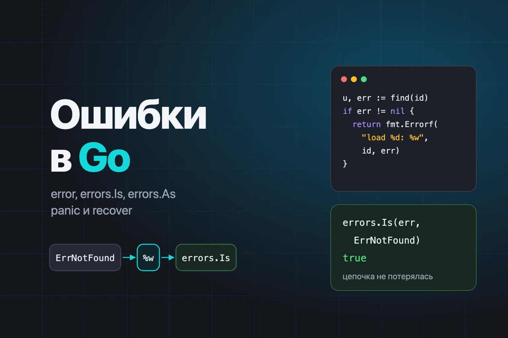
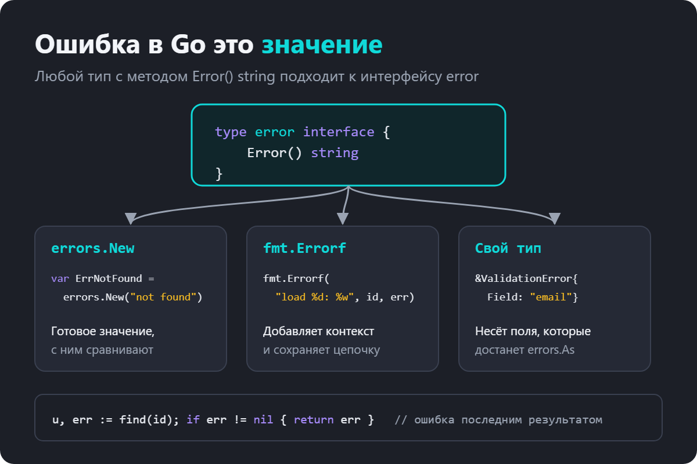
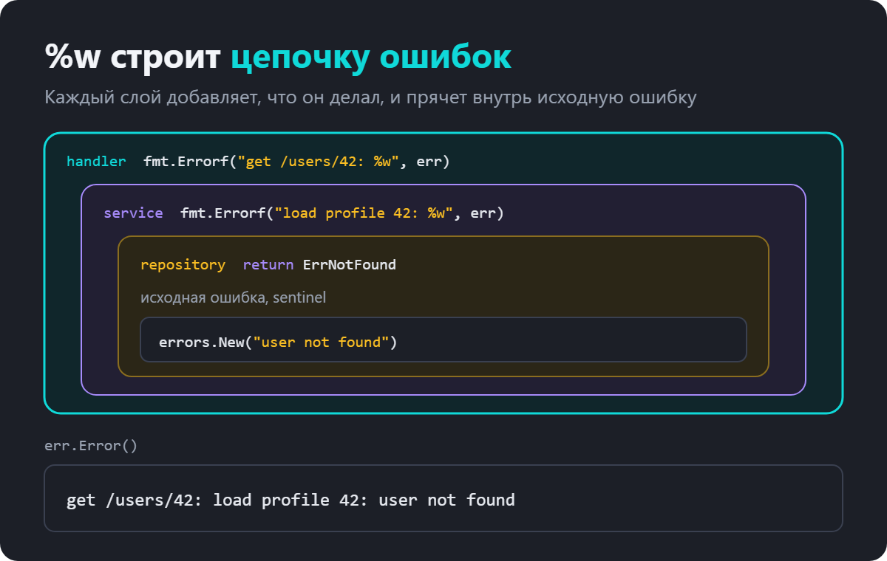
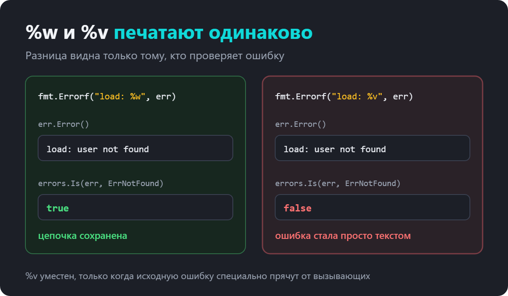
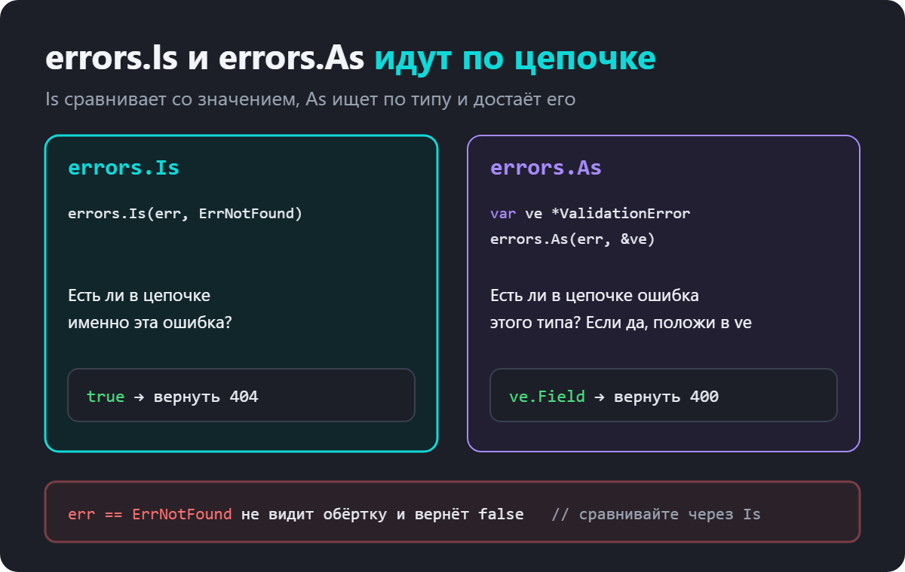
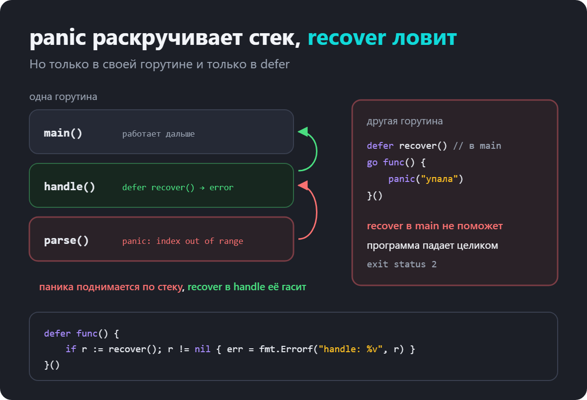
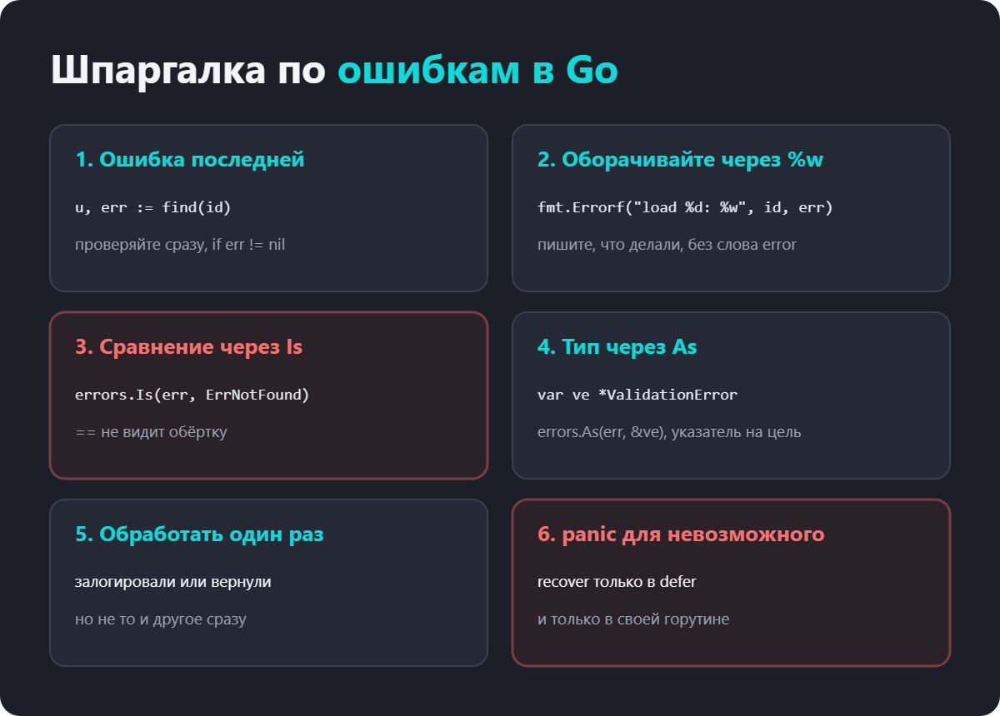

как создавать, оборачивать и проверять error, и когда нужен panic

Новички в Go первым делом жалуются на if err != nil. Он повторяется через строчку, и кажется, что исключения из других языков были удобнее. Через пару месяцев претензии меняются.

ошибка пришла, но непонятно, откуда и что именно сломалось
проверка err == ErrNotFound перестала работать после рефакторинга
одна и та же ошибка трижды попала в лог
функция вернула «ничего», а err != nil всё равно сработало
паника в горутине уронила весь сервис
У всех этих проблем одна причина. Ошибки в Go это обычные значения, и работать с ними нужно как со значениями. Когда это понимаешь, обработка ошибок становится предсказуемой, а вопросы про errors.Is и %w на собеседовании перестают пугать.

Вот что разберём по порядку.

что такое error и как создать ошибку
sentinel-ошибки и свои типы ошибок
обёртка через %w и цепочка ошибок
errors.Is, errors.As и errors.Join
где добавлять контекст и как не логировать одно и то же трижды
panic и recover, и когда они уместны
частые ошибки и вопросы с собеседований

Что такое error в Go
error это встроенный интерфейс с одним методом.

type error interface {
	Error() string
}
Любой тип с методом Error() string подходит к нему. Ошибка в Go это не механизм языка вроде исключений, а обычное значение, которое функция возвращает последним результатом.

u, err := findUser(id)
if err != nil {
	return err
}
Никакой магии. Ошибку можно сохранить в переменную, положить в слайс, передать в канал, сравнить с другой. Программа всегда видит, где она может сломаться, потому что это написано в сигнатуре.

Как создать ошибку
Есть три способа, и у каждого своя задача.

errors.New создаёт ошибку с фиксированным текстом. Чаще всего её кладут в переменную пакета, чтобы потом сравнивать.

var ErrNotFound = errors.New("user not found")
fmt.Errorf собирает текст по шаблону и умеет оборачивать другую ошибку через %w. Об этом подробно ниже.

return fmt.Errorf("load profile %d: %w", id, err)
Свой тип нужен, когда вместе с ошибкой нужно передать данные. Например, какое поле не прошло проверку.

type ValidationError struct {
	Field string
	Msg   string
}

func (e *ValidationError) Error() string {
	return fmt.Sprintf("поле %s: %s", e.Field, e.Msg)
}
Sentinel-ошибки
Sentinel (сигнальная ошибка) это заранее созданное значение ошибки, с которым сравнивают. Вы точно их встречали.

io.EOF, поток закончился
sql.ErrNoRows, запрос ничего не нашёл
context.Canceled и context.DeadlineExceeded
fs.ErrNotExist, файла нет
Своё такое значение объявляют на уровне пакета, а имя по соглашению начинают с Err.

var ErrNotFound = errors.New("user not found")

func findUser(id int64) (User, error) {
	if id != 1 {
		return User{}, ErrNotFound
	}
	return User{ID: 1}, nil
}
Вызывающий код теперь может отличить «пользователя нет» от «база упала» и ответить 404 вместо 500.

Обёртка через %w
Ошибка без контекста почти бесполезна. Если в логе написано user not found, непонятно, какого пользователя искали и в каком месте. Поэтому каждый слой, через который проходит ошибка, добавляет к ней, что он делал.

func loadProfile(id int64) (User, error) {
	u, err := findUser(id)
	if err != nil {
		return User{}, fmt.Errorf("load profile %d: %w", id, err)
	}
	return u, nil
}

func main() {
	_, err := loadProfile(42)
	fmt.Println(err) // load profile 42: user not found
}
Глагол %w (от wrap) делает две вещи. Вставляет текст исходной ошибки и сохраняет её саму внутри новой. Получается матрёшка, которую можно разобрать обратно.

Достать вложенную ошибку можно через errors.Unwrap, но руками это почти не делают. Для проверок есть errors.Is и errors.As, которые проходят по всей цепочке сами.

Почему == перестаёт работать
После обёртки ошибка уже другое значение. Прямое сравнение с sentinel ломается.

_, err := loadProfile(42)
fmt.Println(err == ErrNotFound)          // false
fmt.Println(errors.Is(err, ErrNotFound)) // true
Это частая причина багов после рефакторинга. Кто-то добавил контекст к ошибке в нижнем слое, и проверка == наверху тихо перестала срабатывать. Поэтому сравнивать ошибки нужно всегда через errors.Is, даже если сейчас обёртки нет.

%w и %v печатают одинаково
Если в fmt.Errorf написать %v вместо %w, текст ошибки будет точно таким же. Но исходная ошибка внутрь не сохранится, останется только строка.

lost := fmt.Errorf("load profile %d: %v", 42, ErrNotFound)
fmt.Println(lost)                         // load profile 42: user not found
fmt.Println(errors.Is(lost, ErrNotFound)) // false

В логах разницы не видно, поэтому такую ошибку легко пропустить на ревью. %v уместен только тогда, когда вы специально не хотите, чтобы вызывающие зависели от внутренней ошибки. Например, библиотека не хочет делать детали драйвера базы частью своего API.

errors.Is и errors.As
Обе функции идут по цепочке обёрток от внешней ошибки к самой внутренней. Разница в том, что они ищут.

errors.Is отвечает на вопрос «есть ли в цепочке вот эта конкретная ошибка?». Его используют с sentinel-значениями.

if errors.Is(err, ErrNotFound) {
	http.Error(w, "not found", http.StatusNotFound)
	return
}
errors.As отвечает на вопрос «есть ли в цепочке ошибка вот этого типа?». Если есть, кладёт её в переменную, чтобы можно было прочитать поля.

func register(email string) error {
	if email == "" {
		return fmt.Errorf("register: %w", &ValidationError{Field: "email", Msg: "пустое"})
	}
	return nil
}

func main() {
	err := register("")
	fmt.Println(err) // register: поле email: пустое

	var ve *ValidationError
	if errors.As(err, &ve) {
		fmt.Println("ответить 400, поле", ve.Field) // ответить 400, поле email
	}
}

Стандартная библиотека использует оба способа
Хороший пример это ошибка открытия файла. Её можно проверить и через Is, и через As.

_, err := os.Open("/нет/такого/файла")
fmt.Println(err)                            // open /нет/такого/файла: no such file or directory
fmt.Println(errors.Is(err, fs.ErrNotExist)) // true

var pe *fs.PathError
if errors.As(err, &pe) {
	fmt.Println("op:", pe.Op, "path:", pe.Path) // op: open path: /нет/такого/файла
}
Частая ошибка с errors.As
Второй аргумент errors.As это указатель на переменную нужного типа. Если тип ошибки указатель *ValidationError, то передать нужно &ve, где ve типа *ValidationError. Получается указатель на указатель, и это правильно.

Если передать сам ve, программа упадёт.

var ve *ValidationError
errors.As(err, ve)
// panic: errors: *target must be interface or implement error
Хорошая новость в том, что go vet ловит это до запуска.

second argument to errors.As must be a non-nil pointer to either a type
that implements error, or to any interface type
errors.Join, несколько ошибок сразу
Иногда ошибок несколько. Например, проверили пять полей формы, и три не прошли. Или закрыли файл и получили ошибку, хотя до этого уже была ошибка записи. С Go 1.20 для этого есть errors.Join.

var (
	ErrTimeout = errors.New("timeout")
	ErrAuth    = errors.New("auth failed")
)

err := errors.Join(ErrTimeout, ErrAuth)
fmt.Println(err)
// timeout
// auth failed
fmt.Println(errors.Is(err, ErrTimeout), errors.Is(err, ErrAuth)) // true true
Ошибки печатаются через перевод строки, а errors.Is находит любую из них. В fmt.Errorf с тех же пор можно писать несколько %w.

both := fmt.Errorf("sync: %w; %w", ErrTimeout, ErrAuth)
fmt.Println(both)                    // sync: timeout; auth failed
fmt.Println(errors.Is(both, ErrAuth)) // true
Ошибка при закрытии файла
Join хорошо решает старую проблему с defer f.Close(). Ошибку закрытия часто просто выбрасывают, хотя для записи в файл она важна. Буфер мог не сброситься на диск.

func writeReport(path string, data []byte) (err error) {
	f, err := os.Create(path)
	if err != nil {
		return fmt.Errorf("write report: %w", err)
	}
	defer func() {
		err = errors.Join(err, f.Close())
	}()
	_, err = f.Write(data)
	return err
}
Именованный результат err позволяет defer дописать ошибку закрытия к ошибке записи. Если обе nil, Join вернёт nil.

Где добавлять контекст и как обрабатывать ошибки
Пишите, что делали, а не что сломалось
Хороший текст обёртки описывает действие. load profile 42, query users, decode config. Тогда полный текст ошибки читается как путь от верхнего уровня к причине.

get /users/42: load profile 42: query users: connection refused
Плохие варианты это error occurred, failed to, ошибка при. В ошибке и так понятно, что это ошибка, а слово failed в каждом слое превращает текст в кашу.

Обрабатывайте ошибку один раз
Обработать ошибку значит либо вернуть её наверх, либо залогировать и решить проблему на месте. Но не то и другое сразу.

// плохо, эта ошибка окажется в логе на каждом уровне
if err != nil {
	log.Printf("load profile: %v", err)
	return err
}

// хорошо, добавили контекст и вернули, залогирует верхний уровень
if err != nil {
	return fmt.Errorf("load profile: %w", err)
}
Обычно логирует самый верхний уровень. В HTTP-сервисе это обработчик или middleware, который заодно решает, какой статус вернуть клиенту.

Не возвращайте nil-указатель как error
Если функция возвращает error, а внутри вы вернули переменную типа *MyErr со значением nil, вызывающий получит не nil. В интерфейсе уже записан тип, и err != nil сработает. Если ошибки нет, пишите return nil буквально.

panic и recover
panic останавливает обычное выполнение функции. Go начинает раскручивать стек вызовов вверх, по пути выполняет все отложенные defer. Если по дороге никто не вызвал recover, программа падает и печатает стек.

Паники бывают двух видов. Те, что вызывает сам рантайм.

var m map[string]int
m["a"] = 1 // panic: assignment to entry in nil map

var s []int
_ = s[3] // panic: runtime error: index out of range [3] with length 0
И те, что вы вызываете сами через panic(...).

Когда panic уместен
Почти никогда в обычной логике. Ошибка, которую можно ожидать, это error. Нет файла, пользователь ввёл ерунду, база не ответила, всё это ошибки.

panic оставляют для ситуаций, которых не должно быть никогда. Нарушен инвариант, который гарантирует ваш же код. Программа не может стартовать без обязательной настройки. Функции вида regexp.MustCompile и template.Must паникуют именно потому, что их вызывают со строками из исходного кода, и ошибка там это баг программиста.

Как работает recover
recover останавливает панику и возвращает значение, с которым её вызвали. Работает он только в одном месте, внутри функции, которую вызвал defer. В обычном коде recover просто вернёт nil.

func safeDiv(a, b int) (res int, err error) {
	defer func() {
		if r := recover(); r != nil {
			err = fmt.Errorf("safeDiv: %v", r)
		}
	}()
	return a / b, nil
}

func main() {
	fmt.Println(safeDiv(10, 2)) // 5 <nil>
	fmt.Println(safeDiv(1, 0))  // 0 safeDiv: runtime error: integer divide by zero
}
Здесь паника деления на ноль превратилась в обычную ошибку. Так устроены middleware, которые не дают одному сломанному запросу уронить весь сервер. Стандартный net/http делает это сам, паника в обработчике обрывает только этот запрос.

recover работает только в своей горутине
Это главный подвох. Если паника случилась в другой горутине, recover в main её не поймает, и упадёт вся программа.

func main() {
	defer func() { fmt.Println("recover в main:", recover()) }()

	go func() {
		panic("упала горутина")
	}()

	time.Sleep(100 * time.Millisecond)
	fmt.Println("сюда не дойдём")
}
panic: упала горутина

goroutine 19 [running]:
...
exit status 2
Ни «recover в main», ни «сюда не дойдём» не напечатались. Поэтому каждая горутина, где возможна паника, должна сама ставить defer с recover. Обычно для этого заводят обёртку вроде safeGo(func()), которая логирует панику и не даёт ей уронить сервис.

Частые ошибки
Ошибка 1. Сравнивать через ==

После первой же обёртки проверка перестанет работать. Пишите errors.Is.

Ошибка 2. %v вместо %w

Текст тот же, а errors.Is и errors.As исходную ошибку уже не найдут.

Ошибка 3. Логировать и возвращать одновременно

Одна ошибка попадает в лог на каждом уровне, и понять, что случилось, становится сложнее.

Ошибка 4. Игнорировать ошибку через _

_ = f.Close() иногда оправдан, но data, _ := io.ReadAll(r) почти всегда баг, который проявится позже и в другом месте.

Ошибка 5. errors.As без указателя на переменную

Программа паникует. Передавайте &ve, go vet подскажет.

Ошибка 6. panic вместо error для ожидаемых ситуаций

Нет пользователя, неверный ввод, недоступный сервис это ошибки. Паника для них роняет запрос или программу без шанса обработать.

Ошибка 7. Надеяться на recover в main

Паника в другой горутине его не заметит.

Ошибка 8. Возвращать nil-указатель как error

Вызывающий увидит err != nil, хотя ошибки не было.

Что спрашивают на собеседовании
Что такое error в Go?

Встроенный интерфейс с методом Error() string. Ошибка это обычное значение, функция возвращает её последним результатом.

Чем ошибки в Go отличаются от исключений?

Ошибка это значение, которое явно возвращают и проверяют. Нет скрытого перехода по стеку, путь ошибки виден в коде. Исключениям по смыслу ближе panic, но его используют только для невозможных ситуаций.

Что такое sentinel-ошибка?

Заранее объявленное значение ошибки, с которым сравнивают. io.EOF, sql.ErrNoRows.

Что делает %w в fmt.Errorf?

Оборачивает ошибку. Текст вставляется в сообщение, а сама ошибка сохраняется внутри, и её находят errors.Is и errors.As.

Чем отличаются errors.Is и errors.As?

Is ищет в цепочке конкретное значение ошибки. As ищет ошибку нужного типа и записывает её в переменную, чтобы прочитать поля.

Почему нельзя сравнивать ошибки через ==?

Обёрнутая ошибка это новое значение. == сравнивает только внешнюю ошибку и не видит, что лежит внутри.

Что делает errors.Join?

Объединяет несколько ошибок в одну. errors.Is находит любую из них, текст печатается через перевод строки.

Когда использовать panic?

Для ситуаций, которых не должно быть при правильном коде. Нарушенный инвариант, невозможная настройка при старте. Ожидаемые проблемы это error.

Как работает recover?

Останавливает панику и возвращает её значение. Работает только внутри функции, вызванной через defer, и только для паники в той же горутине.

Что будет при панике в горутине, если в main есть recover?

Программа упадёт. recover ловит панику только в своей горутине.

Почему функция вернула ошибку, а err != nil, хотя внутри был nil?

Вернули nil-указатель конкретного типа. В интерфейсе error записан тип, поэтому он не равен nil.

Шпаргалка по ошибкам в Golang

Если сжать статью до нескольких строк, получится так.

Ошибка это значение интерфейса error, функция возвращает её последней.
Оборачивайте через %w и пишите в тексте, что делали.
Сравнивайте через errors.Is, достаёте тип через errors.As.
%v вместо %w молча рвёт цепочку.
Ошибку либо возвращают, либо логируют, но не всё сразу.
panic только для невозможного, recover только в defer своей горутины.
Попробуйте взять любой свой сервис и найти в нём err == и %v рядом с ошибками. Почти наверняка найдётся пара мест, где проверка ошибки уже тихо не работает.
