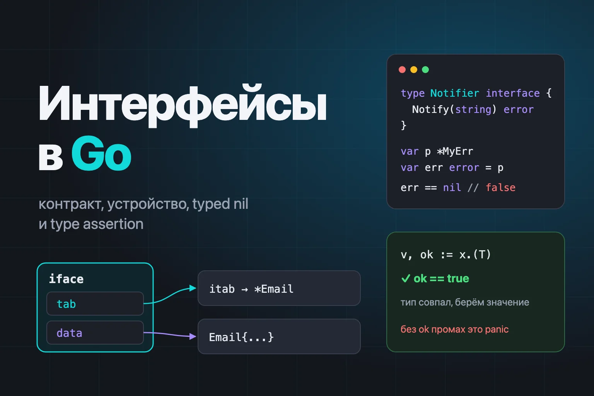
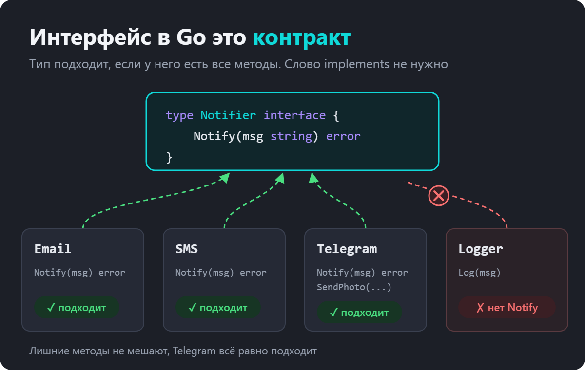
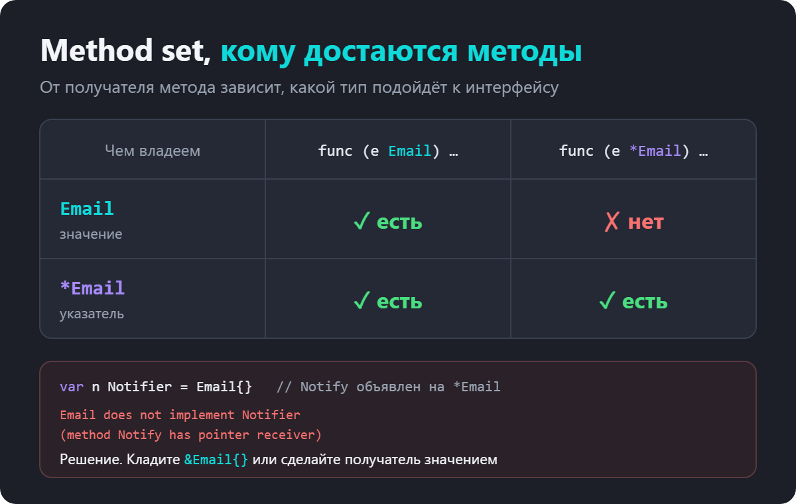
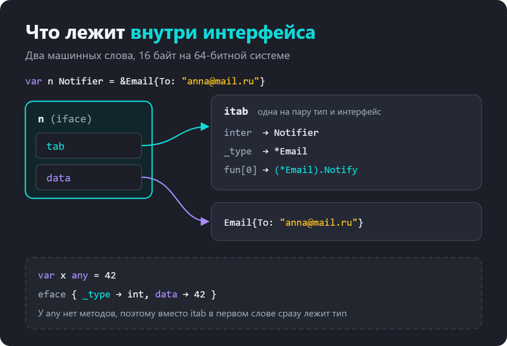
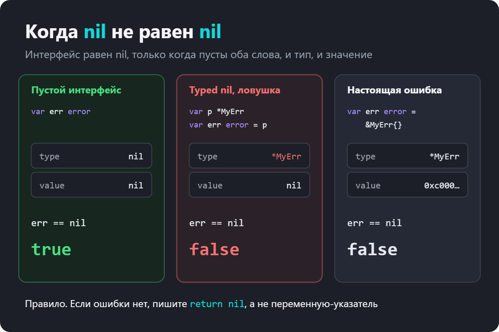
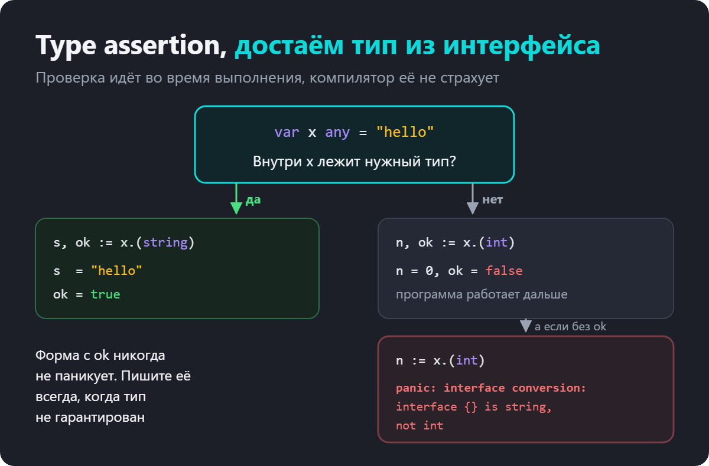
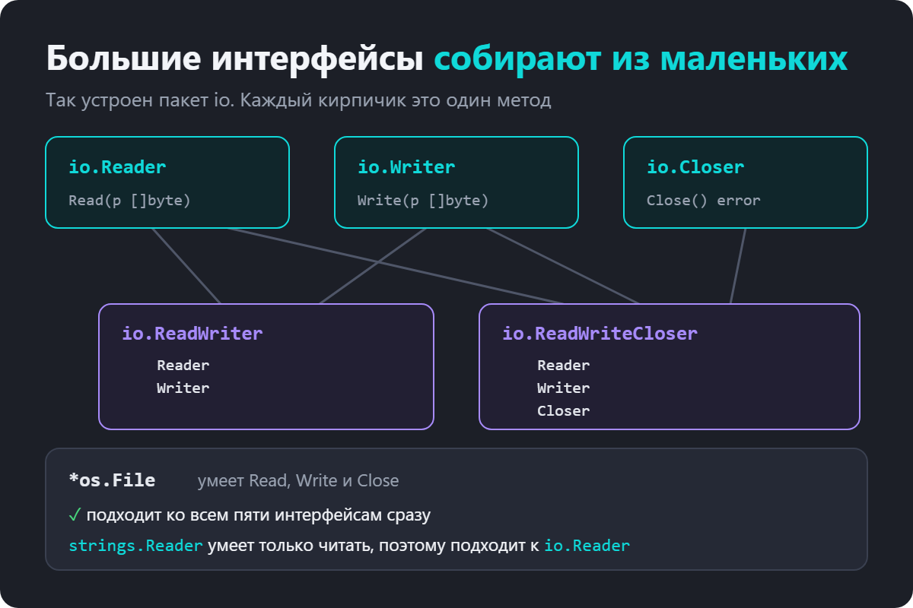
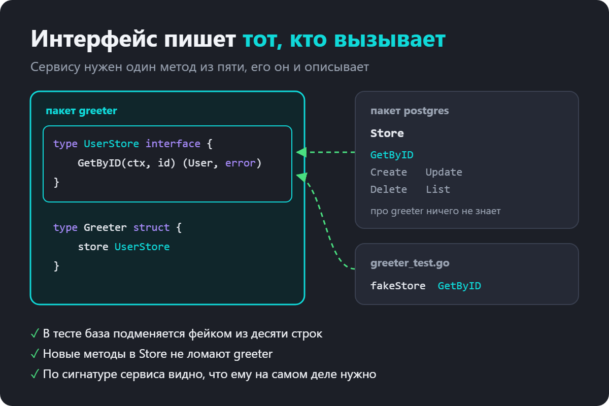
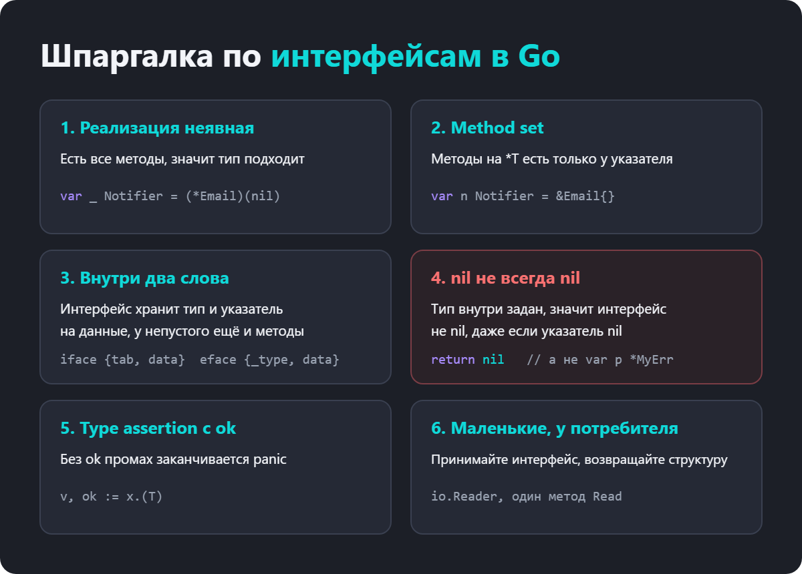

как устроен interface и почему nil не всегда равен nil



Интерфейсы в Go выглядят обманчиво просто. Объявил набор методов, написал тип с такими же методами, и всё работает. Слова implements нет, наследования нет, учить вроде бы нечего.

А потом начинаются странности.

компилятор пишет does not implement, хотя метод на месте
функция вернула nil, а проверка err != nil всё равно срабатывает
x.(int) роняет программу с panic
сравнение двух any внезапно паникует
непонятно, где объявлять интерфейс, рядом с реализацией или рядом с тем, кто его вызывает
Почти все эти вопросы задают на собеседованиях, от Junior до Senior. Хорошая новость в том, что за ними стоит одна простая модель. Разберёмся с ней один раз, и странности станут очевидными.

Вот что разберём по порядку.

что такое интерфейс и почему в Go он реализуется неявно
method set, или почему Email{} не подходит, а &Email{} подходит
как интерфейс устроен внутри, что такое iface, eface и itab
почему nil-указатель внутри error не равен nil
type assertion, type switch и пустой интерфейс any
встраивание интерфейсов на примере пакета io
где объявлять интерфейсы и какого они должны быть размера

Что такое интерфейс в Go
Интерфейс в Go это тип, который описывает поведение. В нём перечислены методы, и больше ничего. Ни полей, ни реализации.

type Notifier interface {
	Notify(msg string) error
}
Эта запись говорит одно, «мне подойдёт любое значение, у которого есть метод Notify(string) error». Неважно, отправляет оно письмо, SMS или сообщение в Telegram.

type Email struct{ To string }

func (e Email) Notify(msg string) error {
	fmt.Println("письмо для", e.To, msg)
	return nil
}

type SMS struct{ Phone string }

func (s SMS) Notify(msg string) error {
	fmt.Println("sms на", s.Phone, msg)
	return nil
}

func Broadcast(list []Notifier, msg string) {
	for _, n := range list {
		n.Notify(msg)
	}
}

func main() {
	Broadcast([]Notifier{
		Email{To: "anna@mail.ru"},
		SMS{Phone: "+7 900 000-00-00"},
	}, "Созвон в 19:00")
}
Функция Broadcast ничего не знает про Email и SMS. Она знает только контракт. Завтра появится Telegram с методом Notify, и Broadcast заработает с ним без единой правки.



Реализация неявная, implements не нужен
В Java или C# класс должен явно объявить, что реализует интерфейс, например class Email implements Notifier. В Go так не делают. Если у типа есть все методы интерфейса с точно такими же сигнатурами, тип подходит. Компилятор проверяет это сам.

Из этого следуют две важные вещи.

Тип может подходить к интерфейсам, о которых его автор не знал. Вы пишете свой Notifier, и чужой тип из библиотеки подходит к нему, если у него есть нужный метод. Ничего менять в библиотеке не нужно.

Лишние методы не мешают. Если у Telegram есть Notify и ещё SendPhoto, он всё равно подходит к Notifier. Интерфейс требует минимум, а не точное совпадение.

Как проверить реализацию на этапе компиляции
Раз связь неявная, легко случайно сломать её. Например, переименовать метод или поменять тип аргумента. Ошибка всплывёт только там, где тип передают в интерфейс, а это может быть другой пакет.

Поэтому в Go есть идиома, которая проверяет реализацию прямо рядом с типом.

var _ Notifier = Email{}
var _ Notifier = (*Telegram)(nil)
Переменная _ никуда не сохраняется и ничего не стоит во время выполнения. Но если Email перестанет подходить к Notifier, сборка упадёт с понятной ошибкой.

cannot use Bad{} (value of struct type Bad) as Shape value in variable declaration:
Bad does not implement Shape (missing method Area)
Запись (*Telegram)(nil) нужна, когда методы объявлены на указателе. Она создаёт nil-указатель нужного типа без аллокации. Почему тут важен указатель, разберём в следующем разделе.

Method set, или почему Email{} не подходит
Самая частая ошибка с интерфейсами выглядит так.

type Email struct{ To string }

func (e *Email) Notify(msg string) error {
	fmt.Println("письмо для", e.To, msg)
	return nil
}

func main() {
	var n Notifier = Email{To: "anna@mail.ru"}
}
cannot use Email{…} (value of struct type Email) as Notifier value in variable declaration:
Email does not implement Notifier (method Notify has pointer receiver)
Метод Notify есть, но объявлен с получателем *Email. А в интерфейс мы кладём значение Email.

У каждого типа есть method set, набор методов, которые к нему относятся. Правило такое.

У значения T в method set только методы с получателем T.
У указателя *T в method set все методы, и с получателем T, и с получателем *T.


Обычный вызов e.Notify("...") на переменной e Email при этом работает. Go сам берёт адрес переменной и вызывает метод на &e. Но с интерфейсом такой трюк невозможен. В интерфейсе лежит копия значения, и взять адрес этой копии так, чтобы изменения были видны снаружи, нельзя. Поэтому язык честно запрещает такую комбинацию.

Исправить можно двумя способами.

// 1. Класть в интерфейс указатель
var n Notifier = &Email{To: "anna@mail.ru"}

// 2. Сделать получатель значением, если метод не меняет структуру
func (e Email) Notify(msg string) error { ... }
Как выбрать? Если метод меняет поля, держит мьютекс или структура большая, нужен указатель. Если тип маленький и неизменяемый, хватит значения. И главное, не смешивайте получатели в одном типе без причины, иначе в голове придётся держать оба method set.

Как интерфейс устроен под капотом
Чтобы понять typed nil, сравнение интерфейсов и стоимость вызова, нужно один раз заглянуть внутрь.

Переменная интерфейсного типа занимает два машинных слова, 16 байт на 64-битной системе. Для интерфейса с методами runtime использует структуру iface.

type iface struct {
	tab  *itab          // какой тип внутри и где его методы
	data unsafe.Pointer // указатель на сами данные
}
itab это таблица, в которой лежат тип интерфейса, конкретный тип значения и адреса методов. Runtime строит её один раз на каждую пару «интерфейс и конкретный тип» и кэширует.



Когда вы вызываете n.Notify("..."), Go берёт tab, находит в нём адрес метода и вызывает его, передав data как получателя. Это и есть динамическая диспетчеризация. Один косвенный переход, никакого поиска по имени во время выполнения.

У пустого интерфейса any методов нет, поэтому таблица ему не нужна. Его структура называется eface, и в первом слове сразу лежит тип.

type eface struct {
	_type *_type
	data  unsafe.Pointer
}
Что происходит со значением при упаковке в интерфейс
Если положить в интерфейс указатель, в data окажется сам этот указатель. Если положить значение, Go сделает его копию и запишет в data адрес копии.

type User struct{ Name string }

func (u User) String() string { return u.Name }

func main() {
	u := User{Name: "Анна"}
	var s fmt.Stringer = u
	u.Name = "Борис"
	fmt.Println(s, u) // Анна Борис

	p := &User{Name: "Анна"}
	var sp fmt.Stringer = p
	p.Name = "Борис"
	fmt.Println(sp) // Борис
}
В первом случае интерфейс хранит свою копию, и изменение u его не трогает. Во втором внутри указатель, поэтому изменение видно.

У копии есть цена. Обычно она уезжает в кучу, а значит, это аллокация и работа для сборщика мусора. В обычном коде это незаметно. В горячем цикле, который миллион раз упаковывает структуры в any, это уже видно в профиле.

Почему nil не равен nil
Теперь главная ловушка, которую спрашивают почти на каждом собеседовании.

type MyErr struct{}

func (e *MyErr) Error() string { return "my error" }

func validate(ok bool) error {
	var err *MyErr
	if !ok {
		err = &MyErr{}
	}
	return err
}

func main() {
	err := validate(true)
	fmt.Println(err == nil) // false
	fmt.Printf("%T\n", err) // *main.MyErr
}
Проверка прошла успешно, ошибки нет, а err == nil возвращает false. Код вызывающей стороны решит, что случилась ошибка.

Вспомним устройство. Интерфейс равен nil, только когда оба слова пустые, и тип, и значение. В validate мы вернули переменную типа *MyErr. Её значение nil, но при упаковке в error в первое слово записался тип *MyErr. Интерфейс больше не пустой.


Такое значение называют typed nil. Лечится оно просто, литералом nil там, где ошибки нет.

func validate(ok bool) error {
	if !ok {
		return &MyErr{}
	}
	return nil
}
Отсюда общее правило. Функция, которая возвращает интерфейс, не должна возвращать переменную конкретного типа, которая может оказаться nil. Особенно это касается error.

Сравнение интерфейсов
Два интерфейсных значения равны, если у них одинаковый динамический тип и равные значения.

var a, b any = 1, 1
fmt.Println(a == b) // true

var c, d any = 1, int64(1)
fmt.Println(c == d) // false, типы int и int64 разные
Подвох в том, что компилятор пропускает сравнение любых интерфейсов, а реальные типы внутри могут быть несравнимыми. Слайсы, map и функции через == сравнивать нельзя, и это выясняется только во время выполнения.

var a, b any = []int{1}, []int{1}
fmt.Println(a == b)
// panic: runtime error: comparing uncomparable type []int
Та же история с ключами map. Тип map[any]int компилируется, но попытка положить в него слайс ключом закончится panic: runtime error: hash of unhashable type []int.


При сравнении интерфейса с nil возвращается true, только если и тип, и значение интерфейса = nil.

Интерфейс в Go — структура, состоит из двух компонентов:
1. Указатель на type: Содержит информацию о типе данных, который реализует интерфейс: *MyStruct.
2. Указатель на value: Содержит конкретное значение этого типа: указатель на структуру или nil.

```go
package main

import "fmt"

type MyInterface interface {
  Method()
}

type MyStruct struct{}

func (m *MyStruct) Method() {
  fmt.Println("Hi, Mark!")
}

func main() {
  var i MyInterface     // интерфейс не инициализирован, тип и значение = nil
  fmt.Println(i == nil) // true

  var s *MyStruct = nil // указатель на структуру = nil
  i = s                 // интерфейс содержит тип *MyStruct, значение nil
  fmt.Println(i == nil) // false
}
```

Сравниваете интерфейс с nil, проверяет оба компонента и, если хотя бы один из них != nil, интерфейс не считается nil.


Пустой интерфейс any
Интерфейс без методов, interface{}, подходит к любому значению, ведь любое значение имеет «все методы» из пустого списка. С Go 1.18 у него есть короткое имя any, это просто псевдоним.

var x any
x = 42
x = "строка"
x = []int{1, 2, 3}
any встречается там, где тип действительно заранее неизвестен. Это fmt.Println, json.Unmarshal в произвольную структуру, контейнеры значений из конфигов.

Но каждый any в сигнатуре означает, что компилятор больше не проверяет типы. Проверять будете вы, руками, через type assertion. Поэтому если тип известен, пишите его. Если функция должна работать с разными типами одинаково, сейчас для этого есть generics.

Type assertion, как достать тип обратно
Положить значение в интерфейс легко. Чтобы достать его обратно как конкретный тип, нужен type assertion.

var x any = "hello"

s, ok := x.(string)
fmt.Println(s, ok) // hello true

n, ok := x.(int)
fmt.Println(n, ok) // 0 false
Если тип совпал, получаем значение и true. Если нет, получаем нулевое значение типа и false, программа работает дальше.

У этой записи есть вторая форма, без ok. Вот она опасна.

n := x.(int)
// panic: interface conversion: interface {} is string, not int



Правило простое. Форма без ok годится, только когда тип гарантирован логикой программы и промах означает баг. Во всех остальных случаях пишите v, ok := x.(T).

Проверка на другой интерфейс
Type assertion умеет проверять не только конкретный тип, но и интерфейс. Так спрашивают «а умеет ли это значение ещё что-то?».

var w io.Writer = os.Stdout

if rw, ok := w.(io.ReadWriter); ok {
	// у os.Stdout есть и Read, можно читать
	_ = rw
}
Так устроена куча оптимизаций в стандартной библиотеке. Например, io.Copy проверяет, нет ли у источника метода WriteTo, и если есть, отдаёт копирование ему.

Type switch, когда вариантов несколько
Если вариантов типа много, цепочка из type assertion становится нечитаемой. Для этого есть type switch.

func describe(v any) string {
	switch x := v.(type) {
	case nil:
		return "nil"
	case int:
		return fmt.Sprintf("int %d", x)
	case string:
		return fmt.Sprintf("string длиной %d", len(x))
	case fmt.Stringer:
		return "Stringer " + x.String()
	case error:
		return "error " + x.Error()
	default:
		return fmt.Sprintf("неизвестный тип %T", x)
	}
}
Внутри каждой ветки x уже имеет нужный тип. В ветке int это int, в ветке fmt.Stringer это fmt.Stringer.

Два нюанса, на которых спотыкаются.

Порядок веток важен. Выполняется первая подходящая. Если значение подходит и под fmt.Stringer, и под error, сработает та ветка, что выше.

Конкретный тип сравнивается точно. Если объявить type Celsius float64, значение Celsius(20) не попадёт в ветку case float64. Для type switch это разные типы, хоть и с одинаковым устройством.

Встраивание интерфейсов
Интерфейсы можно собирать из других интерфейсов. Лучший пример в стандартной библиотеке это пакет io.

type Reader interface {
	Read(p []byte) (n int, err error)
}

type Writer interface {
	Write(p []byte) (n int, err error)
}

type Closer interface {
	Close() error
}

type ReadWriter interface {
	Reader
	Writer
}

type ReadWriteCloser interface {
	Reader
	Writer
	Closer
}
ReadWriter требует оба метода сразу. Тип *os.File умеет Read, Write и Close, поэтому подходит ко всем пяти интерфейсам. А strings.Reader писать не умеет и подходит только к io.Reader.


Сила этой конструкции в маленьких кирпичиках. Функции io.Copy нужен только Reader с одной стороны и Writer с другой. Поэтому она одинаково копирует файл в HTTP-ответ, сетевое соединение в буфер и строку в stdout.

Можно даже сделать свой Reader, который оборачивает чужой.

type upper struct{ r io.Reader }

func (u upper) Read(p []byte) (int, error) {
	n, err := u.r.Read(p)
	copy(p, strings.ToUpper(string(p[:n])))
	return n, err
}

func main() {
	io.Copy(os.Stdout, upper{strings.NewReader("hello, reader\n")})
	// HELLO, READER
}
Пример учебный, он ломается на многобайтных символах, если буфер разрежет букву пополам. Но идея видна. Пять строк кода, и наш тип работает со всем, что принимает io.Reader.

Интерфейсы стандартной библиотеки, которые нужно знать
Их стоит помнить наизусть, они встречаются в каждом проекте.

error с методом Error() string. Любая ошибка в Go это значение, которое подходит к этому интерфейсу.
fmt.Stringer с методом String() string. Если он есть, fmt.Println печатает результат вызова, а не поля структуры.
io.Reader и io.Writer. Чтение и запись байтов из файлов, сети, буферов и HTTP.
http.Handler с методом ServeHTTP(w, r). На нём построен весь net/http, включая роутеры.
sort.Interface с методами Len, Less и Swap. Сейчас чаще пишут slices.SortFunc, но вопрос про sort.Interface на собеседованиях живёт.
context.Context. Да, это тоже интерфейс, поэтому его так легко оборачивать.
type Celsius float64

func (c Celsius) String() string {
	return fmt.Sprintf("%.1f°C", float64(c))
}

func main() {
	var t Celsius = 36.6
	fmt.Println(t) // 36.6°C
}
Где объявлять интерфейс и какого он должен быть размера
Это уже вопрос не синтаксиса, а дизайна. Именно на нём видно разницу между Junior и Middle.

Интерфейс объявляет тот, кто его использует
В Java привыкли класть интерфейс рядом с реализацией, например UserRepository и UserRepositoryImpl в одном пакете. В Go обычно наоборот. Пакет с реализацией отдаёт конкретную структуру, а интерфейс объявляет пакет, которому эта структура нужна, и описывает только те методы, которые сам вызывает.

package greeter

type UserStore interface {
	GetByID(ctx context.Context, id int64) (User, error)
}

type Greeter struct {
	store UserStore
}

func NewGreeter(store UserStore) *Greeter {
	return &Greeter{store: store}
}

func (g *Greeter) Greet(ctx context.Context, id int64) (string, error) {
	u, err := g.store.GetByID(ctx, id)
	if err != nil {
		return "", fmt.Errorf("greet %d: %w", id, err)
	}
	return "Привет, " + u.Email, nil
}
У postgres.Store может быть ещё десять методов. Greeter про них не знает и не должен знать.



Главный выигрыш виден в тестах. Базу не нужно поднимать, достаточно фейка.

type fakeStore struct {
	users map[int64]User
}

func (f fakeStore) GetByID(_ context.Context, id int64) (User, error) {
	u, ok := f.users[id]
	if !ok {
		return User{}, ErrNotFound
	}
	return u, nil
}

func TestGreet(t *testing.T) {
	g := NewGreeter(fakeStore{users: map[int64]User{
		1: {ID: 1, Email: "anna@mail.ru"},
	}})

	got, err := g.Greet(context.Background(), 1)
	if err != nil || got != "Привет, anna@mail.ru" {
		t.Fatalf("got %q, %v", got, err)
	}

	_, err = g.Greet(context.Background(), 2)
	if !errors.Is(err, ErrNotFound) {
		t.Fatalf("want ErrNotFound, got %v", err)
	}
}
Ни моков из генератора, ни Docker в тестах. Десять строк, и сервис проверен на обоих сценариях.

Принимайте интерфейсы, возвращайте структуры
Это короткая формулировка того же принципа. Функция принимает интерфейс, чтобы ей можно было передать что угодно подходящее. А конструктор возвращает конкретный тип, чтобы вызывающий видел все его методы и сам решал, через какой интерфейс с ним работать.

// хорошо
func NewStore(db *pgxpool.Pool) *Store

// обычно лишнее
func NewStore(db *pgxpool.Pool) StoreInterface
Исключение одно и очень известное. Это error, его всегда возвращают интерфейсом.

Чем меньше интерфейс, тем он полезнее
В стандартной библиотеке большинство интерфейсов состоят из одного или двух методов. Роб Пайк сформулировал это как одну из поговорок Go. Чем больше интерфейс, тем слабее абстракция.

Интерфейс на пятнадцать методов подходит ровно к одной реализации и к её моку. Интерфейс на один метод подходит к десяткам типов. Интерфейсы из одного метода по традиции называют глаголом с суффиксом -er, например Reader, Writer, Notifier, Stringer.

Не заводите интерфейс заранее
Частая привычка из других языков это сразу писать интерфейс к каждой структуре, «на будущее». В Go это лишний код. Интерфейс появляется, когда реализаций стало две, или когда его нужно подменить в тесте. До этого хватает конкретного типа.

Интерфейсы и generics
С Go 1.18 интерфейсы получили вторую роль. Ими описывают ограничения для параметров типа.

type Number interface {
	~int | ~int64 | ~float64
}

func Sum[T Number](xs []T) T {
	var s T
	for _, x := range xs {
		s += x
	}
	return s
}

func main() {
	fmt.Println(Sum([]int{1, 2, 3}), Sum([]float64{1.5, 2.5})) // 6 4
}
Запись ~int означает «int и любой тип, у которого int в основе», например type Age int.

Важная деталь. Интерфейс со списком типов можно использовать только как ограничение. Объявить переменную такого типа нельзя.

var n Number
// cannot use type Number outside a type constraint: interface contains type constraints
Как выбирать между ними? Если функция одинаково работает с разными типами и тип известен на этапе компиляции, берите generics. Если поведение разное и выбирается во время выполнения, нужен обычный интерфейс.

Частые ошибки
Ошибка 1. Метод объявлен на указателе, а в интерфейс кладут значение

Компилятор напишет method Notify has pointer receiver. Кладите &Email{} или меняйте получатель.

Ошибка 2. Возвращать nil-указатель как error

Typed nil, самая известная ловушка. Если ошибки нет, пишите return nil.

Ошибка 3. Type assertion без ok там, где тип не гарантирован

Первый же неожиданный тип уронит программу с panic.

Ошибка 4. any повсюду

Каждый any выключает проверку типов. Если тип известен, пишите его, если типов несколько и логика одна, берите generics.

Ошибка 5. Огромные интерфейсы рядом с реализацией

Интерфейс на пятнадцать методов, который лежит в том же пакете, что и единственная реализация, ничего не абстрагирует. Он только добавляет файл, который нужно обновлять.

Ошибка 6. Сравнивать интерфейсы, внутри которых могут быть слайсы или map

Компилятор пропустит, а во время выполнения будет panic.

Ошибка 7. Ждать, что изменение значения отразится в интерфейсе

В интерфейс копируется значение. Если нужно видеть изменения, кладите указатель.

Что спрашивают на собеседовании
Что такое интерфейс в Go?

Тип, который описывает набор методов. Любой тип, у которого есть все эти методы, подходит к интерфейсу автоматически, без явного объявления.

Чем интерфейсы Go отличаются от интерфейсов Java?

Реализация неявная, ключевого слова implements нет. Интерфейс обычно объявляет потребитель, а не автор реализации.

Как проверить, что тип реализует интерфейс, на этапе компиляции?

Строкой var _ Iface = (*T)(nil) или var _ Iface = T{} рядом с типом.

Почему тип с методом на указателе не подходит к интерфейсу?

Из-за method set. У значения T нет методов с получателем *T. А взять адрес значения внутри интерфейса нельзя, поэтому язык это запрещает.

Как интерфейс устроен внутри?

Два слова. Для интерфейса с методами это указатель на itab (тип и таблица методов) и указатель на данные. Для any это указатель на тип и указатель на данные.

Почему интерфейс с nil-указателем внутри не равен nil?

Интерфейс равен nil, только когда пусты и тип, и значение. У typed nil тип записан, значит интерфейс не пустой.

Что будет, если сделать type assertion на неверный тип?

Форма v, ok := x.(T) вернёт нулевое значение и false. Форма v := x.(T) вызовет panic.

Можно ли сравнивать интерфейсы через ==?

Можно. Они равны, если совпадают динамические типы и значения. Если внутри несравнимый тип, например слайс, будет panic во время выполнения.

Что такое any?

Псевдоним для interface{}, появился в Go 1.18. К нему подходит любое значение.

Где лучше объявлять интерфейс?

В пакете, который его использует, и только с теми методами, которые он вызывает.

Почему говорят «принимай интерфейсы, возвращай структуры»?

Принимая интерфейс, функция работает с любой подходящей реализацией и легко тестируется. Возвращая структуру, конструктор не прячет методы и не навязывает абстракцию, которая может не понадобиться.

Чем интерфейс-ограничение в generics отличается от обычного?

Ограничение может содержать список типов, например ~int | ~float64. Такой интерфейс годится только для параметров типа, переменную с ним объявить нельзя.

Шпаргалка по интерфейсам в Golang


Если сжать всю статью до нескольких строк, получится так.

Интерфейс это контракт по методам, реализация неявная.
Методы на *T есть только у указателя, поэтому в интерфейс часто кладут &T{}.
Внутри интерфейса два слова, тип и данные.
Интерфейс равен nil, только когда пусты оба слова. Возвращайте литерал nil.
Type assertion пишите с ok, type switch для нескольких вариантов.
Интерфейсы держите маленькими и объявляйте там, где их вызывают.
Лучший способ закрепить тему это руками прогнать примеры из статьи. Отдельно поломайте typed nil и method set, посмотрите на ошибки компилятора и panic своими глазами. После этого вопросы про интерфейсы на собеседовании перестанут пугать.
