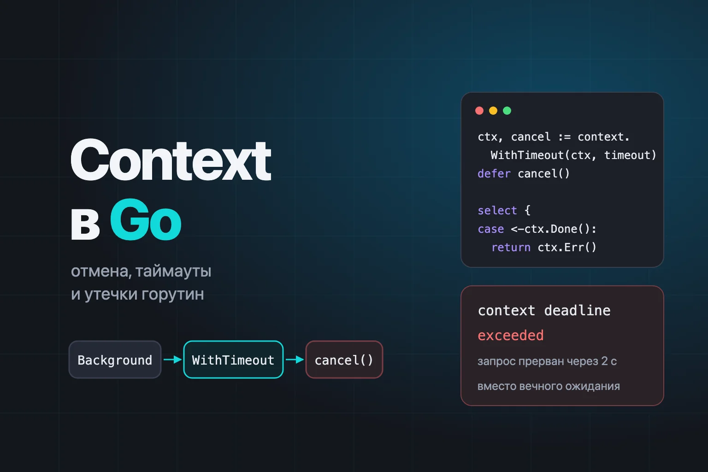
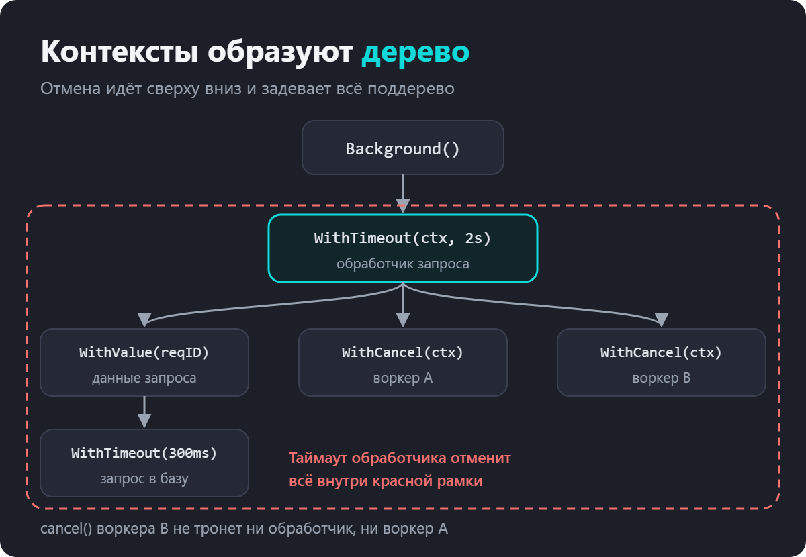
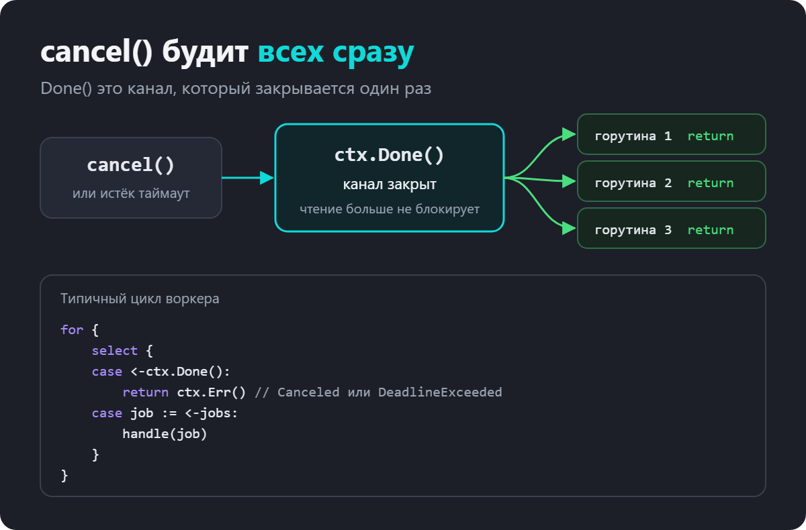
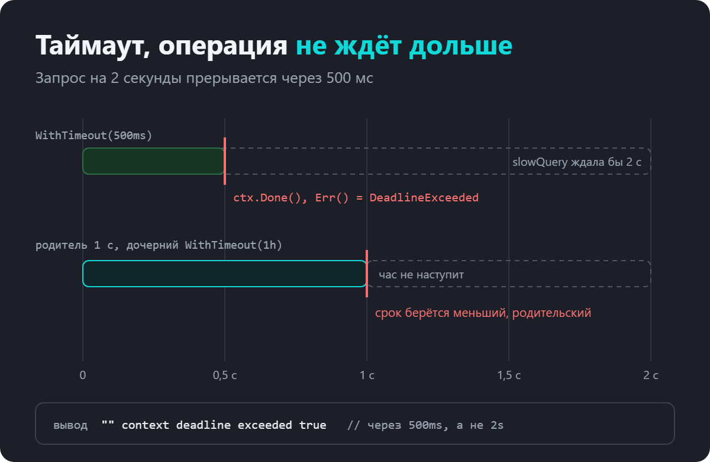
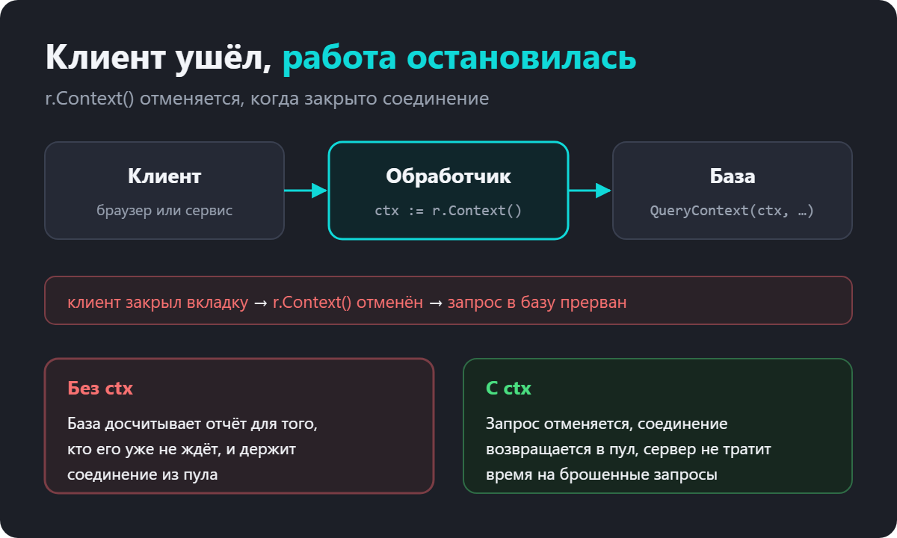
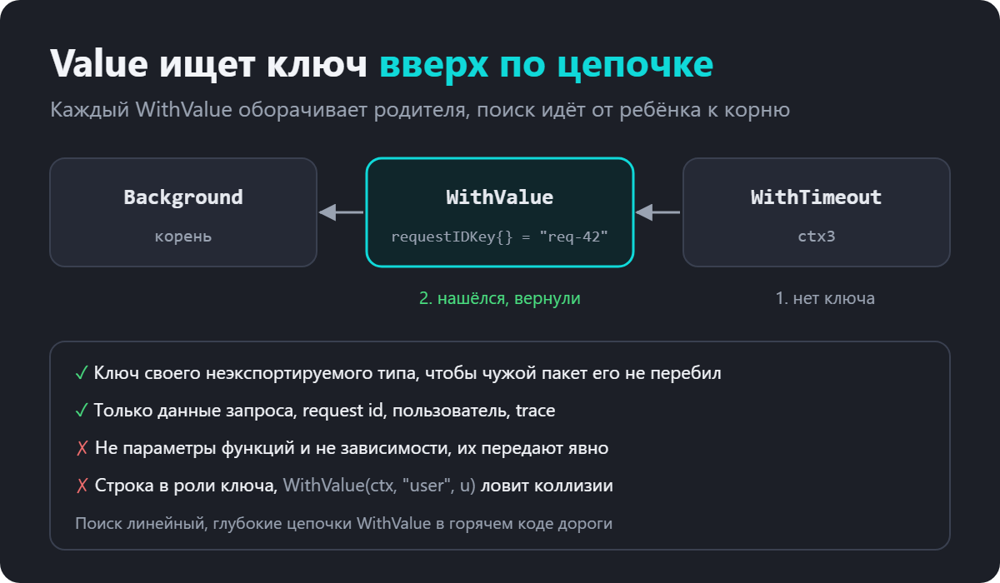
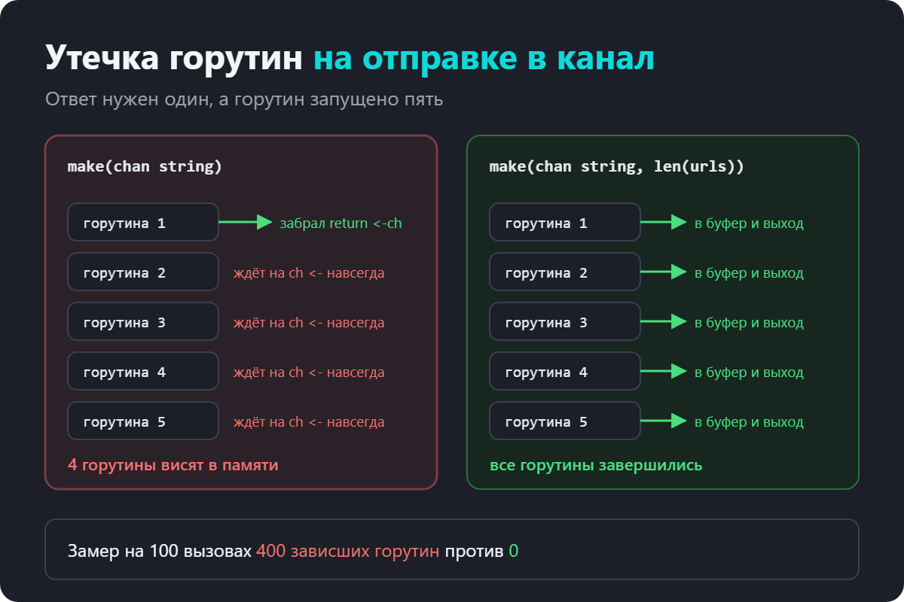
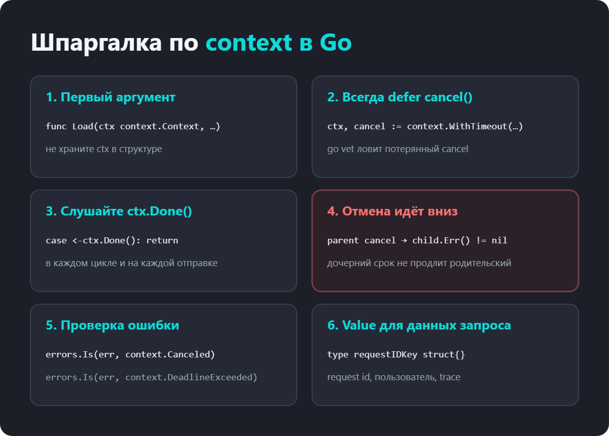

как отменять горутины, ставить таймауты и не терять запросы

Пока программа маленькая, без context легко обойтись. Запустили горутину, она поработала и завершилась. Проблемы начинаются в сервисе, который отвечает на запросы.

клиент давно закрыл вкладку, а сервер всё ещё считает для него отчёт
запрос к внешнему API висит минуту, и вместе с ним висит обработчик
горутины копятся, память растёт, и через пару дней сервис перезапускают
в коде каждая функция принимает ctx, но непонятно, зачем
Всё это решает один пакет context. Он отвечает на вопрос «эту работу ещё кто-то ждёт?» и умеет донести ответ до каждой горутины, которая участвует в запросе. На собеседованиях про него спрашивают почти всегда, обычно вместе с горутинами и каналами.

Вот что разберём по порядку.

что такое context и почему контексты образуют дерево
WithCancel, WithTimeout и WithDeadline
как горутина узнаёт об отмене и почему нужен defer cancel()
context в HTTP-сервере и клиенте
WithValue и что в него можно класть
errgroup, WithCancelCause, AfterFunc и WithoutCancel
как context помогает не допустить утечку горутин

Что такое context в Go
Context это значение, которое передают вниз по цепочке вызовов, чтобы сообщить всем участникам три вещи. Работу пора прекратить. Вот срок, до которого её нужно закончить. Вот данные, которые относятся к этому запросу.

По устройству это обычный интерфейс из четырёх методов.

type Context interface {
	Deadline() (deadline time.Time, ok bool)
	Done() <-chan struct{}
	Err() error
	Value(key any) any
}
Done() возвращает канал, который закрывается, когда работу нужно прекратить.
Err() объясняет причину. До отмены это nil, после context.Canceled или context.DeadlineExceeded.
Deadline() сообщает срок, если он есть.
Value() достаёт данные запроса по ключу.
Важно, что context ничего не останавливает сам. Он только сообщает. Остановиться должна ваша горутина, когда увидит сигнал.

Background и TODO
Любой контекст создаётся от родителя. В самом корне стоит context.Background(), пустой контекст без срока и без отмены. Его берут в main, в тестах и при старте фоновых задач.

ctx := context.Background()
context.TODO() устроен так же, но означает «здесь должен быть настоящий контекст, просто я ещё не протянул его сверху». Это пометка для читателя и линтеров, а не отдельная функциональность.

Передавать вместо контекста nil нельзя. Функции пакета упадут сразу.

var ctx context.Context
context.WithCancel(ctx)
// panic: cannot create context from nil parent
Контексты образуют дерево
Новый контекст всегда оборачивает родителя. Обработчик запроса берёт контекст запроса и добавляет таймаут. Воркер внутри обработчика добавляет свою отмену. Запрос к базе добавляет короткий таймаут. Получается дерево.

Главное правило дерева. Отмена идёт только вниз. Если отменить родителя, отменятся все потомки. Если отменить потомка, родитель и соседи этого не заметят.

parent, cancelParent := context.WithCancel(context.Background())
child, cancelChild := context.WithCancel(parent)

cancelChild()
fmt.Println(parent.Err(), child.Err()) // <nil> context canceled

other, cancelOther := context.WithCancel(parent)
defer cancelOther()

cancelParent()
fmt.Println(parent.Err(), other.Err()) // context canceled context canceled
Именно поэтому таймаут на уровне обработчика HTTP надёжно гасит всю работу запроса, сколько бы горутин она ни запустила. Достаточно, чтобы каждая из них получила свой контекст от контекста запроса.

WithCancel, отмена по команде
context.WithCancel возвращает новый контекст и функцию cancel. Вызов cancel закрывает канал Done() у этого контекста и у всех его потомков.

Классический пример это генератор, который отдаёт значения, пока они кому-то нужны.

func generate(ctx context.Context) <-chan int {
	ch := make(chan int)
	go func() {
		defer close(ch)
		for i := 0; ; i++ {
			select {
			case <-ctx.Done():
				return
			case ch <- i:
			}
		}
	}()
	return ch
}

func main() {
	ctx, cancel := context.WithCancel(context.Background())
	defer cancel()

	for n := range generate(ctx) {
		fmt.Println(n)
		if n == 3 {
			break
		}
	}
	cancel()
	fmt.Println(ctx.Err()) // context canceled
}
Без контекста горутина-генератор так и осталась бы висеть на ch <- i, потому что читать из канала больше некому. С контекстом она видит закрытый Done() и выходит.

Как горутина узнаёт об отмене
Done() это канал, в который никто ничего не пишет. Его только закрывают, один раз. Чтение из закрытого канала не блокируется, поэтому все горутины, которые ждут в select, просыпаются одновременно.

Отсюда типичная форма цикла воркера.

for {
	select {
	case <-ctx.Done():
		return ctx.Err()
	case job := <-jobs:
		handle(job)
	}
}
Если работа идёт без каналов, например долгий расчёт в цикле, проверяйте контекст между итерациями.

for _, row := range rows {
	if err := ctx.Err(); err != nil {
		return err
	}
	process(row)
}
Почему defer cancel() обязателен
Каждый WithCancel, WithTimeout и WithDeadline регистрирует ребёнка у родителя, а таймауты ещё и запускают таймер. Пока не вызван cancel или не отменён родитель, эти ресурсы живут. Если родитель долгоживущий, например Background(), утечка копится с каждым вызовом.

Поэтому правило без исключений. Получили cancel, сразу пишете defer cancel(). Даже если операция закончится раньше срока, лишний вызов ничего не сломает, cancel можно вызывать сколько угодно раз.

go vet ловит забытый cancel сам.

ctx, _ := context.WithTimeout(context.Background(), time.Second)
the cancel function returned by context.WithTimeout should be called,
not discarded, to avoid a context leak
WithTimeout и WithDeadline, отмена по сроку
WithTimeout отменяет контекст через заданное время, WithDeadline в заданный момент. Это одно и то же, WithTimeout(ctx, d) просто вызывает WithDeadline(ctx, time.Now().Add(d)).

Смоделируем медленный запрос, который отвечает через две секунды, и дадим ему полсекунды.

func slowQuery(ctx context.Context) (string, error) {
	select {
	case <-time.After(2 * time.Second):
		return "данные", nil
	case <-ctx.Done():
		return "", ctx.Err()
	}
}

func main() {
	ctx, cancel := context.WithTimeout(context.Background(), 500*time.Millisecond)
	defer cancel()

	res, err := slowQuery(ctx)
	fmt.Printf("%q %v %v\n", res, err, errors.Is(err, context.DeadlineExceeded))
	// "" context deadline exceeded true
}
Функция вернулась через 500 мс, а не через две секунды. Причину отличаем через errors.Is. context.DeadlineExceeded значит, что вышло время, context.Canceled значит, что работу отменили явно.

Дочерний таймаут не продлевает родительский
Срок наследуется вниз, и у потомка он не может быть позже, чем у родителя. Если обработчику дали секунду, а внутри кто-то написал WithTimeout(ctx, time.Hour), контекст всё равно отменится через секунду.

short, c1 := context.WithTimeout(context.Background(), time.Second)
defer c1()
long, c2 := context.WithTimeout(short, time.Hour)
defer c2()

d1, _ := short.Deadline()
d2, _ := long.Deadline()
fmt.Println(d1.Equal(d2)) // true
Это удобно. Внутренний код может спокойно ставить свои короткие таймауты на отдельные шаги и не бояться, что сломает общий срок запроса.

Context в HTTP-сервере и клиенте
В net/http контекст уже встроен. У каждого входящего запроса есть r.Context(), и он отменяется, когда клиент закрыл соединение или сервер завершает работу.

func report(w http.ResponseWriter, r *http.Request) {
	ctx := r.Context()
	select {
	case <-time.After(2 * time.Second):
		fmt.Fprintln(w, "отчёт готов")
	case <-ctx.Done():
		fmt.Println("клиент ушёл:", ctx.Err())
	}
}
Со стороны клиента контекст передают через http.NewRequestWithContext. Тогда таймаут обрывает и ожидание ответа, и чтение тела.

ctx, cancel := context.WithTimeout(context.Background(), 300*time.Millisecond)
defer cancel()

req, _ := http.NewRequestWithContext(ctx, http.MethodGet, url, nil)
resp, err := http.DefaultClient.Do(req)
Если запустить этот клиент против обработчика report, получится такой вывод.

клиент ушёл: context canceled
ошибка клиента: Get "http://127.0.0.1:54660": context deadline exceeded
Клиент перестал ждать через 300 мс, соединение закрылось, и сервер тут же узнал об этом через r.Context().

Дальше контекст нужно передать во всё, что умеет его принимать. Это db.QueryContext, db.ExecContext, pgxpool.Pool.Query(ctx, …), клиенты Redis и Kafka, gRPC. Тогда брошенный клиентом запрос не будет держать соединение с базой и считать результат, который никто не прочитает.

WithValue, данные запроса
context.WithValue кладёт в контекст пару «ключ и значение». Её видят все потомки.

type requestIDKey struct{}

func WithRequestID(ctx context.Context, id string) context.Context {
	return context.WithValue(ctx, requestIDKey{}, id)
}

func RequestID(ctx context.Context) (string, bool) {
	id, ok := ctx.Value(requestIDKey{}).(string)
	return id, ok
}

func main() {
	ctx := WithRequestID(context.Background(), "req-42")
	ctx, cancel := context.WithTimeout(ctx, time.Second)
	defer cancel()

	fmt.Println(RequestID(ctx))                  // req-42 true
	fmt.Println(RequestID(context.Background())) //  false
}
Ключ здесь неэкспортируемого типа requestIDKey. Это защищает от коллизий. Если бы ключом была строка "request_id", любой другой пакет с такой же строкой случайно перезаписал бы значение. Свой тип из другого пакета повторить нельзя.

Value ищет ключ от текущего контекста вверх к родителям. Поэтому значение, положенное выше по дереву, видно всем, кто ниже.

Что можно класть в Value. Данные, которые относятся именно к этому запросу и проходят через все слои. Request id для логов, текущий пользователь, trace id.

Что класть нельзя. Параметры функций, подключение к базе, логгер, конфиг. Если функции нужна зависимость, она должна быть видна в её сигнатуре. Иначе код превращается в угадайку, где неясно, что функция использует и почему падает.

errgroup, первая ошибка отменяет остальных
Частая задача. Запустить несколько загрузок параллельно, дождаться всех, а если одна упала, остальные остановить. Вручную это WaitGroup, канал ошибок и cancel. Готовое решение лежит в пакете golang.org/x/sync/errgroup.

func load(ctx context.Context, name string, d time.Duration, fail bool) error {
	select {
	case <-time.After(d):
		if fail {
			return errors.New(name + " недоступен")
		}
		fmt.Println(name, "загружен")
		return nil
	case <-ctx.Done():
		fmt.Println(name, "отменён:", ctx.Err())
		return ctx.Err()
	}
}

func main() {
	g, ctx := errgroup.WithContext(context.Background())

	g.Go(func() error { return load(ctx, "профиль", 50*time.Millisecond, false) })
	g.Go(func() error { return load(ctx, "заказы", 100*time.Millisecond, true) })
	g.Go(func() error { return load(ctx, "рекомендации", time.Second, false) })

	fmt.Println("ошибка:", g.Wait())
}
профиль загружен
рекомендации отменён: context canceled
ошибка: заказы недоступен
«Заказы» упали через 100 мс, группа отменила свой контекст, и «рекомендации» не стали ждать секунду. Wait вернул первую ошибку. Обратите внимание, что горутины получают ctx из errgroup.WithContext, а не исходный, иначе отмена до них не дойдёт.

WithCancelCause, AfterFunc и WithoutCancel
В Go 1.20 и 1.21 в пакет добавили несколько полезных функций.

WithCancelCause позволяет отменить контекст с конкретной причиной. Err() по-прежнему вернёт context.Canceled, а настоящую причину достанет context.Cause.

ctx, cancel := context.WithCancelCause(context.Background())
cancel(errors.New("платёж отклонён"))

fmt.Println(ctx.Err())          // context canceled
fmt.Println(context.Cause(ctx)) // платёж отклонён
Для таймаутов есть пары WithTimeoutCause и WithDeadlineCause.

AfterFunc вызывает функцию в отдельной горутине, когда контекст отменён. Удобно, чтобы закрыть соединение или освободить ресурс, не заводя для этого свою горутину с select.

stop := context.AfterFunc(ctx, func() {
	fmt.Println("закрываем соединение")
})
defer stop()
WithoutCancel создаёт контекст, который видит значения родителя, но не отменяется вместе с ним. Это для работы, которая должна закончиться даже после ответа клиенту. Например, записать аудит или отправить событие.

reqCtx, reqCancel := context.WithCancel(WithRequestID(context.Background(), "req-7"))
bg := context.WithoutCancel(reqCtx)
reqCancel()

id, _ := RequestID(bg)
fmt.Println(reqCtx.Err(), bg.Err(), id) // context canceled <nil> req-7
Утечка горутин и как context её предотвращает
Утечка горутин это горутина, которая никогда не завершится. Она держит свой стек и всё, на что ссылается. Сборщик мусора её не уберёт, потому что формально она жива.

Самый частый сценарий. Нужен первый ответ из нескольких источников, и для каждого запускается горутина.

func firstLeaky(ctx context.Context, urls []string) string {
	ch := make(chan string)
	for _, u := range urls {
		go func() { ch <- fetch(ctx, u) }()
	}
	return <-ch
}
Функция забирает первый ответ и возвращается. Остальные горутины пытаются отправить в канал, а читать его больше некому. Они висят на ch <- до конца жизни программы.

Я прогнал такой код сто раз с пятью источниками. После этого в программе висело 400 горутин. Исправление в одну строку, канал с буфером на всех.

ch := make(chan string, len(urls))
Каждая горутина кладёт ответ в буфер и завершается. Те же сто вызовов дают ноль зависших горутин.

Второй вариант, когда буфер не подходит, это select на отправке плюс отмена контекста после первого ответа.

func first(ctx context.Context, urls []string) string {
	ctx, cancel := context.WithCancel(ctx)
	defer cancel() // остальные увидят отмену и выйдут

	ch := make(chan string)
	for _, u := range urls {
		go func() {
			select {
			case ch <- fetch(ctx, u):
			case <-ctx.Done():
			}
		}()
	}
	return <-ch
}
Отменённый контекст заодно прервёт сами fetch, если они передают его дальше в HTTP-клиент.

Правила работы с context
Это не просто стиль. Большинство правил прямо описаны в документации пакета.

Контекст первый аргумент функции и называется ctx. func Load(ctx context.Context, id int64) (User, error).
Не храните контекст в структуре. Передавайте явно в каждый вызов. Контекст живёт столько же, сколько запрос, а структура обычно дольше.
Не передавайте nil. Если контекста ещё нет, пишите context.TODO().
Сразу defer cancel() после каждого WithCancel, WithTimeout, WithDeadline.
Слушайте ctx.Done() в каждом долгом цикле и на каждой блокирующей операции.
Передавайте контекст дальше во все вызовы, которые его принимают, иначе отмена до них не дойдёт.
Value только для данных запроса, с ключом своего неэкспортируемого типа.
Частые ошибки
Ошибка 1. Забыть defer cancel()

Таймер и связь с родителем живут до срока. go vet предупредит, не игнорируйте его.

Ошибка 2. Создать контекст, но не слушать Done()

Горутина с бесконечным циклом без select на ctx.Done() отмену не заметит. Context сам ничего не останавливает.

Ошибка 3. Запустить горутину с context.Background() внутри обработчика

Таймаут и отмена запроса до неё не дойдут. Если работа должна пережить запрос, используйте context.WithoutCancel(r.Context()), тогда хотя бы останутся request id и trace.

Ошибка 4. Передать в errgroup исходный контекст

Горутины должны брать ctx, который вернул errgroup.WithContext, иначе отмена после первой ошибки до них не дойдёт.

Ошибка 5. Сравнивать ошибку через ==

Ошибки часто оборачивают. Пишите errors.Is(err, context.DeadlineExceeded), а не err == context.DeadlineExceeded.

Ошибка 6. Строка в роли ключа WithValue

Ключ "user" легко совпадёт с чужим. Нужен свой тип.

Ошибка 7. Тащить в Value зависимости

Логгер или подключение к базе в контексте прячут, что функции на самом деле нужно.

Что спрашивают на собеседовании
Зачем нужен context?

Чтобы передать вниз по цепочке вызовов сигнал отмены, срок выполнения и данные запроса. Это общий способ остановить всю работу, связанную с одним запросом.

Какие методы у интерфейса Context?

Deadline, Done, Err и Value.

Чем отличаются Background и TODO?

Работают одинаково. TODO это пометка, что настоящий контекст сюда ещё не протянули.

Как горутина узнаёт, что контекст отменён?

Через канал Done(). При отмене он закрывается, и чтение из него перестаёт блокироваться. Горутина ждёт его в select или проверяет ctx.Err().

Что будет, если не вызвать cancel?

Ресурсы контекста, связь с родителем и таймер, проживут до отмены родителя или до срока. На долгоживущем родителе это утечка. go vet об этом предупреждает.

Если отменить дочерний контекст, отменится ли родитель?

Нет. Отмена идёт только вниз, от родителя к потомкам.

Можно ли дочерним WithTimeout продлить срок родителя?

Нет. Срок потомка всегда не позже срока родителя.

Чем отличаются context.Canceled и context.DeadlineExceeded?

Canceled значит, что вызвали cancel. DeadlineExceeded значит, что истёк срок. Проверяют через errors.Is.

Когда отменяется r.Context() в HTTP-сервере?

Когда клиент закрыл соединение, когда обработчик вернулся, или когда сервер завершает работу.

Что можно хранить в context.Value?

Только данные конкретного запроса, request id, пользователя, trace id. Ключ своего неэкспортируемого типа.

Почему контекст не хранят в структуре?

Контекст привязан к одному запросу и живёт столько же. Структура обычно живёт дольше, и сохранённый контекст оказывается чужим или уже отменённым.

Как остановить группу горутин после первой ошибки?

errgroup.WithContext. Первая ошибка отменяет общий контекст, Wait возвращает эту ошибку.

Шпаргалка по context в Golang

Если сжать статью до нескольких строк, получится так.

Context передаёт отмену, срок и данные запроса вниз по цепочке вызовов.
Контексты образуют дерево, отмена идёт только вниз.
После каждого WithCancel и WithTimeout сразу defer cancel().
Горутина должна сама слушать ctx.Done(), context её не остановит.
Причину отмены проверяют через errors.Is.
В Value только данные запроса и ключ своего типа.
Отправка в канал без читателя и без select на ctx.Done() это готовая утечка.
Лучше всего тема запоминается руками. Возьмите пример с утечкой, прогоните его с runtime.NumGoroutine() до и после исправления и посмотрите на цифры сами.
