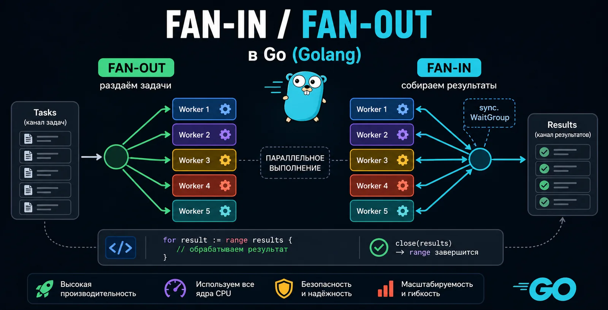

как раздавать задачи и собирать результаты

Есть задачи, которые сами по себе несложные, но их слишком много. Например, нужно сделать 1000 HTTP-запросов, обработать пачку файлов, сходить в несколько внешних API, проверить список URL или прогнать много однотипных операций.

Если выполнять всё последовательно, программа будет ждать каждую операцию по очереди. Один запрос занял 500 мс, тысяча запросов легко превращается в долгие минуты ожидания.

В Go такие задачи удобно решать через горутины и каналы. Но просто запускать горутину на каждую задачу не всегда хорошая идея. Если задач миллион, миллион горутин может съесть память, забить планировщик и превратить ускорение в проблему.

Для таких случаев в Golang часто используют два паттерна конкурентности: Fan-out и Fan-in.

Если коротко:

Fan-out раздаёт одну очередь задач нескольким воркерам
Fan-in собирает результаты из нескольких горутин в один канал
вместе они дают понятный конвейер: задачи → воркеры → результаты
Эта статья про то, как работают fan in golang, fan out golang, как они связаны с worker pool, где чаще всего ошибаются и как писать такой код без дедлоков и утечек горутин.

Что такое Fan-out и Fan-in в Go простыми словами
Представь, что у тебя есть очередь задач. Например, список из 1000 URL. Их нужно обработать: сходить по HTTP, получить ответ, распарсить данные и сохранить результат.

Можно сделать так:

Берём первый URL
Обрабатываем
Берём второй
Обрабатываем
И так тысячу раз
Это последовательно и долго.

А можно создать канал задач и запустить несколько воркеров. Каждый воркер будет брать следующую свободную задачу из канала. Один занят, второй берёт следующую. Второй занят, третий берёт ещё одну. Так работа распределяется автоматически.

Это и есть Fan-out.

После этого каждый воркер получает результат. Но читать результаты из пяти, десяти или двадцати разных мест неудобно. Поэтому воркеры пишут в один общий канал результатов, а основной код читает всё из него.

Это уже Fan-in.

В итоге получается схема:

tasks channel → worker 1 → results channel
              → worker 2 → results channel
              → worker 3 → results channel
              → worker 4 → results channel
              → worker 5 → results channel
Один вход, несколько обработчиков, один выход.

Зачем нужны Fan-in / Fan-out в Golang
Fan-in и Fan-out в Go нужны, когда одну большую пачку независимых задач можно обрабатывать параллельно.

Типичные примеры:

HTTP-запросы к внешним сервисам
обработка файлов
чтение данных из очереди
парсинг страниц
batch-обработка событий
запросы в базу данных
фоновые джобы
обработка изображений
валидация большого списка данных
Главная идея простая: если задачи не зависят друг от друга, их не обязательно выполнять по одной.

Например:

1000 HTTP-запросов последовательно: условно 10 минут
1000 HTTP-запросов через пул воркеров: условно 30 секунд

Цифры зависят от сети, API, лимитов, железа и кода. Но принцип один: для IO-bound задач параллельная обработка часто даёт огромный прирост.

Fan-out в Go: раздаём работу нескольким воркерам
Fan-out в Go, это когда несколько горутин читают задачи из одного канала.

Канал в таком случае работает как очередь. Кто из воркеров свободен, тот и забирает следующую задачу.

Пример базовой схемы:

package main

import "fmt"

type Task struct {
	ID int
}

func process(task Task) {
	fmt.Println("process task", task.ID)
}

func main() {
	tasks := make(chan Task)

	for i := 0; i < 5; i++ {
		go func(workerID int) {
			for task := range tasks {
				fmt.Println("worker", workerID)
				process(task)
			}
		}(i)
	}

	for i := 1; i <= 10; i++ {
		tasks <- Task{ID: i}
	}

	close(tasks)
}
Что здесь происходит:

создаём канал tasks
запускаем 5 воркеров
каждый воркер читает из tasks через range
отправляем задачи в канал
закрываем tasks, когда задач больше не будет
Когда канал tasks закрывается и все значения из него прочитаны, цикл for task := range tasks завершается, и воркеры спокойно выходят.

Это базовый fan-out.

Почему канал работает как очередь задач
В Go канал можно использовать как безопасную очередь между горутинами.

Когда несколько воркеров читают из одного канала, Go сам распределяет значения между ними. Не нужно вручную писать mutex, индекс текущей задачи, список занятых воркеров или свой балансировщик.

Вот почему fan-out в Golang так удобен:

один канал хранит поток задач
несколько горутин читают из него конкурентно
каждая задача попадёт только одному воркеру
свободный воркер заберёт следующую задачу
код остаётся коротким и понятным
Но важно не путать. Канал не гарантирует идеальное равномерное распределение. Если один воркер быстрее, он может обработать больше задач. Обычно это даже хорошо, потому что получается естественная балансировка по скорости.

Сколько воркеров запускать
Один из частых вопросов: сколько воркеров нужно для fan-out?

Ответ зависит от типа задачи.

Если задача IO-bound
IO-bound, это когда код в основном ждёт внешние операции:

HTTP
базу данных
файловую систему
сеть
очередь сообщений
Для таких задач воркеров может быть больше, чем ядер CPU. Например, 10, 20, 50, 100. Но число всё равно нужно ограничивать.

Почему? Потому что внешние сервисы имеют лимиты, база данных имеет пул соединений, сеть имеет пропускную способность, а сама программа не должна создавать бесконечную нагрузку.

Если задача CPU-bound
CPU-bound, это когда код реально грузит процессор:

сжатие изображений
хеширование больших файлов
криптография
тяжёлые вычисления
парсинг больших объёмов данных
Для таких задач обычно начинают с количества воркеров около runtime.NumCPU().

Пример:

workers := runtime.NumCPU()
Если запустить сильно больше CPU-bound воркеров, быстрее может не стать. Процессор не станет бесконечным, а переключений между горутинами будет больше.

Почему не стоит запускать горутину на каждую задачу
Горутины лёгкие, но не бесплатные.

Да, в Go горутина намного дешевле потока ОС. Но если задач миллион, запускать миллион горутин просто потому что можно, плохая идея.

У каждой горутины есть стек, метаданные и стоимость планирования. Даже если стартовый стек небольшой, при огромном количестве горутин это быстро превращается в серьёзную нагрузку.

Плохой вариант:

for _, task := range tasks {
	go process(task)
}
Для 100 задач может быть нормально. Для миллиона уже опасно.

Лучше использовать фиксированный пул воркеров:

workerCount := 20
Так ты контролируешь параллелизм и не даёшь программе разрастись до неконтролируемого состояния.

Fan-in в Go: собираем результаты в один канал
Fan-in в Go, это когда несколько горутин пишут результаты в один общий канал, а потребитель читает из одного места.

Например, у нас есть 5 воркеров. Каждый обрабатывает задачи и возвращает Result. Вместо того чтобы заводить отдельный канал на каждого воркера, можно сделать один общий results.

Пример:

package main

import (
	"fmt"
	"sync"
)

type Task struct {
	ID int
}

type Result struct {
	TaskID int
	Value  string
}

func process(task Task) Result {
	return Result{
		TaskID: task.ID,
		Value:  fmt.Sprintf("result for task %d", task.ID),
	}
}

func main() {
	tasks := make(chan Task)
	results := make(chan Result)

	var wg sync.WaitGroup

	for i := 0; i < 5; i++ {
		wg.Add(1)

		go func(workerID int) {
			defer wg.Done()

			for task := range tasks {
				results <- process(task)
			}
		}(i)
	}

	go func() {
		for i := 1; i <= 10; i++ {
			tasks <- Task{ID: i}
		}
		close(tasks)
	}()

	go func() {
		wg.Wait()
		close(results)
	}()

	for res := range results {
		fmt.Println(res)
	}
}
Здесь уже есть полноценная связка fan-out + fan-in:

tasks раздаёт задачи воркерам
воркеры обрабатывают задачи параллельно
results собирает результаты в один поток
sync.WaitGroup ждёт завершения воркеров
close(results) сообщает читателю, что результатов больше не будет
Почему для Fan-in нужен sync.WaitGroup
Главный вопрос в fan-in: кто должен закрывать канал результатов?

Закрывать канал должен тот, кто точно знает, что новых значений больше не будет.

В нашем случае в results пишут несколько воркеров. Значит, нельзя закрыть results внутри одного воркера. Другие воркеры могут ещё писать, и тогда будет panic:

send on closed channel
Поэтому нужен sync.WaitGroup.

Логика такая:

Перед запуском каждого воркера вызываем wg.Add(1)
В конце работы воркер вызывает wg.Done()
Отдельная горутина ждёт wg.Wait()
Когда все воркеры завершились, она закрывает results
Ключевой фрагмент:

var wg sync.WaitGroup

for i := 0; i < workerCount; i++ {
	wg.Add(1)
	go func() {
		defer wg.Done()
		for task := range tasks {
			results <- process(task)
		}
	}()
}

go func() {
	wg.Wait()
	close(results)
}()
Это один из самых важных шаблонов для fan in fan out golang.

errgroup как альтернатива WaitGroup
В Go часто вместо sync.WaitGroup используют errgroup из пакета golang.org/x/sync/errgroup.

Это часть golang concurrency patterns и удобный способ управлять группой горутин, особенно если нужно обрабатывать ошибки и останавливать выполнение при первой ошибке.

Главное отличие: errgroup позволяет автоматически завершить все горутины при возникновении ошибки, что упрощает код по сравнению с ручным управлением через WaitGroup и каналы.

Важное правило: wg.Add нужно вызывать до go func
Одна из частых ошибок, которую любят спрашивать на собеседованиях по Go:

go func() {
	wg.Add(1)
	defer wg.Done()
	// work
}()
Так делать не надо.

Почему? Потому что wg.Wait() может выполниться раньше, чем горутина успеет вызвать wg.Add(1). Получается гонка по смыслу: основной код думает, что ждать уже некого, закрывает канал, а воркер ещё даже не зарегистрировался.

Правильно так:

wg.Add(1)
go func() {
	defer wg.Done()
	// work
}()
Add всегда до запуска горутины.

Полный пример Fan-in / Fan-out в Go
Давай соберём нормальный пример: есть список задач, фиксированный пул воркеров и один канал результатов.

package main

import (
	"fmt"
	"sync"
	"time"
)

type Task struct {
	ID int
}

type Result struct {
	TaskID int
	Text   string
}

func process(task Task) Result {
	time.Sleep(300 * time.Millisecond)

	return Result{
		TaskID: task.ID,
		Text:   fmt.Sprintf("task %d processed", task.ID),
	}
}

func worker(id int, tasks <-chan Task, results chan<- Result, wg *sync.WaitGroup) {
	defer wg.Done()

	for task := range tasks {
		fmt.Println("worker", id, "started task", task.ID)
		results <- process(task)
	}
}

func main() {
	const workerCount = 5
	const taskCount = 20

	tasks := make(chan Task)
	results := make(chan Result)

	var wg sync.WaitGroup

	for i := 1; i <= workerCount; i++ {
		wg.Add(1)
		go worker(i, tasks, results, &wg)
	}

	go func() {
		for i := 1; i <= taskCount; i++ {
			tasks <- Task{ID: i}
		}
		close(tasks)
	}()

	go func() {
		wg.Wait()
		close(results)
	}()

	for result := range results {
		fmt.Println("result:", result.Text)
	}
}
Что важно в этом коде:

tasks закрывается после отправки всех задач
воркеры завершаются, когда range tasks заканчивается
WaitGroup ждёт всех воркеров
results закрывается только после завершения всех воркеров
основной код читает range results, пока канал не закрыт
Это классическая схема fan-in / fan-out в Go.

Буферизированный канал результатов: когда он нужен
В примерах выше results небуферизированный:

results := make(chan Result)
Это значит, что воркер не сможет отправить результат, пока кто-то его не прочитает.

Иногда это нормально. Такой подход создаёт естественный backpressure: если потребитель не успевает читать, воркеры притормаживают.

Но иногда это мешает. Например, воркеры быстро считают результаты, а сохранение в базу идёт медленно. Тогда все воркеры могут встать на записи в results.

Можно добавить буфер:

results := make(chan Result, 100)
Буфер не делает систему бесконечно быстрой. Он просто даёт небольшой запас, чтобы сгладить разницу между скоростью воркеров и скоростью потребителя.

Хорошее правило: буфер помогает, но не должен быть костылём, который скрывает архитектурную проблему.

Что будет, если забыть close (results)
Если основной код читает так:

for result := range results {
	fmt.Println(result)
}
то цикл завершится только после закрытия results.

Если забыть close(results), программа может зависнуть навсегда. Все результаты уже пришли, воркеры завершились, но range продолжает ждать новые значения.

Вот почему связка wg.Wait() → close(results) так важна.

Правильно:

go func() {
	wg.Wait()
	close(results)
}()
Что будет, если закрыть results слишком рано
Другая ошибка: закрыть results до завершения воркеров.

Например:

close(results)
если после этого хотя бы один воркер попробует выполнить:

results <- result
программа упадёт с panic:

panic: send on closed channel
Поэтому правило такое:

Канал закрывает тот, кто контролирует всех отправителей.

Если отправитель один, он может сам закрыть канал. Если отправителей много, закрытие обычно делают через sync.WaitGroup.

Fan-in через отдельную функцию merge
Иногда результаты приходят не из одного общего канала, а из нескольких каналов. Например, у тебя есть несколько независимых источников данных, и каждый возвращает свой канал.

Тогда удобно написать функцию merge, которая объединяет несколько каналов в один.

package main

import "sync"

func merge[T any](channels ...<-chan T) <-chan T {
	out := make(chan T)

	var wg sync.WaitGroup
	wg.Add(len(channels))

	for _, ch := range channels {
		go func(c <-chan T) {
			defer wg.Done()

			for value := range c {
				out <- value
			}
		}(ch)
	}

	go func() {
		wg.Wait()
		close(out)
	}()

	return out
}
Это уже чистый fan-in: много входных каналов, один выходной.

Использовать можно так:

out := merge(ch1, ch2, ch3)

for value := range out {
	fmt.Println(value)
}
Fan-out через worker pool
На практике fan-out чаще всего выглядит как worker pool.

Worker pool, это фиксированное количество воркеров, которые читают задачи из общей очереди.

func startWorkers(workerCount int, tasks <-chan Task, results chan<- Result) *sync.WaitGroup {
	var wg sync.WaitGroup

	for i := 0; i < workerCount; i++ {
		wg.Add(1)

		go func(workerID int) {
			defer wg.Done()

			for task := range tasks {
				results <- process(task)
			}
		}(i)
	}

	return &wg
}
Такая функция отделяет запуск воркеров от остального кода и делает конвейер чище.

Fan-in / Fan-out и pipeline в Go
Fan-in и Fan-out часто используются как часть pipeline.

Pipeline в Go, это цепочка стадий, связанных каналами. Каждая стадия получает данные из входного канала, что-то с ними делает и отправляет дальше.

Например:

source → tasks → workers → results → save
Где:

source создаёт задачи
tasks передаёт их воркерам
workers обрабатывают задачи параллельно
results собирает результат
save сохраняет или отправляет данные дальше
Fan-out обычно появляется на стадии, где нужно ускорить обработку.

Fan-in появляется там, где нужно снова собрать много параллельных потоков в один.

Fan-in и fan-out — это базовые golang concurrency patterns, на которых строятся более сложные pipeline-архитектуры в реальных сервисах.

Отмена работы через context.Context
В реальном коде важно уметь останавливать pipeline.

Например:

пользователь отменил запрос
внешний API начал возвращать ошибки
один воркер нашёл критическую ошибку
истёк timeout
сервис завершает работу
Если не продумать отмену, горутины могут продолжить работать, хотя результат уже никому не нужен.

В Go для этого обычно используют context.Context.

Пример воркера с отменой:

func worker(
	ctx context.Context,
	id int,
	tasks <-chan Task,
	results chan<- Result,
	wg *sync.WaitGroup,
) {
	defer wg.Done()

	for {
		select {
		case <-ctx.Done():
			return

		case task, ok := <-tasks:
			if !ok {
				return
			}

			result := process(task)

			select {
			case <-ctx.Done():
				return
			case results <- result:
			}
		}
	}
}
Здесь воркер проверяет ctx.Done():

перед получением задачи
перед отправкой результата
Это защищает от ситуации, когда воркер завис на отправке в канал, а читатель уже ушёл.

Ошибки в Fan-in / Fan-out
В учебных примерах часто показывают только успешный путь. В реальном коде почти всегда нужны ошибки.

Один из удобных вариантов: отправлять в results структуру, где есть и данные, и ошибка.

type Result struct {
	TaskID int
	Value  string
	Err    error
}
Тогда воркер может сделать так:

value, err := doWork(task)
results <- Result{
	TaskID: task.ID,
	Value:  value,
	Err:    err,
}
А потребитель решает, что делать:

for result := range results {
	if result.Err != nil {
		fmt.Println("error:", result.Err)
		continue
	}

	save(result)
}
Если при первой ошибке нужно остановить весь pipeline, лучше использовать context.WithCancel или golang errgroup из golang.org/x/sync/errgroup.

Если в коде есть сложная логика с ошибками и отменой выполнения, вместо ручного управления каналами и WaitGroup часто используют errgroup golang — это упрощает контроль ошибок и завершение горутин.

Типичные подводные камни Fan-in / Fan-out в Go
Горутина на каждую задачу
Плохо:

for _, task := range tasks {
	go process(task)
}
Если задач очень много, можно получить огромный расход памяти и проблемы с планированием.

Лучше:

const workerCount = 20
И фиксированный пул воркеров.

2. Забыли закрыть канал задач
Если воркеры читают так:

for task := range tasks {
	process(task)
}
но tasks никто не закрыл, воркеры будут ждать новые задачи вечно.

Правильно:

close(tasks)
после отправки всех задач.

3. Забыли закрыть канал результатов
Если потребитель читает range results, но results не закрывается, программа зависнет.

Правильно:

go func() {
	wg.Wait()
	close(results)
}()
4. Вызвали wg.Add внутри горутины
Плохо:

go func() {
	wg.Add(1)
	defer wg.Done()
}()
Правильно:

wg.Add(1)
go func() {
	defer wg.Done()
}()
5. Закрыли канал, пока в него ещё пишут
Если закрыть results до завершения всех воркеров, будет panic.

Запомни правило:

Не закрывай канал со стороны получателя. Закрывает тот, кто отправляет и знает, что отправка закончилась.

6. Нет отмены через context
Если downstream больше не читает результаты, upstream может зависнуть на отправке.

В реальном production-коде лучше добавлять context.Context, особенно если есть HTTP-запросы, таймауты или ранний выход по ошибке.

7. Слишком большой буфер канала
Иногда пытаются решить все проблемы буфером:

results := make(chan Result, 1000000)
Это не решение, а перенос проблемы в память. Буфер должен сглаживать нагрузку, а не заменять нормальную архитектуру.

Когда Fan-in / Fan-out подходит хорошо
Этот паттерн отлично подходит, если:

задач много
задачи независимы друг от друга
порядок результатов не критичен
работу можно разбить на одинаковые операции
есть смысл ограничить параллелизм
нужно собрать результаты в один поток
Примеры:

обойти список URL
скачать файлы
посчитать хеши файлов
обработать события из очереди
проверить пользователей по внешнему API
распарсить много документов
выполнить пачку SQL-запросов с ограничением по пулу соединений
Когда Fan-in / Fan-out может быть лишним
Не стоит тащить fan-in / fan-out везде подряд.

Он может быть лишним, если:

задач мало
обработка очень быстрая
порядок результатов строго важен
логика сильно усложняется из-за каналов
обычный цикл читается проще
узкое место не в обработке, а в чём-то другом
Go даёт удобные инструменты для конкурентности, но это не значит, что любой цикл нужно превращать в pipeline.

Иногда простой код лучше умного.

Fan-in / Fan-out на собеседованиях по Go
Тему fan in fan out golang часто спрашивают на собеседованиях, потому что она хорошо показывает, понимает ли разработчик конкурентность в Go.

Обычно проверяют не сам термин, а практические вещи:

как работают каналы
кто должен закрывать канал
зачем нужен sync.WaitGroup
почему wg.Add вызывается до go func
что будет при записи в закрытый канал
как избежать deadlock
как ограничить количество горутин
когда нужен буферизированный канал
как сделать отмену через context.Context
Если кандидат просто говорит «ну fan-out это распараллелить, fan-in это собрать», этого мало. Важно уметь написать рабочий код и объяснить, где он может сломаться.

Короткая шпаргалка по Fan-in / Fan-out в Go
Элемент	Зачем нужен
Tasks channel	очередь входных задач
Workers	горутины, которые читают задачи и выполняют работу
Results channel	общий канал для результатов
sync.WaitGroup	ждёт завершения всех воркеров
close(tasks)	сообщает воркерам, что задач больше нет
close(results)	сообщает потребителю, что результатов больше нет
range results	читает результаты до закрытия канала
context.Context	останавливает pipeline при отмене или ошибке

Главное, что нужно запомнить

Fan-out, это раздача задач нескольким воркерам.
Fan-in, это сбор результатов из нескольких горутин в один канал.
Вместе они дают удобный паттерн для параллельной обработки данных в Go.
Базовая схема выглядит так:

создали tasks → запустили N воркеров → воркеры пишут в results → WaitGroup закрыл results → читаем range results
Самые важные правила:

не запускай горутину на каждую задачу без ограничения
используй фиксированный worker pool
закрывай tasks, когда задач больше нет
закрывай results только после завершения всех воркеров
вызывай wg.Add до go func
добавляй context.Context, если возможна отмена
не лечи архитектурные проблемы огромными буферами каналов

F.A.Q.
Что такое Fan-out в Go?
Fan-out в Go, это паттерн, при котором несколько горутин читают задачи из одного канала и обрабатывают их параллельно.

Что такое Fan-in в Go?
Fan-in в Go, это паттерн, при котором результаты из нескольких горутин или каналов собираются в один общий канал.

Зачем нужен Fan-in / Fan-out в Golang?
Fan-in / Fan-out нужен для параллельной обработки большого количества независимых задач: HTTP-запросов, файлов, событий, batch-операций и других IO-bound или CPU-bound задач.

Чем Fan-out отличается от worker pool?
Fan-out, это общий принцип раздачи работы нескольким обработчикам. Worker pool, это частая реализация fan-out с фиксированным количеством воркеров.

Кто должен закрывать results channel?
Канал результатов должен закрывать код, который знает, что все отправители завершились. Обычно для этого используют sync.WaitGroup: сначала wg.Wait(), потом close(results).

Почему нельзя вызывать wg.Add внутри горутины?
Потому что wg.Wait() может завершиться раньше, чем горутина успеет вызвать wg.Add(1). Поэтому Add всегда делают до go func.

Сколько воркеров запускать в Fan-out?
Для CPU-bound задач часто начинают с runtime.NumCPU(). Для IO-bound задач воркеров может быть больше, но число всё равно нужно ограничивать с учётом лимитов базы, API, сети и памяти.

Когда нужен context.Context в Fan-in / Fan-out?
context.Context нужен, если pipeline может завершиться раньше: по таймауту, ошибке, отмене HTTP-запроса или остановке сервиса. Он помогает не оставлять зависшие горутины.
