как работают goroutine, WaitGroup, race condition и конкурентность

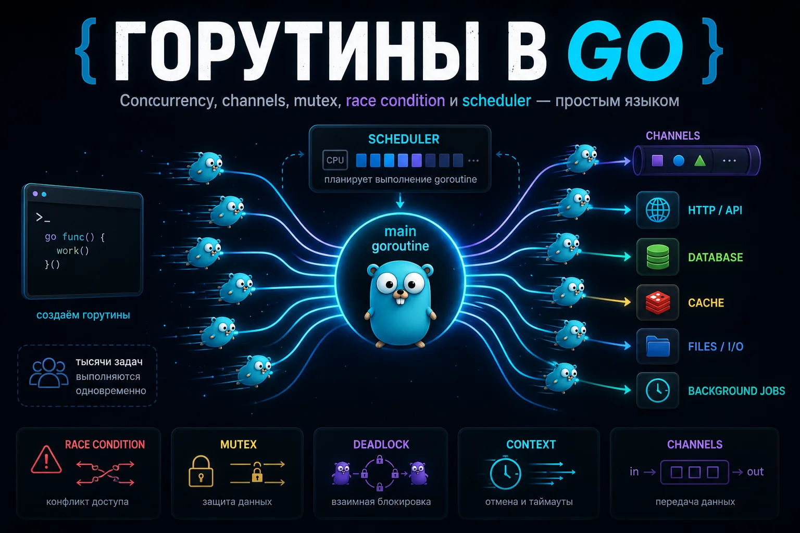

Что такое горутина в Golang
Горутина (goroutine) — это способ запустить код отдельно от основного выполнения программы (main).

Представь обычную программу без goroutine:

сделали шаг 1
потом шаг 2
потом шаг 3
Всё идёт строго по очереди, но в реальных программах часто нужно делать несколько вещей одновременно.

Например:

сервер ждёт запросы пользователей
параллельно делает запросы в базу
отправляет логи
работает с файлами
выполняет фоновые задачи
Если всё делать строго по очереди, программа будет постоянно ждать и тормозить.

Для этого в Go есть goroutine.

С помощью goroutine можно сказать программе: эту задачу выполняй отдельно

В Go это делается ключевым словом go:

package main
import (
"fmt"
"time"
)
func sayHello() {
fmt.Println("hello from goroutine")
}
func main() {
go sayHello()
time.Sleep(time.Second)
}
Вот эта строка запускает функцию отдельно от main:

go sayHello()
Пока goroutine работает, main может продолжать выполнять другой код.

Именно поэтому goroutine используют для:

серверов
API
многопоточной обработки
очередей
парсеров
фоновых задач
highload-сервисов
Горутины очень лёгкие, поэтому в Go их можно запускать тысячами.

Что такое конкурентность в Go
Перед изучением горутин важно понять, что такое конкуренция в Golang.

Конкуренция (concurrency) — это способность программы работать с несколькими задачами в один период времени и не блокироваться на одной операциии. Не обязательно физически выполнять их в одну наносекунду. Главное, что программа не привязана к одной последовательной цепочке.

Пример из жизни

Повар поставил вариться пасту, пока она варится — режет овощи, потом проверяет соус, потом возвращается к пасте. Он не делает всё строго по очереди от начала до конца. Он переключается между задачами.

Пока одна горутина ждёт ответ от базы данных или сети, программа может в это время выполнять другую горутину.

То есть приложение не простаивает без дела и может переключаться между задачами.

Есть ещё параллелизм (parallelism) — это когда задачи реально выполняются одновременно на разных ядрах CPU. Go умеет и concurrency, и parallelism, но это разные вещи.

Коротко:

Concurrency — управляем несколькими задачами.
Parallelism — реально выполняем несколько задач одновременно.

Горутины в первую очередь дают удобную модель конкуренции.

Почему goroutine — одна из главных фишек Golang
Go стал популярным в backend не только из-за простого синтаксиса. Основная причина — конкурентность. То есть приложение постоянно переключается между задачами вместо того, чтобы простаивать.

В серверной разработке это критично. Одновременно могут приходить тысячи запросов, работать очереди, cron-задачи, websocket-соединения, фоновые воркеры.

В Golang запуск конкурентной задачи выглядит так:

go processRequest(req)
Без ручного создания thread (потока операционной системы), без сложной настройки пула потоков, без отдельной инфраструктуры вокруг каждой мелкой задачи.

Именно поэтому goroutine стали базовым инструментом почти для любого backend-кода на Go. Без них сложно представить современные API, очереди, парсеры, realtime-сервисы и вообще нормальную конкурентную обработку данных.

Goroutine vs thread: чем горутина отличается от потока

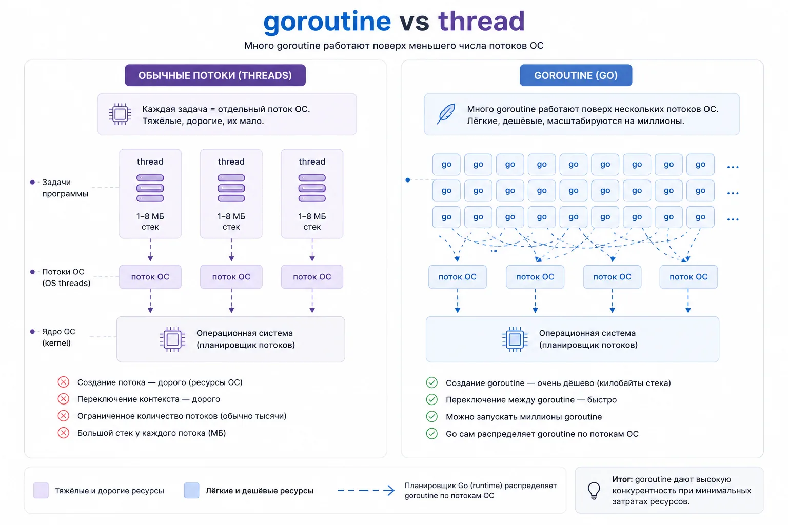

Это один из самых частых вопросов на Go-собеседовании.

Поток ОС (thread) — тяжёлая сущность, которой управляет операционная система. У потока обычно большой стек, дорогое создание и переключение. Если создать десятки тысяч потоков, приложение быстро упрётся в память и накладные расходы.

Горутина — лёгкая сущность, которой управляет runtime Go.

Runtime — это внутренняя система Go, которая отвечает за выполнение программы.

Именно runtime:

запускает goroutine
переключает их между потоками
управляет scheduler
работает с памятью
запускает garbage collector
следит за конкурентным выполнением
То есть runtime — это «движок» Go-программы, который работает между твоим кодом и операционной системой. Она стартует с маленьким стеком, который может расти по мере необходимости. Планировщик Go сам распределяет горутины по потокам ОС.

Упрощённо:

Thread — поток операционной системы.
Goroutine — задача внутри runtime Go.

Это не значит, что горутина вообще бесплатная. Нет. У неё тоже есть память, стек, состояние, работа планировщика. Но по сравнению с обычными потоками она намного легче.

Именно поэтому в Go нормально иметь тысячи и десятки тысяч goroutine, если они сделаны осмысленно и не висят без дела.

Как устроены горутины: модель GMP
Когда ты пишешь:

go worker()
Go не создаёт отдельный поток ОС для каждой goroutine.

Внутри работает планировщик runtime Go. Чаще всего его объясняют через модель GMP:

G — goroutine;
M — machine, поток ОС;
P — processor, контекст выполнения, который связывает goroutine и thread.
Упрощённо можно представить так:

много G выполняются на нескольких M через P

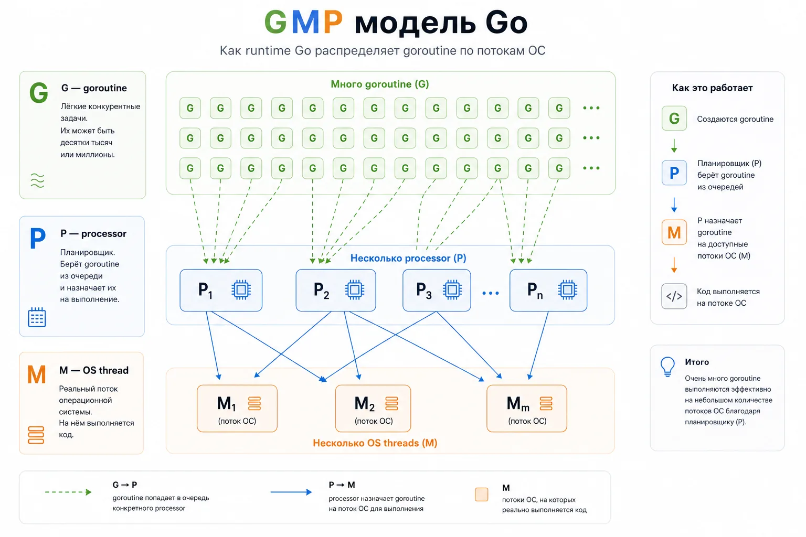

Runtime Go решает, какую goroutine поставить на выполнение, какую остановить, какую перенести на другой поток, а какую разбудить после ожидания сети, таймера или канала.

Для повседневной разработки не нужно держать в голове все детали планировщика. Но важно понимать главное: goroutine управляются не напрямую операционной системой, а Go runtime.

Отсюда и эффективность.

Как запустить goroutine
Горутина запускается ключевым словом go перед вызовом функции.

package main
import "fmt"
func printMessage() {
fmt.Println("message")
}
func main() {
go printMessage()
}
Но этот код может ничего не вывести.

Почему? Потому что main завершится раньше, чем goroutine успеет выполниться.

Почему main не ждёт goroutine
Это первая ловушка почти у всех новичков.

Функция main сама выполняется в goroutine. Её часто называют main goroutine.

Когда main заканчивается, программа завершается полностью. Остальные goroutine не получают дополнительное время на завершение.

Пример:

package main
import "fmt"
func main() {
go fmt.Println("hello")
}
Ты можешь ожидать вывод hello, но программа может завершиться раньше.

Важно

Main не ждёт остальные goroutine автоматически.

Если нужно дождаться результата, нужно явно синхронизировать выполнение.

Почему time.Sleep — плохой способ ждать goroutine
В учебных примерах часто пишут так:

func main() {
go worker()
time.Sleep(time.Second)
}
Для демонстрации это терпимо. Для реального кода — плохая практика:

ты не знаешь, сколько реально займёт задача
сеть может отвечать дольше
база может тормозить
на слабой машине код поведёт себя иначе
тесты станут медленными и нестабильными
time.Sleep не синхронизирует работу. Он просто заставляет программу ждать наугад.

Нормальный способ дождаться goroutine — sync.WaitGroup, channel или context, в зависимости от задачи.

sync.WaitGroup: как дождаться завершения goroutine

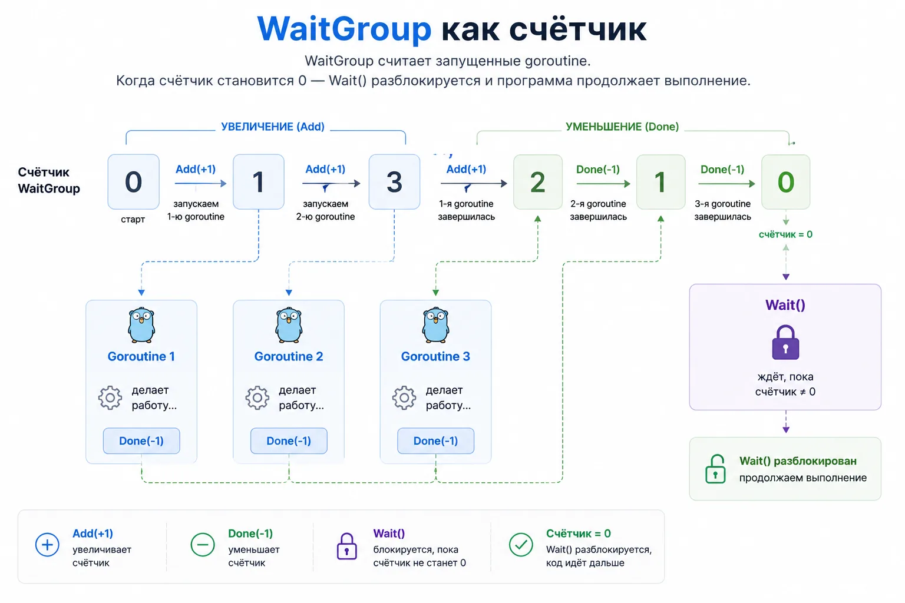

sync.WaitGroup — простой счётчик активных goroutine.

Пример:

package main
import (
"fmt"
"sync"
)
func worker(id int, wg *sync.WaitGroup) {
defer wg.Done()
fmt.Println("worker", id, "done")
}
func main() {
var wg sync.WaitGroup
for i := 1; i <= 3; i++ {
wg.Add(1)
go worker(i, &wg)
}
wg.Wait()
fmt.Println("all workers done")
}
Как это работает:

wg.Add(1) увеличивает счётчик
wg.Done() уменьшает счётчик
wg.Wait() ждёт, пока счётчик станет нулём
defer wg.Done() обычно ставят в начале функции, чтобы счётчик уменьшился даже при раннем выходе из функции.

Частая ошибка с WaitGroup
Нельзя делать wg.Add(1) внутри самой goroutine, если wg.Wait() уже может стартовать раньше.

Плохо:

for i := 0; i < 3; i++ {
go func() {
wg.Add(1)
defer wg.Done()
work()
}()
}
wg.Wait()
Add должен происходить до запуска goroutine.

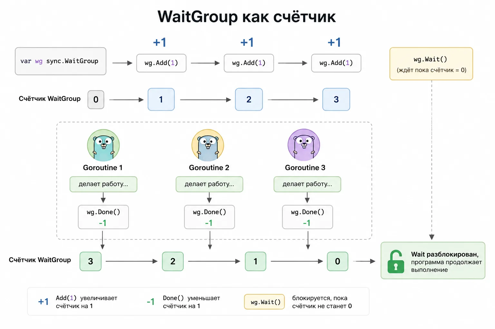

Что делать, если goroutine должна вернуть результат
WaitGroup хорошо подходит, когда нужно просто дождаться завершения работы.

Но часто одной синхронизации мало. Goroutine может что-то посчитать, сходить во внешний сервис, обработать файл или получить данные из базы. Тогда результат нужно вернуть обратно в main goroutine.

Через return это не сработает:

go calculate()
Когда функция запускается через go, её результат нельзя просто присвоить переменной как при обычном вызове.

Для передачи результата между горутинами в Golang обычно используют channels.

Очень простой пример:

package main
import "fmt"
func main() {
resultCh := make(chan int)
go func() {
resultCh <- 42
}()
result := <-resultCh
fmt.Println(result)
}
Здесь goroutine отправляет результат в channel, а main goroutine его получает.

Что такое канал простыми словами
Channel (канал) — это способ обмениваться данными между goroutine. Если goroutine — это конкурентные задачи, то channels — это связь между ними.

Представь трубу:

goroutine → channel → другая goroutine
Одна goroutine может отправить данные:

ch <- 42
А другая — получить:

value := <-ch
Важно понимать: каналы — это не просто контейнер для значений. Каналы в Go ещё и синхронизируют горутины.

Например:

msg := <-ch
Если данных в канале пока нет, goroutine остановится и будет ждать.

То есть channels помогают:

передавать данные между goroutine
ждать завершения работы
строить worker pool
делать fan-in/fan-out
ограничивать конкурентность
синхронизировать выполнение
Именно поэтому темы goroutines и каналы golang почти всегда изучают вместе.

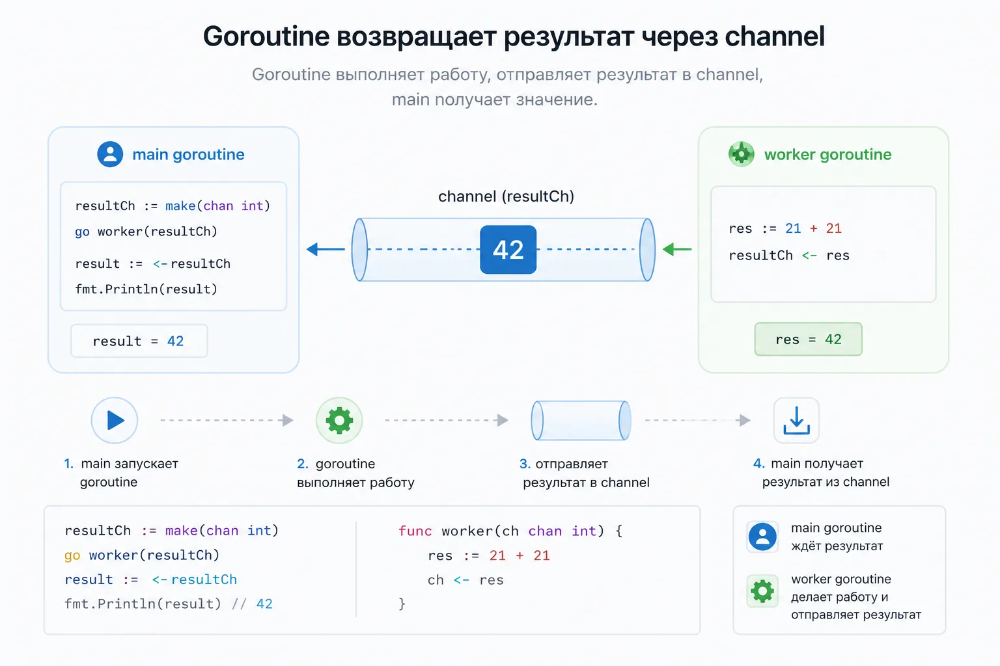

Ошибки внутри goroutine
Ещё один важный момент: если goroutine делает работу в фоне, нужно подумать, как вернуть не только результат, но и ошибку.

Плохой вариант — просто печатать ошибку внутри goroutine:

go func() {
if err := doWork(); err != nil {
fmt.Println(err)
}
}()
Так main goroutine не узнает, что работа завершилась ошибкой. Для логов этого может быть достаточно, но для бизнес-логики обычно нет.

Один из вариантов — отправлять результат и ошибку через channel:

type Result struct {
Value int
Err error
}
func main() {
resultCh := make(chan Result)
go func() {
value, err := doWork()
resultCh <- Result{Value: value, Err: err}
}()
result := <-resultCh
if result.Err != nil {
fmt.Println("error:", result.Err)
return
}
fmt.Println(result.Value)
}
Такой подход часто встречается в сервисах, где нужно параллельно сходить в несколько источников и собрать ответы.

Например:

запросить профиль пользователя
получить баланс
сходить в рекомендательную систему
собрать итоговый ответ для API
Goroutine ускоряют работу, но без нормальной обработки ошибок конкурентный код быстро превращается в хаос.

Panic внутри goroutine
Сначала важно понять разницу между error и panic.

error — это обычная ошибка, которую программа ожидает и умеет обработать.

Например:

file, err := os.Open("data.txt")
if err != nil {
fmt.Println(err)
}
А panic — это уже аварийная ситуация. Обычно panic возникает, когда программа попала в состояние, из которого не может нормально продолжать работу.

Например:
выход за границы slice
запись в закрытый channel
обращение к nil pointer
критическая ошибка в логике программы
Простой пример:

panic("something went wrong")
Когда panic происходит в обычном коде, программа начинает раскручивать стек вызовов и завершает работу.

С goroutine есть важный нюанс. Если внутри goroutine случится panic, она не «вернётся» в main как обычная ошибка.

Пример:

package main
func main() {
go func() {
panic("boom")
}()
select {}
}

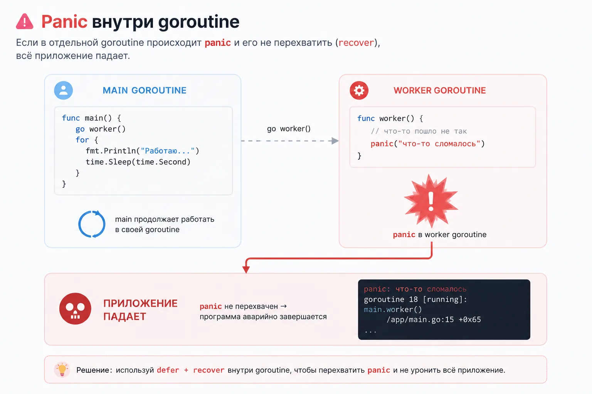

Panic в любой goroutine может уронить всю программу, если её не обработать.

Иногда в фоновых задачах используют recover, чтобы не дать одной ошибке положить весь процесс:

go func() {
defer func() {
if r := recover(); r != nil {
fmt.Println("recovered:", r)
}
}()
riskyWork()
}()
Но recover не должен быть способом замазать плохую архитектуру. Если goroutine может падать, лучше заранее понимать:

почему она падает
где логировать ошибку
нужно ли перезапускать задачу
можно ли продолжать работу сервиса
В production у фоновых goroutine обычно есть:

логирование
метрики
context для остановки
обработка ошибок
понятный жизненный цикл

Race condition
Goroutine выполняются конкурентно, из-за этого несколько goroutine могут одновременно обращаться к одним и тем же данным. Именно так появляются race condition (гонки данных).

Race condition возникает, когда результат программы зависит от порядка выполнения goroutine.

Например:

две goroutine одновременно увеличивают счётчик
несколько goroutine пишут в одну map
несколько goroutine делают append в один slice
одна goroutine читает данные, пока другая их меняет
Проблема в том, что scheduler Go не гарантирует порядок выполнения goroutine. Поэтому такой код в конкурентном выполнении может давать неожиданный результат:

counter++
В реальных сервисах race condition приводят к:

потерянным данным
нестабильным багам
random behavior
fatal error: concurrent map writes
production-инцидентам
Для поиска таких проблем в Go есть race detector:

go test -race ./...
Именно goroutine чаще всего становятся причиной race condition, потому что несколько частей программы начинают работать одновременно.

Но сама тема race condition, shared memory, mutex, atomic и синхронизации — это уже отдельная большая область Go concurrency.

В этой статье важно понять главное:

goroutine могут одновременно работать с одной памятью
и это опасно без синхронизации

Подробно:

почему counter++ не атомарен
как работает mutex
зачем нужен RWMutex
когда использовать atomic
почему map не thread-safe
как искать race condition
чем channels отличаются от mutex

Mutex, RWMutex и atomic: базовое понимание

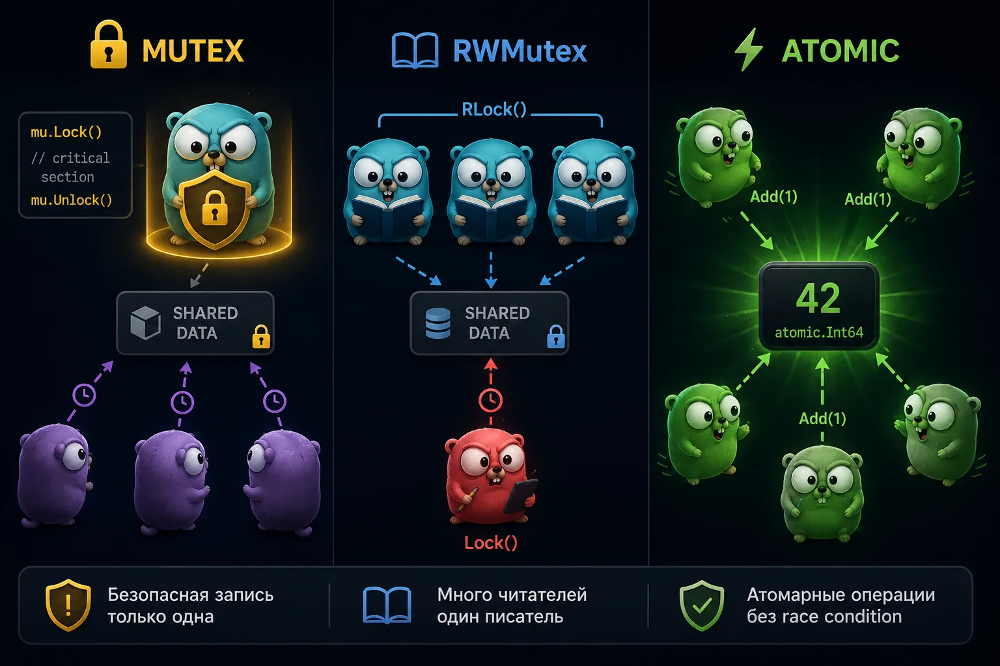

Когда несколько goroutine работают с одной памятью одновременно, нужен способ синхронизации.

Самый частый инструмент — sync.Mutex.

Mutex работает как замок:

одна goroutine заходит в критическую секцию
остальные ждут освобождения
Пример:

var mu sync.Mutex
mu.Lock()
counter++
mu.Unlock()
Если данных много читают и редко изменяют, используют sync.RWMutex:

RLock() — для чтения
Lock() — для записи
А для простых счётчиков иногда используют sync/atomic:

var counter atomic.Int64
counter.Add(1)
Но важно понимать: это уже тема не столько про goroutine, сколько про shared memory и синхронизацию.

В рамках этой статьи достаточно запомнить главное:

Важно

Goroutine могут одновременно обращаться к одной памяти и без синхронизации это приводит к race condition

Context и отмена горутины
Одна из важных вещей в Go: goroutine должна уметь завершаться.

Запустить goroutine легко. Остановить её правильно — уже сложнее. Для отмены операций в Go используют context.Context.

Пример:

ctx, cancel := context.WithCancel(context.Background())
defer cancel()
Goroutine может слушать сигнал отмены:

func worker(ctx context.Context) {
for {
select {
case <-ctx.Done():
return
default:
doWork()
}
}
}
context используют для:

timeout
отмены HTTP-запроса
graceful shutdown
остановки worker pool
отмены долгих операций
защиты от goroutine leak
Пример с timeout:

ctx, cancel := context.WithTimeout(context.Background(), time.Second)
defer cancel()
select {
case result := <-resultCh:
fmt.Println(result)
case <-ctx.Done():
fmt.Println("timeout:", ctx.Err())
}
Здесь программа либо получает результат, либо выходит по timeout.

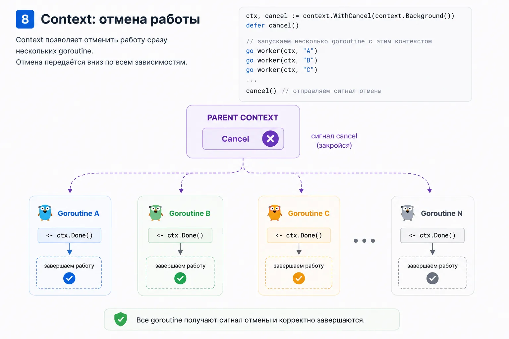

Утечка горутин: goroutine leak

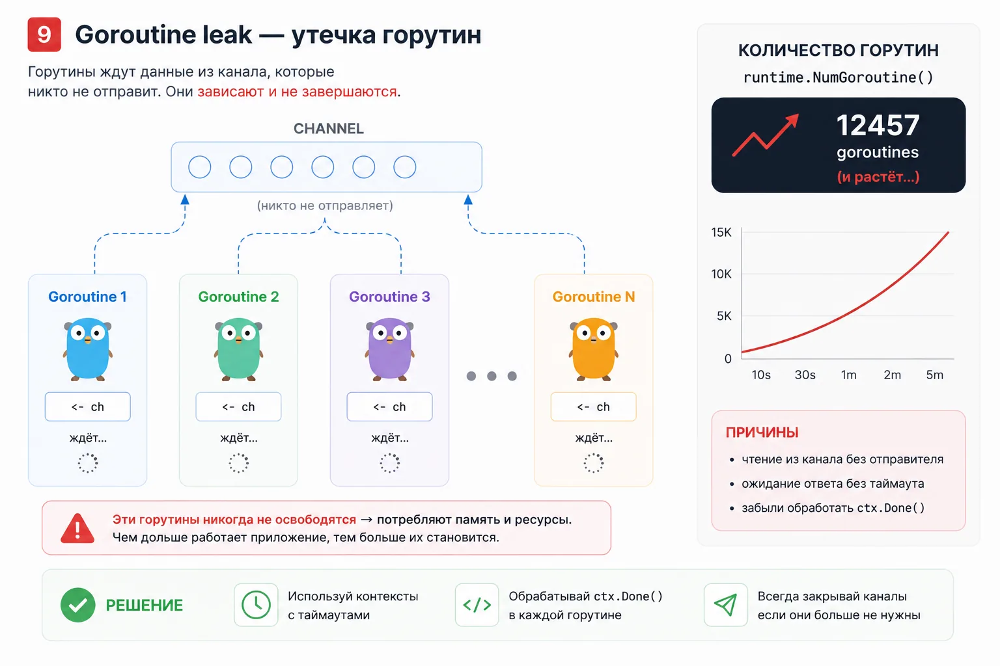

Goroutine leak — это ситуация, когда goroutine больше не нужна, но продолжает жить.

Например:

func leak() {
ch := make(chan int)
go func() {
value := <-ch
fmt.Println(value)
}()
}
Функция leak() завершится, но goroutine останется ждать значение из ch. Никто в этот channel уже не отправит данные. Такая goroutine зависла навсегда.

Одна такая утечка может быть незаметной. Но если она возникает на каждый HTTP-запрос, через время сервис начнёт деградировать.

Что может случиться:

растёт память
растёт число goroutine
увеличивается latency
scheduler тратит больше ресурсов
сервис становится нестабильным
Проверять число goroutine можно через runtime:

fmt.Println(runtime.NumGoroutine())
В production чаще используют метрики, pprof и мониторинг.

Типичные причины goroutine leak:

чтение из channel, в который никто не пишет
запись в channel, который никто не читает
отсутствие context cancellation
бесконечный цикл без выхода
зависший network call без timeout
Как ограничивать количество goroutine

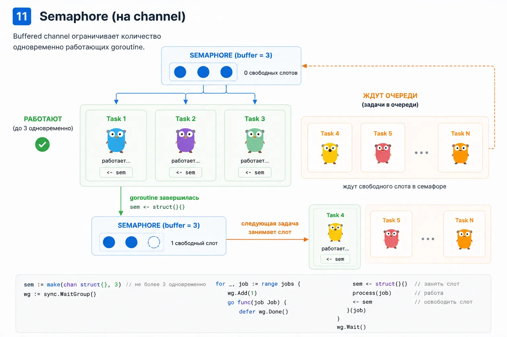

Большая ошибка — запускать goroutine без лимита.

Например:

for _, task := range tasks {
go process(task)
}
Если задач 100 — нормально. Если задач 1 000 000 — плохо.

Да, goroutine лёгкие. Но они не бесплатные.

Они потребляют:

память
время scheduler
соединения
файловые дескрипторы
лимиты базы данных
лимиты внешних API
Поэтому в реальных сервисах конкурентность ограничивают.

Самые частые способы:

worker pool
semaphore
buffered channel как семафор
rate limiter
context cancellation
Простой семафор на buffered channel:

sem := make(chan struct{}, 10)
for _, task := range tasks {
sem <- struct{}{}
go func(task Task) {
defer func() { <-sem }()
process(task)
}(task)
}
Здесь одновременно работает не больше 10 goroutine. Это помогает не положить базу, внешний API или собственный сервис.

Worker Pool

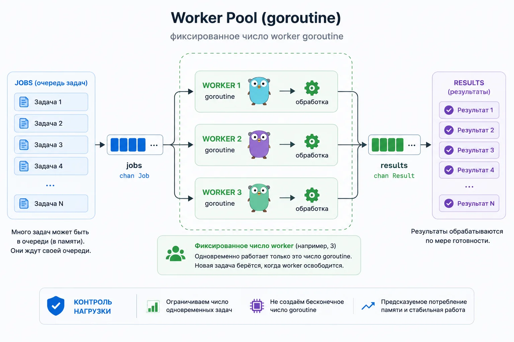

Worker pool — это паттерн, где есть ограниченное количество worker goroutine. Они берут задачи из очереди и обрабатывают их параллельно.

Схема:

jobs → workers → results

Worker pool нужен, когда задач много, но выполнять их все одновременно нельзя.

Например:

обработать 100 000 файлов
распарсить список URL
отправить письма
обработать очередь задач
сделать batch processing
В этой статье важно понять саму идею: worker pool помогает управлять количеством goroutine.

Подробная реализация обычно строится на channels.

Fan-in / Fan-out в Go
Fan-out — это когда одну работу распределяют между несколькими goroutine.

Fan-in — когда результаты нескольких goroutine собирают обратно в один поток.

Схема:

fan-out: одна очередь → много goroutine
fan-in: много goroutine → один результат

Эти паттерны часто появляются в Go-коде, когда нужно ускорить обработку данных.

Например:

параллельно сходить в несколько API
одновременно обработать пачку файлов
распараллелить вычисления
собрать результаты обратно
Но технически fan-in/fan-out почти всегда завязаны на channels.

Что спрашивают на собеседованиях по goroutine
По goroutine часто спрашивают не синтаксис, а понимание модели.

Типичные вопросы:

Что такое goroutine?
Чем goroutine отличается от thread?
Почему main не ждёт goroutine?
Как дождаться завершения goroutine?
Как работает WaitGroup?
Почему нельзя делать Add внутри goroutine?
Что такое race condition?
Как работает race detector?
Когда использовать mutex?
Чем mutex отличается от channel?
Что такое goroutine leak?
Как остановить goroutine?
Зачем нужен context?
Как ограничить количество goroutine?
Что такое scheduler Go?
Что такое GMP?
Если человек отвечает только «goroutine — это лёгкий поток», обычно этого мало.

На собеседовании ждут, что разработчик понимает:

как goroutine живёт
как она завершается
как она синхронизируется
как не получить race
как не получить leak
как ограничить конкурентность
Как изучать goroutine правильно

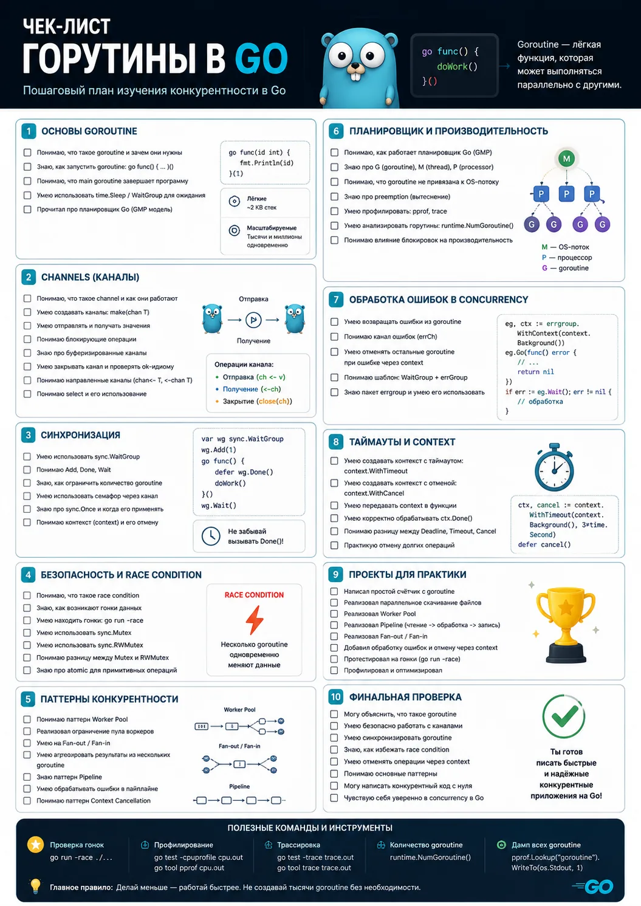

Не стоит учить goroutine как набор отдельных конструкций.

Лучше идти по шагам:

Понять обычный запуск через go
Разобраться, почему main не ждёт goroutine
Научиться ждать через WaitGroup
Понять race condition
Научиться защищать shared state через mutex
Понять context cancellation
Разобраться с goroutine leak
Изучить channels
Перейти к worker pool, pipeline, fan-in/fan-out
Так тема складывается в систему, а не в набор случайных примеров.

Где goroutine нужны в реальной работе
В реальном backend goroutine встречаются постоянно.

Примеры:

HTTP-сервер обрабатывает запросы конкурентно
worker pool разгребает очередь задач
сервис параллельно ходит в несколько API
cron запускает фоновые операции
websocket держит соединения
логирование работает асинхронно
batch job обрабатывает большие объёмы данных
На собеседованиях по Go часто проверяют именно это понимание: умеешь ли ты не просто написать go func(), а понимаешь ли, что будет с этой goroutine дальше.

FAQ по горутинам
Что такое goroutine в Go?

Goroutine — это лёгкая конкурентная задача, которой управляет runtime Go. Она запускается ключевым словом go и позволяет выполнять работу отдельно от основного хода программы.

Чем goroutine отличается от thread?

Thread — поток операционной системы. Goroutine — задача внутри runtime Go. Горутины легче потоков, быстрее создаются и управляются планировщиком Go.

Почему main не ждёт goroutine?

Потому что main сама выполняется в main goroutine. Когда main завершается, программа завершается полностью.

Как дождаться завершения goroutine?

Чаще всего через sync.WaitGroup, channel или context. Для простого ожидания нескольких goroutine обычно используют WaitGroup.

Что такое goroutine leak?

Это goroutine, которая больше не нужна, но продолжает жить. Например, она ждёт чтение из channel, куда никто больше не отправит данные.

Как остановить goroutine?

Обычно через context.Context, закрытие channel или другой явный сигнал завершения.

Что такое scheduler в Go?

Scheduler — это планировщик runtime Go, который распределяет goroutine по потокам ОС.

Что такое GMP модель?

GMP — модель планировщика Go: G — goroutine, M — поток ОС, P — processor, контекст выполнения.

Нужно ли всегда использовать goroutine?

Нет. Goroutine нужны, когда есть реальная конкурентная работа: запросы, фоновые задачи, параллельная обработка, ожидание сети или базы.

Горутина — это не поток
Чем горутина отличается от потока ОС и как Go runtime планирует выполнение.

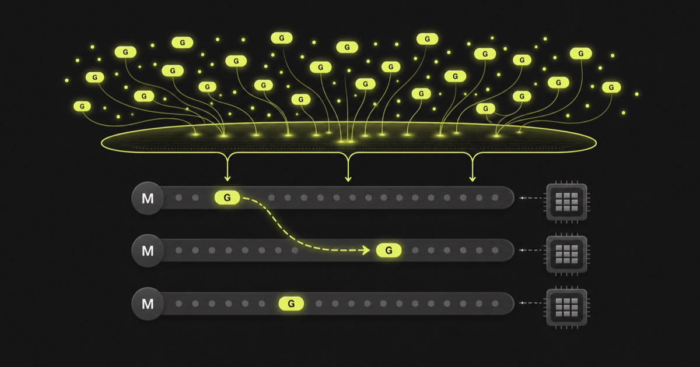

Короткий ответ: горутина — это задача, которой управляет планировщик Go, а поток — ресурс операционной системы. Runtime размещает много горутин на меньшем числе потоков ОС, переносит их между потоками и останавливает, когда они ждут канал, таймер или сеть. Поэтому go f() не означает "создать новый поток".

На собеседовании этого ответа обычно достаточно для старта. Дальше стоит объяснить модель G-M-P и показать, где удобная абстракция перестаёт быть бесплатной.

Что именно планирует Go
В исходниках runtime используются три сущности:

G хранит состояние горутины: её стек, точку продолжения и статус;
M соответствует потоку ОС;
P содержит ресурсы, нужные M для выполнения пользовательского Go-кода, включая локальную очередь runnable-горутин.
Число P равно GOMAXPROCS. Чтобы исполнять Go-код, планировщик соединяет одну G, один M и один P. Когда горутина блокируется на канале, runtime может припарковать её и дать тому же M/P другую работу. Если M ушёл в блокирующий системный вызов, P можно передать другому M.

Именно здесь часто возникает путаница. GOMAXPROCS ограничивает число потоков, которые одновременно исполняют пользовательский Go-код. Он не задаёт ни количество горутин, ни жёсткий верхний предел для всех M: дополнительные потоки могут понадобиться, пока другие застряли в системных вызовах.

Схема в упрощённом виде выглядит так:

local run queue     local run queue
      |                   |
      v                   v
   G + P + M           G + P + M       G (waiting on network)
       |                   |                      |
       +------ OS scheduler / CPU cores ----------+

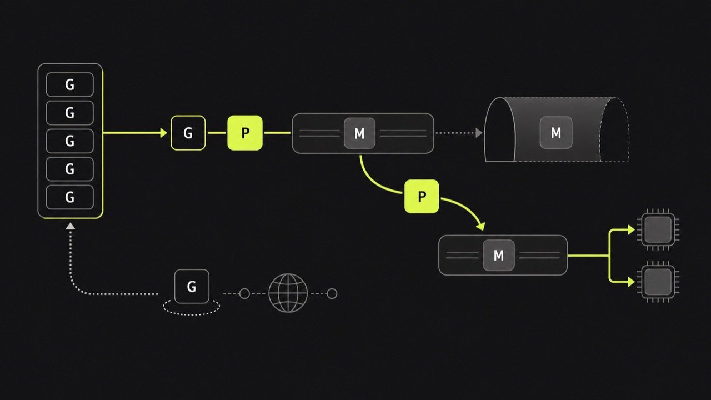

В реальном runtime есть глобальная очередь, stealing между P, таймеры и отдельный сетевой poller. Но начинать ответ с этих деталей не нужно. Сначала покажите, что понимаете разделение задачи, потока и права выполнять Go-код.

Почему горутин может быть много
Поток ОС обычно создаётся и переключается ядром. У него есть системный стек и связанные с ОС структуры. Горутина создаётся внутри процесса Go, а её пользовательский стек начинает с небольшого размера и может расти или уменьшаться. В текущем описании runtime указан стартовый размер порядка 2 КБ, но воспринимать это как навсегда закреплённую гарантию языка не стоит: это деталь реализации.

Небольшой растущий стек и пользовательский планировщик делают запуск горутины заметно дешевле запуска отдельного потока. "Дешевле" всё же не равно "бесплатно". Каждая горутина удерживает стек и служебное состояние. Она может также удерживать ссылки на крупные объекты, открытые соединения или место в очереди.

Вот код, который выглядит безобидно, но способен создать неограниченное число ожидающих горутин:

func consume(jobs <-chan Job) {
	for job := range jobs {
		go func(j Job) {
			_ = callSlowDependency(j)
		}(job)
	}
}
Если зависимость замедлится, вход продолжит создавать работу быстрее, чем она завершается. Память растёт, а лимит у внешнего сервиса обходится огромным числом одновременных запросов.

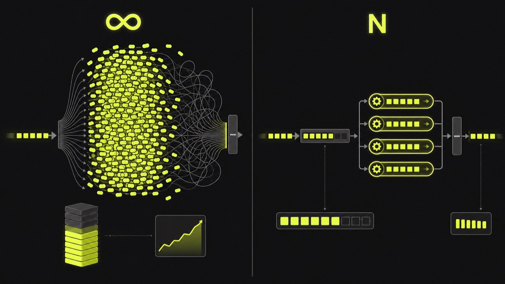

Рабочая версия задаёт границу конкурентности:

func consume(ctx context.Context, jobs <-chan Job, workers int) error {
	g, ctx := errgroup.WithContext(ctx)

	for range workers {
		g.Go(func() error {
			for {
				select {
				case <-ctx.Done():
					return ctx.Err()
				case job, ok := <-jobs:
					if !ok {
						return nil
					}
					if err := callSlowDependency(job); err != nil {
						return err
					}
				}
			}
		})
	}

	return g.Wait()
}
Здесь число одновременно выполняемых вызовов видно из кода. Контекст останавливает остальных воркеров после ошибки. Это прозаичнее, чем go на каждой итерации, зато систему можно нагрузочно тестировать и прогнозировать.

Что происходит при ожидании
Для разработчика важно различать блокировку горутины и блокировку потока.

При ожидании канала или совместимого с runtime сетевого ввода-вывода горутина паркуется. Она исчезает из очереди готовых к исполнению задач до события, после чего снова становится runnable. Поток в это время может выполнять другую G.

Блокирующий системный вызов устроен иначе: M может застрять внутри ядра. Runtime старается не оставлять P без работы и передаёт его другому M. Поэтому число потоков процесса иногда выше GOMAXPROCS. Cgo и некоторые низкоуровневые вызовы тоже делают картину сложнее.

Go умеет вытеснять горутины, которые долго не отдают управление сами. Это не повод писать бесконечные CPU-циклы без оглядки: лишняя конкуренция всё равно создаёт очереди, переключения и работу для сборщика мусора.

GOMAXPROCS в контейнере
Есть практическая деталь, из-за которой старые ответы на собеседовании устаревают. До Go 1.25 значение GOMAXPROCS по умолчанию ориентировалось на логические CPU хоста. Процесс в контейнере с лимитом в 2 CPU на машине со 128 CPU мог планировать гораздо больше параллельной работы, чем разрешал cgroup, и попадать под периодический throttling.

Runtime учитывает лимит контейнера по умолчанию, когда директива go в go.mod имеет версию 1.25 или новее и приложение само не задало GOMAXPROCS. Он также может обновлять значение при изменении лимита. CPU limit и GOMAXPROCS всё равно описывают разные вещи: первый ограничивает процессорное время за период, второй ограничивает параллельное исполнение Go-кода.

Для production-диагностики мало посмотреть на число горутин. Сопоставьте профиль горутин, GOMAXPROCS, CPU throttling контейнера, задержки зависимостей и размер очередей. Большое число G бывает нормальным у сервера с множеством ожидающих соединений. Быстро растущее число G вместе с растущей памятью и незавершающимися стеками уже похоже на утечку.

Разбор Вектора: какой ответ звучит по-мидловому
Слабый ответ заканчивается на фразе "горутины лёгкие". Хороший связывает механику с инженерным решением:

Горутина является планируемой задачей runtime, а M является потоком ОС.
P ограничивает параллельное выполнение через GOMAXPROCS.
Ожидание может припарковать G, не занимая M, но системный вызов способен заблокировать M.
Число горутин всё равно нужно ограничивать там, где есть конечный ресурс: база, внешний API, память или очередь.
Последний пункт отличает знание терминов от понимания эксплуатации. Если кандидат предлагает "запустить горутину на каждый запрос", полезно спросить, что произойдёт при деградации базы на 30 секунд. Ответ про backpressure, таймаут и ограниченный пул обычно ценнее пересказа всех очередей планировщика.

Частые ошибки на собеседовании
Говорить, что одна горутина всегда привязана к одному потоку. Runtime может продолжить её на другом M.
Приравнивать GOMAXPROCS к количеству горутин или всех потоков процесса.
Обещать точный размер стека как свойство спецификации Go. Начальный размер относится к реализации runtime и может измениться.
Делать вывод, что миллионы горутин безопасны при любой нагрузке. Важны удерживаемая память, внешние лимиты и скорость завершения.
Объяснять конкурентность словом "параллельно". На одном P горутины могут выполняться конкурентно, но не одновременно.
Вопросы для самопроверки
Зачем runtime нужна сущность P, если уже есть G и M?
Может ли процесс иметь больше потоков, чем GOMAXPROCS, и почему?
Что произойдёт с P, если M войдёт в долгий системный вызов?
Почему ограниченный worker pool бывает безопаснее go на каждый элемент?
Чем CPU limit контейнера отличается от лимита параллелизма GOMAXPROCS?

Продолжить можно с архитектурной задачей про Rate Limiter на 100K RPS и разбором потоковой репликации PostgreSQL. Там тот же навык проверяется на другом масштабе: сначала модель, затем границы и отказные сценарии.
