channels, select, deadlock и конкурентное взаимодействие

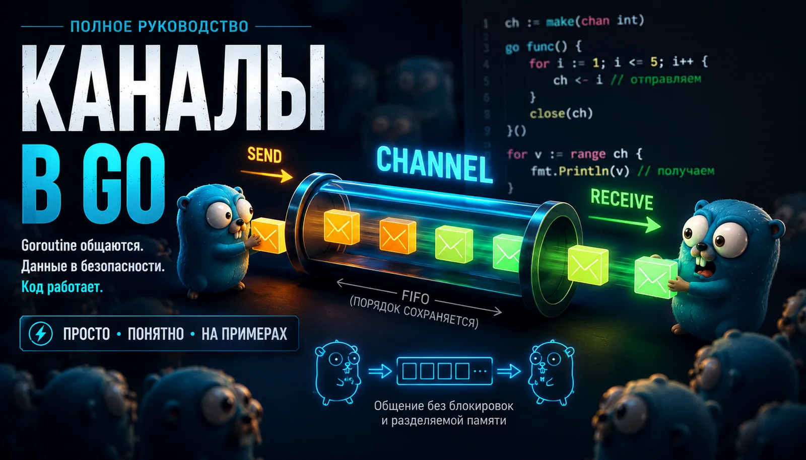

Что такое channels в Go
Channels (каналы) — это способ обмениваться данными между горутинами. Если goroutine — это конкурентные задачи, то channels — это механизм связи между ними. Именно поэтому темы горутины и каналы в Go почти всегда идут рядом.

Горутины выполняют работу:

go worker()
А channels позволяют этим goroutine:

передавать данные
синхронизироваться
сообщать о завершении
строить worker pool
делать fan-in/fan-out
управлять конкурентной обработкой
В Go каналы используются настолько часто, что вопросы про goroutines и каналы golang — база почти любого Go-собеседования.

Ниже разберём каналы от базы до production-паттернов.

Как goroutine общаются через каналы
Горутины сами по себе только запускают конкурентную работу. Но часто им нужно обмениваться данными. Для этого в Go есть каналы.

Channel — это типизированный канал связи между горутинами.

Создание канала:

ch := make(chan string)
Отправка значения:

ch <- "hello"
Получение значения:

msg := <-ch
Полный пример:

package main
import "fmt"
func main() {
ch := make(chan string)
go func() {
ch <- "hello from goroutine"
}()
msg := <-ch
fmt.Println(msg)
}
Здесь main goroutine ждёт чтение из канала. Другая goroutine отправляет сообщение. После получения программа продолжает выполнение.

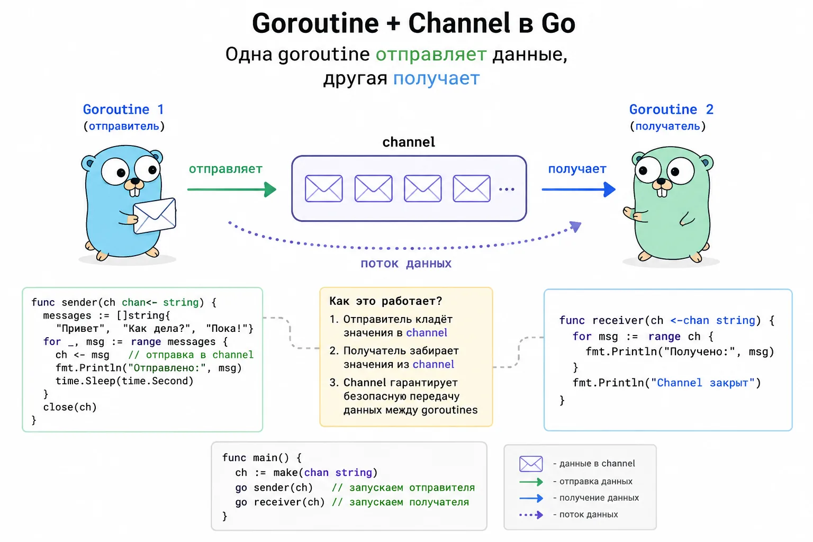

Почему канал блокирует выполнение

Небуферизированный канал синхронизирует отправителя и получателя. Если goroutine отправляет значение в канал, но никто не читает, отправитель блокируется. Если goroutine читает из канала, но никто не пишет, получатель блокируется.

Пример deadlock:

package main
func main() {
ch := make(chan int)
ch <- 1
}
Здесь main пытается записать в канал, но другой goroutine для чтения нет. Поэтому программа зависает и падает с ошибкой:

fatal error: all goroutines are asleep - deadlock!
Важно понимать: channel — это не просто контейнер с данными, это ещё и механизм синхронизации между goroutine.

Fatal error: all goroutines are asleep - deadlock

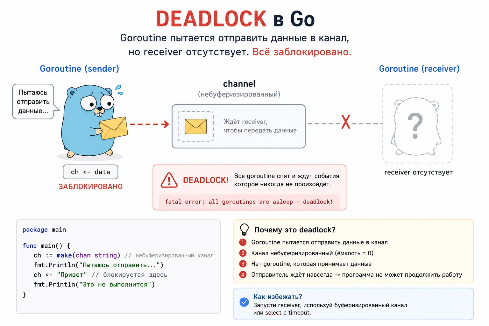

Когда начинаешь работать с каналами, сначала кажется, что всё просто: одна goroutine отправила значение, другая его получила. Но у channels есть важное свойство: они не только передают данные, но и блокируют выполнение, если второй стороны нет.

Это поведение полезно. Благодаря ему горутины могут синхронизироваться без дополнительных флагов и ручных проверок. Но если неправильно выстроить обмен данными, программа может остановиться намертво.

Так появляется deadlock.

Deadlock возникает, когда goroutine ждут друг друга или ждут событие, которое уже никогда не произойдёт. В этот момент ни одна goroutine не может продолжить выполнение, а runtime Golang понимает: программа застряла.

Поэтому появляется ошибка:

fatal error: all goroutines are asleep - deadlock!
Эту ошибку часто видят именно при работе с каналами, потому что отправка и чтение из канала могут блокировать goroutine.

Самый простой пример:

package main
func main() {
ch := make(chan string)
ch <- "hello"
}
Здесь канал небуферизированный. main пытается отправить значение в ch, но другой goroutine, которая читает из канала, нет.

В итоге происходит следующее:

main goroutine доходит до строки ch <- "hello".
Канал ждёт получателя.
Получателя нет.
main goroutine блокируется.
Других goroutine, которые могли бы что-то сделать, тоже нет.
Runtime Go видит, что все goroutine спят.
Программа падает с deadlock.
То есть проблема не в самом канале. Проблема в том, что мы создали точку ожидания, но не создали того, кто это ожидание разблокирует.

Частые ситуации, где появляется deadlock:

отправили значение в канал, но никто не читает
читаем из канала, но никто не пишет
читаем через range, но канал никогда не закрывают
буфер канала заполнен, а получателя нет
ждём WaitGroup, но забыли вызвать Done
запустили pipeline, но одна из стадий перестала читать данные
Важно

Deadlock — это не ошибка компиляции и не случайный баг. Код может спокойно скомпилироваться, но зависнуть уже во время выполнения.

В этом и опасность. По синтаксису всё выглядит нормально:

ch <- value
Но для Go эта строка означает не просто «положи значение в канал». Она означает: «передай значение, когда появится получатель». Если получателя нет, goroutine будет ждать.

Чтобы избежать deadlock, всегда проверяй три вещи:

Кто отправляет данные в канал
Кто читает данные из канала
Кто и когда закрывает канал, если чтение идёт через range
Исправленный пример:

package main
import "fmt"
func main() {
ch := make(chan string)
go func() {
ch <- "hello"
}()
msg := <-ch
fmt.Println(msg)
}
Теперь есть две стороны:

goroutine отправляет значение
main goroutine читает значение
Обмен состоялся, блокировка снялась, программа завершилась нормально.

Buffered channel и unbuffered channel
Каналы Golang бывают буферизированные и небуферизированные.

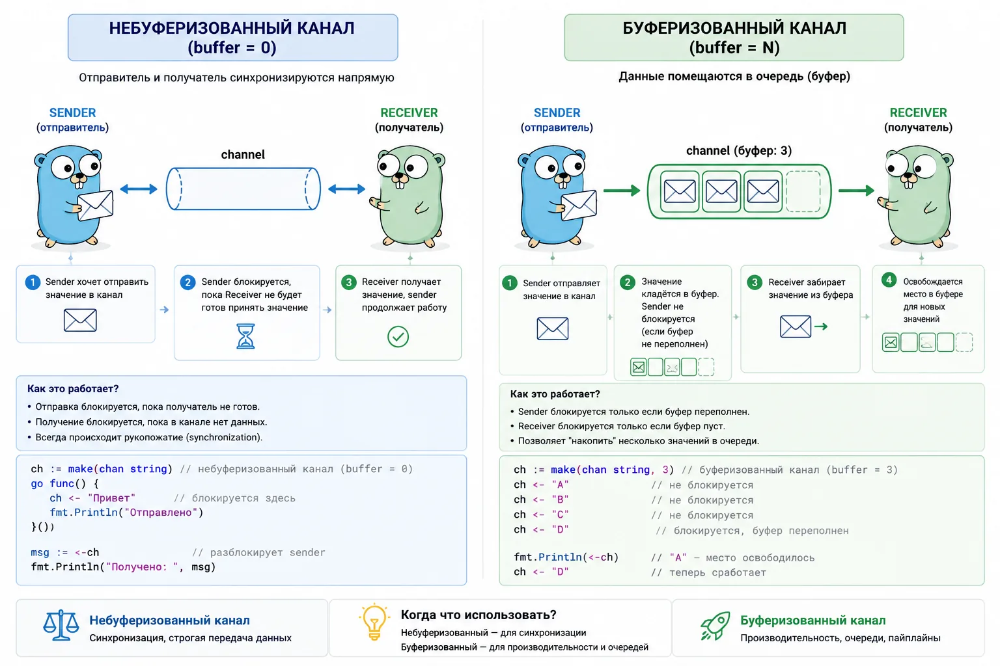

Небуферизированный канал
ch := make(chan int)
Отправитель блокируется, пока получатель не заберёт значение. Такой канал хорош, когда тебе нужна строгая синхронизация.

Буферизированный канал
ch := make(chan int, 3)
У канала есть буфер на 3 элемента.

ch <- 1
ch <- 2
ch <- 3
Эти записи не заблокируются, пока буфер не заполнится. А вот четвёртая запись без чтения уже заблокируется:

ch <- 4 // блокировка, если никто не читает
Когда использовать buffered channel
Буфер полезен, когда отправитель и получатель работают с разной скоростью.

Например:

очередь задач
логирование
worker pool
пакетная обработка
временное сглаживание нагрузки
Но буфер не должен быть способом спрятать проблему. Если канал постоянно забит, проблема в архитектуре или скорости обработки.

Закрытие канала в Golang

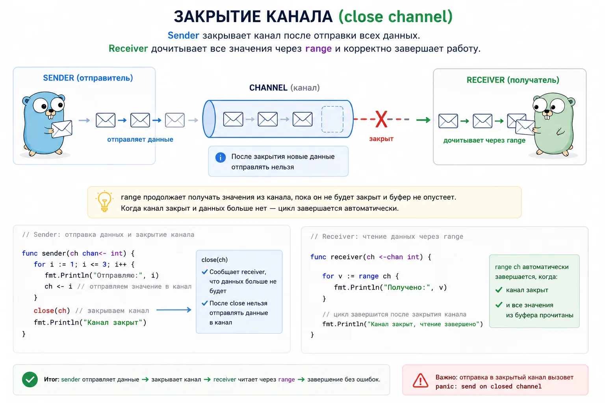

Канал можно закрыть:

close(ch)
Закрытие означает: новых значений больше не будет.

Частый пример:

ch := make(chan int)
go func() {
for i := 0; i < 3; i++ {
ch <- i
}
close(ch)
}()
for v := range ch {
fmt.Println(v)
}
range читает из канала, пока канал не закрыт и пока в нём остаются значения.

Кто должен закрывать channel
Обычно канал закрывает отправитель. Потому что только отправитель точно знает, что новых данных больше не будет.

Если записать в закрытый канал, будет panic:

panic: send on closed channel
Если закрыть уже закрытый канал:

panic: close of closed channel
Это одна из самых частых ошибок у новичков.

Что будет при чтении из закрытого канала
Из закрытого канала можно читать. Если в буфере ещё есть значения, они будут прочитаны. Если значений больше нет, чтение вернёт zero value типа.

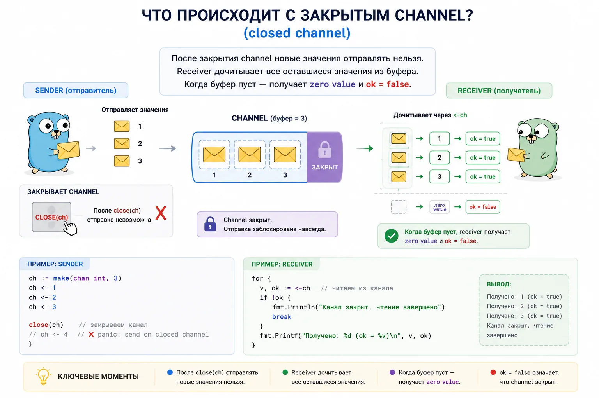

ch := make(chan int, 1)
ch <- 10
close(ch)
v1 := <-ch // 10
v2 := <-ch // 0
Чтобы отличить настоящее значение от zero value, используют второе значение:

v, ok := <-ch
if !ok {
fmt.Println("channel closed")
}
ok == false означает, что канал закрыт и значений больше нет.

Select в Golang

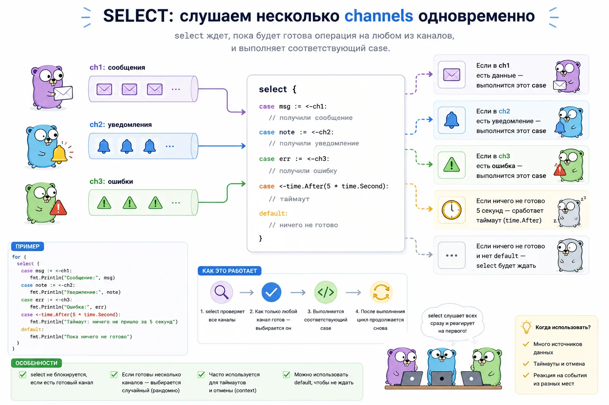

select позволяет ждать несколько операций с каналами одновременно.

select {
case msg := <-ch1:
fmt.Println("from ch1:", msg)
case msg := <-ch2:
fmt.Println("from ch2:", msg)
}
Если готово несколько каналов, Go выберет один из готовых вариантов.

select часто используют для:

timeout
cancellation
чтения из нескольких каналов
fan-in
graceful shutdown
обработки сигналов
worker pool
Пример с timeout:

select {
case result := <-resultCh:
fmt.Println(result)
case <-time.After(time.Second):
fmt.Println("timeout")
}
В production-коде вместо голого time.After часто используют context.Context.

Pipeline в Go
Pipeline в Go — это когда обработка данных разбивается на несколько последовательных этапов.

Представь конвейер на заводе — сначала одна часть системы создаёт данные, потом другая их обрабатывает, потом третья сохраняет результат или отправляет дальше.

В Go такие этапы часто соединяют через каналы.

Например:

input → process → output
Что происходит:

первая goroutine генерирует данные
отправляет их в channel
следующая goroutine читает данные из канала
обрабатывает их
отправляет дальше в следующий channel
последняя стадия получает готовый результат
То есть channel здесь работает как труба между разными этапами обработки.

Главная идея Pipeline

Каждая goroutine делает только свою часть работы: одна отвечает за чтение, другая за обработку, третья за сохранение.

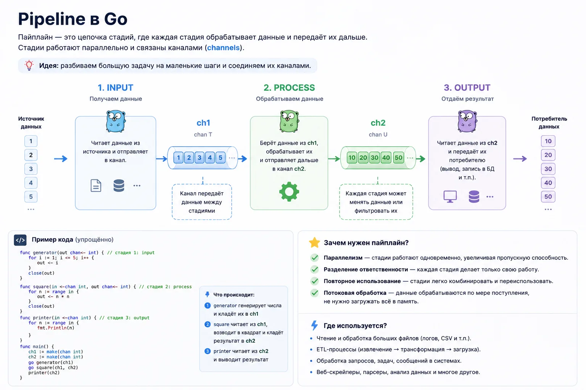

Из-за этого код проще масштабировать и распараллеливать.

Например pipeline используют:

обработка файлов
парсинг данных
стриминг
очереди задач
обработка HTTP-запросов
ETL и data processing
Каждая стадия pipeline:

читает из входного канала
что-то делает
пишет в выходной канал
Пример:

func gen(nums ...int) <-chan int {
out := make(chan int)
go func() {
defer close(out)
for _, n := range nums {
out <- n
}
}()
return out
}
Pipeline удобен для batch processing, стриминга, ETL, обработки файлов, конкурентной обработки данных.

Но у pipeline есть риск утечек. Если одна стадия перестала читать, предыдущая может зависнуть на записи.

Worker Pool в Golang
Worker pool — это способ ограничить количество одновременно работающих goroutine.

Новички часто делают так:

for _, task := range tasks {
go process(task)
}

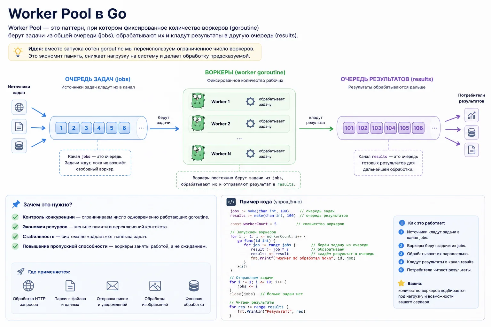

Проблема в том, что если задач станет 10 000, ты создашь 10 000 goroutine. Иногда это нормально. Но в реальных сервисах так можно:

забить CPU
съесть память
положить базу
упереться в лимиты API
перегрузить систему
Поэтому в Go часто используют worker pool, идея очень похожа на очередь работников:

есть очередь задач
есть фиксированное количество работников
каждый worker берёт следующую задачу
делает работу
идёт за следующей
То есть задачи могут быть тысячами, но одновременно работают только, например, 5 или 10 goroutine.

В Go это обычно выглядит так:

есть channel с задачами (jobs)
есть несколько worker goroutine
workers читают задачи из канала
результаты складывают в другой channel
Главная цель

Контролировать нагрузку и не создавать бесконечное количество goroutine

Worker pool используют почти везде:

обработка файлов
email-рассылки
background jobs
очереди задач
HTTP-запросы
парсинг сайтов
batch processing
Например, у тебя 1000 изображений, но одновременно обрабатываются только 5, остальные ждут в очереди. Так система работает стабильно и не умирает от нагрузки.

Пример:

func worker(id int, jobs <-chan int, results chan<- int) {
for job := range jobs {
results <- job * 2
}
}
Worker pool используют:

обработка файлов
очереди задач
email-рассылки
парсеры
background jobs
batch processing
Fan-out и Fan-in
Fan-out — когда одна очередь задач распределяется на несколько goroutine. Fan-in — когда результаты из нескольких goroutine собираются обратно в один канал.

Это частый production-паттерн.

Например:

параллельно обработать список URL
сходить в несколько API
распарсить пачку файлов
собрать результаты обратно

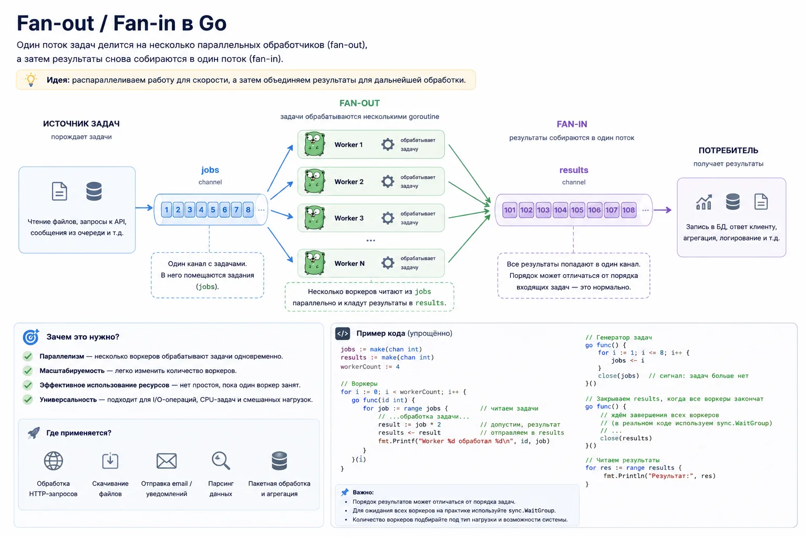

Context и отмена операций через channels

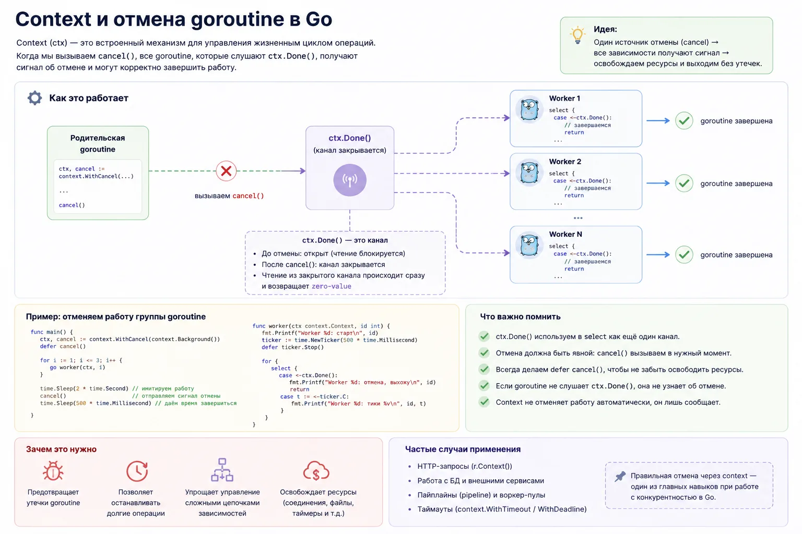

Когда начинаешь работать с каналами, быстро появляется проблема: как корректно остановить goroutine?

Например:

пользователь закрыл HTTP-запрос
timeout уже истёк
pipeline больше не нужен
worker pool завершает работу
сервис выключается
Если goroutine продолжат ждать данные из channel или пытаться туда писать, они могут зависнуть навсегда. Так появляются goroutine leak и зависшие worker.

Для решения этой проблемы в Go используют context.Context.

Важно понимать: context сам ничего не останавливает. Он только отправляет сигнал отмены. А goroutine уже сама должна:

получить этот сигнал
прекратить работу
выйти из цикла
освободить ресурсы
Чаще всего context используется вместе с select, потому что ctx.Done() — это тоже channel. Когда context отменяется, канал Done() закрывается и select может это поймать.

Пример:

func worker(ctx context.Context, jobs <-chan int) {
for {
select {
case <-ctx.Done():
fmt.Println("worker stopped")
return
case job := <-jobs:
fmt.Println("process", job)
}
}
}
Что здесь происходит:

worker ждёт либо новую задачу
либо сигнал отмены
как только context отменяется — goroutine завершается
Создание context:

ctx, cancel := context.WithCancel(context.Background())
defer cancel()
Также часто используют:

context.WithTimeout()
context.WithDeadline()
Это особенно важно в:

HTTP-серверах
pipeline
worker pool
работе с базой
внешних API
background jobs
Без cancellation горутины могут продолжать жить даже после того, как результат уже никому не нужен.

Например:

Клиент уже отключился
HTTP-handler завершился
А worker всё ещё ждёт данные из channel
В production такие утечки постепенно убивают сервис:

растёт число goroutine
увеличивается память
появляются зависшие операции
растёт нагрузка на scheduler
Поэтому почти любая конкурентная система в Go рано или поздно приходит к связке:

channel + select + context

Утечка goroutine при работе с каналами Golang
Одна из самых неприятных проблем в Go — goroutine leak. Это ситуация, когда goroutine больше не делает полезную работу, но продолжает жить. Чаще всего это происходит именно из-за channels.

Например:

goroutine ждёт чтение из channel
sender пытается записать данные, но receiver уже умер
pipeline остановился посередине
worker pool больше никому не нужен
select никогда не получает событие
Пример:

func leak() {
ch := make(chan int)
go func() {
value := <-ch
fmt.Println(value)
}()
}
Что здесь происходит:

Создаётся goroutine
Она ждёт чтение из ch
Но никто никогда не отправит туда данные и функция leak() завершится
Но goroutine останется жить в памяти и это очень опасно. Одна зависшая goroutine — не проблема, но если такое происходит внутри HTTP-сервиса или worker pool под нагрузкой, через время можно получить большие проблемы:

десятки тысяч зависших goroutine
рост памяти
деградацию scheduler
зависания
production-инциденты
Особенно часто leak появляются в pipeline.

Например:

input → process → output
Если стадия output перестала читать данные, то:

process зависнет на отправке
input зависнет следом
весь pipeline начнёт блокироваться
Поэтому при работе с channels важно всегда понимать кто читает, кто пишет и как всё это остановится.

Главные способы защиты от goroutine leak:

использовать context.Context
правильно закрывать channels
не делать бесконечные for range без остановки
использовать select с ctx.Done()
следить, чтобы у sender всегда был receiver
В production goroutine leak — одна из самых частых проблем конкурентного кода.

Именно поэтому на собеседованиях любят спрашивать: что будет, если никто не читает из channel?

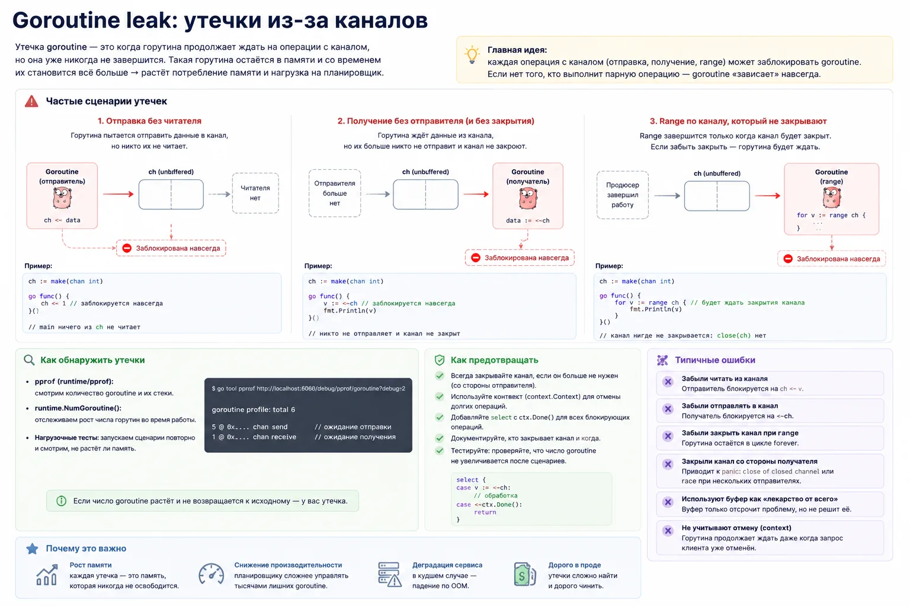

Главные правила поведения каналов
У channels есть несколько важных правил. Их часто называют аксиомами channels.

Это не какие-то «теоретические законы», а реальные особенности работы runtime Go.

Если их не понимать, появляются, deadlock, panic, зависшие goroutine, странное поведение select, production-баги. Эти правила очень любят спрашивать на собеседованиях.

Потому что они быстро показывают, что человек реально понимает channels, а не просто копировал код из примеров.

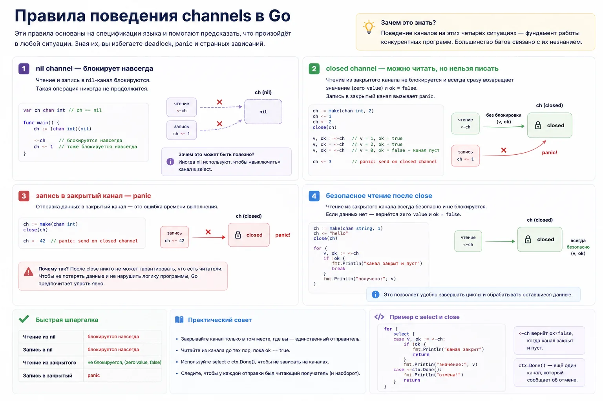

Запись в nil channel блокируется навсегда
var ch chan int
ch <- 1
nil channel — это канал, который не был создан через make. Он существует как переменная, но самого канала в памяти нет, поэтому runtime некуда отправлять данные.

Goroutine зависнет навсегда.

Чтение из nil channel блокируется навсегда
var ch chan int
<-ch
Здесь та же проблема — читать неоткуда, потому что реального channel не существует. Поэтому goroutine тоже зависнет.

Интересный факт: nil channels специально используют внутри select

Так можно динамически отключать case.

Запись в закрытый channel вызывает panic
close(ch)
ch <- 1
После закрытия channel больше не принимает новые данные. Поэтому runtime сразу вызывает panic:

panic: send on closed channel
Это защита от повреждения логики программы.

Чтение из закрытого channel безопасно
v, ok := <-ch
Если канал закрыт:

чтение не вызывает panic
можно дочитать оставшиеся значения
после этого придёт zero value
ok == false означает: channel закрыт и данных больше нет

Именно поэтому range по channel работает корректно после close(ch).

Типичные ошибки при работе с channels
Каналы в Go выглядят простой конструкцией:

ch <- value
value := <-ch
Но в реальных проектах именно вокруг channels появляется огромное количество зависаний, deadlock и утечек goroutine.

Ниже ошибки, которые чаще всего встречаются у новичков и регулярно всплывают на собеседованиях.

Использовать time.Sleep вместо нормальной синхронизации
Плохой пример:

go worker()
time.Sleep(time.Second)
Новички часто пытаются подождать, пока горутина завершится через Sleep.

Проблема в том, что:

goroutine может завершиться раньше
может завершиться позже
код становится нестабильным
появляются случайные баги
Правильный подход:

WaitGroup
channels
context
synchronization primitives
Читать через range, но не закрыть channel
for v := range ch {
fmt.Println(v)
}
range завершится только после закрытия channel. Если channel никто не закроет — goroutine зависнет навсегда.

Это одна из самых популярных причин deadlock.

Закрывать channel со стороны receiver
Обычно channel закрывает sender. Потому что именно sender знает — данных больше не будет.

Если receiver закроет channel слишком рано, sender может попытаться записать туда данные.

И программа упадёт:

panic: send on closed channel
Писать в закрытый channel
close(ch)
ch <- 1
После close channel больше не принимает значения.

Это всегда panic.

Поэтому в конкурентном коде важно понимать:

кто отвечает за close
когда канал закрывается
кто ещё может писать данные
Делать бесконечные goroutine без cancellation
go func() {
for {
value := <-ch
fmt.Println(value)
}
}()
Если sender исчезнет, goroutine останется ждать данные вечно — так появляются goroutine leak. В production это может постепенно убить сервис.

Используй:

context.Context
select
ctx.Done()
корректное закрытие channels
Игнорировать buffered/unbuffered поведение
Новички часто думают, что channel то же, что очередь. Но небуферизированный channel работает как точка синхронизации.

Sender и receiver встречаются одновременно. А buffered channel позволяет временно складывать значения в буфер. Если этого не понимать, появляются неожиданные блокировки, deadlock и странное поведение pipeline.

Забывать кто читает из channel
Очень частая production-проблема:

sender пишет данные
receiver уже завершился
goroutine зависает на отправке
Особенно часто это ломает:

pipeline
worker pool
fan-in/fan-out
Поэтому при работе с каналами всегда задавай себе три вопроса:

кто пишет?
кто читает?
кто всё это остановит?
Что спрашивают на собеседованиях по channels
Частые вопросы:

Что такое channel?
Чем buffered отличается от unbuffered?
Что вызывает deadlock?
Кто должен закрывать канал?
Что будет при чтении из закрытого канала?
Что такое select?
Что такое nil channel?
Что такое fan-in/fan-out?
Когда использовать mutex вместо channels?
Шпаргалка по каналам Golang
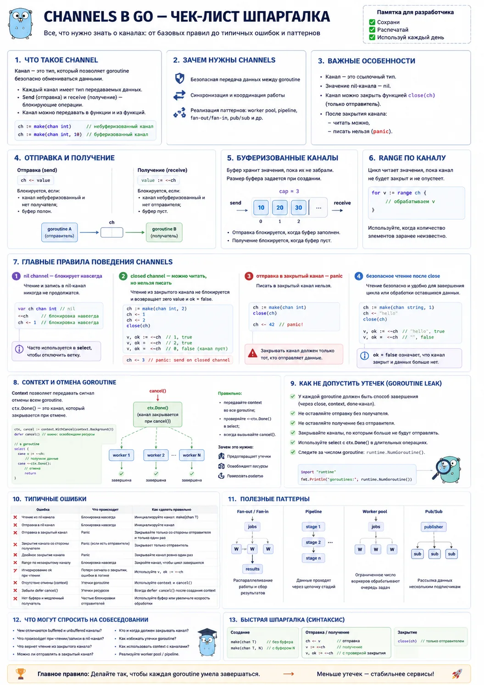

Channels — одна из ключевых частей конкурентности в Go.

Через channels goroutine:

обмениваются данными
синхронизируются
строят worker pool
делают pipeline
управляют конкурентной обработкой
Но важно понимать не только синтаксис. На реальных проектах и собеседованиях обычно проверяют:

понимаешь ли ты блокировки
умеешь ли избегать deadlock
знаешь ли как закрывать channels
умеешь ли останавливать goroutine
понимаешь ли buffered/unbuffered channels
умеешь ли строить worker pool и pipeline
Когда channels складываются вместе с goroutine, context и synchronization primitives, конкурентность в Go перестаёт быть набором магических конструкций и становится нормальным инженерным инструментом.

FAQ по каналам
Что такое channel в Go?

Channel в Go — это типизированный механизм связи между goroutine. Через channel одна goroutine может отправить значение, а другая получить его.

Чем buffered channel отличается от unbuffered channel?

Unbuffered channel блокирует отправителя, пока получатель не заберёт значение. Buffered channel имеет буфер и позволяет временно хранить несколько значений без немедленного чтения.

Почему возникает deadlock при работе с channels?

Deadlock возникает, когда goroutine ждёт операцию с channel, которая уже никогда не произойдёт. Например, отправка есть, а получателя нет, или чтение есть, а отправителя нет.

Кто должен закрывать channel в Go?

Обычно channel закрывает отправитель, потому что именно он знает, что новых данных больше не будет. Receiver чаще всего только читает данные.

Что будет при чтении из закрытого channel?

Чтение из закрытого channel безопасно. Сначала можно дочитать оставшиеся значения, затем канал начнёт возвращать zero value и ok = false.

Что будет при записи в закрытый channel?

Запись в закрытый channel вызывает panic: send on closed channel.

Зачем нужен select в Go?

select позволяет ждать несколько операций с channels одновременно. Его используют для timeout, cancellation, чтения из нескольких каналов, fan-in, worker pool и graceful shutdown.

Что такое nil channel?

Nil channel — это channel, который не был создан через make. Чтение и запись в nil channel блокируются навсегда.

Что такое goroutine leak при работе с channels?

Goroutine leak возникает, когда goroutine зависает на операции с channel и больше не может завершиться. Например, она ждёт данные из channel, в который никто уже не отправит значение.

Когда использовать channel, а когда mutex?

Channel удобен для передачи данных и координации goroutine. Mutex лучше подходит для защиты общей памяти, когда нескольким goroutine нужен безопасный доступ к одной структуре данных.
