mutex, atomic, shared memory и синхронизация goroutine

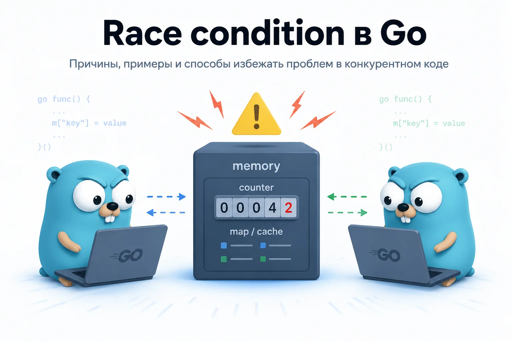

Когда разработчик впервые начинает использовать goroutine, почти сразу появляется новая проблема — теперь код выполняется не последовательно, а конкурентно. А значит несколько частей программы могут одновременно работать с одной и той же памятью. Именно в этот момент появляются race condition.

На маленьких примерах такие ошибки могут быть незаметны. Программа иногда работает нормально, иногда начинает вести себя странно, иногда падает только под нагрузкой.

Именно поэтому race condition считаются одной из самых неприятных проблем в конкурентном программировании.

В Go эта тема особенно важна, потому что goroutine очень дешёвые и их легко запускать тысячами. Но чем больше concurrent-кода появляется в приложении, тем важнее понимать:

как goroutine работают с общей памятью
почему counter++ может ломаться
зачем нужны mutex и atomic операции
почему map не безопасна для конкурентной записи
как искать гонки данных через race detector

Что такое shared memory в Go

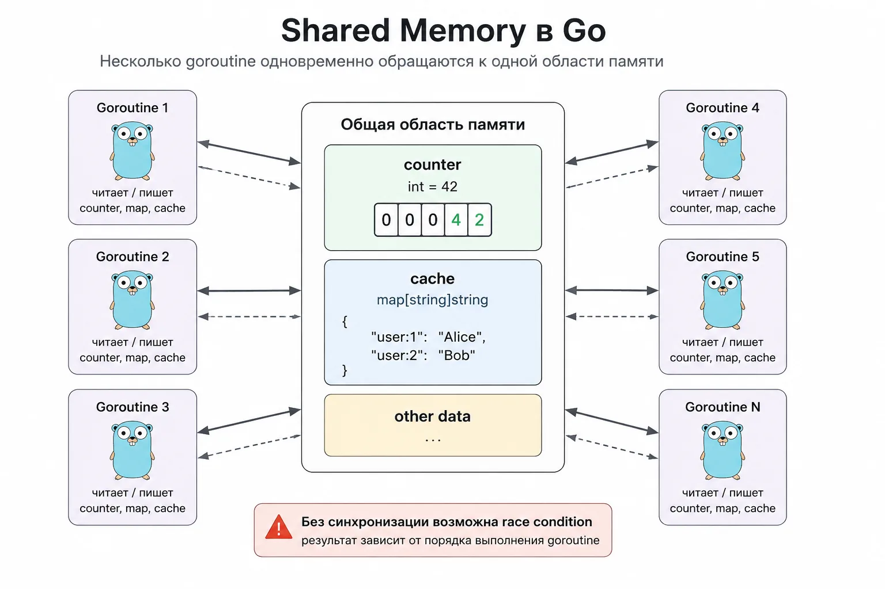

Race condition почти всегда появляются вокруг shared memory.

Shared memory — это память, к которой обращаются несколько goroutine одновременно.

Например:

общий counter
map с кэшем
slice с данными
структура конфигурации
список подключений
состояние сервиса
Проблема начинается, когда несколько goroutine одновременно читают и пишут, или пишут в одну область памяти.

Тогда результат зависит от порядка выполнения goroutine. А порядок выполнения scheduler не гарантирует.

Именно поэтому race condition — это не редкий баг Go, а фундаментальная проблема конкурентного программирования.

Race condition в Go

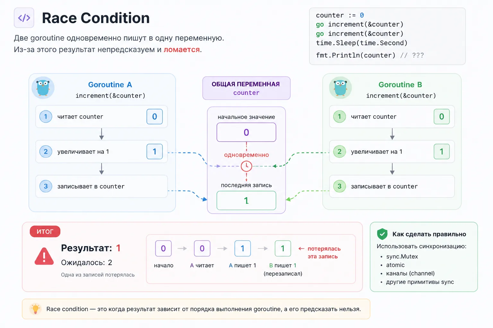

Goroutine легко запускать, но из-за этого легко получить одну из самых неприятных ошибок в конкурентном коде — race condition.

Race condition (гонка данных) возникает, когда результат программы зависит от того, в каком порядке выполнились goroutine.

Проще говоря: две goroutine одновременно трогают одни и те же данные

Если обе только читают — обычно проблемы нет.

Проблема начинается, когда хотя бы одна goroutine пишет.

Например:

одна goroutine читает переменную, другая в этот момент её меняет
две goroutine одновременно увеличивают счётчик
несколько goroutine пишут в одну map
несколько goroutine делают append в один slice
одна goroutine меняет структуру, а другая одновременно читает её поля
На первый взгляд код может выглядеть нормально. Он даже может тысячу раз отработать без ошибки. А потом внезапно начнёт давать странный результат.

В этом и проблема race condition: ошибка зависит от порядка выполнения, а порядок выполнения goroutine не гарантирован.

Почему counter++ не безопасен
Классический пример:

package main
import (
"fmt"
"sync"
)
func main() {
var wg sync.WaitGroup
counter := 0
for i := 0; i < 1000; i++ {
wg.Add(1)
go func() {
defer wg.Done()
counter++
}()
}
wg.Wait()
fmt.Println(counter)
}
Кажется, что в конце должно быть 1000.

Но counter++ — это не одна атомарная операция. Внутри там несколько шагов:

1. прочитать counter
2. увеличить значение на 1
3. записать новое значение обратно

Теперь представь две goroutine.

counter сейчас равен 0.

Первая goroutine читает 0.

Вторая goroutine тоже читает 0.

Первая увеличивает до 1 и записывает.

Вторая тоже увеличивает своё старое значение до 1 и записывает.

В итоге две goroutine выполнили работу, а в счётчике получилось 1, хотя ожидалось 2.

Схема:

counter = 0

Goroutine A читает 0
Goroutine B читает 0

Goroutine A пишет 1
Goroutine B пишет 1

ожидали 2
получили 1

Одна запись потерялась — это и есть race condition.

Почему race condition сложно заметить
Race condition часто не проявляется сразу. Сегодня программа выводит правильный результат. Завтра на другой машине — неправильный. Под нагрузкой — падает. В тестах — иногда зелёная, иногда красная.

Причина в том, что scheduler Go сам решает, когда какую goroutine выполнять.

Scheduler (планировщик) — это часть runtime Go, которая распределяет goroutine по потокам ОС.

Он постоянно решает:

какую goroutine сейчас запускать
какую остановить
какую разбудить после ожидания
какую перенести на другой поток
Из-за этого порядок выполнения goroutine заранее не гарантирован, ты не контролируешь точный порядок выполнения.

Поэтому нельзя писать код в надежде, что эта goroutine точно успеет первой. В конкурентном коде такая логика ломается.

Race condition с map
С map ситуация ещё опаснее. Обычная map в Go не безопасна для конкурентной записи.

Пример:

package main
func main() {
m := map[int]int{}
go func() {
m[1] = 1
}()
go func() {
m[2] = 2
}()
select {}
}
Такой код может упасть с ошибкой:

fatal error: concurrent map writes

Поэтому если несколько goroutine работают с одной map, нужна синхронизация: sync.Mutex, sync.RWMutex, sync.Map или другая архитектура, где состоянием владеет одна goroutine.

sync.Map: когда используют concurrent map
Для некоторых сценариев в Go есть sync.Map.

Пример:

var cache sync.Map
cache.Store("user", 42)
value, ok := cache.Load("user")
sync.Map уже умеет безопасно работать конкурентно, но это не улучшенная map для всего подряд.

Обычно sync.Map используют:

для read-heavy нагрузки
кэшей
редко изменяемых структур
shared registry
long-lived concurrent state
Во многих случаях обычная map + mutex будет проще и быстрее.

Поэтому sync.Map — инструмент под конкретные сценарии, а не универсальная замена map.

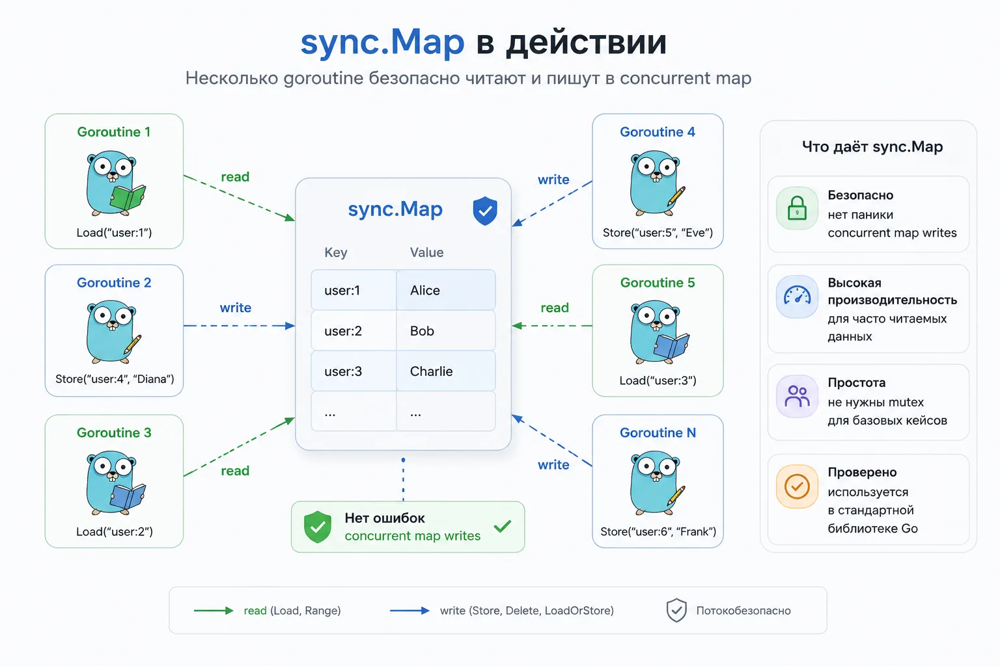

Race condition со slice
Со slice тоже можно получить проблемы.

Например, если несколько goroutine одновременно делают append в один и тот же slice:

items := []int{}
for i := 0; i < 1000; i++ {
go func(i int) {
items = append(items, i)
}(i)
}
append может менять внутренний массив slice, длину и capacity.

Если несколько goroutine делают это одновременно, можно получить потерянные элементы, повреждённые данные или непредсказуемое поведение.

Как находить race condition
Для поиска таких проблем в Go есть race detector.

Для тестов:

go test -race ./...
Для обычного запуска:

go run -race main.go
Если race detector найдёт проблему, он покажет:

где была запись
где было чтение или другая запись
какие goroutine участвовали
стек вызовов
Это один из главных инструментов при работе с конкурентным кодом. Но важно понимать: race detector помогает находить ошибки, а не заменяет понимание синхронизации.

Как исправляют race condition
Основные способы:

sync.Mutex, если нужно защитить общую переменную
sync.RWMutex, если много чтений и мало записей
sync/atomic, если нужен простой счётчик или флаг
channels, если данные нужно передавать между goroutine
архитектура с владельцем состояния, когда только одна goroutine меняет данные
Дальше разберём mutex, потому что это самый простой и частый способ защитить shared state.

Mutex: когда канал не нужен
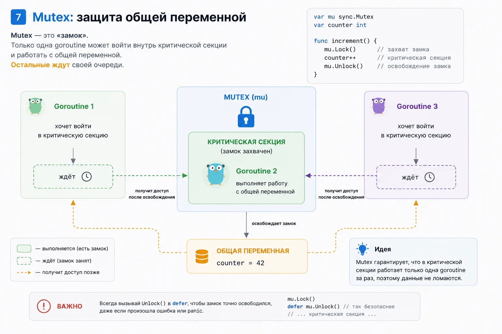

Channels часто показывают как главный инструмент конкурентности в Go. Но это не значит, что ими нужно решать всё.

Если задача — защитить общую переменную, часто проще использовать sync.Mutex.

Пример исправления counter:

package main
import (
"fmt"
"sync"
)
func main() {
var wg sync.WaitGroup
var mu sync.Mutex
counter := 0
for i := 0; i < 1000; i++ {
wg.Add(1)
go func() {
defer wg.Done()
mu.Lock()
counter++
mu.Unlock()
}()
}
wg.Wait()
fmt.Println(counter)
}
Mutex работает как замок.

Пока одна goroutine находится внутри критической секции, другая ждёт.

правило

Нужно передать данные между goroutine — думай про channel. Нужно защитить общую память — думай про mutex.

Общая память + запись из нескольких goroutine = нужна синхронизация

Это не железный закон, но хорошая стартовая логика для новичка.

Channels vs Mutex: что использовать
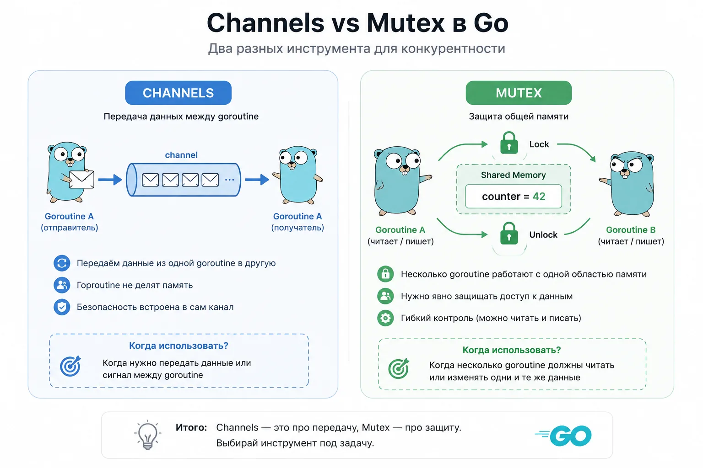

Новички часто пытаются решить вообще всё через channels. Но channels — не замена mutex.

Хорошее правило:

Channels — для передачи данных.
Mutex — для защиты shared memory.

Если тебе нужно защитить: counter, map, slice, shared state — то mutex обычно проще.

Если нужно:

передать результат
построить pipeline
сделать worker pool
синхронизировать стадии обработки
То channels подходят лучше.

В production Go-коде почти всегда используются оба подхода.

sync.RWMutex
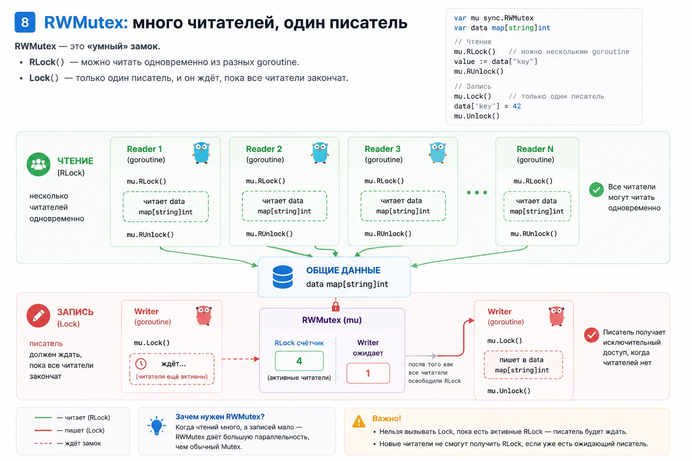

Иногда данных много читают и редко изменяют. Например:

кэш настроек
справочник
локальное состояние сервиса
таблица маршрутов
in-memory конфиг
Если использовать обычный Mutex, читатели будут блокировать друг друга, хотя они ничего не меняют.

Для таких случаев есть sync.RWMutex.

Он разделяет блокировки:

RLock() для чтения
Lock() для записи
Пример:

var mu sync.RWMutex
var cache = map[string]string{}
func get(key string) string {
mu.RLock()
defer mu.RUnlock()
return cache[key]
}
func set(key, value string) {
mu.Lock()
defer mu.Unlock()
cache[key] = value
}
Несколько goroutine могут читать одновременно, но когда приходит запись, она получает эксклюзивный доступ.

RWMutex полезен не всегда. Если записей много, он может не дать выигрыша и только усложнить код. Поэтому его используют там, где чтений действительно сильно больше, чем записей.

Deadlock на mutex
Mutex тоже можно использовать неправильно.

Классический пример:

mu.Lock()
mu.Lock()
Вторая блокировка зависнет навсегда.

Также deadlock можно получить, если:

забыть Unlock()
взять mutex в разном порядке
получить циклическое ожидание
заблокировать mutex и уйти в долгую операцию
Поэтому конкурентный код — это ещё и про аккуратное управление shared state.

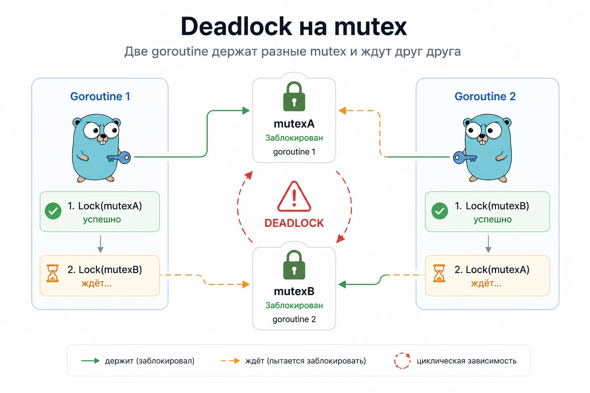

Atomic operations

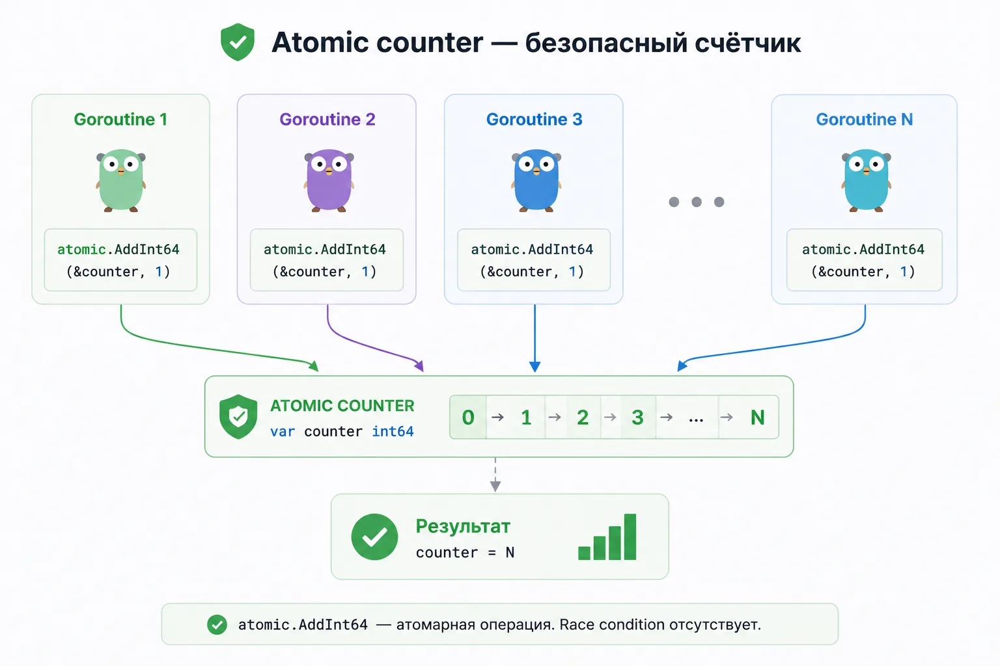

Для простых счётчиков иногда используют пакет sync/atomic.

Например:

var counter atomic.Int64
counter.Add(1)
fmt.Println(counter.Load())
Atomic операции полезны для:

счётчиков
флагов
метрик
простых числовых значений
Но ими не стоит заменять нормальную архитектуру.

Если состояние сложное, лучше использовать mutex, channel или отдельную goroutine-владельца состояния.

Почему race condition особенно опасны на проде

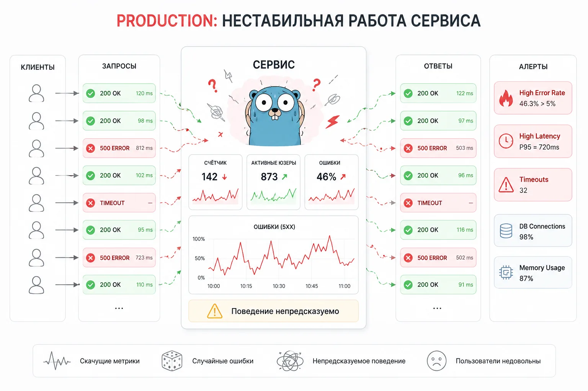

Самая неприятная часть race condition — нестабильность.

Ошибка может:

не проявляться неделями
проявляться только под нагрузкой
ломаться только на production
исчезать при дебаге
не воспроизводиться локально
Из-за этого гонки данных считаются одним из самых дорогих типов багов в backend-разработке.

Особенно в:

highload-сервисах
realtime системах
очередях
websocket
финансовых системах
многопоточных API
Иногда сервис просто странно работает:

теряются данные
скачут счётчики
ломается cache
приходят дубли
периодически падают map
возникают phantom bugs
И причина оказывается в одной конкурентной записи.

Что спрашивают на собеседованиях по race condition
Типичные вопросы:

Что такое race condition?
Почему counter++ не атомарен?
Чем mutex отличается от atomic?
Когда использовать RWMutex?
Почему map не thread-safe?
Что делает race detector?
Что такое shared memory?
Чем channels отличаются от mutex?
Что такое concurrent map writes?
Что такое deadlock?
Что такое atomic operation?
синтаксис goroutine, но плохо понимает именно shared memory и синхронизацию.

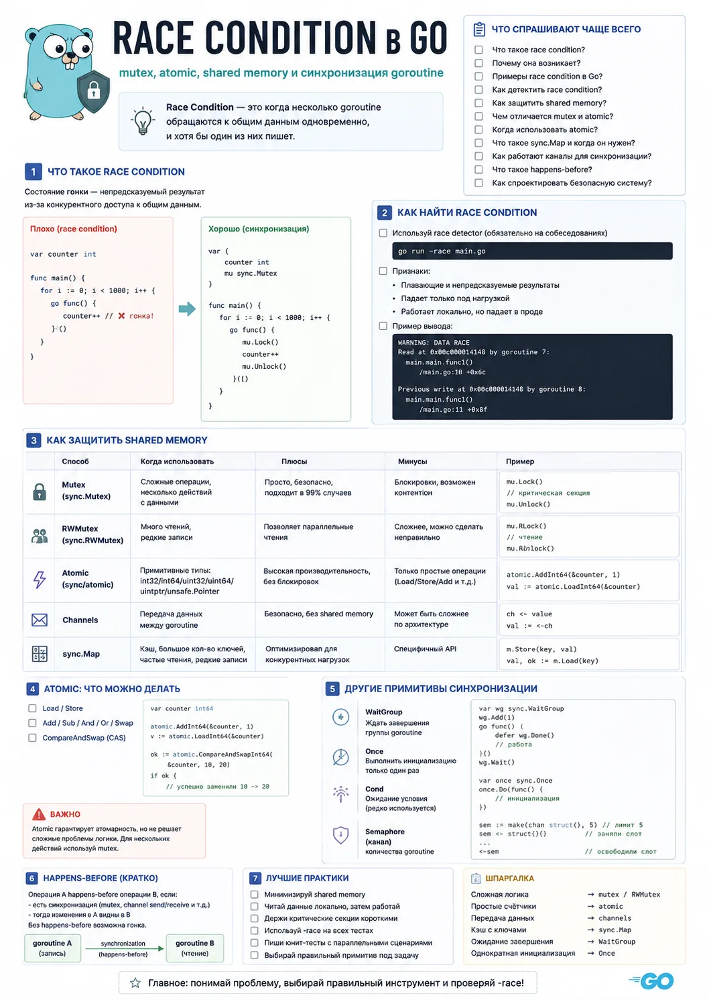

Race condition — одна из главных проблем конкурентного программирования. Пока приложение маленькое, гонки данных могут не проявляться, но под нагрузкой они начинают приводить к:

нестабильности
потерянным данным
random bugs
падениям
corruption state
production-инцидентам
Поэтому Go-разработчик должен понимать:

как goroutine работают с памятью
почему shared state опасен
как использовать mutex
когда нужен RWMutex
где подходят atomic операции
как искать гонки через race detector
почему channels не заменяют mutex
Это фундамент backend-разработки.
