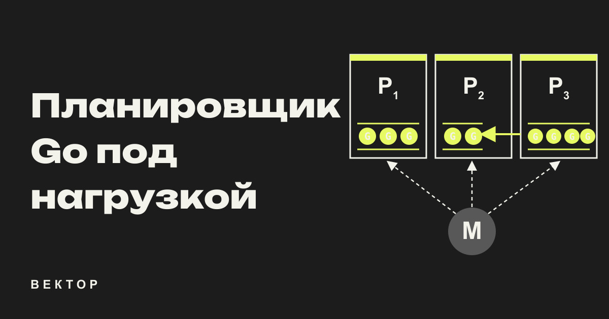
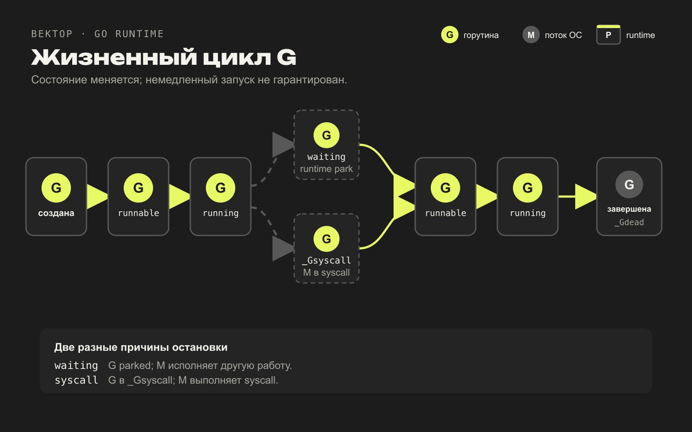
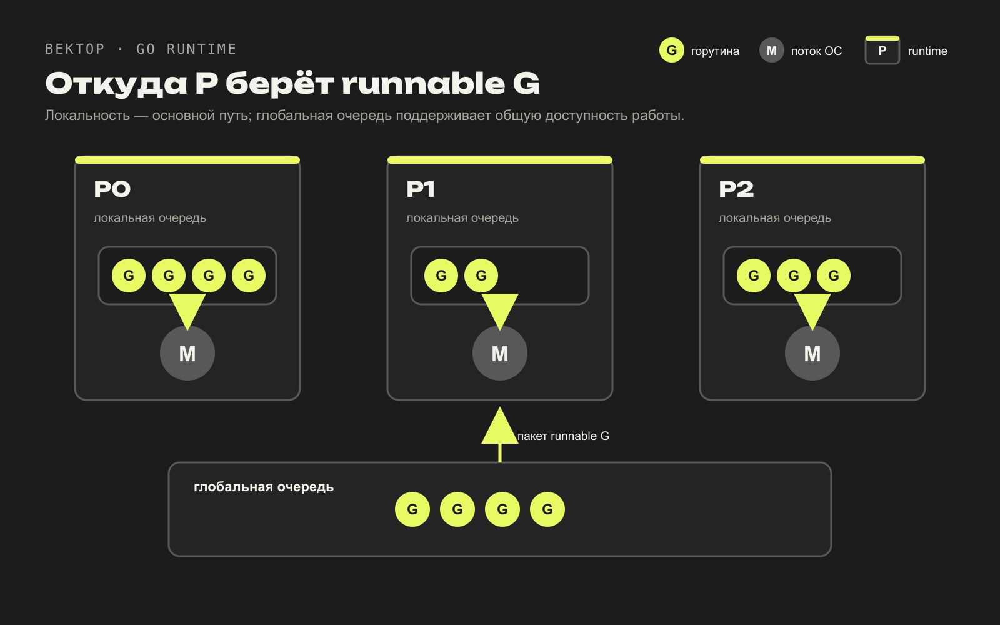
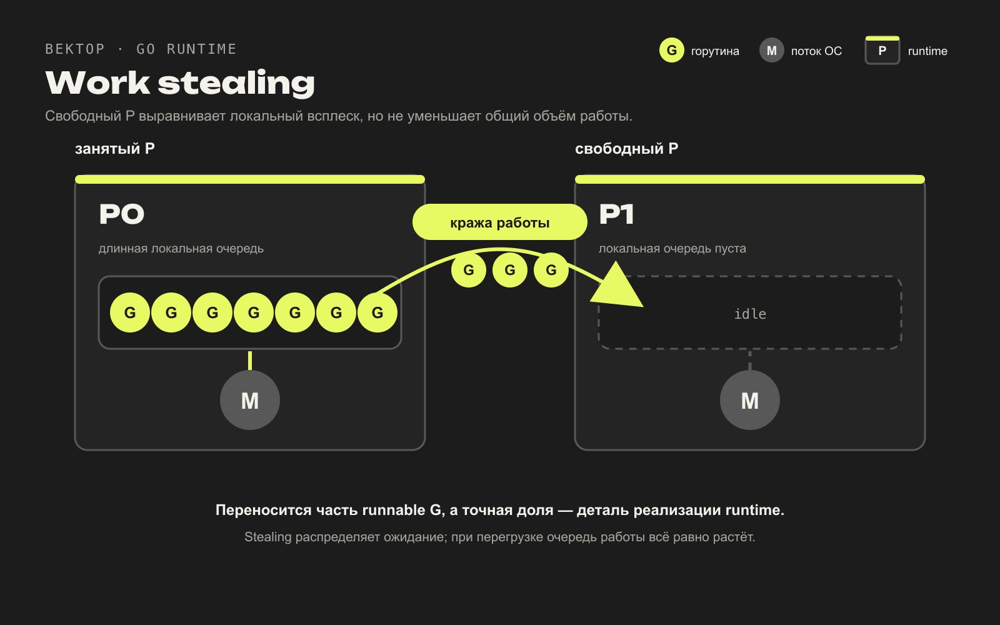
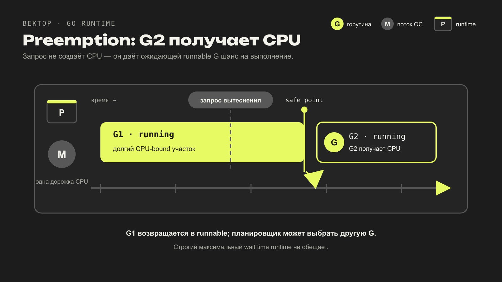
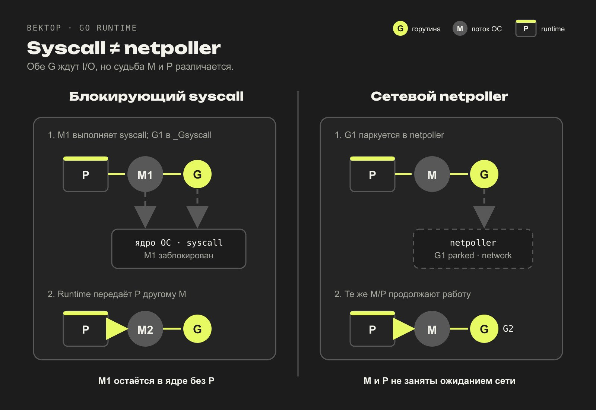
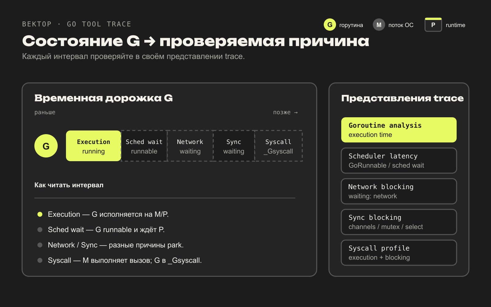

Планировщик Go под нагрузкой: очереди, work stealing, preemption и netpoller
Как Go распределяет горутины между потоками, крадёт работу у соседних P и обслуживает сетевой ввод-вывод.

Короткий ответ: когда G ждёт событие, которое обслуживает runtime, — например, канал, таймер или поддерживаемый сетевой дескриптор, — runtime паркует G, а M с P продолжает цикл планировщика и может запустить другую работу. Блокирующий syscall идёт другим путём: G переходит в _Gsyscall, M может остаться внутри ядра, а P runtime вправе передать другому M. Когда M с P ищет следующую runnable G, свободный P при пустой собственной очереди может забрать часть работы у соседа. GOMAXPROCS задаёт количество P, но не общее число горутин или потоков ОС. Поэтому медленный запуск runnable-горутин, рост числа M и большое число ожидающих G указывают на разные проблемы.

Базовую модель G–M–P мы разобрали в статье «Горутина — это не поток». Здесь нас интересует следующий уровень: откуда планировщик берёт работу, как выравнивает нагрузку между P и что именно показывает go tool trace.

Статья опирается на runtime Go 1.26. Названия функций помогают связать объяснение с исходниками, но порядок проверок, размеры очередей, число попыток stealing и другие числовые детали не входят в спецификацию языка. В следующей версии Go они могут измениться.

Что происходит после go f()
Оператор go f() не запускает f немедленно и не создаёт поток ОС. Runtime выделяет или переиспользует структуру G, готовит начальный стек и контекст вызова, присваивает новой горутине состояние _Grunnable, затем помещает её в очередь работы. Обычно это локальная очередь текущего P. Если локальная очередь заполнена, часть накопившихся G переносится в глобальную очередь.

Полезно держать в голове пять состояний:

_Grunnable: G готова работать, но ещё не получила M и P.
_Grunning: G исполняется на M, у которого есть P.
_Gwaiting: G припаркована внутри runtime, например на канале, mutex, таймере или сетевом вводе-выводе.
_Gsyscall: M выполняет системный вызов, а связанная с ним G находится в этом состоянии. P runtime вправе передать другому M.
_Gdead: функция завершилась, структуру G можно позже переиспользовать.
Переход из waiting в runnable тоже не означает немедленного запуска. Событие лишь возвращает G в набор готовой работы. Дальше ей нужен свободный P, M и очередь без чрезмерного ожидания.

Пробуждённая G не начинает выполняться сразу: сначала она возвращается в runnable и ждёт M с P.

Эта разница хорошо видна в перегруженном сервисе. Если запрос к базе завершился, обслуживающая его G стала runnable, но все P заняты CPU-bound работой, задержка запроса продолжает расти уже не в базе. Горутина ждёт планировщик. По одному лишь wall time обработчика эти две причины не различить.

Локальные и глобальная очереди
У каждого P есть своя очередь runnable-горутин. Локальная очередь уменьшает конкуренцию за общий lock и сохраняет локальность: M с этим P может брать следующую G, не обращаясь к общей структуре на каждом переключении. Рядом с обычной кольцевой очередью находится слот runnext. Он нужен для G, которую желательно выполнить следующей с наследованием остатка текущего временного кванта.

Глобальная очередь нужна для работы, которую нельзя или невыгодно оставить у одного P. Туда попадает, например, часть локальной очереди при переполнении. Глобально добавляется и работа, которую runtime делает runnable пачкой без привязки к текущему P.

Локальная очередь сокращает общий lock, но глобальная очередь и другие источники работы остаются частью поиска.

Фраза «планировщик всегда сначала берёт G из локальной очереди» удобна только как первое приближение. В findRunnable Go 1.26 есть дополнительные источники работы: trace reader, GC workers, таймеры и netpoller. Кроме того, runtime периодически проверяет глобальную очередь до локальной. Эта проверка защищает от сценария, в котором две G постоянно будят друг друга через runnext, а глобальная работа долго не получает процессор.

Когда обычная локальная очередь пуста, findRunnable проверяет глобальную и может перенести оттуда пакет G в локальную очередь. Затем следует неблокирующая проверка netpoller и попытка stealing. Такой порядок полезно знать для чтения исходников, но нельзя строить корректность программы на конкретной последовательности. Планировщик не обещает FIFO между всеми горутинами.

На практике очередь важнее числа горутин сама по себе. Большое число G, которые ждут сокеты, может почти не спорить за CPU. Гораздо меньший набор runnable G при нескольких P уже создаёт scheduler latency. Поэтому метрика runtime.NumGoroutine() отвечает лишь на вопрос «сколько G существует», но ничего не говорит о распределении по состояниям.

Как свободный P крадёт работу
Один P может опустошить очередь, пока соседний накопил сотни runnable G. Централизованный диспетчер смог бы распределять их равномерно, но стал бы общей точкой синхронизации. Go использует другой ход: P без работы ищет загруженного соседа и пытается забрать часть его локальной очереди. Это и есть work stealing.

Свободный P забирает часть очереди соседа; остальная работа остаётся у исходного P.

В Go 1.26 функция stealWork обходит P в псевдослучайном порядке несколькими проходами. Такой порядок распределяет обращения свободных P между очередями. На последнем проходе runtime также проверяет таймеры выбранного P и может попробовать забрать его runnext; эту G оставляют напоследок, потому что она связана с временным квантом текущей работы.

Сам перенос выполняет runqsteal. В рассматриваемой реализации он забирает часть runnable-работы из обычной очереди жертвы, кладёт пачку в очередь текущего P и одну G сразу возвращает для исполнения. Часто этот механизм описывают как «кражу половины очереди». Так проще представить выравнивание нагрузки, но это не контракт Go: точная доля, число проходов и обращение с runnext являются деталями runtime.

На собеседовании встречается формулировка: «Как выбирается жертва при work stealing в планировщике Go?» Короткий ответ такой: P обходятся в псевдослучайном порядке, чтобы распределить конкуренцию между очередями; у выбранного P с runnable-работой планировщик пытается украсть часть G. Углублённый ответ должен добавить версию Go и оговорку об отсутствии гарантии в спецификации.

Stealing не должен превращаться в постоянное сканирование всех P. Поток, который ищет работу, находится в состоянии spinning. Runtime ограничивает число spinning M относительно занятых P, иначе приложение с большим GOMAXPROCS и низким реальным параллелизмом тратило бы CPU на пустой обход очередей. Когда spinning M сдаётся и собирается заснуть, планировщик повторно проверяет источники работы, чтобы не пропустить G, ставшую runnable в неудобный момент.

У такого поиска есть цена:

work stealing выравнивает локальные всплески, но сам потребляет CPU и синхронизацию;
равномерно заполненные очереди не означают, что система справляется с нагрузкой.
Если вход создаёт работу быстрее, чем P её выполняют, stealing только перераспределит ожидание. Ограничивать такой поток нужно на уровне приложения: очередью конечного размера, worker pool, backpressure или отказом принять лишнюю работу.

Когда горутину вытесняют
Горутина может перестать выполняться добровольно. Отправка в заполненный канал, чтение из пустого канала, ожидание mutex, time.Sleep, сетевой ввод-вывод или явный runtime.Gosched() возвращают управление runtime. Часть этих операций переводит G в _Gwaiting, а Gosched оставляет её runnable и разрешает запустить другую работу.

Сложнее случай, когда G долго выполняет чистый Go-код и не блокируется:

for {
	hashBlock()
}
Полагаться только на добровольные остановки нельзя. В Go 1.26 sysmon проверяет P, у которых долго не менялся schedtick, и вызывает preemptone. Runtime делает этот запрос без гарантии немедленного переключения. Он помечает G для синхронного вытеснения и, если платформа поддерживает асинхронный путь, прерывает M механизмом ОС; на Unix используется сигнал. Если текущая инструкция является допустимой асинхронной safe point, выполнение переходит в runtime, а G возвращается в runnable.

Запрос на вытеснение приводит к переключению только тогда, когда runtime может безопасно остановить G.

Формулировка «Может ли планировщик не переключиться на некоторые горутины, пока другие работают?» требует аккуратного ответа. Планировщик старается обеспечивать прогресс и умеет вытеснять долгий Go-код, но не обещает строгой справедливости или максимального времени ожидания. Задержки возможны из-за длинных непредваряемых участков runtime, cgo, stop-the-world фаз, переполненных очередей и обычного дефицита CPU.

Preemption исправляет голодание, вызванное одной долгой G, но не добавляет вычислительных ресурсов. Если четыре P уже заняты полезной CPU-работой, пятая runnable G всё равно ждёт. Частые переключения при большом числе runnable G могут даже снизить пропускную способность из-за потери локальности и расходов планировщика.

Зачем runtime нужен sysmon
sysmon часто называют «главным потоком планировщика». Это неточно. Обычный выбор следующей G выполняют M вместе с P в цикле планировщика. sysmon является системным монитором runtime и работает без P, поэтому способен наблюдать систему, даже когда все P заняты пользовательским кодом или зависли в syscall.

В Go 1.26 sysmon периодически:

делает неблокирующую проверку netpoller, если сеть долго никто не опрашивал;
через retake проверяет долгие syscall и запрашивает вытеснение G;
будит служебную G для принудительного GC по времени, если это требуется;
обновляет автоматическое значение GOMAXPROCS, когда включён соответствующий режим.
Объяснять sysmon проще через последствия его работы. Без независимого монитора P могли бы дольше оставаться привязанными к M в системных вызовах, CPU-bound G хуже уступали бы процессор, а сетевые события при определённой нагрузке замечались бы позже. Сам sysmon не исполняет готовые горутины и не заменяет обычный цикл планировщика.

Частота его работы адаптивна. Когда действий нет, монитор засыпает дольше; при активной системе продолжает проверять syscall, preemption и сеть. Точные интервалы снова относятся к реализации Go 1.26, а не к поведению, на которое должен рассчитывать прикладной код.

Syscall и netpoller
Фразы «горутина заблокировалась» недостаточно. Для runtime важно, где именно она ждёт.

При syscall G находится в _Gsyscall, а M может остаться в ядре; связанный P runtime способен отдать другой работе. При сетевом ожидании через netpoller G паркуется в _Gwaiting, поэтому тот же M с P может запустить другую G.

Syscall способен удержать M, а netpoller отделяет ожидание готовности сети от потока ОС.

При обычном блокирующем системном вызове текущая G переходит в _Gsyscall, а M входит в ядро. Сначала P может ещё числиться связанным с этим syscall, чтобы быстрый возврат не требовал полного перепланирования. Если вызов затягивается и есть другая работа, runtime отбирает P и передаёт его свободному или новому M через путь handoffp. Заблокированный M остаётся в ядре без P. Когда syscall завершается, G должна снова получить P или перейти в runnable и дождаться исполнения.

На вопрос «Если GOMAXPROCS=1, сколько потоков ОС реально будет задействовано?» нельзя отвечать «один». Единственный P разрешает одновременно выполнять пользовательский Go-код только одному M. Но потоков ОС может быть больше: один M способен застрять в syscall, пока другой M с тем же единственным P продолжит выполнять Go-код. К этому добавляются системные потоки runtime и cgo. По значению GOMAXPROCS точное число M определить нельзя.

Сетевой ввод-вывод для поддерживаемых runtime файловых дескрипторов идёт другим путём. На Unix такой fd обычно регистрируется в платформенном poller заранее, когда runtime готовит его poll descriptor. Если чтение или запись обнаруживает, что операция пока не готова, текущая G связывается с соответствующим слотом ожидания в poll descriptor и паркуется в _Gwaiting с причиной network. M не обязан сидеть в блокирующем read вместе с ней и может продолжить работу с тем же P. Когда ОС сообщает о готовности дескриптора, poller извлекает ожидающую G, переводит её в runnable и добавляет в доступную планировщику работу.

Netpoller — часть Go runtime поверх платформенного механизма ожидания событий ОС. Он связывает готовность файловых дескрипторов с припаркованными G, поэтому множество сетевых соединений может ждать I/O без отдельного заблокированного M на каждое соединение. Этого достаточно для короткого ответа на собеседовании; дальше имеет смысл уточнить границы механизма.

Слово «обычно» здесь существенно. Не любой вызов, связанный с вводом-выводом, автоматически проходит через netpoller. Поведение зависит от типа дескриптора, операционной системы, используемого пакета, syscall и cgo. Если сервис внезапно создаёт много потоков, стоит проверить стеки и trace, а не делать вывод, что netpoller «сломался».

Что на самом деле ограничивает GOMAXPROCS
GOMAXPROCS задаёт число P. Тем самым оно ограничивает количество M, которые могут одновременно исполнять пользовательский Go-код. Оно не ограничивает:

количество существующих G;
число G в состоянии runnable или waiting;
жёсткий максимум M;
число запросов к базе или внешнему API;
CPU quota, которую ядро выделит контейнеру.
Возьмём контейнер с лимитом 2 CPU и GOMAXPROCS=8. Восемь P разрешают runtime планировать до восьми одновременно исполняющихся участков Go-кода, но cgroup всё равно выдаёт контейнеру примерно два CPU времени за период. При CPU-bound нагрузке процесс быстрее исчерпает квоту и будет ждать следующего периода. В метриках это выглядит как throttling и неровная latency: runnable G остаются в очередях, но ядро временно не выделяет M процессорное время.

Начиная с Go 1.25 runtime на Linux умеет учитывать CPU limit контейнера в значении по умолчанию и периодически пересчитывать его. В Go 1.26 выбирается минимум из числа логических CPU, CPU affinity и средней cgroup quota. Дробная quota округляется вверх, а cgroup-ограничение само по себе не опускает default ниже двух P. Это поведение действует, если приложение не задало GOMAXPROCS явно и настройки совместимости модуля его не отключили. Это деталь default Go 1.26, а не гарантия для следующих релизов. Cgroup решает, сколько CPU времени получит процесс, а GOMAXPROCS определяет параллелизм исполнения Go-кода внутри этого бюджета.

Увеличение GOMAXPROCS помогает не всегда. Для CPU-bound программы результат может улучшаться до числа реально доступных ядер, а потом ухудшаться из-за переключений, конкуренции за cache и блокировок. Для I/O-bound сервера высокий throughput чаще обеспечивается парковкой G, а не большим числом P. Настройку следует проверять нагрузочным тестом с production-подобными лимитами.

Диагностика через go tool trace
CPU profile показывает, где процесс тратил CPU. Он не объясняет, почему runnable G долго не получала P или почему сотни G стояли на сетевом ожидании. Для этого нужен execution trace.

Минимальный воспроизводимый пример:

package main

import (
	"os"
	"runtime/trace"
)

func main() {
	file, err := os.Create("trace.out")
	if err != nil {
		panic(err)
	}
	defer file.Close()

	if err := trace.Start(file); err != nil {
		panic(err)
	}
	defer trace.Stop()

	runWorkload()
}

func runWorkload() {}
Собрать и открыть trace:

go run .
go tool trace trace.out
Записывать trace следует на ограниченном интервале: он добавляет накладные расходы и создаёт файл, размер которого растёт вместе с числом событий. Для HTTP-сервиса удобен net/http/pprof endpoint trace с короткой длительностью, но доступ к нему нельзя оставлять публичным.

Trace разделяет выполнение, ожидание запуска и блокировки, поэтому один wall time не объясняет задержку.

В интерфейсе и pprof-подобных профилях trace нас интересуют разные интервалы:

Execution time: G действительно выполнялась на M с P. Горячий CPU участок будет виден здесь, а не в scheduler wait.
Scheduler wait: время между переходом G в runnable и фактическим запуском. В исходниках cmd/trace это профиль состояния GoRunnable. Рост обычно означает дефицит CPU, длинные очереди runnable или конкуренцию с другой работой runtime.
Network blocking: время G в waiting с причиной network. Оно может быть нормальным для сервера с keep-alive соединениями. Важно смотреть конкретные стеки и корреляцию с пользовательской latency.
Sync blocking: ожидание каналов, sync.Mutex, sync.Cond, select и других примитивов. Большая величина бывает ожидаемой у worker pool, но один доминирующий lock часто указывает на contention.
Syscall execution: часть syscall, пока P ещё связан с вызвавшим его M. Отдельный syscall-профиль агрегирует время G в состоянии syscall целиком.
Syscall blocking: интервал после того, как P перешёл в idle или был отдан другой работе, а G всё ещё оставалась в syscall. Он помогает отличить быстрый вызов от вызова, который удержал M и потребовал перепланирования.
Не складывайте эти числа в один «процент медленности». Waiting на сети может быть нормальной жизнью idle-соединения, а заметный scheduler wait в чувствительном обработчике уже требует разбора. Начинайте с временного диапазона, где выросла пользовательская latency, находите нужную G или регион, затем сопоставляйте runnable, running, waiting и syscall.

Полезный порядок разбора:

Проверьте, был ли участок CPU-bound: execution time и CPU profile.
Если G была runnable, измерьте scheduler wait и число одновременно runnable G.
Если G ждала, разделите network, sync и syscall по стекам.
Сопоставьте момент с GOMAXPROCS, CPU throttling контейнера, GC и latency зависимостей.
После такого разбора фраза «планировщик тормозит» распадается на проверяемые причины. Это может быть scheduler pressure, но trace нередко выводит на очередь у mutex, медленный syscall или избыток CPU-работы для доступного лимита.

Разбор Вектора: ответ на собеседовании
Ответ примерно на минуту:

Планировщик Go соединяет runnable-горутину G, поток ОС M и процессор runtime P. Число P равно GOMAXPROCS. Сначала P ищет работу в нескольких источниках: периодически в глобальной очереди ради справедливости, в своей локальной очереди, затем среди сетевых событий и очередей других P. Свободный P может украсть часть runnable G у другого P. При ожидании сети G обычно паркуется через netpoller, поэтому M продолжает выполнять другие G. При блокирующем syscall M может остаться в ядре, а P runtime передаст другому M. sysmon следит за долгими syscall, preemption, таймерами и сетевыми событиями, но не является единственным потоком планировщика.

Для senior-уровня добавьте границы этого ответа:

порядок в findRunnable, размер очередей и алгоритм stealing относятся к текущей реализации;
work stealing выравнивает нагрузку, но не устраняет перегрузку;
preemption улучшает прогресс, но не гарантирует строгой справедливости;
GOMAXPROCS ограничивает P, а не G, M или cgroup quota;
различить scheduler wait, network wait, sync wait и syscall нужно по trace, а не по числу горутин.
Если интервьюер спрашивает про выбор жертвы, назовите псевдослучайный обход P и несколько проходов в Go 1.26. Если спрашивает про сеть, объясните переход _Gwaiting → _Grunnable, а не просто скажите «используется epoll». Если спрашивает про syscall, обязательно проговорите судьбу P и возможность появления другого M.

Частые ошибки на собеседовании
Рисовать одну общую FIFO-очередь. У P есть локальные очереди и runnext, а также существует глобальная очередь и другие источники runnable-работы.
Обещать, что локальная очередь всегда проверяется первой. Даже в одном релизе перед ней могут обслуживаться глобальная справедливость, GC или trace.
Говорить, что work stealing гарантированно забирает ровно половину и всегда делает четыре попытки. Так ведёт себя рассматриваемая реализация в определённых ветках, но спецификация Go этого не обещает.
Называть sysmon главным scheduler thread. Следующую G обычно ищет обычный M с P; sysmon наблюдает и обслуживает runtime независимо от P.
Приравнивать любой I/O к netpoller. Блокирующий syscall или cgo может удерживать M.
Считать GOMAXPROCS числом потоков процесса. Это количество P и предел параллельного исполнения пользовательского Go-кода.
Объяснять высокую latency только большим числом горутин. Нужны их состояния и время в runnable, waiting, syscall и running.
Воспринимать preemption как защиту от перегрузки. Он не сокращает очередь работы и не добавляет CPU.
Вопросы для самопроверки
Почему полностью локальные очереди без глобальной проверки могут привести к голоданию части работы?
Зачем stealWork начинает обход с псевдослучайной позиции?
Почему runtime ограничивает число spinning M?
Чем переход _Gwaiting → _Grunnable после сетевого события отличается от завершения _Gsyscall?
Что происходит с P, если связанный M надолго вошёл в syscall?
Почему при GOMAXPROCS=1 у процесса всё равно может быть несколько потоков ОС?
Как в trace отличить медленную зависимость от долгого ожидания runnable G?
Почему повышение GOMAXPROCS в контейнере с CPU limit иногда ухудшает tail latency?
Какие утверждения о findRunnable допустимо использовать для диагностики, но нельзя считать контрактом языка?
