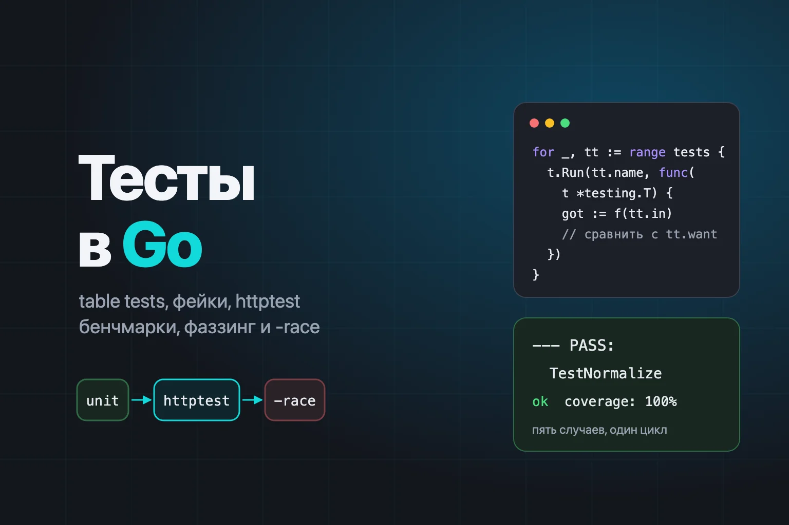
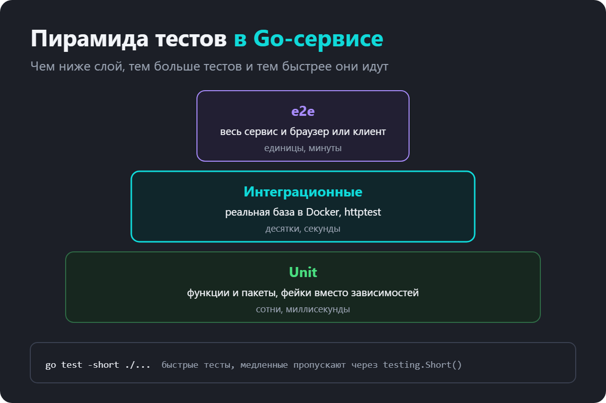
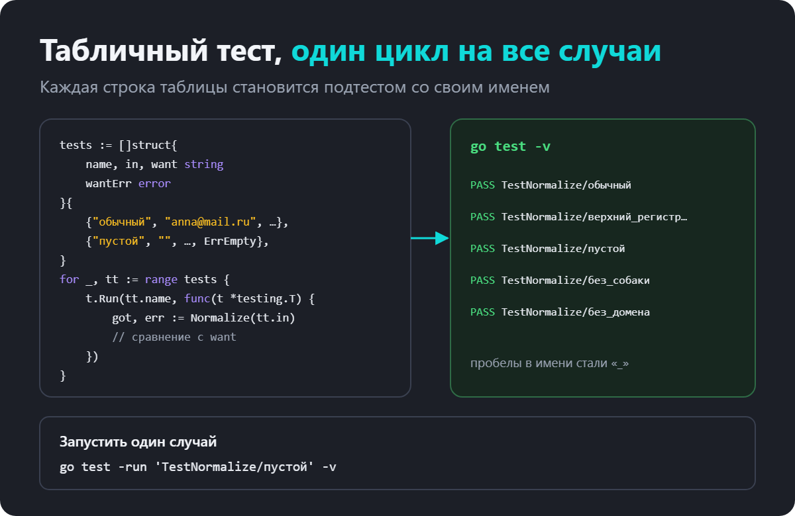
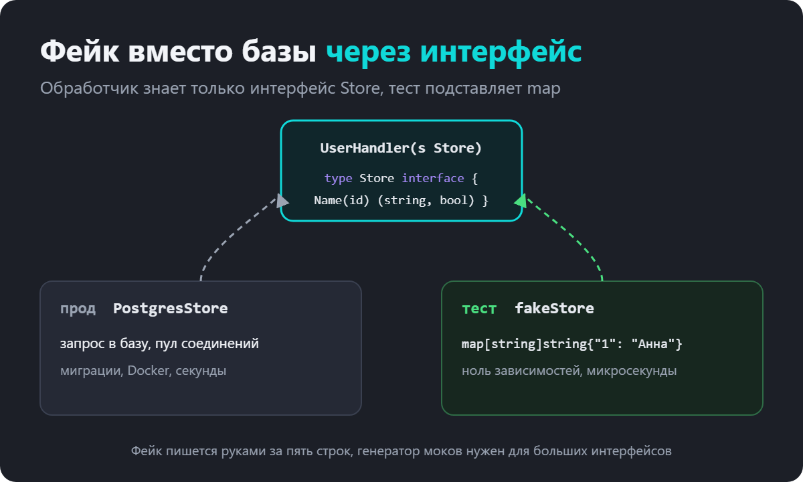
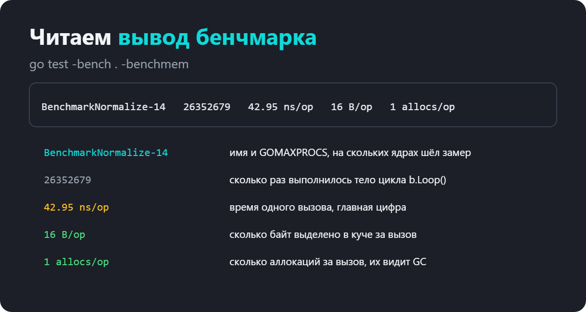
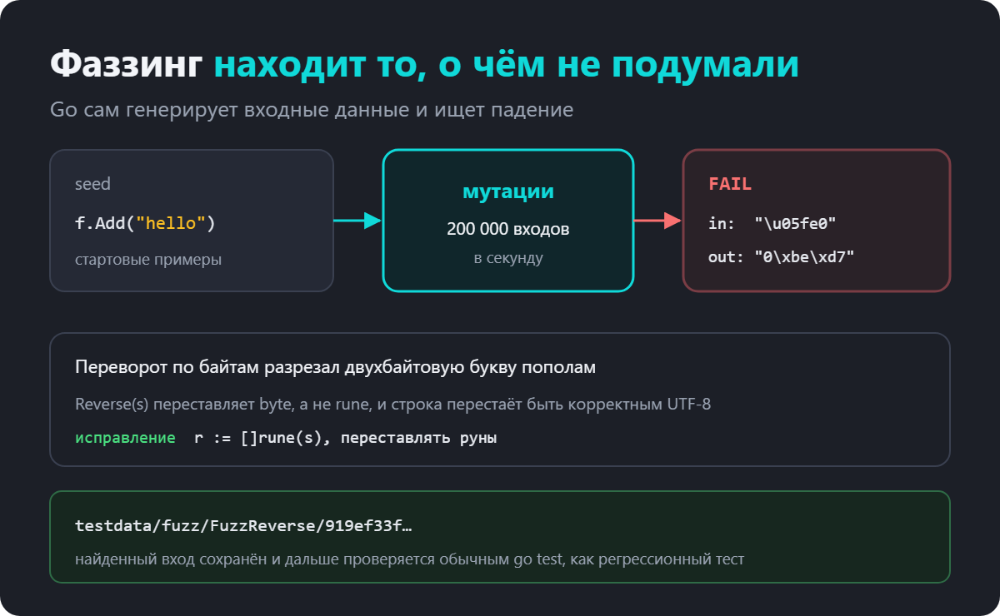
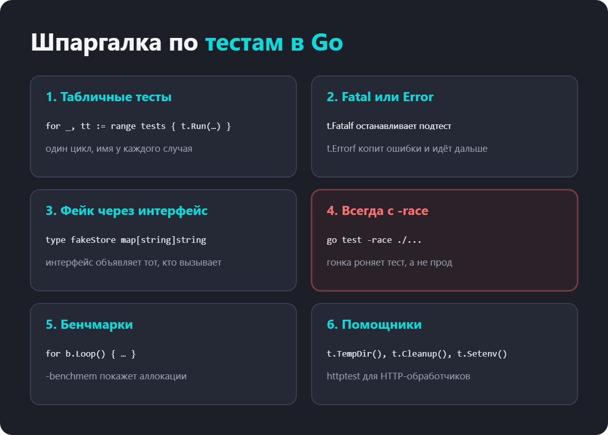

как писать табличные тесты, подменять зависимости и ловить гонки

В Go тесты встроены в язык. Не нужен отдельный фреймворк, не нужен раннер, не нужно ничего настраивать. Пишете файл _test.go, запускаете go test, и всё работает. Поэтому на собеседовании почти всегда спрашивают, как вы тестируете код, а в тестовом задании без тестов решение часто даже не смотрят.

При этом многие пишут тесты по наитию. Копируют одну и ту же проверку пять раз, поднимают настоящую базу ради функции на десять строк, не запускают детектор гонок. Разберём, как принято писать тесты в Go и какие инструменты дают больше всего пользы.

Вот что разберём по порядку.

пакет testing, t.Error и t.Fatal
табличные тесты и подтесты через t.Run
фейки и моки через интерфейсы
тесты HTTP-обработчиков через httptest
помощники t.Cleanup, t.TempDir, t.Parallel
детектор гонок и покрытие
бенчмарки и фаззинг

Пакет testing, основы
Тест это функция в файле с суффиксом _test.go. Имя начинается с Test, единственный аргумент *testing.T.

Возьмём функцию, которую будем тестировать дальше. Она нормализует email и проверяет формат.

var (
	ErrEmpty    = errors.New("email пустой")
	ErrNoAt     = errors.New("нет символа @")
	ErrNoDomain = errors.New("нет домена")
)

func Normalize(s string) (string, error) {
	s = strings.TrimSpace(strings.ToLower(s))
	if s == "" {
		return "", ErrEmpty
	}
	at := strings.LastIndex(s, "@")
	if at < 1 {
		return "", ErrNoAt
	}
	if !strings.Contains(s[at+1:], ".") {
		return "", ErrNoDomain
	}
	return s, nil
}
Простейший тест выглядит так.

func TestNormalizeLower(t *testing.T) {
	got, err := Normalize("Anna@Mail.RU")
	if err != nil {
		t.Fatalf("неожиданная ошибка: %v", err)
	}
	if got != "anna@mail.ru" {
		t.Errorf("got %q, want %q", got, "anna@mail.ru")
	}
}
go test ./...
Error или Fatal
Обе функции помечают тест упавшим. Разница в том, что происходит дальше.

t.Error и t.Errorf записывают ошибку, и тест продолжается. Удобно, когда проверок несколько и хочется увидеть все проблемы за один запуск.
t.Fatal и t.Fatalf записывают ошибку и сразу останавливают тест. Нужно, когда дальше проверять бессмысленно. Например, функция вернула ошибку, и результат всё равно пустой.
Сообщение пишут в формате «что получили, что ждали». Тогда по выводу сразу понятно, что сломалось, без открытия кода.

Пирамида тестов
В Go-сервисе тесты обычно делят на три уровня. Внизу много быстрых unit-тестов, которые проверяют функции и пакеты без внешних зависимостей. Выше интеграционные тесты с настоящей базой или HTTP. На вершине немного end-to-end тестов всего сервиса.

Медленные тесты удобно прятать за флагом -short.

func TestRepoWithPostgres(t *testing.T) {
	if testing.Short() {
		t.Skip("нужна база, пропускаем в -short")
	}
	// ...
}
go test -short ./... прогонит только быстрые, а в CI запускают полный набор.

Табличные тесты
Главный стиль тестов в Go. Вместо пяти почти одинаковых функций описываем случаи таблицей и проходим её одним циклом.

func TestNormalize(t *testing.T) {
	tests := []struct {
		name    string
		in      string
		want    string
		wantErr error
	}{
		{name: "обычный", in: "anna@mail.ru", want: "anna@mail.ru"},
		{name: "верхний регистр и пробелы", in: "  Anna@Mail.RU ", want: "anna@mail.ru"},
		{name: "пустой", in: "", wantErr: ErrEmpty},
		{name: "без собаки", in: "anna.mail.ru", wantErr: ErrNoAt},
		{name: "без домена", in: "anna@mail", wantErr: ErrNoDomain},
	}
	for _, tt := range tests {
		t.Run(tt.name, func(t *testing.T) {
			got, err := Normalize(tt.in)
			if !errors.Is(err, tt.wantErr) {
				t.Fatalf("Normalize(%q) err = %v, want %v", tt.in, err, tt.wantErr)
			}
			if got != tt.want {
				t.Errorf("Normalize(%q) = %q, want %q", tt.in, got, tt.want)
			}
		})
	}
}
t.Run превращает каждую строку в подтест со своим именем. Это даёт три вещи. Упавший случай видно по имени. Один t.Fatalf останавливает только свой подтест, а не всю таблицу. И любой случай можно запустить отдельно.

go test -run 'TestNormalize/пустой' -v
Так выглядит упавший случай. Имя подтеста, строка и наше сообщение.

--- FAIL: TestNormalize (0.00s)
    --- FAIL: TestNormalize/обычный (0.00s)
        email_test.go:28: Normalize("anna@mail.ru") = "anna@mail.ru", want "Anna@mail.ru"
FAIL
Новый случай добавляется одной строкой в таблицу. Поэтому покрыть граничные условия, пустую строку, пробелы, юникод, становится дешевле, чем не покрывать.

Ошибки здесь проверяются через errors.Is, а не через ==. Если функция однажды начнёт оборачивать ошибку через %w, тест не сломается.

Фейки и моки через интерфейсы
Код, который ходит в базу, в очередь или во внешний API, тяжело тестировать напрямую. Решение в Go почти всегда одно. Код зависит не от конкретной базы, а от маленького интерфейса, и в тесте вместо базы подставляется фейк.

type Store interface {
	Name(id string) (string, bool)
}

func UserHandler(s Store) http.HandlerFunc {
	return func(w http.ResponseWriter, r *http.Request) {
		name, ok := s.Name(r.PathValue("id"))
		if !ok {
			http.Error(w, "not found", http.StatusNotFound)
			return
		}
		w.Header().Set("Content-Type", "application/json")
		json.NewEncoder(w).Encode(map[string]string{"name": name})
	}
}
В проде сюда придёт хранилище на PostgreSQL. В тесте хватит map.

type fakeStore map[string]string

func (f fakeStore) Name(id string) (string, bool) {
	n, ok := f[id]
	return n, ok
}

Пять строк, никаких библиотек, тест работает за микросекунды. Чем меньше интерфейс, тем проще фейк, поэтому интерфейс объявляют в пакете, который его использует, и только с нужными методами.

Фейк или мок? Фейк это рабочая упрощённая реализация, как наш map. Мок дополнительно проверяет, что его вызвали с нужными аргументами и нужное число раз. Для моков есть генераторы, go.uber.org/mock (mockgen) и mockery. Они полезны для больших интерфейсов и когда важна именно последовательность вызовов. Но в большинстве тестов фейка хватает, и такой тест проще читать.

Тесты HTTP-обработчиков через httptest
Пакет net/http/httptest позволяет вызвать обработчик без настоящего сервера и сети. NewRequest создаёт запрос, NewRecorder записывает ответ.

func TestUserHandler(t *testing.T) {
	mux := http.NewServeMux()
	mux.Handle("GET /users/{id}", UserHandler(fakeStore{"1": "Анна"}))

	tests := []struct {
		path     string
		wantCode int
		wantBody string
	}{
		{"/users/1", http.StatusOK, `{"name":"Анна"}`},
		{"/users/2", http.StatusNotFound, "not found"},
	}
	for _, tt := range tests {
		t.Run(tt.path, func(t *testing.T) {
			t.Parallel()
			req := httptest.NewRequest(http.MethodGet, tt.path, nil)
			rec := httptest.NewRecorder()
			mux.ServeHTTP(rec, req)

			if rec.Code != tt.wantCode {
				t.Fatalf("code = %d, want %d", rec.Code, tt.wantCode)
			}
			if got := strings.TrimSpace(rec.Body.String()); got != tt.wantBody {
				t.Errorf("body = %q, want %q", got, tt.wantBody)
			}
		})
	}
}
Запрос идёт через mux, поэтому заодно проверяется маршрут и шаблон пути {id}, который появился в стандартном роутере в Go 1.22.

Если нужен настоящий сервер, например чтобы протестировать HTTP-клиент, есть httptest.NewServer. Он поднимает сервер на случайном порту и возвращает его адрес.

Помощники testing.T
t.Parallel() запускает подтесты параллельно. Ускоряет медленные тесты, но требует, чтобы подтесты не делили изменяемое состояние. Раньше здесь была ловушка с переменной цикла, все подтесты видели последний tt. С Go 1.22 у каждой итерации своя переменная, и копировать tt := tt больше не нужно.

t.Cleanup(func()) регистрирует уборку, которая выполнится после теста и всех его подтестов. Удобнее defer, потому что её можно вызвать из помощника, и она сработает в конце теста, а не помощника.

t.TempDir() создаёт временную папку и сам удаляет её после теста.

t.Setenv(key, value) выставляет переменную окружения на время теста и возвращает старое значение.

t.Helper() помечает функцию помощником. Тогда при падении Go покажет строку в тесте, а не строку внутри помощника.

func newTestStore(t *testing.T) *Store {
	t.Helper()
	dir := t.TempDir()
	s, err := Open(filepath.Join(dir, "db"))
	if err != nil {
		t.Fatalf("open store: %v", err)
	}
	t.Cleanup(func() { s.Close() })
	return s
}

Детектор гонок и покрытие
go test -race
Флаг -race включает детектор гонок данных. Код работает медленнее, зато любая гонка, которая случилась во время теста, роняет его с понятным отчётом.

type Counter struct{ n int }

func (c *Counter) Inc() { c.n++ }

func Run(c *Counter, workers int) {
	var wg sync.WaitGroup
	for range workers {
		wg.Add(1)
		go func() {
			defer wg.Done()
			c.Inc()
		}()
	}
	wg.Wait()
}
WARNING: DATA RACE
...
--- FAIL: TestRun (0.00s)
    testing.go:1617: race detected during execution of test
Гонки редко проявляются на ноутбуке разработчика и почти всегда проявляются под нагрузкой на проде. Поэтому go test -race ./... стоит включить в CI по умолчанию. Это самый дешёвый способ поймать их заранее.

Покрытие
go test -cover показывает, какая доля кода выполнилась в тестах.

ok  	ex	0.327s	coverage: 100.0% of statements
Подробный отчёт по строкам в браузере.

go test -coverprofile=cover.out ./...
go tool cover -html=cover.out
Покрытие полезно, чтобы найти непроверенные ветки, особенно обработку ошибок. Но 100% не цель. Тест, который вызывает код без проверок, даёт покрытие и не ловит ни одной ошибки.

Бенчмарки
Бенчмарк это функция BenchmarkXxx(b *testing.B). С Go 1.24 её пишут через b.Loop(), рантайм сам подбирает число итераций и не даёт компилятору выкинуть код как неиспользуемый.

func BenchmarkNormalize(b *testing.B) {
	for b.Loop() {
		Normalize("  Anna@Mail.RU ")
	}
}
go test -bench . -benchmem -run '^$'
BenchmarkNormalize-14   26352679   42.95 ns/op   16 B/op   1 allocs/op

Флаг -run '^$' отключает обычные тесты, чтобы они не мешали замеру. -benchmem добавляет байты и аллокации, а это часто важнее времени. Сравнивать два варианта кода удобно через benchstat, он учитывает разброс между запусками.

Фаззинг
Табличный тест проверяет случаи, которые вы придумали. Фаззинг ищет те, о которых вы не подумали. С Go 1.18 он встроен в go test. Вы задаёте свойство, которое должно выполняться для любого входа, и стартовые примеры, а Go генерирует сотни тысяч вариаций.

Возьмём переворот строки, который переставляет байты.

func Reverse(s string) string {
	b := []byte(s)
	for i, j := 0, len(b)-1; i < j; i, j = i+1, j-1 {
		b[i], b[j] = b[j], b[i]
	}
	return string(b)
}

func FuzzReverse(f *testing.F) {
	f.Add("hello")
	f.Fuzz(func(t *testing.T, s string) {
		r := Reverse(s)
		if utf8.ValidString(s) && !utf8.ValidString(r) {
			t.Errorf("Reverse(%q) = %q, сломали UTF-8", s, r)
		}
	})
}
go test -fuzz FuzzReverse -fuzztime 20s
--- FAIL: FuzzReverse (0.03s)
    rev_test.go:13: Reverse("׾0") = "0\xbe\xd7", сломали UTF-8

    Failing input written to testdata/fuzz/FuzzReverse/919ef33f58147bd0
За доли секунды фаззер нашёл строку с двухбайтовой буквой, которую переворот по байтам разрезал пополам. Исправление в том, чтобы переставлять не байты, а руны, []rune(s).

Найденный вход сохранился в testdata. Теперь обычный go test без флага -fuzz будет проверять его каждый раз, как регрессионный тест. Фаззинг особенно хорош для парсеров, валидаторов и всего, что принимает данные снаружи.

Частые ошибки
Ошибка 1. Копировать один тест пять раз

Таблица с t.Run короче, читается лучше, и новый случай добавляется одной строкой.

Ошибка 2. Поднимать настоящую базу ради бизнес-логики

Логику тестируют с фейком, а базу проверяют отдельными интеграционными тестами.

Ошибка 3. Не запускать -race

Гонка, которую не поймал тест, найдётся на проде под нагрузкой.

Ошибка 4. Гнаться за 100% покрытия

Покрытие показывает, какой код выполнился, а не какой код проверен.

Ошибка 5. Сравнивать ошибки через ==

Тест сломается, как только ошибку обернут. Пишите errors.Is.

Ошибка 6. t.Parallel с общим изменяемым состоянием

Параллельные подтесты, которые пишут в одну переменную, дают ту самую гонку, которую мы ищем.

Ошибка 7. Сообщение без контекста

t.Error("неверно") ничего не скажет через месяц. Пишите, что передали, что получили и что ждали.

Что спрашивают на собеседовании
Как устроены тесты в Go?

Встроенный пакет testing и команда go test. Тесты лежат в файлах _test.go, функции называются TestXxx и принимают *testing.T.

Чем t.Error отличается от t.Fatal?

Error отмечает ошибку, и тест продолжается. Fatal отмечает ошибку и сразу останавливает текущий тест или подтест.

Что такое табличные тесты?

Случаи описываются слайсом структур и проверяются одним циклом. Каждый случай запускают через t.Run, чтобы у него было имя и его можно было запустить отдельно.

Как тестировать код, который ходит в базу?

Сделать зависимость маленьким интерфейсом и подставить в тесте фейк. Работу с самой базой проверить интеграционными тестами с настоящей базой, например в Docker.

Чем фейк отличается от мока?

Фейк это упрощённая рабочая реализация. Мок ещё проверяет, как его вызывали. Фейк проще и чаще достаточно.

Как протестировать HTTP-обработчик?

Через httptest.NewRequest и httptest.NewRecorder, вызвав ServeHTTP напрямую. Для HTTP-клиента подойдёт httptest.NewServer.

Зачем флаг -race?

Включает детектор гонок данных. Любая гонка во время теста роняет его с отчётом, где видно, какие горутины и в каком месте обращались к данным.

Как написать бенчмарк?

Функция BenchmarkXxx(b *testing.B) с циклом for b.Loop() (до Go 1.24 for i := 0; i < b.N; i++). Запуск go test -bench . -benchmem.

Что такое фаззинг?

Автоматическая генерация входных данных для проверки свойства, которое должно выполняться всегда. Найденные падения сохраняются в testdata и дальше проверяются обычным go test.

Что делает t.Helper()?

Помечает функцию помощником, и при падении Go показывает строку в самом тесте, а не внутри помощника.

Шпаргалка по тестам в Golang

Если сжать статью до нескольких строк, получится так.

Тест это TestXxx(t *testing.T) в файле _test.go, запуск go test ./....
Случаи описывайте таблицей и прогоняйте через t.Run.
Зависимости подменяйте фейками через маленькие интерфейсы.
HTTP проверяйте через httptest, гонки через -race.
Бенчмарк через b.Loop() и -benchmem, фаззинг для всего, что приходит снаружи.
Попробуйте взять любую свою функцию с тремя-четырьмя ветками и написать к ней табличный тест. Обычно уже на пятом случае находится граничное условие, о котором вы не думали.
