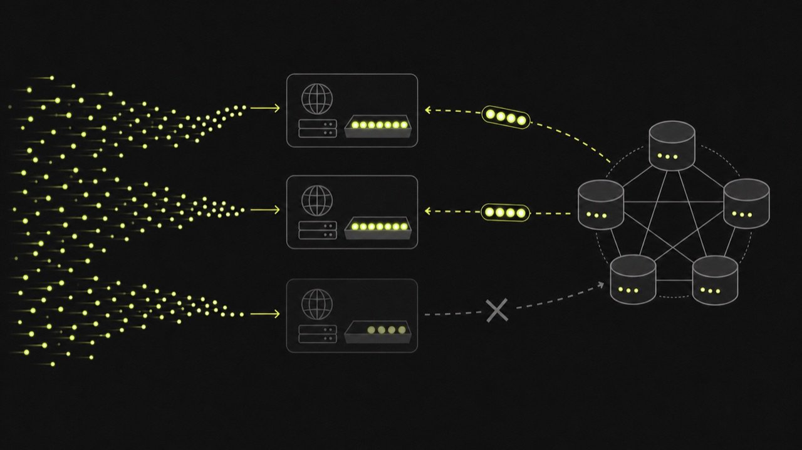

Как спроектировать Rate Limiter на 100K RPS
Разбираем требования, алгоритмы и распределённую архитектуру Rate Limiter.

Короткий ответ: проверку лимита ставим у API Gateway, состояние делим по ключу клиента между шардами Redis, а решение allow/deny принимаем атомарным Lua-скриптом. Для обычного API подойдёт token bucket: он держит среднюю скорость и разрешает заранее оговорённый короткий всплеск. Но прежде чем рисовать Redis Cluster, нужно определить, что именно означает лимит и какой перерасход допустим при сбое.

Число 100K RPS само по себе почти ничего не проектирует. Это средняя или пиковая нагрузка? Один глобальный лимит или миллионы независимых ключей? Можно ли пропустить запрос при недоступном хранилище? От ответов зависит и алгоритм, и схема отказоустойчивости.

Сначала договоримся о требованиях
Предположим такой контракт:

входящий пик составляет 100 000 запросов в секунду;
лимиты задаются на API key и endpoint;
типовой тариф разрешает 100 запросов в секунду со всплеском до 200;
решение добавляет не больше нескольких миллисекунд к p99;
конфигурация тарифа обновляется за секунды, а не за часы;
при сбое одного узла система продолжает работать, небольшой временный перерасход допустим.
Последний пункт надо произнести вслух. Если никакой перерасход невозможен, каждый запрос должен согласовываться с единственным актуальным состоянием. Тогда сетевая партиция превращается в отказ для части клиентов. Если бизнес допускает ограниченную погрешность, можно выдавать gateway локальные квоты и пережить короткую недоступность Redis.

Ответ Rate Limiter обычно содержит два разных ограничения. Первое защищает продуктовый тариф, например 10 000 запросов в сутки на tenant. Второе защищает инфраструктуру от всплеска, например 100 запросов в секунду с burst 200. Один token bucket не обязан решать обе задачи. На практике удобно последовательно проверять долгую квоту и короткий защитный лимит.

Выбираем алгоритм без каталога терминов
Fixed window counter прост: INCR по ключу окна и EXPIRE. Он дешёвый, но на границе окон клиент может отправить почти два лимита за короткий промежуток. При лимите 1000 в минуту запросы с 12:00:59 и 12:01:00 формально попадают в разные окна.

Sliding log хранит время каждого запроса, обычно в sorted set. Ответ получается точным для скользящего интервала, зато горячий клиент создаёт много записей и операций удаления. На 100K RPS эта точность может оказаться слишком дорогой.

Token bucket хранит два значения: остаток токенов и время последнего пополнения. Токены добавляются с заданной скоростью до ёмкости bucket. Запрос тратит один или несколько токенов. Такой алгоритм естественно описывает среднюю скорость и разрешённый burst, а состояние на ключ остаётся постоянного размера.

Для нашего контракта берём token bucket. Fixed window можно оставить для грубой суточной квоты, если скачок на границе суток приемлем.

Путь одного запроса
Client
  |
  v
Load Balancer
  |
  +--> API Gateway instance
          |  1. auth -> tenant/API key
          |  2. read cached policy
          |  3. atomic token check
          v
      Redis Cluster shard
          |
          +--> allow: upstream service
          +--> deny:  HTTP 429 + Retry-After
Ключ можно собрать как rl:{tenant_id}:endpoint. Часть в фигурных скобках является hash tag Redis Cluster: связанные ключи одного tenant попадут в один слот, если скрипту понадобится обратиться к нескольким из них. Все ключи, которые читает Lua-скрипт, нужно передавать через KEYS, а не собирать внутри скрипта. Это требование Redis особенно важно в cluster-режиме.

Конфигурацию лимитов не стоит читать из основной базы на каждый запрос. Gateway получает правила из сервиса конфигурации, кэширует их на короткое время и инвалидирует при обновлении тарифа. Состояние bucket живёт отдельно в Redis.

Атомарная проверка в Redis
Операция состоит из чтения состояния, расчёта пополнения и записи нового остатка. Если выполнить эти команды отдельными round trip, два конкурентных запроса могут увидеть один остаток и оба потратить последний токен. Lua выполняет цикл read-decide-update атомарно.

Ниже сокращённый вариант. В production стоит договориться о единицах, округлении и максимальном TTL, а затем покрыть скрипт тестами на границах времени.

-- KEYS[1] = rl:{tenant_id}:endpoint
-- ARGV: now_ms, refill_per_ms, capacity, cost, ttl_ms

local state = redis.call('HMGET', KEYS[1], 'tokens', 'updated_at')
local capacity = tonumber(ARGV[3])
local tokens = tonumber(state[1]) or capacity
local updated_at = tonumber(state[2]) or tonumber(ARGV[1])
local now = math.max(tonumber(ARGV[1]), updated_at)

local elapsed = now - updated_at
tokens = math.min(capacity, tokens + elapsed * tonumber(ARGV[2]))

local allowed = 0
local cost = tonumber(ARGV[4])
if tokens >= cost then
  tokens = tokens - cost
  allowed = 1
end

redis.call('HSET', KEYS[1], 'tokens', tokens, 'updated_at', now)
redis.call('PEXPIRE', KEYS[1], tonumber(ARGV[5]))

return {allowed, tokens}
Время в примере передаёт gateway. Значит, нужно учитывать разброс часов между экземплярами и не позволять сохранённой отметке идти назад, поэтому now сравнивается с updated_at. Другой вариант получает время на стороне Redis. Выбор нужно закрепить в контракте и тестах, а не оставить случайной деталью клиента.

Скрипт параметризован: его текст не меняется для каждого тарифа. Клиент может загрузить его через SCRIPT LOAD и вызывать по SHA с обработкой NOSCRIPT после рестарта или failover. Redis прямо предупреждает, что кэш скриптов не является постоянным.

Как выдержать 100K RPS
Один синхронный запрос в Redis на каждый входящий запрос означает те же 100K операций принятия решения в секунду. Отправлять всё в один узел без измерений нельзя. Нагрузка зависит от размера скрипта, сети, числа горячих ключей, persistence и репликации.

Мы бы шли так:

Распределили ключи по 16 384 hash slots Redis Cluster, которыми владеют primary-шарды. Redis вычисляет слот как CRC16(key) mod 16384, а hash tag позволяет нескольким связанным ключам попасть в один слот.
Разместили gateway и соответствующие шарды в одной зоне или регионе, чтобы решение не ходило через дальнюю сеть.
Заранее нагрузили скрипт тем же распределением ключей, что ожидается в production. Равномерные случайные ключи скрывают проблему одного очень горячего tenant.
Помимо throughput, смотрели бы на p99 команды, CPU Redis, сетевой трафик, evictions, ошибки MOVED/ASK и задержку failover.
Pipeline полезен, когда клиент уже имеет пачку независимых решений. На обычном синхронном HTTP-пути gateway не может бесконечно ждать накопления batch: это экономит round trip ценой задержки. Поэтому batching нужно проверять измерениями, а не добавлять на диаграмму автоматически.

Если 100K обращений к Redis слишком дороги, появляется локальный слой. Например, центральный bucket выдаёт gateway аренду на 100 токенов, а тот тратит её в памяти. Количество центральных операций падает примерно во столько раз, каков размер аренды. Цена тоже понятна: при падении экземпляра токены теряются, а при сетевой партиции несколько gateway могут временно превысить глобальный лимит. Верхнюю границу перерасхода можно оценить как сумму неиспользованных локальных аренд.

Отказы и решение fail-open или fail-closed
При таймауте Redis есть два базовых поведения:

fail-closed отклоняет запрос и лучше защищает дорогой или уязвимый downstream;
fail-open пропускает запрос и сохраняет доступность пользовательского API.
Единый выбор для всех endpoint редко разумен. Операцию отправки SMS или тяжёлый отчёт логично закрыть. Чтение публичного профиля можно временно пропустить, параллельно включив локальный аварийный лимит. Ответ должен возвращаться быстро: короткий timeout полезнее каскада ретраев, который удвоит нагрузку на уже больной Redis.

Реплика Redis не решает проблему мгновенно. После failover новая primary может не иметь последних асинхронно реплицированных списаний, поэтому часть токенов "вернётся". Для тарифной бухгалтерии Rate Limiter вообще не должен быть единственным источником истины. Точные списания и деньги учитываются отдельным долговечным контуром.

Между регионами компромисс ещё жёстче. Один глобальный Redis даёт согласованное состояние, но добавляет межрегиональную задержку и точку зависимости. Региональные buckets быстрее, однако общий лимит становится приблизительным. Можно заранее разделить глобальную квоту между регионами и периодически перераспределять остаток. Хороший ответ на собеседовании называет допустимую погрешность до выбора схемы.

Разбор Вектора: где в этой задаче система
Кандидаты часто тратят всё время на сравнение token bucket и sliding window. Алгоритм занимает одну доску. Основная работа начинается рядом:

как извлечь идентичность до проверки лимита;
как применить новые правила без запроса в SQL на каждый request;
что считать горячим ключом и как его увидеть;
как поведёт себя gateway при таймауте Redis;
какой перерасход возможен во время failover или локальных аренд.
Мы бы начали интервью с простого fixed window и меняли дизайн через требования. Нужен burst — переходим к token bucket. Появились несколько gateway — выносим состояние. Дошли до 100K RPS — шардируем и измеряем. Потребовали работу при партиции — обсуждаем локальные квоты и цену неточности. Так видно ход мысли, а не заученную картинку.

Частые ошибки на собеседовании
Сразу сказать "Redis справится", не оценив число операций и горячие ключи.
Выполнить GET, расчёт и SET раздельно, оставив гонку между запросами.
Обещать одновременно строгий глобальный лимит, низкую задержку во всех регионах и доступность при сетевой партиции.
Не задать TTL. Неактивные ключи тогда копятся бессрочно.
Путать Rate Limiter с точным биллингом и считать асинхронный failover без потерь.
Возвращать один 429 без Retry-After, метрик причины и информации об оставшейся квоте там, где её можно безопасно показать.
Вопросы для самопроверки
Как fixed window позволяет удвоить короткий всплеск на границе окна?
Почему read-decide-update должен быть одной атомарной операцией?
Что изменится, если один tenant создаёт половину всей нагрузки?
Как оценить максимальный перерасход при локальной аренде токенов?
Для каких endpoint вы выберете fail-open, а для каких fail-closed?
Почему асинхронная реплика Redis не превращает Rate Limiter в точный биллинг?
Чтобы потренировать соседние темы, разберите чем горутина отличается от потока ОС и как PostgreSQL передаёт WAL на standby. В первой задаче пригодится ограничение конкурентности, во второй хорошо видна цена асинхронного подтверждения.
