Как Anthropic заменили git на свою систему контроля версий. Разбор архитектуры Scion
30 000 изменений в день, 100 ГБ истории и 25 миллионов выкачиваний кода в сутки. Разбираем, почему git не выдержал, как устроен Scion, и что из этой архитектуры пригодится в своих системах и на собесе

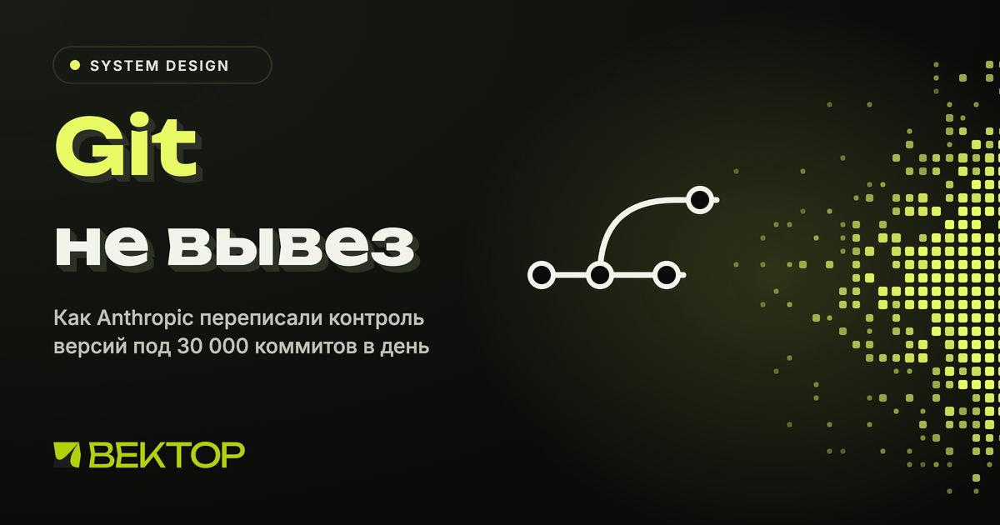

Короткий ответ. Git задуман для человека, который работает офлайн и держит у себя полную копию репозитория. В Anthropic почти все клиенты репозитория это агенты и CI-задачи, которые всегда онлайн. Поэтому они перенесли всю работу на сервер, сделали клиент тонким, а данные адресуют по содержимому. Адрес объекта это хэш его байтов, поэтому объект никогда не меняется, и его может отдать любой кэш, ни с кем не согласовывая. Так появился Scion. Он раздается через три уровня кэшей и требует в 200 раз меньше процессора и памяти, чем прежняя инфраструктура зеркал git.

Ниже по шагам, откуда взялась проблема и как устроено решение. Все цифры из статьи инженеров Anthropic от 13 октября 2026 года, ссылка в конце.

Откуда взялась проблема
В мае 2026 года в главный репозиторий Anthropic вливали в среднем около 2 500 изменений в день. В сентябре уже больше 30 000. Авторы прямо пишут, что в эту ситуацию их привела способность Claude писать код. И ждут, что рост не замедлится: спрос на вливание кода почти бесконечен, и каждое снятое узкое место сразу превращается в еще больше кода.

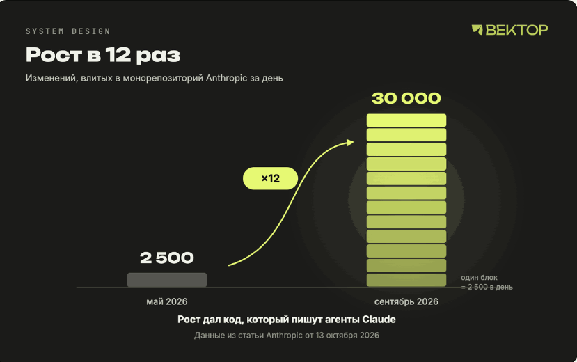

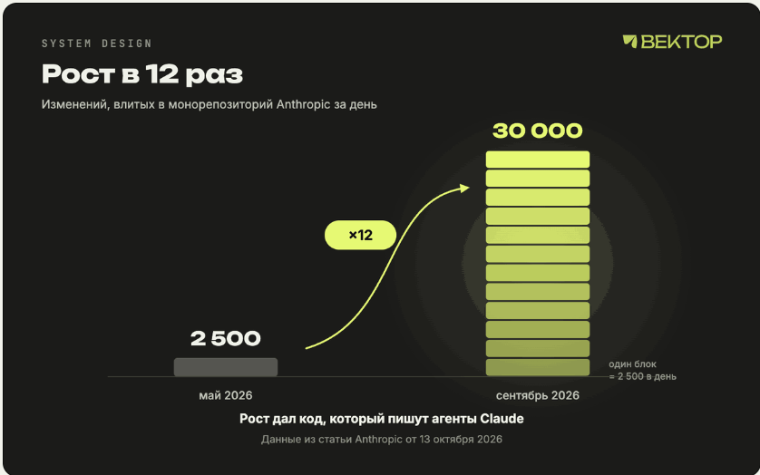

Рост в 12 раз за четыре месяца

Сами авторы признают, что нагрузка у них необычная. Но они ждут, что в ближайшие 6–12 месяцев такие проблемы станут встречаться чаще у всех, кто активно пишет код агентами. Поэтому разбор полезен не только как новость. Это хороший пример того, как система, спроектированная под людей, ломается под агентами.

Почему git упирается в монорепозиторий
Git децентрализован. Каждый клон это полный самостоятельный репозиторий. Он умеет считать diff, читать историю и blame, переключаться на любую ревизию без сети. Для подавляющего большинства проектов это правильный дизайн, и именно поэтому git стал стандартом.

У Anthropic монорепозиторий перестал помещаться в эту модель. Одна только история основной ветки весит почти 100 ГБ, сжатая рабочая копия больше 25 ГБ. Для CI код выкачивают порядка 25 миллионов раз в сутки, и это без окружений разработчиков, песочниц агентов и исследовательских задач.

25 ГБ × 25 млн = 625 ПБ в сутки

Перемножим. 25 ГБ на 25 миллионов выкачиваний дает больше 600 петабайт трафика git в сутки. Никто так, конечно, не делал. У git есть инструменты, чтобы работать с куском репозитория:

shallow clone забирает только последние коммиты без глубокой истории;
sparse checkout раскладывает на диск только нужные папки;
promisor remote позволяет не скачивать часть объектов, пока они не понадобятся.
Плюс стандартные приемы для больших монорепозиториев. Внутренние зеркала git снимают нагрузку с основного сервера, а готовые снимки репозитория в blob-хранилище (их называют seeds) ускоряют первый клон. Anthropic использовали все это, и на пике у них работали несколько сотен зеркал.

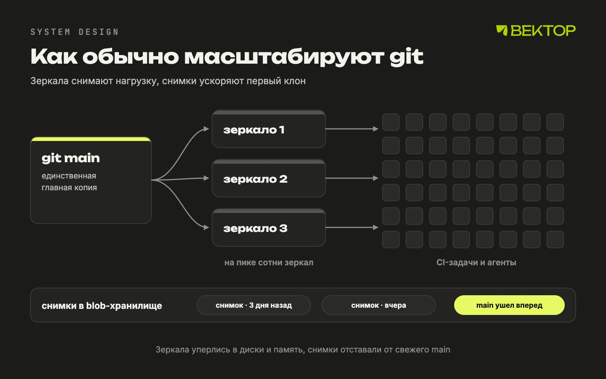

Зеркала и снимки покупают время, но отстают от свежего кода

Это помогало, но чем чаще вливали код, тем тяжелее было все поддерживать. Снимки все сильнее отставали от вершины main между обновлениями. Операции, которым нужна история, например diff и blame, все сложнее было удерживать рабочими на частичных клонах. А зеркала уперлись в диски и память машин, когда репозиторий их перерос.

Главное наблюдение из статьи. Как и большинство компаний, Anthropic использовали git как централизованную систему с одной главной копией. А почти все клиенты были агентами и задачами, которые онлайн по определению. Свойства, которые делают git отличным для распределенной офлайн-работы, здесь только мешали. Отсюда вопрос: как выглядел бы контроль версий, если с самого начала проектировать его под клиентов, которые всегда в сети?

Прикинем на салфетке
С этого начинается любой разбор на собесе по system design. Возьмем цифры из статьи и посчитаем нагрузку.

Запись. 30 000 изменений в сутки, в сутках 86 400 секунд. Выходит около 0,35 изменения в секунду в среднем. Даже если в пике нагрузка в десять раз выше, это единицы записей в секунду.
Чтение. 25 миллионов выкачиваний в сутки это около 290 выкачиваний в секунду. Если каждое тянет 25 ГБ, получается около 7 ТБ в секунду.
Соотношение. На одно изменение приходится больше 800 выкачиваний.
Вывод: система читающая. Узкое место не в том, чтобы принять коммит, а в том, чтобы раздать код. Значит, архитектура должна делать чтение дешевым и масштабируемым: кэши, неизменяемые объекты, отдача только нужного. Вся конструкция Scion дальше отвечает именно на это.

Принципы Scion
У больших монорепозиториев есть предшественники, прежде всего Piper в Google и Sapling в Meta. Scion во многом опирается на их опыт, особенно на серверную часть Sapling под названием Mononoke. Принципов шесть.

Клиент всегда онлайн. Git считает, что клиент работает без сети, и поэтому отдает ему полную копию. Scion строит клиент и протоколы вокруг сервера, который всегда доступен, а клиент забирает данные, когда они понадобились.

Клиент и сервер неравноправны. В git любой клиент может стать полноценным сервером. В Scion историю файлов, blame, создание коммитов, слияния и rebase делает сервер. Клиент держит ограниченный локальный кэш объектов, раскладывает файлы рабочей копии, следит за изменениями на диске и дает удобный интерфейс к серверу. Сам он почти ничего не вычисляет, зато ему нужно намного меньше данных.

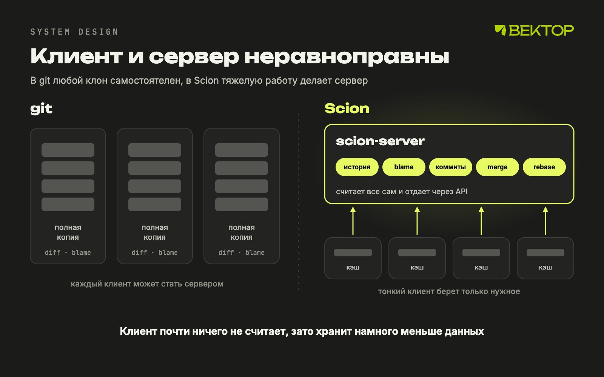

Полная копия у каждого против тонкого клиента и умного сервера

Контроль версий как сервис с API. Если CI-задаче в мире git нужно узнать, кто последним менял строку или как связаны два коммита, ей приходится держать локальную копию репозитория. В Scion все запросы, которые использует клиент, доступны и через API, поэтому многим задачам локальный репозиторий не нужен вовсе. Автоматические bisect (поиск коммита, который сломал тесты, бинарным поиском по истории) и revert (откат такого коммита) в Anthropic работают именно так. Без дешевого программного доступа к истории они бы не масштабировались.

Все масштабируется горизонтально. Данные репозитория распределены, полной копии нет нигде, даже на сервере. Как это возможно? Все данные адресуются по содержимому, и объект после записи не меняется. Значит, любой сервер может закэшировать его, ни с кем не договариваясь. Серверы Scion по сути большие кэши, которые еще умеют считать производные данные, и чтобы выдержать больше нагрузки, достаточно добавить серверов. Нет и аналога packfile (сжатых пачек объектов git), поэтому не нужно обслуживание репозитория.

Коммит дешевый, инкрементальный и без блокировок. Коммиты, rebase и слияния происходят на сервере, пушить нечего. Клиент следит за файлами на диске и отправляет изменения на сервер через API, а коммит создается уже там. Стоимость коммита должна зависеть от размера изменения, а не от размера репозитория, иначе сервер не успеет. Ссылки вроде веток и тегов Scion не поощряет, кроме main и релизных веток: глобальное состояние, о котором должны договориться все серверы, рано или поздно становится проблемой масштабирования.

Рабочая копия необязательна. CI-задаче, которой нужен diff коммита с его merge base (общим предком ветки и main), не нужен checkout, она спрашивает сервер. Многие записи тоже идут через API. А когда файлы на диске все же нужны, протокол построен вокруг sparse checkout (только нужные папки) и виртуальных рабочих копий, где файл появляется при первом чтении. Клиент платит только за то, что реально читает.

Коротко в одной таблице.

git	Scion
Где лежит история	полная копия у каждого клиента	только на сервере, распределена по хранилищам
Кто считает blame и историю файла	клиент сам, по локальной копии	сервер, ответ доступен через API
Где создается коммит	локально, потом push	сразу на сервере, пушить нечего
Что скачивает клиент	packfile с тем, чего у него нет по мнению сервера	только запрошенные деревья и файлы
Ветки и теги	дешевые, их может быть сколько угодно	не поощряются, кроме main и релизных веток
Работа без сети	полноценная	не предусмотрена
Обслуживание репозитория	gc и перепаковка объектов	не нужно, packfile нет

Changeset вместо коммита
Единица работы в Scion называется changeset. Это запись в журнале предзаписи (write-ahead log), то есть в журнале, куда записи только дописываются в конец и никогда не переписываются. Так же устроены журналы транзакций в базах данных. Changeset хранит почти то же, что коммит git, но с важным отличием. Коммит git указывает на дерево всего проекта. Changeset хранит список файлов, которые изменились относительно первого родителя, и ссылки на сжатое содержимое этих файлов в blob-хранилище. Ссылки адресуют данные по содержимому, то есть ключ это хэш самих данных.
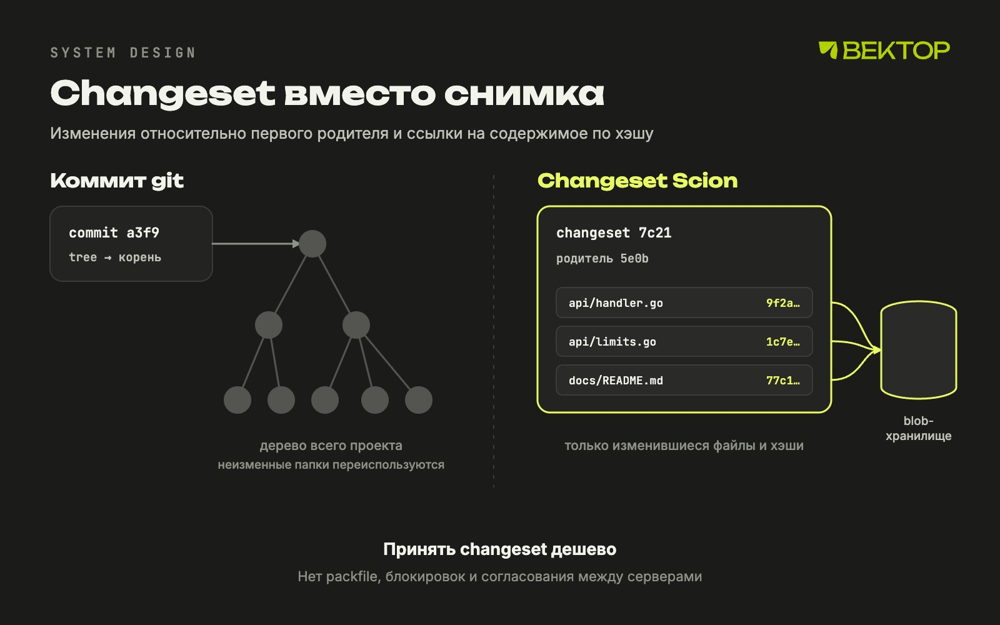

Changeset описывает разницу, а не снимок

Почему относительно первого родителя? У коммита слияния два родителя: первый это main, второй это вливаемая ветка. В монорепозитории, где все вливают изменения сразу в одну основную ветку (такую схему называют trunk-based development), людям нужна история и blame только по основной линии. Это осознанный выбор авторов, а не ограничение модели.

Такая структура позволяет принимать changeset с очень высокой скоростью. Не нужно принимать packfile, нет блокировок и согласования между серверами, не нужно двигать ссылки. Ссылки в Scion технически есть, но ни создание, ни получение коммитов их не трогает. Сдвиг ссылки это отдельная операция compare-and-swap над одной строкой в Spanner, распределенной SQL-базе Google. Compare-and-swap значит «поменяй, только если значение не изменилось с тех пор, как я его прочитал». В SQL это выглядит так:

UPDATE refs SET head = 'новый_changeset'
WHERE name = 'main' AND head = 'старый_changeset';
Если кто-то успел сдвинуть ссылку раньше, запрос ничего не обновит, и клиент повторит попытку. Это оптимистичная блокировка, как atomic.CompareAndSwap в Go.

Производные данные
Changeset хранит только разницу, поэтому сам по себе не ответит быстро, кто последним правил строку или какие коммиты меняли файл. Для этого Scion строит дополнительные структуры: для blame, для истории путей, skip list по графу коммитов (например, ссылки на предков через несколько шагов, чтобы быстро найти общего предка, не перебирая историю по одному коммиту). Все, что не входит в сам changeset, авторы называют производными данными и считают одним общим механизмом.

Каждый вид производных данных определен рекурсивно. Значение для changeset вычисляется из значений его родителей плюс сам changeset.

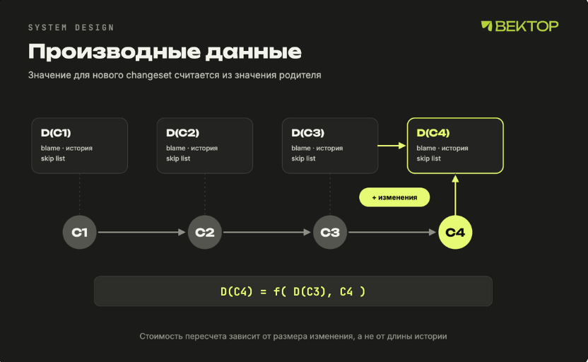

Новый changeset не пересчитывает историю с нуля

У этого подхода три плюса:

Новый вид производных данных добавляется легко, когда новая структура ускорит какую-то операцию. Так в Scion со временем появились индексы для поиска копирований и поиска файлов по пути.
Для каждого вида можно решить, считать его сразу или по требованию. Ненужное не считается и не хранится заранее.
Клиент не видит внутреннее устройство этих структур, поэтому их можно оптимизировать, не трогая клиент.
Как клиент забирает файлы
В начале миграции код еще лежал в git, а Scion отвечал только на вопросы об истории: кто менял строку, как связаны коммиты. Уже это избавило CI и внутренние инструменты от необходимости держать свои копии репозитория. Файлы и рабочие копии на порядки тяжелее, и для них нужен был отдельный протокол.

В git клиент при fetch рассказывает серверу, какие объекты у него уже есть, а сервер вычисляет, чего не хватает, и собирает ответ в packfile. Клиент Scion, scn, устроен наоборот. Он никогда не говорит, что у него есть, а только просит нужное. Начинает с корневого дерева, проверяет локальное хранилище, рекурсивно запрашивает недостающие деревья, а потом так же blob-ы, то есть содержимое файлов.

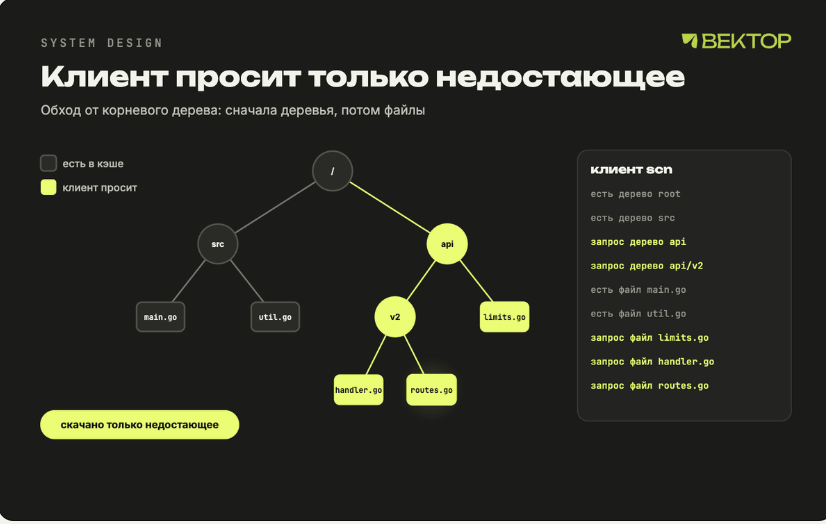

Каждый запрос просит конкретный неизменяемый объект

Из этого сразу следуют три вещи. Каждый запрос просит объект, который никогда не меняется, значит его может отдать любой кэш без согласования. Процесс можно возобновить с места обрыва, потому что нет одного ответа на много гигабайт. И sparse или виртуальные рабочие копии не требуют специальной поддержки: клиент просто не просит деревья, которые ему не нужны.

Три уровня кэша
На каждой машине работает демон scion-daemon, который хранит объекты для всех задач этой машины. Почти всем задачам нужен монорепозиторий, и задачи на одной машине переиспользуют одни и те же объекты. Демон стартует с периодически обновляемого снимка и дальше ходит только в кэш-серверы своего региона, scion-cache. Они отдают объекты прямо из памяти, причем сразу в том формате, который демон положит на диск, поэтому не тратят время на вычисление недостающего и дельта-сжатие (когда объект хранят как разницу с похожим объектом и при отдаче его приходится собирать). Если объекта нет в кэше, scion-cache идет в главные scion-server, а те читают из Spanner или облачного хранилища.

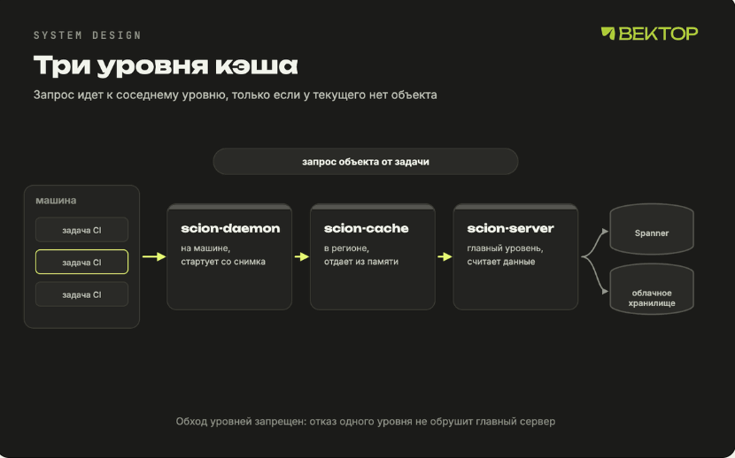

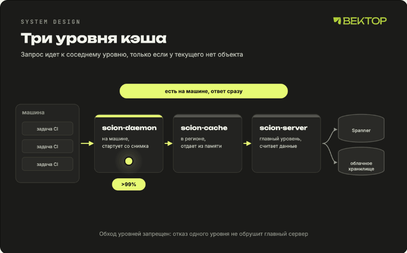

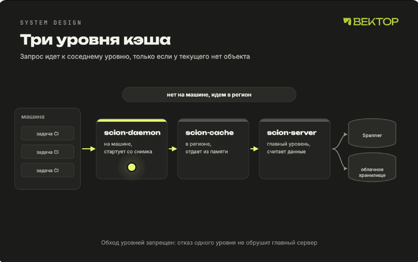

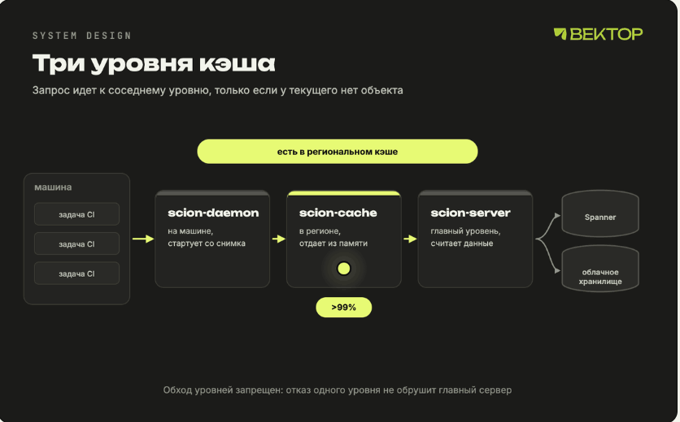

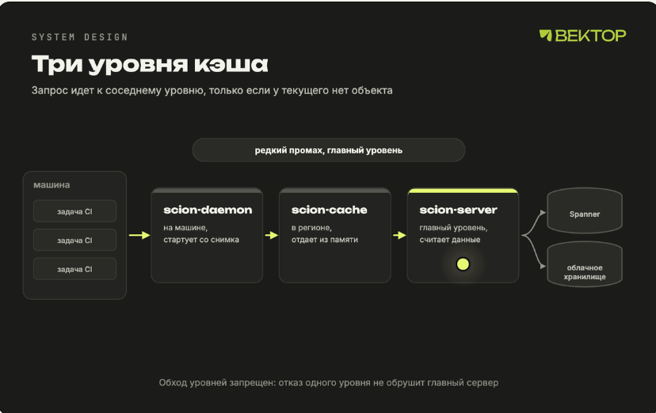

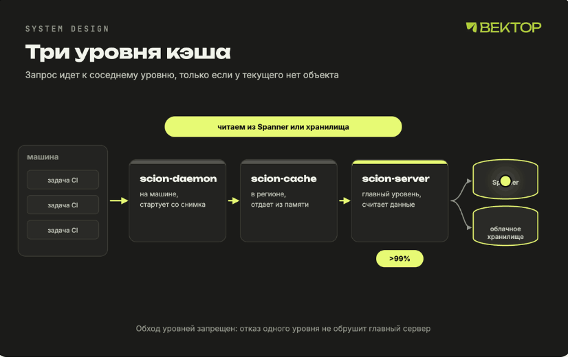

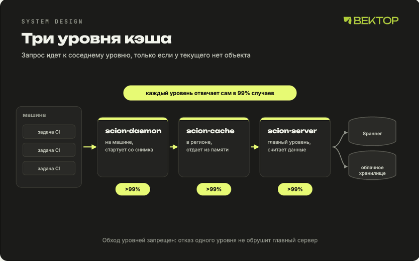

Попадание в кэш на каждом уровне выше 99%

Все три уровня отвечают на одинаковые RPC, поэтому клиенту не нужно знать, как устроены кэши. Теоретически любой уровень может ходить в любой, но Anthropic строго держат порядок уровней, чтобы изолировать домены отказа, то есть чтобы поломка в одном месте не расползалась по всей системе. Если упадет региональный scion-cache, его клиенты не должны лавиной обрушиться на scion-server и положить всю систему.

Каждый уровень держит попадание в кэш выше 99% и не хранит долгоживущее состояние, поэтому его легко масштабировать.

Что получилось
Инфраструктура Scion требует в 200 раз меньше процессора и памяти, чем прежние зеркала git.
CI и исследовательские задачи выкачивают код на два порядка быстрее, за секунды вместо минут.
Только CI сэкономил 25% мощности процессоров по всему парку машин.
Ни клиентам, ни кэшам не нужно обслуживать репозиторий, поэтому жизненный цикл задач стал проще.
Scion и инструмент код-ревью Antique сделали семь человек. Заодно они построили еще полдюжины связанных систем и полностью перевели на все это монорепозиторий за пять месяцев. И все это время объем вливаемого за день кода рос: за период проекта больше чем в десять раз.

Что пришлось поменять в процессе
Очередь на слияние. Классическая очередь с глобальной блокировкой репозитория вливает изменения строго по одному, и перед каждым прогоняет тесты на свежем main. Когда за время прогона тестов успевают влиться сотни или тысячи изменений, такая схема не работает. Anthropic не смогли воспроизвести глобальную блокировку и вместо этого вложились в автоматические тесты после слияния и перед выкаткой. Одновременные изменения иногда конфликтуют, но Claude обычно исправляет конфликт быстрее, чем человек его заметит. А если изменение все же сломало main, его ловят тесты после слияния, а до прода не пускают тесты перед выкаткой.

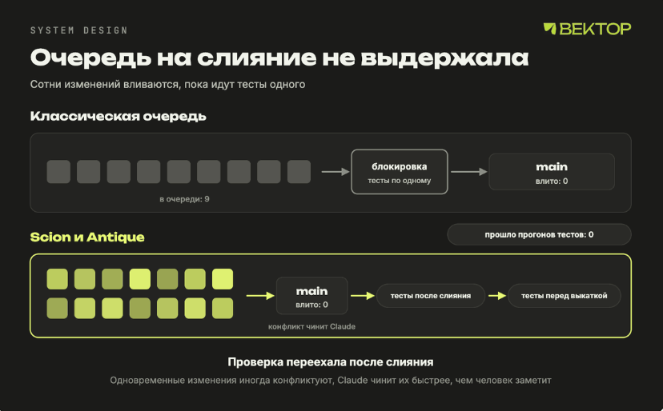

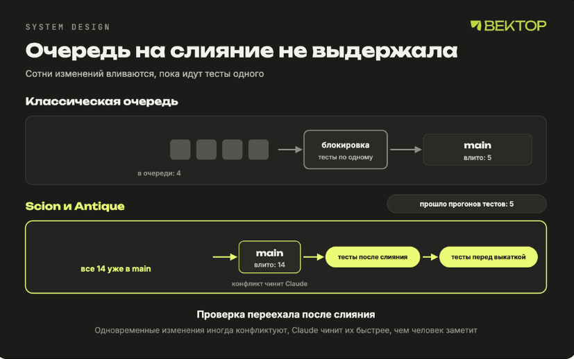

Проверка переехала после слияния

Права доступа. Scion умеет выдавать права на отдельные папки, чтобы защитить самый чувствительный код и при этом не терять плюсы монорепозитория. В инструменте ревью можно задавать правила одобрения по смыслу изменения, например отличать правку комментария от изменения логики. Так люди тратят внимание на действительно важное.

Мониторинг. На каждый компонент заведен отдельный Claude с доступом к телеметрии и логам. Авторы называют их «суперфанатами»: есть суперфанат scion-daemon, scion-cache, очереди слияния в Antique. Они ведут себя как опытный инженер, которому нечем заняться, кроме как обновлять графики и искать странности, и ловят тонкие проблемы, мимо которых проходят обычные алерты.

Роль инженеров
Все инженеры проекта теперь оценивают Claude как более сильного кодера, чем они сами. Пример из статьи. Первую версию конвейера переноса данных из git в Scion писали в основном руками и считали хорошей. Потом попросили раннюю внутреннюю версию Claude переписать его целиком, без дополнительных указаний. Новая версия потребляла в 20 раз меньше памяти, работала в 4 раза быстрее и сохранила все неявные правила порядка загрузки данных.

При этом работа людей не исчезла, она поменялась. Инженеры держат в голове, как системы связаны между собой, и принимают решения о компромиссах. И очень часто их роль сводилась к тому, чтобы сказать Claude «нет».

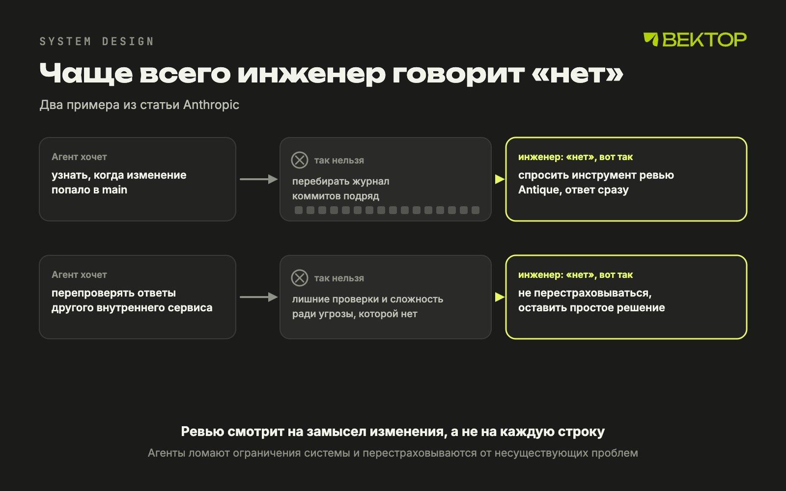

Оба примера из статьи Anthropic

Два примера из статьи. Несколько систем, которые писал Claude, пытались узнать, когда изменение попало в main, перебирая журнал коммитов подряд, хотя ответ есть в инструменте код-ревью. А состязательное ревью, где один агент критикует код другого, иногда перестраховывалось: однажды ревью не доверяло другому внутреннему сервису, и Claude добавил лишние проверки и сложность. Ревью у них по-прежнему проходит каждое изменение, но теперь люди смотрят на замысел изменения, а не читают каждую строку.

Чем пришлось заплатить
Бесплатных архитектур не бывает, и на собесе про минусы спросят обязательно. Часть минусов авторы называют сами, часть следует из устройства системы.

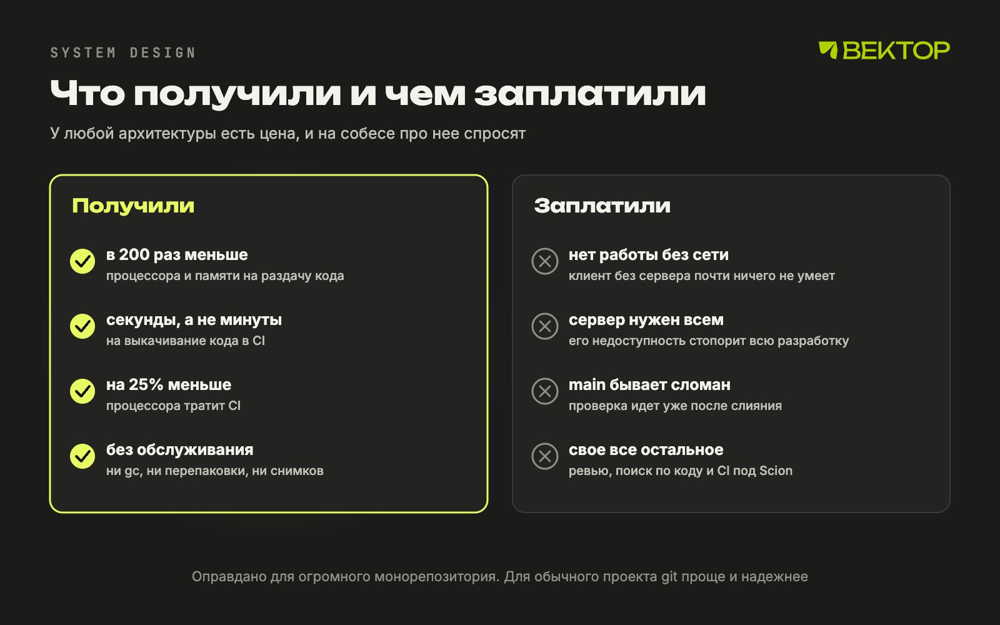

Что получили и чем заплатили

Без сети работать нельзя. Клиент без сервера почти ничего не умеет: ни истории, ни коммитов. Для агентов и CI это нормально, для человека в самолете нет.
Сервер стал обязательной зависимостью. Если Scion недоступен, встает разработка всей компании. Поэтому так важны уровни кэша без долгоживущего состояния и строгая изоляция отказов.
Main может быть временно сломан. Без глобальной блокировки изменения вливаются до полной проверки. Ошибку ловят тесты после слияния и перед выкаткой, но между слиянием и проверкой в main может лежать сломанный код.
Ветки ограничены. Привычный процесс с множеством долгоживущих веток Scion не поощряет.
Переезд тянет за собой все остальное. Scion сильно отличается от git, поэтому ему нужны свое ревью, свой поиск по коду и свой CI. Авторы прямо пишут, что другим компаниям такой переезд дался бы тяжело.
Что из этого взять себе
Scion не замена git. Сами авторы пишут, что такая архитектура имеет смысл только для огромных монорепозиториев с десятками тысяч инженеров или роем агентов. Но приемы из нее работают и в обычных системах.

Адресуй данные по содержимому. Если ключ это хэш данных, объект никогда не меняется, и его можно кэшировать где угодно без инвалидации и согласования. Так работают слои Docker-образов и файлы с хэшем в имени вроде app.3f9a1c.js, которые CDN может кэшировать бессрочно.
Проектируй под реальных клиентов. Git оптимизирован под офлайн-людей, а у Anthropic клиенты всегда онлайн. Перепроверь, под кого на самом деле работает твоя система.
Выноси тяжелое на сервер и давай API. Когда каждый клиент держит свою копию данных, ты платишь трафиком, диском и обслуживанием. Один сервис с API дешевле сотни локальных копий.
Стоимость операции должна зависеть от размера изменения. Если коммит, запись или пересчет стоят пропорционально всему объему данных, система рано или поздно встанет.
Убирай глобальное состояние. Чем меньше данных, о которых должны договориться все узлы, тем проще масштабироваться. В Scion это ссылки, которые сведены к одной строке с compare-and-swap.
Держи порядок уровней кэша. Одинаковый протокол на всех уровнях удобен, но строгая иерархия защищает от каскадных отказов. По той же схеме устроены CDN: ближний узел, региональный кэш, исходный сервер.
Авторы предлагают и пути для самого git: серверные RPC для запросов к истории, новый протокол согласования при fetch, лучше совместимые sparse и shallow режимы.

Как это могут спросить на собесе
Почему данные, адресуемые по содержимому, легко кэшировать? Ключ объекта это хэш его содержимого. Объект с данным ключом никогда не меняется, значит любой узел может держать копию и отдавать ее без проверки актуальности. Инвалидация кэша, самая неприятная часть кэширования, просто не нужна.

Чем shallow clone отличается от sparse checkout? Shallow clone режет историю: забирает только последние коммиты. Sparse checkout режет дерево файлов: раскладывает на диск только выбранные папки. Это разные оси, и их можно сочетать.

Почему очередь на слияние с глобальной блокировкой плохо масштабируется? Изменения вливаются строго по одному, и каждое ждет свой прогон тестов. Пропускная способность ограничена временем прогона. Пачки изменений ускоряют очередь, но когда тест в пачке падает, приходится искать виновника и перезапускать проверку. При тысячах изменений в день очередь растет быстрее, чем разбирается, поэтому проверку переносят после слияния и чинят конфликты по факту.

Прикинь нагрузку на такую систему. 30 000 записей в сутки это около 0,35 в секунду, а 25 млн выкачиваний это около 290 в секунду, то есть больше 800 чтений на одну запись. Система читающая, поэтому оптимизировать нужно раздачу: неизменяемые объекты, кэши, отдача только нужного.

Какие минусы у такой архитектуры и когда так делать не стоит? Нет работы без сети, сервер становится обязательной зависимостью для всех, main может быть временно сломан, а переезд требует своего ревью, поиска и CI. Это оправдано только для огромного монорепозитория с десятками тысяч инженеров или роем агентов. Для обычного проекта git с его офлайн-моделью проще и надежнее.

Зачем строго держать иерархию кэшей, если все уровни понимают одинаковый протокол? Чтобы отказ одного уровня не превратился в лавину запросов к источнику. Если региональный кэш упал, его клиенты не должны пойти напрямую в главный сервер и положить его.

Как посчитать производные данные для истории без полного пересчета? Определить их рекурсивно: значение для нового коммита считается из значений родителей и самого изменения. Тогда стоимость пропорциональна размеру изменения, и можно выбирать, считать сразу или лениво по запросу.
