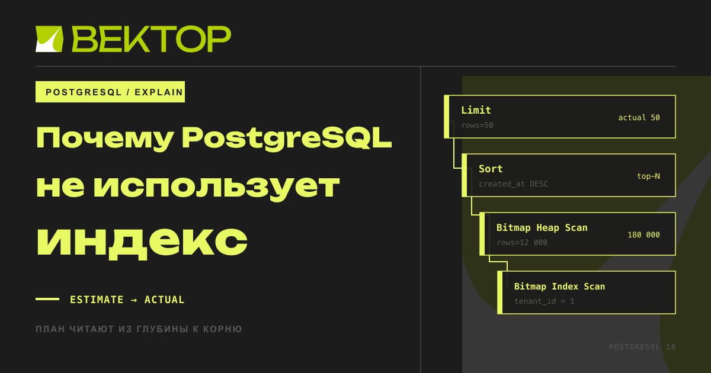
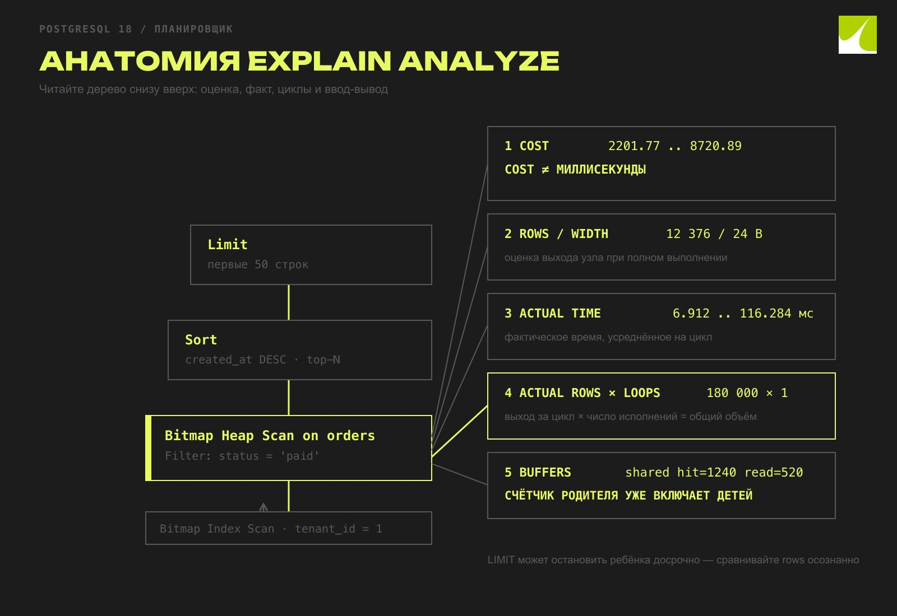
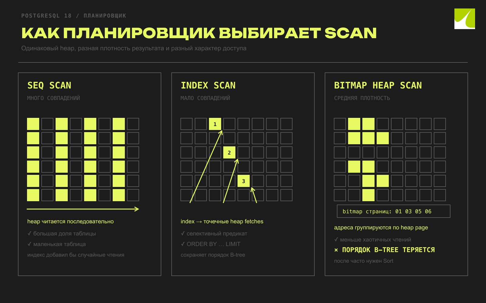
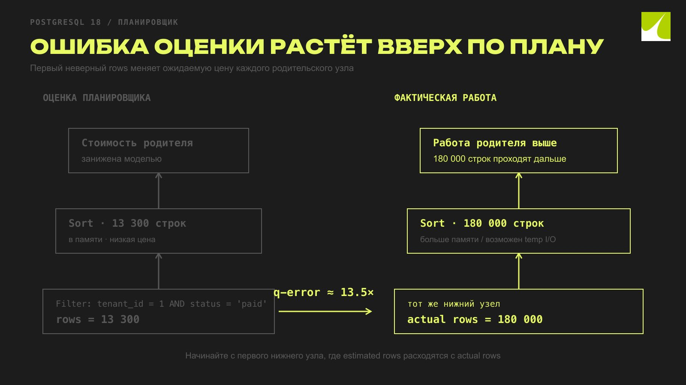
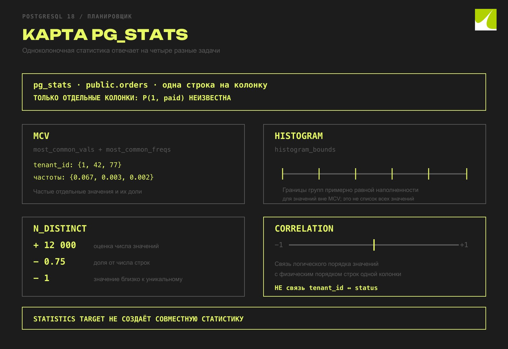
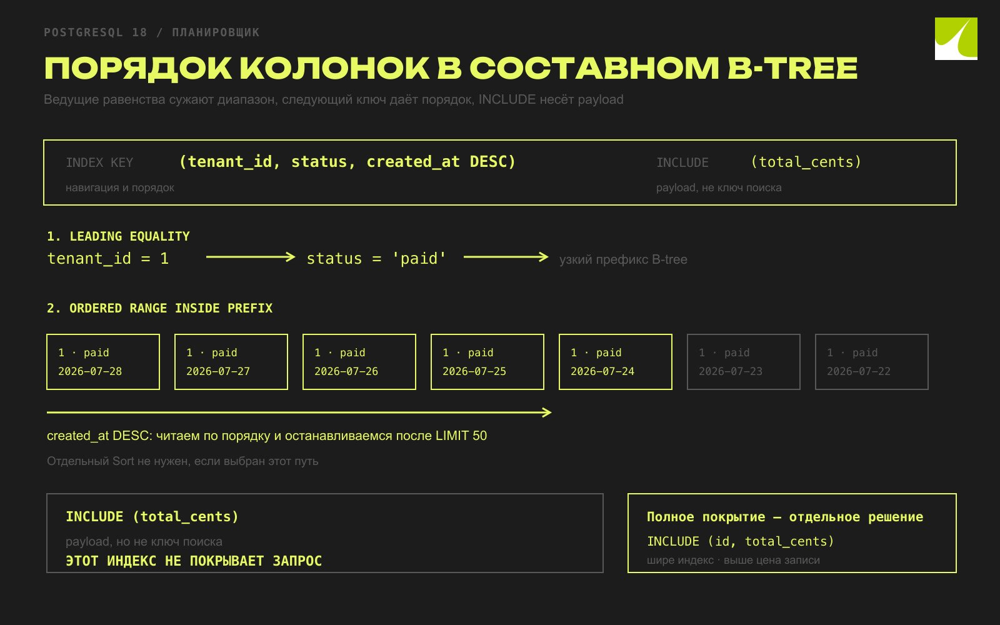
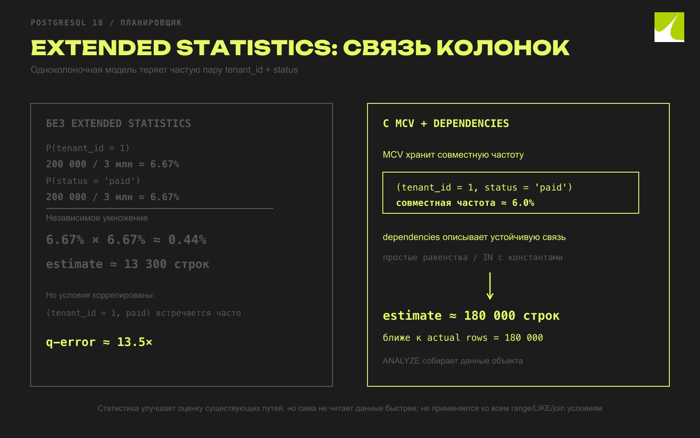
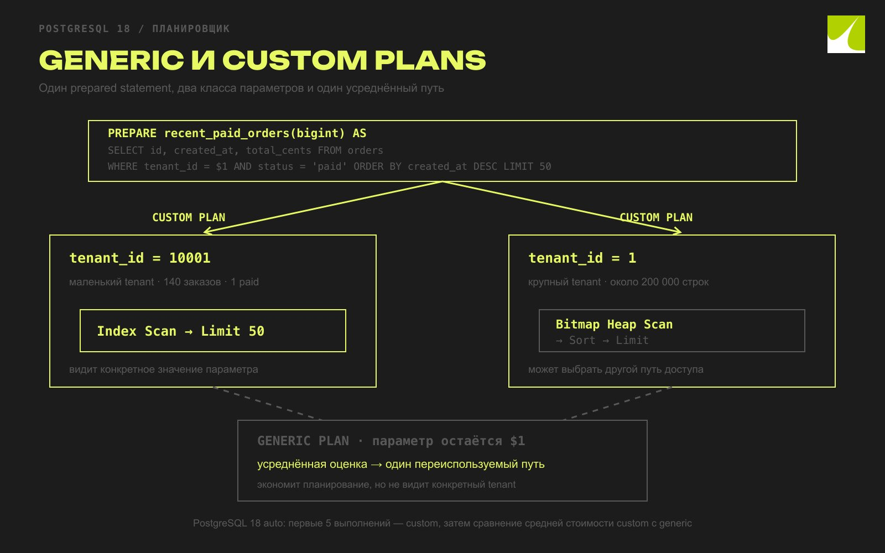

Почему PostgreSQL не использует индекс: читаем EXPLAIN и исправляем план
Разбираем медленный запрос по EXPLAIN ANALYZE, находим ошибку оценки строк и проверяем, нужен ли PostgreSQL другой индекс или статистика.

Короткий ответ: PostgreSQL выбирает не «самый индексный», а самый дешёвый план по своей модели. Если он предпочёл Seq Scan, сначала сравните estimated и actual rows, посмотрите loops, фильтры и BUFFERS. Затем проверьте свежесть статистики и только после этого меняйте запрос или индекс. cost нельзя сравнивать с миллисекундами, а enable_seqscan = off не исправляет причину. Хорошее изменение подтверждается повторным EXPLAIN (ANALYZE, BUFFERS) на тех же данных и на разных классах параметров.

Представим API истории заказов. У большинства клиентов запрос укладывается в десятки миллисекунд, но у одного крупного клиента периодически занимает секунды:

SELECT id, created_at, total_cents
FROM orders
WHERE tenant_id = $1
  AND status = 'paid'
ORDER BY created_at DESC
LIMIT 50;
Индекс на tenant_id уже есть, но это ещё не делает его подходящим для фильтра, порядка и доли выбранных строк. Разберём запрос на данных, где причина воспроизводится.

Воспроизводим перекос данных
Все команды из этого раздела предназначены для отдельной тестовой базы PostgreSQL 18. Они создают таблицу и три миллиона строк, поэтому запускать их в рабочей схеме не нужно.

CREATE TABLE orders (
    id          bigint GENERATED ALWAYS AS IDENTITY PRIMARY KEY,
    tenant_id   bigint NOT NULL,
    status      text NOT NULL,
    created_at  timestamptz NOT NULL,
    total_cents bigint NOT NULL
);

WITH source AS (
    SELECT
        g,
        CASE
            WHEN g <= 200000 THEN 1::bigint
            ELSE 2::bigint + ((g - 200001) % 20000)
        END AS tenant_id
    FROM generate_series(1, 3000000) AS s(g)
)
INSERT INTO orders (tenant_id, status, created_at, total_cents)
SELECT
    tenant_id,
    CASE
        WHEN tenant_id = 1 AND g % 10 <> 0 THEN 'paid'
        WHEN tenant_id <> 1 AND g <= 220000 THEN 'paid'
        WHEN g % 7 = 0 THEN 'cancelled'
        ELSE 'pending'
    END,
    timestamptz '2026-01-01 00:00:00+00'
        - ((g::bigint * 7919) % 31536000) * interval '1 second',
    1000 + (g % 250000)
FROM source;

CREATE INDEX idx_orders_tenant ON orders (tenant_id);
ANALYZE orders;
У tenant 1 двести тысяч заказов, из них 90% оплачены. У каждого из остальных клиентов ровно 140 заказов и один оплаченный. Всего в таблице 200 тысяч оплаченных заказов из трёх миллионов, то есть 6,67%. Условия tenant_id = 1 и status = 'paid' явно связаны: знание tenant меняет вероятность статуса. Обычная статистика по одной колонке видит популярность tenant_id = 1 и общую популярность paid, но без extended statistics может оценить их сочетание как произведение двух независимых вероятностей.

Проверим распределение, а не будем верить генератору на слово:

SELECT
    tenant_id,
    count(*) AS all_orders,
    count(*) FILTER (WHERE status = 'paid') AS paid_orders
FROM orders
WHERE tenant_id IN (1, 2, 10001)
GROUP BY tenant_id
ORDER BY tenant_id;
В приложении $1 связывает драйвер. Для ручной диагностики в psql подставим типизированный литерал и сохраним точный текст запроса, значение параметра, версию сервера и результат:

SELECT version();

EXPLAIN (ANALYZE, BUFFERS)
SELECT id, created_at, total_cents
FROM orders
WHERE tenant_id = 1::bigint
  AND status = 'paid'
ORDER BY created_at DESC
LIMIT 50;
На конкретной машине числа будут другими: ANALYZE использует выборку, а время и попадания в кеш зависят от окружения. Типичная форма исходного плана выглядит так:

Limit  (cost=... rows=50 width=24)
  (actual time=... rows=50 loops=1)
  ->  Sort  (cost=... rows=... width=24)
        (actual time=... rows=50 loops=1)
        Sort Key: created_at DESC
        Sort Method: top-N heapsort
        ->  Bitmap Heap Scan on orders
              (cost=... rows=... width=24)
              (actual time=... rows=180000 loops=1)
              Recheck Cond: (tenant_id = 1)
              Filter: (status = 'paid'::text)
              Rows Removed by Filter: 20000
              ->  Bitmap Index Scan on idx_orders_tenant
                    (cost=... rows=... width=0)
                    (actual time=... rows=200000 loops=1)
                    Index Cond: (tenant_id = 1)
Planning Time: ...
Execution Time: ...
Планировщик применил индекс. Проблема в другом: он получил через индекс все строки tenant, отфильтровал статус, а затем просмотрел 180 тысяч строк ради пятидесяти самых свежих. Пользовательская задержка при этом может быть больше Execution Time: стандартный EXPLAIN ANALYZE не измеряет передачу результата клиенту, а приложение добавляет ожидание пула соединений, сеть, преобразование данных и свою работу.

Безопасный EXPLAIN
Обычный EXPLAIN строит план, но не выполняет оператор. Он подходит для первого взгляда на production, хотя само планирование тоже требует блокировок каталога и ресурсов. EXPLAIN ANALYZE запускает запрос и добавляет фактические строки и время каждого узла. Для тяжёлого SELECT это настоящая нагрузка, а не симуляция. На рабочей базе заранее оцените риск, используйте стенд или реплику, задайте разумные statement_timeout и lock_timeout, если правила эксплуатации это допускают.

С изменяющими операторами цена ошибки выше. Документация PostgreSQL рекомендует выполнить анализ внутри транзакции и откатить её:

BEGIN;
EXPLAIN (ANALYZE, BUFFERS)
UPDATE orders
SET status = 'archived'
WHERE id = 42;
ROLLBACK;
ROLLBACK не делает такой запуск безвредным. UPDATE успеет взять блокировки, создать версии строк, выполнить триггеры и сгенерировать WAL. Внешний эффект триггера или изменение sequence может не откатиться вместе со строкой. Этот приём защищает от фиксации обычного DML, но не заменяет оценку последствий.

BUFFERS показывает работу с блоками:

shared hit означает, что нужный блок обычной таблицы или индекса уже был в буферном кеше PostgreSQL;
shared read означает, что блок пришлось прочитать в shared buffers; это не доказывает физическое чтение с накопителя, потому что блок мог быть в page cache ОС;
local относится к временным таблицам и их индексам;
temp read/written относится к временным блокам сортировок, hash и похожих операций;
dirtied и written показывают изменённые и записанные блоки.
При включённом track_io_timing план также содержит время чтения и записи блоков. У верхнего узла счётчики включают работу дочерних узлов, поэтому складывать все строки Buffers нельзя.

Сравнение холодного первого запуска с прогретым вторым почти всегда вводит в заблуждение. Выполняйте варианты в одинаковом порядке на одинаковом снимке данных либо делайте несколько чередующихся прогонов. Записывайте не только время, но и план, параметры, число блоков и настройки, которые отличаются от стандартных.

Как читать дерево плана
План читают из глубины к корню. Нижние узлы получают строки из таблиц или индексов. Родитель сортирует, соединяет, агрегирует или ограничивает их. Отступ показывает связь родителя и ребёнка.

Limit  (cost=9132.01..9132.13 rows=50 width=24)
       (actual time=142.431..142.447 rows=50 loops=1)
  ->  Sort  (cost=9132.01..9162.95 rows=12376 width=24)
            (actual time=142.429..142.437 rows=50 loops=1)
        Sort Key: created_at DESC
        Sort Method: top-N heapsort  Memory: 31kB
        ->  Bitmap Heap Scan on orders
              (cost=2201.77..8720.89 rows=12376 width=24)
              (actual time=6.912..116.284 rows=180000 loops=1)
              Recheck Cond: (tenant_id = 1)
              Filter: (status = 'paid'::text)
              Rows Removed by Filter: 20000
Это иллюстративные числа, а не обещанный результат генератора на любой машине. В них важны поля:

cost=9132.01..9132.13 содержит startup cost и total cost. Это условные единицы модели, а не миллисекунды. Стоимость родителя включает детей.
rows=12376 до фактического запуска является оценкой числа строк, которые узел выдаст при полном выполнении.
width=24 является оценкой среднего размера выдаваемой строки в байтах.
actual time=... измеряется в миллисекундах и в узле с несколькими исполнениями усредняется на один цикл.
actual rows=... тоже является средним на один цикл. Чтобы оценить общий объём выдачи узла, учитывайте loops.
Rows Removed by Filter показывает строки, прочитанные узлом, но отброшенные обычным фильтром. Index Cond уже ограничивает проход по индексу, а Filter проверяется после получения кандидата.
У Limit и родительских узлов есть ещё одна тонкость. Ребёнок может не выполниться до конца: после пятидесятой строки Limit прекращает запрашивать данные. Поэтому фактические строки остановленного index scan нельзя механически сравнивать с оценкой, рассчитанной для полного прохода. В исходном плане Sort должен получить все подходящие строки, прежде чем вернуть top-N, и ошибка оценки на Bitmap Heap Scan видна целиком.

Planning Time и Execution Time отвечают на разные вопросы. Первое включает построение плана, второе исполнение внутри сервера с накладными расходами instrumentation. Ни одно из них в стандартном режиме не равно полной задержке приложения.

Сначала разберите нижний узел: сколько строк он ожидал, сколько выдал за все циклы и сколько блоков затронул. Затем поднимайтесь к корню.

Почему Seq Scan может быть правильным
Индекс не является коротким путём при любой селективности. Селективность условия — доля строк, которые ему соответствуют. Если запрос выбирает половину большой таблицы, переходы от индексных записей к множеству разрозненных heap-страниц могут стоить дороже последовательного чтения таблицы.

Три распространённых способа доступа решают разные задачи:

Seq Scan читает heap последовательно и проверяет фильтр для каждой строки. Он разумен при большой доле результата, маленькой таблице или отсутствии подходящего индекса.
Index Scan идёт по индексу и сразу получает строки heap в индексном порядке. Он хорош при небольшом результате и при ORDER BY ... LIMIT, если порядок индекса совпадает с запросом.
Bitmap Index Scan сначала собирает адреса строк в bitmap. Bitmap Heap Scan затем группирует обращения по heap-страницам. Это компромисс для среднего числа совпадений; цена startup выше, а порядок индекса к результату не сохраняется.
Планировщик сравнивает относительную стоимость CPU, последовательных и случайных чтений, учитывает оценку кеша и корреляцию физического порядка. Значения seq_page_cost, random_page_cost, effective_cache_size должны описывать средний workload установки. Подгонять их по одному запросу опасно.

В нашем случае индекс на tenant_id отсеивает 2,8 миллиона чужих заказов, поэтому bitmap-путь выглядит разумно. Но он не помогает с status и не выдаёт строки по created_at DESC. Для большого tenant остаются фильтрация и сортировка. Если бы условие выбирало значительную часть всей таблицы, Seq Scan мог бы оказаться дешевле и быстрее.

SET enable_seqscan = off иногда полезен в лаборатории, чтобы увидеть альтернативный план и его оценку. Это грубый диагностический рычаг: настройка лишь отговаривает PostgreSQL от Seq Scan, а не устраняет ошибку статистики или структуры индекса. Оставлять такую настройку как «фикс» запроса нельзя.

Bitmap scan уменьшает хаотичность обращений к heap, но теряет индексный порядок. Поэтому после него часто остаётся отдельная сортировка.

Ищем ошибку оценки строк
В исходном плане Bitmap Index Scan достаточно точно оценивает двести тысяч строк tenant 1. Ошибка появляется на следующем узле, где добавляется status = 'paid': вместо примерно 180 тысяч планировщик ожидает около 13,3 тысячи. Конкретный коэффициент меняется между запусками ANALYZE, но направление ошибки устойчиво.

Для положительных estimated и actual rows удобно считать отношение:

q-error = max(actual_rows / estimated_rows,
              estimated_rows / actual_rows)
Оценка 13 300 при факте 180 000 даёт q-error около 13,5. Если одна cardinality равна нулю, отношение не определено: зафиксируйте расхождение «ноль против ненулевого значения» отдельно; при двух нулях ошибки cardinality нет. rows и actual rows в строке узла относятся к одному выполнению, поэтому их можно сравнивать напрямую. Если нужен суммарный объём работы узла с loops > 1, умножайте на loops обе стороны сравнения. При LIMIT проверьте, не был ли узел остановлен досрочно.

Число строк участвует в оценке всех операций выше. Недооценённый набор может сделать дешёвыми в модели:

многократный inner scan внутри nested loop;
сортировку, которая в реальности обрабатывает гораздо больше данных или уходит во временные файлы;
случайные обращения к heap;
передачу строк между parallel workers.
Само расхождение ещё не доказывает, что именно оно создало плохой план. Начинайте с первого нижнего узла, где оценка заметно расходится с фактом, и формулируйте проверяемую гипотезу. Здесь гипотеза проста: планировщик считает tenant_id и status независимыми.

Чтобы сравнить cardinality без досрочной остановки LIMIT, можно временно исследовать те же предикаты отдельным диагностическим запросом:

EXPLAIN (ANALYZE, BUFFERS)
SELECT count(*)
FROM orders
WHERE tenant_id = 1::bigint
  AND status = 'paid';
Это не замена основному запросу: count(*) может получить другой физический план. Он нужен только для чистой проверки оценки сочетания условий.

Ошибка появляется там, где к tenant добавляется статус, а затем меняет ожидаемую цену сортировки и других родительских узлов.

Что планировщик знает о данных
Сначала исключим банальную причину: статистика могла устареть после массовой загрузки или изменения распределения. Autovacuum обычно запускает auto-analyze, но между изменением и следующим проходом есть окно. Ручной ANALYZE orders; на крупной рабочей таблице тоже создаёт нагрузку, поэтому его запускают по эксплуатационному регламенту.

Читаем доступное представление pg_stats, а не внутренний pg_statistic:

SELECT attname, null_frac, n_distinct, most_common_vals,
       most_common_freqs, histogram_bounds, correlation
FROM pg_stats
WHERE schemaname = 'public'
  AND tablename = 'orders';
Поля отвечают на разные вопросы:

null_frac — доля NULL. В нашем DDL все колонки NOT NULL, поэтому ожидаем ноль.
n_distinct — оценка числа различных значений. Положительное значение задаёт количество, отрицательное описывает долю от числа строк; -1 близко к уникальной колонке.
most_common_vals хранит частые значения, а most_common_freqs их доли. Популярный tenant 1 и статус paid могут попасть сюда.
histogram_bounds делит оставшиеся, не вошедшие в MCV значения, на группы примерно равной наполненности. Это не список всех значений и не временной график.
correlation показывает статистическую связь между физическим порядком строк и логическим порядком значений одной колонки. Значение около 1 или -1 может снизить оценку цены упорядоченного index scan. Это поле не описывает связь tenant_id со status.
Обычный pg_stats хранит сведения по каждой колонке отдельно. Даже если там видны оба перекоса, из этих строк нельзя восстановить частоту пары (tenant_id = 1, status = 'paid').

Размер MCV и histogram зависит от statistics target. Для сложного распределения можно повысить его у конкретной колонки:

ALTER TABLE orders ALTER COLUMN tenant_id SET STATISTICS 500;
ALTER TABLE orders ALTER COLUMN status SET STATISTICS 500;
ANALYZE orders;
Больший target увеличивает выборку, время ANALYZE и объём статистики. Он помогает точнее описать отдельные колонки, но сам по себе не создаёт знание об их совместном распределении. Перед постоянным изменением сравните планы и стабильность оценки.

correlation в pg_stats относится к физическому порядку одной колонки. Для связи двух условий нужен отдельный объект extended statistics.

Выбираем исправление
До создания индекса сверьте тип параметра с типом колонки, а выражение запроса — с выражением индекса. Не оборачивайте индексированную колонку в функцию без необходимости. Если запрос действительно фильтрует по выражению, рассматривайте expression index осознанно.

Затем выпишите равенства и порядок результата. Для B-tree ограничения равенства на ведущих колонках сокращают диапазон сканирования. После tenant_id = ... и status = ... строки в индексе можно читать по created_at.

Посмотрите и на остальной workload. Индекс для одного endpoint может дублировать существующий или ухудшить частые записи. Проверьте запросы обновления статуса, очистку истории и другие варианты сортировки.

Отдельно решите, нужно ли полное покрытие. В PostgreSQL обычный index scan обращается к heap. Index-only scan возможен, когда все требуемые колонки есть в индексе и visibility map позволяет не проверять видимость строки в heap.

Кандидат из разбираемого запроса:

CREATE INDEX CONCURRENTLY idx_orders_tenant_status_created
ON orders (tenant_id, status, created_at DESC)
INCLUDE (total_cents);
Первые две колонки задают узкий диапазон по равенству. created_at внутри диапазона соответствует сортировке, поэтому executor может остановиться после первых 50 строк без отдельного Sort. Для единственной сортируемой колонки B-tree с ASC можно читать назад; явный DESC здесь в основном фиксирует намерение и становится существеннее в индексах со смешанными направлениями.

INCLUDE (total_cents) хранит сумму как payload, но не участвует в поиске. Этот запрос ещё возвращает id, которого в индексе нет, поэтому Index Only Scan по показанному индексу невозможен: executor должен получить id из heap. Если измерения показывают пользу полного покрытия, вариант должен включать обе выдаваемые payload-колонки:

CREATE INDEX CONCURRENTLY idx_orders_tenant_status_created_cover
ON orders (tenant_id, status, created_at DESC)
INCLUDE (id, total_cents);
Такой индекс шире. Он занимает больше места, увеличивает запись и может замедлить поиск из-за дополнительных страниц. Кроме того, на часто обновляемой таблице visibility map будет чаще требовать heap fetches, и выигрыш index-only scan уменьшится. INCLUDE нужно обосновывать планом с Heap Fetches, а не словом «покрывающий».

Если endpoint всегда ищет только оплаченные заказы, возможен partial index:

CREATE INDEX CONCURRENTLY idx_orders_paid_tenant_created
ON orders (tenant_id, created_at DESC)
INCLUDE (total_cents)
WHERE status = 'paid';
Он меньше и не получает запись для строк с другими статусами. Но запрос должен позволить планировщику доказать, что его WHERE подразумевает предикат индекса. Наш литерал status = 'paid' подходит. Параметризованное status = $2 в generic plan не обязано подходить, потому что значение неизвестно при планировании. Если приложение часто запрашивает разные статусы, обычный составной индекс может быть полезнее.

CREATE INDEX CONCURRENTLY не блокирует обычные INSERT, UPDATE и DELETE так, как стандартная сборка, но делает больше работы, проходит таблицу дважды и может заметно добавить CPU/I/O. Его нельзя выполнять внутри transaction block. После ошибки может остаться invalid index, который потребляет место и расходы на обновление. Команду нужно планировать и наблюдать как production-операцию, а не вставлять в случайный релиз.

После создания кандидата повторяем исходный план:

EXPLAIN (ANALYZE, BUFFERS)
SELECT id, created_at, total_cents
FROM orders
WHERE tenant_id = 1::bigint
  AND status = 'paid'
ORDER BY created_at DESC
LIMIT 50;
Повторный план должен показать:

исчез ли отдельный Sort;
остановился ли index scan после небольшого числа строк;
уменьшились ли затронутые buffers и Execution Time;
нет ли большого Rows Removed by Filter;
одинаково ли разумен план для tenant 1 и небольшого tenant;
не выросла ли неприемлемо цена записи.

Ключи ограничивают поиск и дают порядок. Колонки INCLUDE только несут payload и не помогают навигации по B-tree.

Когда нужны extended statistics
Новый индекс решает доступ и сортировку, но не обязательно исправляет оценку числа оплаченных заказов. Эта оценка влияет не только на наш LIMIT: тот же предикат может участвовать в join, aggregation или запросе без ограничения.

PostgreSQL не строит статистику для всех сочетаний колонок автоматически: комбинаций слишком много. Создадим объект только для пары, которая реально встречается вместе:

CREATE STATISTICS orders_tenant_status_stats (dependencies, mcv)
ON tenant_id, status
FROM orders;

ANALYZE orders;
CREATE STATISTICS создаёт описание объекта. Данные собирает следующий ANALYZE или auto-analyze.

dependencies оценивает функциональную зависимость: насколько значение одной колонки определяет другую. В PostgreSQL 18 этот вид применяется к простым условиям равенства с константами и IN с константами; он не является общим механизмом для range, LIKE или join условий.

mcv хранит частые комбинации значений и их совместные частоты. Для нашего перекоса пара (1, paid) является хорошим кандидатом. Совместный MCV умеет отличить реальную частоту пары от произведения частот отдельных колонок.

Проверим оценку на запросе без досрочной остановки:

EXPLAIN (ANALYZE, BUFFERS)
SELECT count(*)
FROM orders
WHERE tenant_id = 1::bigint
  AND status = 'paid';
Сравнивать нужно строку scan-узла до и после ANALYZE: estimated rows должны стать ближе к actual rows. Тип сканирования может не измениться, и это нормально. Статистика не ускоряет чтение сама по себе. Она даёт планировщику более точную картину для выбора существующих путей.

Extended statistics тоже имеют цену: ANALYZE тратит больше времени, каталог хранит дополнительные данные, а планирование обрабатывает их. Создавайте объекты для сочетаний, где ошибка уже измерена. В PostgreSQL 18 extended statistics не используются для оценки selectivity условий соединения двух таблиц, поэтому ожидать от них исправления любого join нельзя.

Одноколоночная модель перемножает частоты. Совместный MCV хранит частую пару, а dependencies описывает устойчивую связь условий.

Generic и custom plans
План, хороший для крупного tenant, может быть лишним для tenant с сотней строк. Подготовленные операторы добавляют ещё один выбор.

PREPARE recent_paid_orders(bigint) AS
SELECT id, created_at, total_cents
FROM orders
WHERE tenant_id = $1
  AND status = 'paid'
ORDER BY created_at DESC
LIMIT 50;

EXPLAIN EXECUTE recent_paid_orders(1);
EXPLAIN EXECUTE recent_paid_orders(10001);
Custom plan строится для конкретного выполнения и видит значение параметра. Generic plan не зависит от значения и может переиспользоваться. Он экономит планирование, но при parameter skew один усреднённый путь иногда плохо подходит крупному или маленькому tenant.

В PostgreSQL 18 при plan_cache_mode = auto первые пять выполнений параметризованного prepared statement получают custom plans. Затем сервер сравнивает среднюю оценочную стоимость custom plans со стоимостью generic plan и решает, оправдывает ли экономия исполнения повторное планирование. Это эвристика текущей версии, а не API-контракт на будущее.

Посмотреть generic plan без подстановки значения можно напрямую:

EXPLAIN (GENERIC_PLAN)
SELECT id, created_at, total_cents
FROM orders
WHERE tenant_id = $1
  AND status = 'paid'
ORDER BY created_at DESC
LIMIT 50;
GENERIC_PLAN разрешает placeholders и несовместим с ANALYZE, потому что выполнять запрос без значения параметра нельзя. В выводе generic plan остаётся $1; в custom plan, показанном через EXPLAIN EXECUTE, обычно виден подставленный литерал.

Если поведение меняется после нескольких вызовов или зависит от истории соединения в пуле, сравните режимы в одной сессии:

BEGIN;

SET LOCAL plan_cache_mode = 'force_custom_plan';
EXPLAIN EXECUTE recent_paid_orders(1);
EXPLAIN EXECUTE recent_paid_orders(10001);

SET LOCAL plan_cache_mode = 'force_generic_plan';
EXPLAIN EXECUTE recent_paid_orders(1);
EXPLAIN EXECUTE recent_paid_orders(10001);

ROLLBACK;
plan_cache_mode здесь является диагностическим переключателем. Постоянное force_custom_plan добавляет планирование каждому выполнению, а force_generic_plan отказывается от знания параметров. Сначала исправьте статистику, индекс и форму запроса; глобальная настройка редко является первым правильным решением.

После extended statistics custom plan может точнее оценить известную пару (tenant_id, status). Generic plan всё равно не знает $1 и вынужден ориентироваться на распределение без конкретного tenant. Поэтому итог проверяют минимум на двух классах параметров, а не только на «счастливом» примере.

Custom plan знает значение tenant. Generic plan экономит повторное планирование, но при сильном перекосе данных его усреднённый выбор может проигрывать.

Проверяем результат целиком
После изменения легко остановиться на красивой строке Index Scan. Этого мало. Сравнение должно отвечать пользовательской задаче.

Сохраните планы до и после для крупного и обычного tenant. Выполните несколько чередующихся прогонов при сопоставимом состоянии кеша. Сравните Execution Time, но также buffers и объём работы каждого узла. Быстрый прогретый запуск с теми же тысячами read buffers может плохо вести себя после рестарта или под конкуренцией.

Проверьте запись. Новый индекс обновляется при INSERT, при изменении любой его ключевой или включённой колонки, занимает место и участвует в vacuum. Смена status особенно важна для нашего определения: она меняет индексную запись. Оцените размер:

SELECT
    pg_size_pretty(pg_relation_size('orders')) AS table_size,
    pg_size_pretty(pg_relation_size('idx_orders_tenant_status_created')) AS index_size;
Проведите нагрузочный тест с реальным соотношением чтения и записи. Если старый idx_orders_tenant полностью дублируется ведущим префиксом нового индекса для вашего workload, не удаляйте его автоматически: сначала проверьте usage, ограничения, планы других запросов и эксплуатационный процесс отката.

Наконец, сравните полную задержку endpoint. EXPLAIN не измеряет ожидание соединения и передачу по сети. Улучшенный план может решить основную проблему, но серверное и клиентское время всё равно нужно наблюдать отдельно.

Чек-лист Вектора
Сохраните точный SQL, типы и значения параметров, версию PostgreSQL.
Получите обычный EXPLAIN; ANALYZE запускайте только после оценки риска.
Для DML используйте транзакцию с ROLLBACK и учитывайте блокировки, WAL и триггеры.
Читайте план снизу вверх. Найдите первый узел с большой ошибкой rows.
Учитывайте loops, досрочную остановку LIMIT, фильтры и Rows Removed by Filter.
Смотрите BUFFERS, а не только время одного прогретого запуска.
Проверьте pg_stats, свежесть ANALYZE и связь условий.
Сформулируйте одну гипотезу: статистика, запрос или конкретный индекс.
Проверьте её на копии данных или стенде и повторите исходный план.
Прогоните крупный, обычный и редкий набор параметров; для prepared statements сравните generic/custom plans.
Измерьте цену индекса для записи, vacuum и диска.
Только после этого планируйте production-изменение и способ отката.
Короткий ответ на собеседовании занимает около минуты:

PostgreSQL выбирает план с минимальной оценочной стоимостью, а не план с индексом любой ценой. Сначала я получаю обычный EXPLAIN и оцениваю риск выполнения запроса. Если нагрузка приемлема, запускаю EXPLAIN (ANALYZE, BUFFERS), читаю дерево снизу вверх и сравниваю estimated с actual rows с учётом loops. Затем смотрю фильтры, removed rows и buffer I/O. Если первая большая ошибка появилась на сочетании коррелированных условий, проверяю pg_stats, свежий ANALYZE и при необходимости extended statistics. Индекс проектирую под равенства, диапазон и ORDER BY LIMIT, но проверяю его цену для записи. Результат подтверждаю повторным планом на тех же данных, включая разные значения параметров и generic/custom plans.

Частые ошибки
Искать слово Index Scan вместо узла, где уходит время или I/O.
Сравнивать cost с миллисекундами. У них разные шкалы.
Считать shared hit физическим чтением. Это как раз попадание в shared buffers.
Складывать buffers родителя и детей, хотя родитель уже включает дочерние значения.
Умножать или не умножать actual rows на loops без понимания, какой объём сравнивается.
Сравнивать estimated rows полного прохода с actual rows узла, который рано остановил LIMIT.
Объявлять любой Seq Scan ошибкой и лечить его через enable_seqscan = off.
Повышать default_statistics_target глобально из-за одной коррелированной пары колонок.
Называть индекс с INCLUDE (total_cents) полностью покрывающим, забыв про выбранный id и visibility map.
Создавать partial index, не проверив, может ли планировщик доказать его предикат для реальной формы prepared query.
Судить по одному tenant и одному прогретому запуску.
Оставлять force_custom_plan или force_generic_plan постоянной настройкой после диагностического эксперимента.
Вопросы для самопроверки
Почему cost=1000 не означает одну секунду?
Что означает actual rows=10 loops=100 и какой объём мог выдать узел суммарно?
Почему большой shared hit не доказывает медленный диск?
Когда Seq Scan дешевле B-tree и чем обычный Index Scan отличается от bitmap scan?
Где искать первую причину, если ошибка cardinality растёт вверх по дереву?
Почему высокий statistics target для отдельных колонок не заменяет dependencies или совместный mcv и каковы ограничения extended statistics в PostgreSQL 18?
Почему INCLUDE не гарантирует index-only scan?
Когда partial index по status = 'paid' не будет доступен parameterized query?
Чем generic plan отличается от custom plan при сильном перекосе tenant?
Какие измерения, кроме времени чтения, нужны перед добавлением индекса в production?
