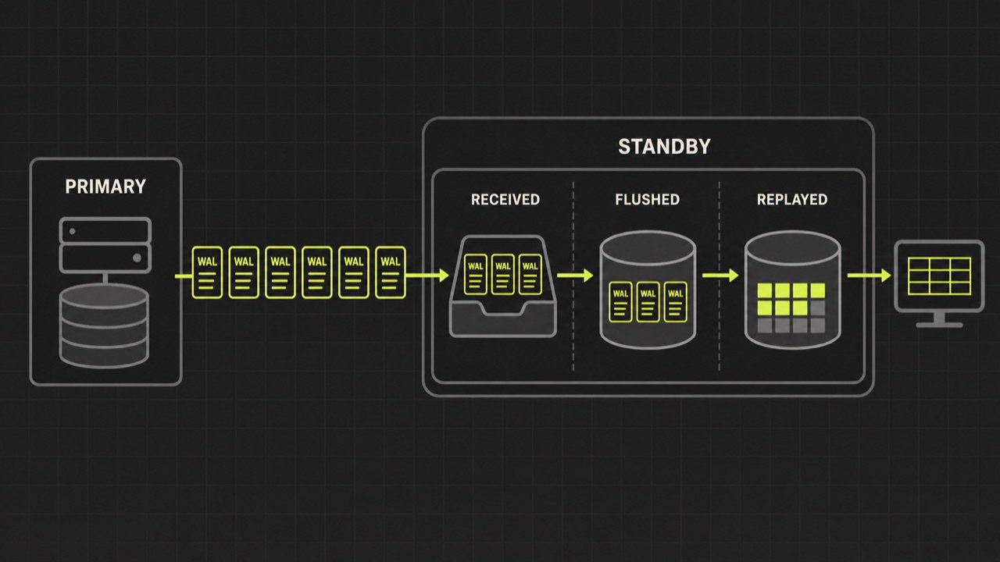
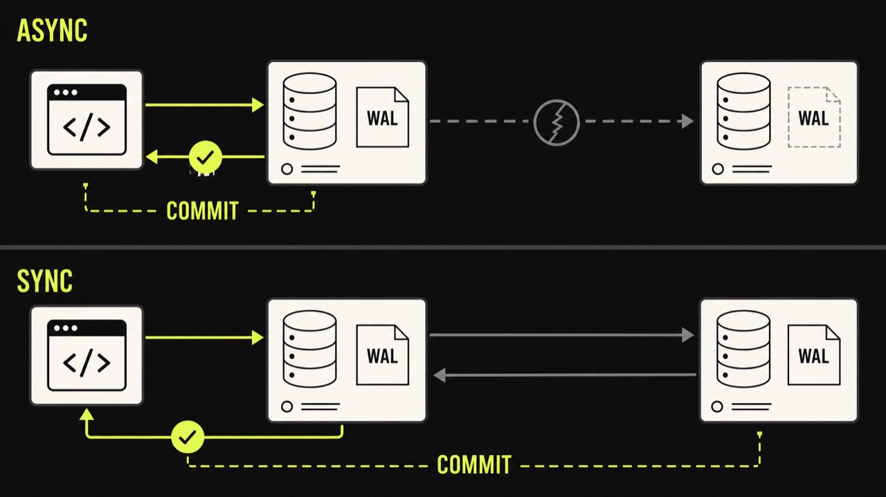

Как устроена репликация PostgreSQL?
Потоковая репликация PostgreSQL и типичные дополнительные вопросы на собеседовании.

Короткий ответ: primary записывает изменения в WAL, а standby получает эти записи, сохраняет и воспроизводит их у себя. При streaming replication процессы walsender и walreceiver передают WAL по постоянному соединению, не дожидаясь заполнения целого сегмента. По умолчанию такая репликация асинхронная: успешный COMMIT на primary не гарантирует, что standby уже получил или применил запись.

Для мидла этого объяснения мало ровно на один вопрос: "Что случится, если primary упадёт сразу после commit?" Возможна потеря последних подтверждённых клиенту транзакций при переключении на отстающую реплику. Дальше интервью обычно идёт в сторону синхронного режима, replication slots и измерения lag.

WAL сначала, реплика потом
PostgreSQL использует write-ahead log: перед изменением страниц данных информация о модификации попадает в WAL. Физическая репликация пересылает эти записи standby, а тот повторяет изменения на уровне хранения. Это не поток SQL-запросов. Реплике не требуется заново выполнять UPDATE accounts ... и выбирать строки по условию; она воспроизводит WAL-записи.

Упрощённый путь транзакции:

Application
    |
    v
Primary: WAL generated -> WAL flushed -> COMMIT acknowledged
    |
    |  walsender === streaming connection === walreceiver
    v
Standby: WAL received -> WAL flushed -> WAL replayed
                                  |
                                  +--> read-only queries with hot_standby

Три положения на standby не стоит смешивать:

received означает, что WAL пришёл по сети;
flushed означает, что он записан на диск standby;
replayed означает, что изменения применены и видны запросам на hot standby.
Реплика может быстро получать WAL, но медленно применять его из-за нагрузки или конфликтов с долгими запросами. Поэтому фраза "сеть быстрая, значит lag нет" не выдерживает диагностики.

Минимальная конфигурация
На primary нужен отдельный пользователь с LOGIN и REPLICATION, разрешение в pg_hba.conf и достаточное значение max_wal_senders. На standby primary_conninfo указывает, куда подключаться. Пароль лучше хранить в защищённом .pgpass, а не в общем конфигурационном файле.

Пример разрешения на primary:

# pg_hba.conf
host  replication  replicator  10.20.0.12/32  scram-sha-256
Настройки standby могут выглядеть так:

# postgresql.conf on standby
primary_conninfo = 'host=10.20.0.10 port=5432 user=replicator application_name=standby_a'
primary_slot_name = 'standby_a_slot'
hot_standby = on
Это не пошаговая инструкция по созданию standby: перед запуском ему ещё нужна согласованная базовая копия кластера и признак standby-режима. На собеседовании важнее показать назначение параметров, чем пытаться восстановить все команды по памяти.

После подключения на primary появляется walsender, на standby — walreceiver. Состояние можно смотреть через системные представления:

-- primary
SELECT application_name,
       state,
       sync_state,
       sent_lsn,
       write_lsn,
       flush_lsn,
       replay_lsn
FROM pg_stat_replication;

-- standby
SELECT pg_last_wal_receive_lsn(),
       pg_last_wal_replay_lsn(),
       pg_last_xact_replay_timestamp();
Разность LSN показывает объём отставания в байтах, а время последней replayed-транзакции помогает оценить задержку по времени. У временной метрики есть неприятная особенность: если на primary просто нет новых транзакций, старый timestamp не доказывает проблему. Метрики нужно читать вместе с текущей нагрузкой и состоянием соединения.

Асинхронный и синхронный режимы
Асинхронная streaming replication не добавляет ожидание standby в обычный commit-path. Она подходит для read replicas и сценариев, где небольшой RPO допустим. Если primary потерян до того, как WAL дошёл до standby, последние подтверждённые транзакции могут отсутствовать после promotion.

Синхронная репликация заставляет commit ждать подтверждения от выбранного standby. Какие именно standby считаются синхронными, задаёт synchronous_standby_names. Например, quorum-конфигурация может ждать любые два из трёх:

synchronous_standby_names = 'ANY 2 (standby_a, standby_b, standby_c)'

Но слово "синхронная" ещё не описывает точку подтверждения. Параметр synchronous_commit определяет, чего ждёт транзакция: записи WAL на удалённый диск или, в более строгом варианте, применения записи на standby. Чем сильнее гарантия, тем больше commit latency и зависимость от состояния реплик.

Нулевая потеря данных на диаграмме не означает автоматический failover без риска. Нужно корректно определить, какая нода содержит самые свежие WAL, не допустить двух primary и перенаправить клиентов. Выбор лидера и изоляцию старой primary обеспечивает внешний контур управления, а не один параметр PostgreSQL.

Зачем нужен replication slot
Если standby отключился, primary продолжает создавать WAL и со временем удаляет старые сегменты. Вернувшаяся реплика может обнаружить, что нужного продолжения уже нет. Тогда её придётся восстанавливать из новой базовой копии или архива.

Physical replication slot сообщает primary, какой WAL ещё нужен конкретному потребителю. Primary удерживает сегменты до подтверждения со стороны standby. Это удобная страховка от слишком раннего удаления, но у неё есть обратная сторона: забытый или долго неактивный slot способен заполнить pg_wal и остановить primary из-за нехватки диска.

Поэтому slot нельзя просто создать и забыть. Нужны алерты на pg_replication_slots, объём удерживаемого WAL и свободное место. Параметр max_slot_wal_keep_size помогает поставить верхнюю границу, после которой slot может стать непригодным и реплику придётся пересобирать. Это неприятно, но обычно лучше, чем неожиданно заполнить диск на primary.

WAL archive решает соседнюю задачу. Архив хранит завершённые WAL-сегменты вне pg_wal и позволяет standby или point-in-time recovery дочитать историю после разрыва. Slot и archive можно использовать вместе: первый следит за прогрессом конкретного потребителя, второй хранит долговечную историю по собственной политике.

Чтение со standby не всегда бесплатно
При hot_standby=on реплика принимает read-only запросы во время recovery. Кажется, что достаточно отправить туда тяжёлые отчёты и разгрузить primary. Но standby одновременно должен replay WAL.

Долгий запрос может обращаться к версии строки, которую WAL уже требует удалить. PostgreSQL выбирает между задержкой replay и отменой конфликтующего запроса. max_standby_streaming_delay ограничивает, сколько standby готов отставать при применении потокового WAL из-за таких конфликтов. Это общий бюджет задержки для применения данных, а не максимальное время жизни каждого запроса.

hot_standby_feedback уменьшает число отмен, сообщая primary о нужных standby версиях строк. Цена переносится на primary: VACUUM дольше сохраняет старые версии, возможен bloat. Здесь нет настройки, которая всегда делает лучше. Для аналитической реплики часто выбирают больший допустимый lag; для failover-реплики важнее быстрое воспроизведение WAL. Иногда эти роли разумно разделить между разными standby.

Что происходит при переключении
Promotion завершает recovery и делает standby новой primary. Приложение должно переподключиться, а старую primary нельзя просто вернуть в кластер как равноправный сервер. Если она принимает запись одновременно с новой, возникает split brain.

Практический failover включает несколько шагов:

Убедиться, что старая primary действительно изолирована или выключена.
Выбрать наиболее актуальную standby и выполнить promotion.
Переключить endpoint или service discovery для клиентов.
Перенастроить остальные standby на новую upstream-ноду.
Восстановить бывшую primary как standby, часто через pg_rewind или новую базовую копию.
На собеседовании стоит отдельно назвать RPO и RTO. RPO описывает допустимую потерю данных, RTO — допустимое время восстановления сервиса. Асинхронная реплика может дать короткий RTO, но ненулевой RPO. Синхронная реплика снижает риск потери подтверждённых транзакций, зато может ухудшить доступность записи и latency.

Разбор Вектора: как отвечать последовательно
Нормальный ответ строится слоями. Сначала WAL и пара walsender/walreceiver. Затем асинхронное подтверждение и возможная потеря последних транзакций. После этого interviewer сам даст повод перейти к sync replication, slots, lag или failover.

Мы бы не начинали с двадцати параметров postgresql.conf. Лучше провести один сбойный сценарий:

Клиент получил успешный commit, primary сразу потерял диск, standby отставал на 300 мс. Какие данные увидим после promotion?

В асинхронном режиме последние транзакции могут исчезнуть. В синхронном нужно уточнить synchronous_commit, состав синхронных standby и факт, что commit действительно получил нужное подтверждение. Этот разбор показывает понимание гарантий лучше, чем определение "master-slave репликации".

Второй полезный сценарий: standby не работал сутки, slot активен, диск primary заканчивается. Правильная реакция начинается с проверки удерживаемого WAL и свободного места, а не с бездумного удаления slot. После удаления реплика может лишиться нужной истории; сначала нужен план её восстановления.

Частые ошибки на собеседовании
Говорить, что primary передаёт на standby SQL-запросы. Физическая репликация передаёт WAL.
Считать успешный commit доказательством наличия данных на асинхронной реплике.
Путать получение, flush и replay WAL, а затем измерять lag одной случайной метрикой.
Называть replication slot "защитой от потери данных" без риска заполнения pg_wal.
Обещать, что read replica всегда разгружает кластер. Долгие запросы могут конфликтовать с replay и увеличивать bloat через feedback.
Описывать promotion, но забывать fencing старой primary и риск split brain.
Смешивать физическую и логическую репликацию. У них разный уровень данных и разные сценарии применения.
Вопросы для самопроверки
Чем received_lsn, flush_lsn и replay_lsn отличаются друг от друга?
Какие подтверждённые данные можно потерять при асинхронном failover?
Что добавляет replication slot и чем он опасен?
Почему старый pg_last_xact_replay_timestamp() не всегда означает lag?
Как долгий запрос на hot standby мешает replay WAL?
Что нужно сделать со старой primary перед promotion standby?
Как меняются RPO, latency и доступность записи в синхронном режиме?
Связанные разборы: как спроектировать Rate Limiter на 100K RPS и почему горутина не равна потоку ОС. Первый продолжает тему согласованности при сбоях, второй помогает точнее рассуждать о конкурентном выполнении.
