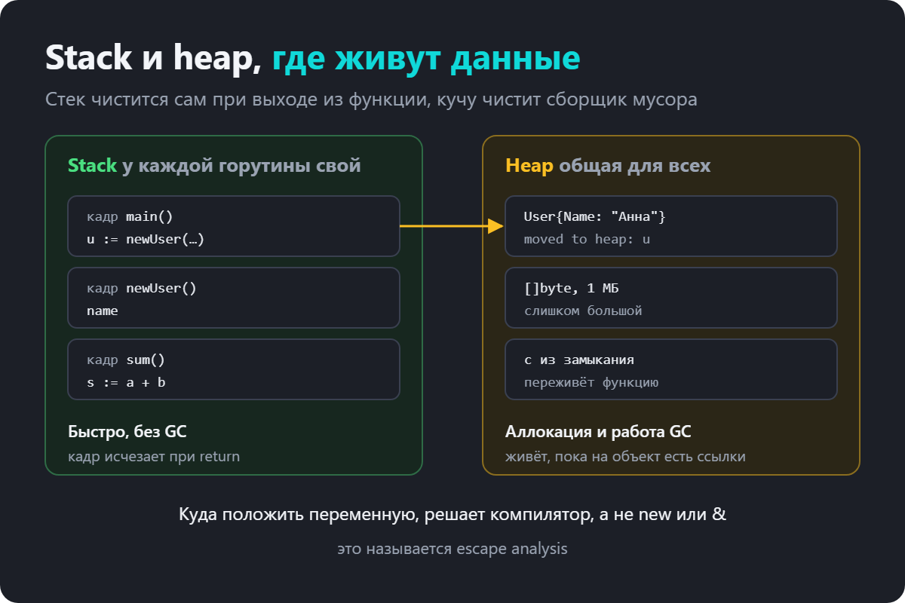
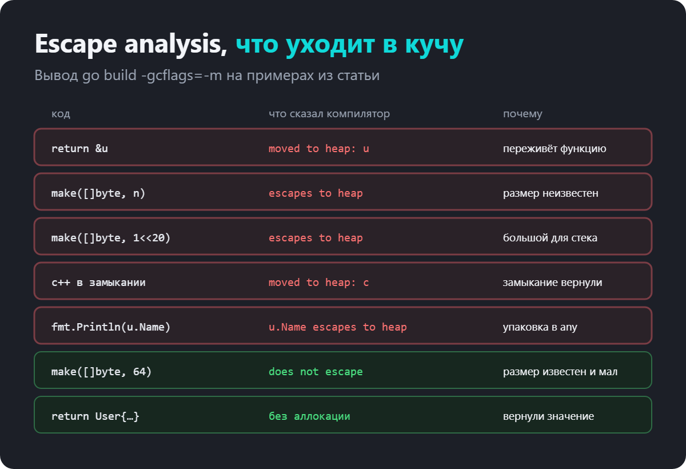
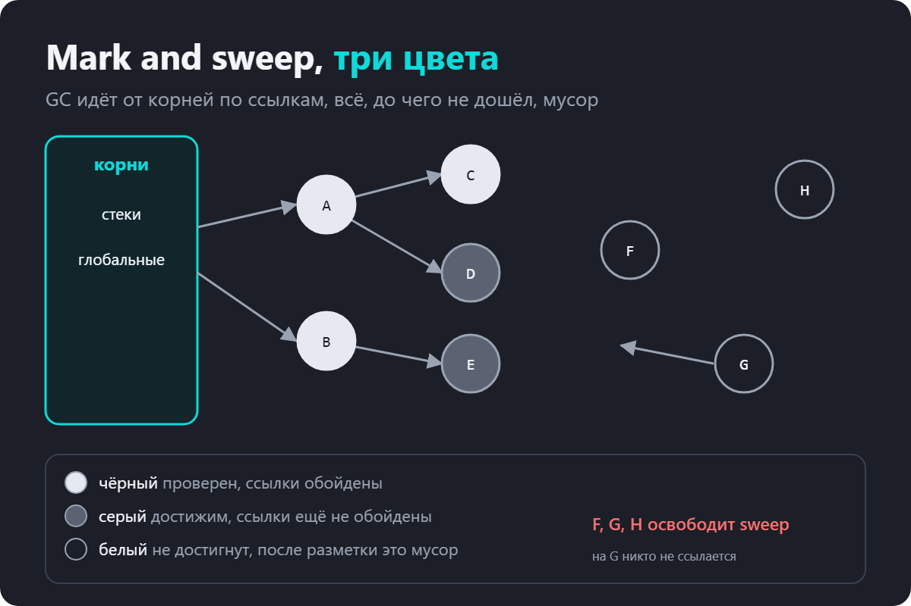
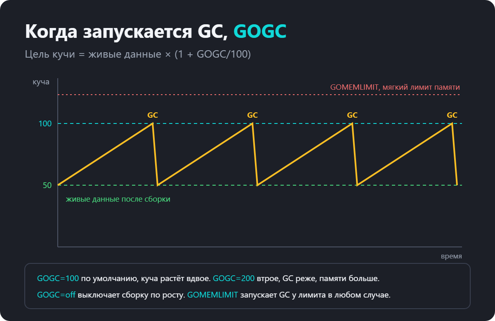
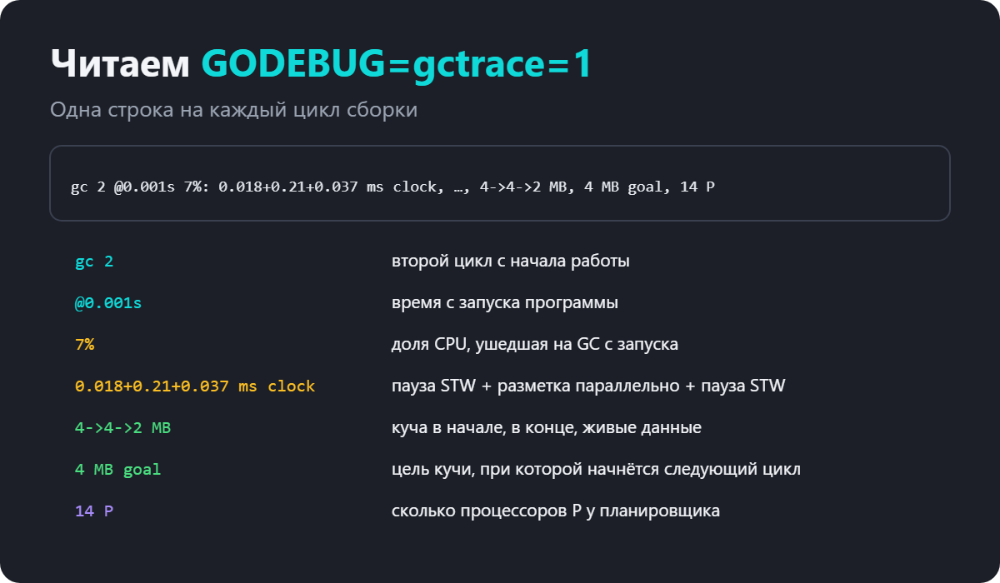
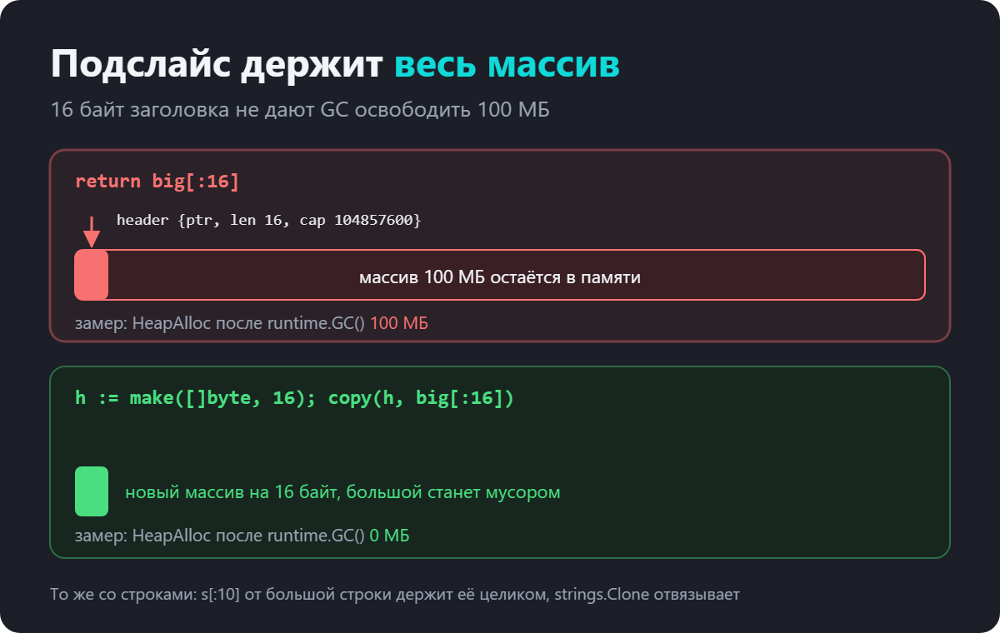

Сборщик мусора в Go, куда попадают переменные, как работает GC и откуда берутся утечки памяти

Про сборщик мусора в Go обычно вспоминают в двух случаях. На собеседовании, где спрашивают «как работает GC» и «что такое escape analysis». И на проде, когда сервис медленно съедает память, а в профиле половина времени уходит в runtime.mallocgc.

В обоих случаях не хватает одной картины в голове. Где живут переменные, кто решает, куда их положить, когда сборщик просыпается и почему в языке со сборкой мусора всё равно бывают утечки.

Вот что разберём по порядку.

stack и heap, и чем они отличаются для производительности
escape analysis и как прочитать решения компилятора
как работает GC, трёхцветная разметка и паузы
когда запускается сборка, GOGC и GOMEMLIMIT
как читать GODEBUG=gctrace=1 и pprof
как уменьшить нагрузку на GC
утечки памяти, которые GC не спасает
что спрашивают на собеседованиях
Все цифры в статье сняты на Go 1.25, примеры можно запустить у себя.

Stack и heap
У каждой горутины есть свой стек. В нём лежат кадры вызванных функций с их локальными переменными. Когда функция возвращается, её кадр просто перестаёт существовать. Ничего освобождать не нужно, и сборщик мусора стек не трогает. Это очень дёшево.

Куча (heap) общая для всей программы. Туда попадают данные, которые должны пережить функцию, где их создали, или которые слишком велики для стека. Выделение в куче дороже, а освобождает её сборщик мусора, когда на объект не осталось ссылок.

Важная особенность Go. Программист не выбирает, где окажется переменная. Не важно, создали вы её через new, через &User{} или обычным объявлением. Решает компилятор, и называется это escape analysis.

Escape analysis
Компилятор смотрит, может ли значение понадобиться после выхода из функции. Если нет, оно остаётся на стеке. Если может, оно «убегает» (escape) в кучу.

Решения компилятора можно увидеть флагом -gcflags=-m.

func sum(a, b int) int {
	s := a + b
	return s
}

func newUser(name string) *User {
	u := User{Name: name}
	return &u
}

func byValue(name string) User {
	return User{Name: name}
}

func makeBuf(n int) []byte {
	return make([]byte, n)
}

func fixedBuf() int {
	buf := make([]byte, 64)
	return len(buf)
}

func counter() func() int {
	c := 0
	return func() int {
		c++
		return c
	}
}
go build -gcflags=-m .
./main.go:16:2: moved to heap: u
./main.go:25:13: make([]byte, n) escapes to heap
./main.go:29:13: make([]byte, 64) does not escape
./main.go:34:2: moved to heap: c
./main.go:35:9: func literal escapes to heap
./main.go:45:15: u.Name escapes to heap
Разберём, что тут произошло.

sum. Переменная s осталась на стеке, про неё компилятор даже ничего не написал.
newUser. Мы вернули указатель на u, значит u должна пережить функцию. moved to heap.
byValue. Вернули значение, а не указатель. Структура копируется вызывающему, кучи нет.
makeBuf. Размер n неизвестен на этапе компиляции, поэтому буфер в куче.
fixedBuf. Размер известен, маленький, буфер наружу не уходит. Стек.
counter. Замыкание вернули наружу, и захваченная переменная c должна жить вместе с ним.
fmt.Println(u.Name). Аргументы fmt принимают any, и упаковка значения в интерфейс часто уводит его в кучу.

Слишком большие значения тоже уходят в кучу, даже если размер известен.

func small() int { b := make([]byte, 1024); return len(b) }  // does not escape
func large() int { b := make([]byte, 1<<20); return len(b) } // escapes to heap
Почему это важно
Каждое значение в куче это аллокация и работа для сборщика. В обычном коде разница незаметна. В горячем пути, который обрабатывает десятки тысяч запросов в секунду, лишние аллокации превращаются в заметную долю CPU.

Отсюда практический совет. Не возвращайте указатель на маленькую структуру «для скорости». Копия из нескольких полей обычно дешевле, чем аллокация в куче и последующая сборка.

Как работает сборщик мусора
Сборщик мусора в Go конкурентный и работает по схеме mark and sweep. Он не перемещает объекты в памяти и не делит их на поколения, как это делают JVM и .NET. Зато большую часть работы делает параллельно с вашей программой.

Трёхцветная разметка
Разметка начинается с корней. Это стеки всех горутин и глобальные переменные. Всё, до чего можно дойти от корней по указателям, живое. Всё остальное мусор.

Чтобы обходить граф параллельно с работающей программой, объекты делят на три цвета.

белый ещё не достигнут
серый достигнут, но его собственные ссылки ещё не обойдены
чёрный достигнут, и все его ссылки обойдены
В начале все объекты белые, корни серые. Сборщик берёт серый объект, красит в серый всё, на что он ссылается, а сам объект перекрашивает в чёрный. Когда серых не осталось, белые объекты недостижимы. Фаза sweep возвращает их память в аллокатор.

Обратите внимание на объекты F и G. G ссылается на F, но на сам G никто не ссылается. Значит, недостижимы оба. Циклические ссылки для такого сборщика не проблема, в отличие от подсчёта ссылок.

Write barrier и паузы
Пока идёт разметка, программа продолжает менять указатели. Она могла бы спрятать белый объект за чёрным, и сборщик бы его не увидел. Чтобы этого не случилось, во время разметки включается write barrier. Это небольшой код, который компилятор вставляет в каждую запись указателя и который сообщает сборщику об изменениях.

Полностью программа останавливается (stop the world, STW) только дважды за цикл, в начале и в конце разметки. Обычно эти паузы длятся десятки или сотни микросекунд.

Ещё один механизм это mark assist. Если горутина выделяет память быстрее, чем сборщик успевает размечать, она сама помогает с разметкой перед аллокацией. Поэтому под высокой нагрузкой GC тормозит не через паузы, а через то, что горячие горутины тратят часть времени на чужую работу.

Когда запускается GC
Go не запускает сборку по таймеру. Он смотрит на рост кучи. После очередной сборки известен объём живых данных, и цель для следующей вычисляется так.

цель кучи = живые данные × (1 + GOGC / 100)
По умолчанию GOGC=100. Было 50 МБ живых данных после сборки, следующая начнётся, когда куча дорастёт примерно до 100 МБ. С недавних версий в расчёт добавляются ещё стеки горутин и глобальные переменные, но суть та же.

Это компромисс между памятью и CPU.

GOGC=200. Куча растёт втрое, сборок меньше, CPU свободнее, памяти больше.
GOGC=50. Сборок больше, памяти меньше.
GOGC=off. Сборка по росту кучи выключена.
Я запустил небольшую программу, которая выделяет 200 буферов по мегабайту и часть сохраняет. С GOGC=100 сборщик запустился 27 раз, с GOGC=400 всего 5, с GOGC=off ни разу.

GOMEMLIMIT
С Go 1.19 есть второй рычаг, GOMEMLIMIT. Это мягкий лимит памяти для рантайма. Когда общий объём памяти подходит к лимиту, сборщик запускается чаще, чем требует GOGC.

Это особенно полезно в контейнере. Раньше сервис с GOGC=100 мог удвоить кучу и упереться в лимит памяти пода, после чего его убивал OOM killer. Теперь можно поставить GOMEMLIMIT чуть ниже лимита контейнера, и рантайм будет держаться под ним.

GOMEMLIMIT=900MiB ./service
Проверим на той же программе. С GOGC=off и без лимита она не собирает мусор вовсе. С GOGC=off GOMEMLIMIT=150MiB сборщик молчит, пока куча мала, и включается, когда она подходит к лимиту.

gc 5 @0.007s 1%: ..., 130->133->103 MB, 140 MB goal, ...
Лимит мягкий. Если живых данных больше лимита, программа не упадёт от рантайма, но сборщик будет работать почти непрерывно. Поэтому GOMEMLIMIT не заменяет борьбу с утечками.

Оба параметра можно менять из кода через debug.SetGCPercent и debug.SetMemoryLimit из пакета runtime/debug.

Как посмотреть, что делает GC
GODEBUG=gctrace=1
Самый быстрый способ. Переменная окружения заставляет рантайм печатать строку на каждый цикл сборки.

GODEBUG=gctrace=1 ./app
gc 1 @0.000s 6%: 0.022+0.21+0.020 ms clock, ..., 4->4->1 MB, 4 MB goal, 0 MB stacks, 0 MB globals, 14 P
gc 2 @0.001s 7%: 0.018+0.21+0.037 ms clock, ..., 4->4->2 MB, 4 MB goal, 0 MB stacks, 0 MB globals, 14 P

Главное здесь три вещи. Процент CPU на сборку с начала работы. Тройка 4->4->2 MB, где последнее число это живые данные. Если оно растёт от цикла к циклу и не падает, это похоже на утечку. И время пауз, первое и третье слагаемое в ms clock.

pprof
Для поиска, кто именно выделяет память, нужен профилировщик. В сервис подключают net/http/pprof и снимают профиль кучи.

import _ "net/http/pprof"

go http.ListenAndServe("localhost:6060", nil)
go tool pprof -http=:8080 http://localhost:6060/debug/pprof/heap
В профиле кучи два основных режима. inuse_space показывает, кто держит память прямо сейчас, это для поиска утечек. alloc_space показывает, кто больше всего выделял за всё время, это для поиска лишних аллокаций, которые грузят GC.

Как уменьшить нагрузку на GC
Сборщику тем легче, чем меньше аллокаций. Вот приёмы, которые дают эффект чаще всего. Я замерил количество аллокаций через testing.AllocsPerRun.

Выделяйте слайсы с запасом
Если размер известен заранее, задайте ёмкость. Иначе append будет перевыделять массив по мере роста.

func grow(n int) []int {
	var s []int
	for i := 0; i < n; i++ {
		s = append(s, i)
	}
	return s
}

func prealloc(n int) []int {
	s := make([]int, 0, n)
	for i := 0; i < n; i++ {
		s = append(s, i)
	}
	return s
}
На тысяче элементов grow делает 12 аллокаций, prealloc одну.

Собирайте строки через strings.Builder
Строки неизменяемые, и каждое s += p создаёт новую строку. Склейка ста кусков через += дала 99 аллокаций, через strings.Builder шесть.

var b strings.Builder
for _, p := range parts {
	b.WriteString(p)
}
s := b.String()
Если итоговый размер известен, b.Grow(n) уберёт и эти шесть.

Переиспользуйте буферы через sync.Pool
sync.Pool хранит временные объекты, чтобы их можно было взять повторно вместо новой аллокации. Типичный кандидат это буферы для сериализации и рендеринга.

var bufPool = sync.Pool{
	New: func() any { return new(bytes.Buffer) },
}

func render(name string) string {
	buf := bufPool.Get().(*bytes.Buffer)
	defer func() {
		buf.Reset()
		bufPool.Put(buf)
	}()
	buf.WriteString("Привет, ")
	buf.WriteString(name)
	return buf.String()
}
Две вещи, которые важно помнить. Объект из пула нужно сбросить перед возвратом, иначе следующий получит чужие данные. И пул не кэш. Сборщик мусора может очистить его в любой момент, поэтому хранить там что-то, что нужно сохранить, нельзя.

Не держите указатели там, где они не нужны
Сборщик обходит только то, где есть указатели. Огромный map[int]int или слайс структур без указателей он почти не сканирует. А map[string]*User на миллион записей это миллион объектов, которые нужно обойти на каждой разметке. Если в горячей структуре можно хранить значения, а не указатели, GC скажет спасибо.

Утечки памяти в языке с GC
Сборщик освобождает только недостижимое. Если на ненужные данные по-прежнему есть ссылка, для него они живые. Вот самые частые источники таких утечек.

Подслайс большого массива
Слайс это ссылка на массив. Если взять маленький кусок большого слайса и сохранить его, весь массив останется в памяти.

func loadHeader(keep bool) []byte {
	big := make([]byte, 100<<20) // 100 МБ, как будто прочитали файл
	// ...
	if keep {
		return big[:16] // подслайс держит весь массив
	}
	h := make([]byte, 16)
	copy(h, big[:16])
	return h
}
Я замерил HeapAlloc после принудительной сборки. С подслайсом в памяти осталось 100 МБ. С копией ноль.

Со строками то же самое. s[:10] от строки в мегабайт держит мегабайт. Отвязать подстроку от исходной можно через strings.Clone.

Зависшие горутины
Горутина, которая навсегда заблокирована на канале, держит свой стек и всё, на что ссылается. Сборщик её не тронет. Это, пожалуй, самая частая утечка в Go-сервисах, и лечится она контекстом и правильной работой с каналами.

Кэши и map без ограничения
map, в который только добавляют, растёт вечно. Кроме того, map в Go не уменьшает свои внутренние массивы после удаления элементов. Кэш нужно ограничивать по размеру или по времени жизни, а большой map, из которого всё удалили, иногда проще пересоздать.

Глобальные слайсы и забытые подписки
Слайс обработчиков, в который добавляют и никогда не удаляют. Глобальный реестр соединений. Подписка на события, от которой не отписались. Всё это корни, от которых сборщик видит ваши данные живыми.

Что изменилось в последних версиях
С Go 1.23 таймеры и тикеры, на которые больше нет ссылок, собираются, даже если не вызвали Stop. Раньше забытый time.NewTicker был классической утечкой.
В Go 1.24 появились пакет weak со слабыми указателями и runtime.AddCleanup на замену runtime.SetFinalizer.
В Go 1.25 есть экспериментальный сборщик Green Tea, включается через GOEXPERIMENT=greenteagc при сборке. Он иначе обходит мелкие объекты и в программах с большим количеством аллокаций тратит на GC меньше CPU.
Частые ошибки
Ошибка 1. Возвращать указатель «для скорости»

Указатель на маленькую структуру уводит её в кучу. Копия обычно дешевле.

Ошибка 2. Думать, что new и & всегда означают кучу

Решает escape analysis. p := &User{} вполне может остаться на стеке, если указатель не убегает.

Ошибка 3. Крутить GOGC вместо поиска аллокаций

Параметр сдвигает баланс между памятью и CPU, но не убирает причину. Сначала профиль alloc_space.

Ошибка 4. Ставить GOMEMLIMIT ниже реального объёма живых данных

Сборщик будет работать непрерывно и съест CPU. Лимит ставят с запасом над рабочим объёмом, но ниже лимита контейнера.

Ошибка 5. Использовать sync.Pool как кэш

Содержимое пула может исчезнуть после любой сборки.

Ошибка 6. Хранить кусок большого слайса или строки

Весь исходный массив остаётся в памяти. Копируйте через copy или strings.Clone.

Ошибка 7. Считать, что в языке с GC утечек не бывает

Зависшие горутины, вечные map и глобальные слайсы держат память не хуже ручного malloc без free.

Что спрашивают на собеседовании
Чем стек отличается от кучи в Go?

Стек у каждой горутины свой, кадры освобождаются при возврате из функции без участия GC. Куча общая, её чистит сборщик мусора.

Что такое escape analysis?

Анализ компилятора, который решает, может ли значение пережить функцию. Если может, оно размещается в куче, если нет, остаётся на стеке. Посмотреть решения можно через go build -gcflags=-m.

Когда переменная уходит в кучу?

Когда на неё возвращают указатель, когда её захватывает замыкание, которое живёт дольше функции, когда размер неизвестен при компиляции или слишком велик, когда значение упаковывают в интерфейс.

Как работает сборщик мусора в Go?

Конкурентный mark and sweep с трёхцветной разметкой. От корней (стеки и глобальные переменные) размечаются достижимые объекты, недостижимые освобождаются. Объекты не перемещаются, поколений нет.

Зачем нужен write barrier?

Чтобы программа, которая меняет указатели во время разметки, не спрятала от сборщика живой объект.

Бывает ли в Go stop the world?

Да, две короткие паузы за цикл, в начале и в конце разметки. Основная работа идёт параллельно с программой.

Когда запускается GC?

Когда куча дорастает до цели, которая считается от живых данных и GOGC. По умолчанию это примерно двойной объём живых данных. Ещё GC запускается, когда память подходит к GOMEMLIMIT.

Что делает GOGC и что делает GOMEMLIMIT?

GOGC задаёт, насколько куча может вырасти между сборками. GOMEMLIMIT задаёт мягкий лимит памяти, у которого сборщик начинает работать чаще.

Как найти утечку памяти в Go-сервисе?

Посмотреть на рост живых данных в gctrace или метриках, снять профиль кучи через pprof в режиме inuse_space, проверить число горутин через runtime.NumGoroutine или профиль горутин.

Почему в языке с GC бывают утечки?

Сборщик освобождает только недостижимое. Зависшие горутины, неограниченные map и подслайсы больших массивов достижимы, поэтому живут вечно.

Что такое sync.Pool и когда его использовать?

Пул временных объектов для переиспользования, чтобы снизить число аллокаций. Подходит для буферов в горячем коде. Это не кэш, сборщик может очистить его в любой момент.

Шпаргалка по сборщику мусора в Golang

Если сжать статью до нескольких строк, получится так.

Куда положить переменную, решает компилятор, смотрите через -gcflags=-m.
GC конкурентный, mark and sweep, три цвета, паузы короткие.
Сборка начинается, когда куча вырастает до цели по GOGC, или у GOMEMLIMIT.
Меньше аллокаций это меньше работы GC. Ёмкость слайсов, strings.Builder, sync.Pool.
Утечки в Go это ссылки, которые держат ненужное. Горутины, map, подслайсы.
Чтобы тема закрепилась, возьмите любую свою функцию из горячего пути и прогоните go build -gcflags=-m. Почти всегда найдётся пара значений, которые уходят в кучу без всякой необходимости.
