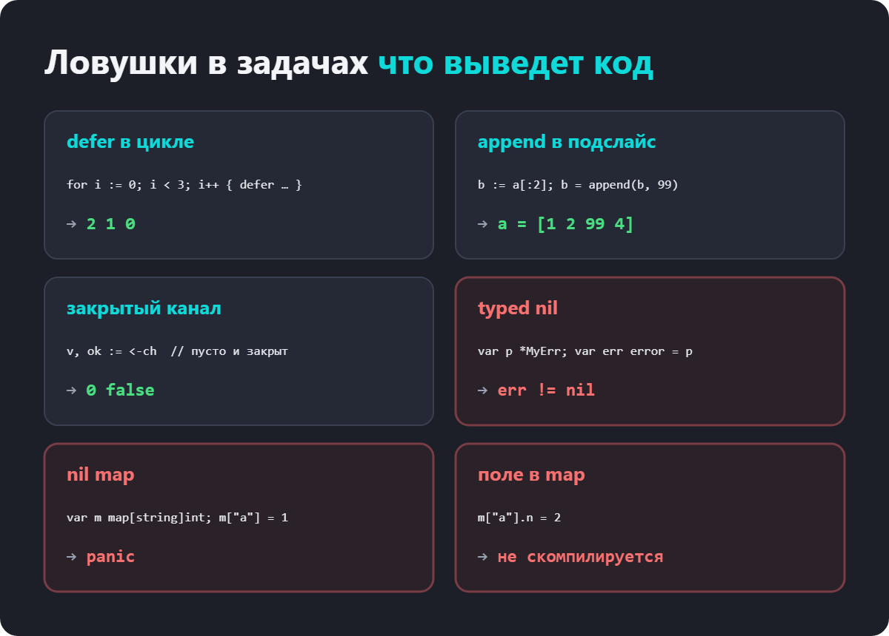
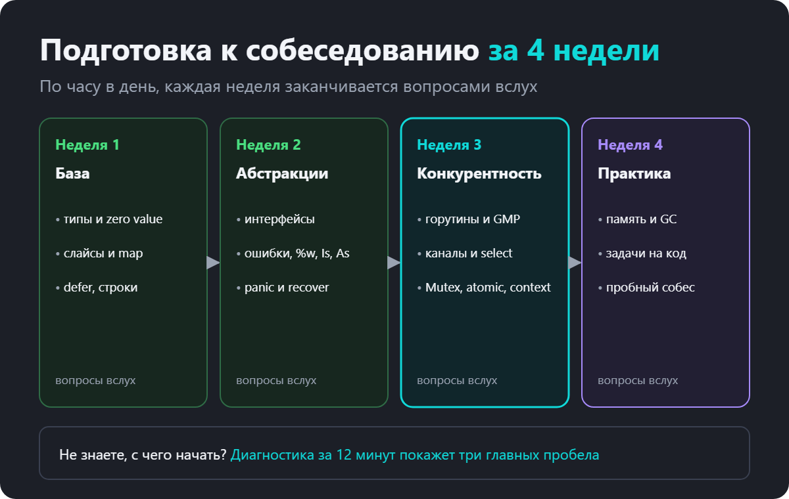

Вопросы на собеседовании по Go, 50+ вопросов с ответами для Junior и Middle

Собеседование на Go-разработчика почти всегда идёт по одному сценарию. Немного о себе и опыте, потом теория по языку, потом задача на код, а на Middle и выше ещё архитектура. Теоретическая часть удивительно стабильна. Компании разные, а вопросы одни и те же, потому что они проверяют, понимаете ли вы, как Go устроен, а не помните ли вы синтаксис.

Здесь собраны вопросы, которые встречаются чаще всего, с короткими ответами. Такой ответ можно дать вслух за минуту. Под каждой темой ссылка на подробный разбор с примерами и схемами, если хочется копнуть глубже.

Как пользоваться статьёй. Сначала закройте ответы ладонью и попробуйте ответить сами. Где запнулись, там и пробел. Задачи на код в конце лучше решать без запуска, на бумаге, как на настоящем собеседовании.

Типы и базовые конструкции
1. Что такое zero value?

Значение, которое получает переменная, если её объявили без инициализации. У чисел это 0, у строки пустая строка, у bool false, у указателей, слайсов, map, каналов, функций и интерфейсов nil. У структуры каждое поле получает своё нулевое значение. В Go нет неинициализированной памяти, это часть дизайна языка.

Подробнее про zero values

2. Чем nil в Go отличается от null в других языках?

nil это нулевое значение только для указателей, слайсов, map, каналов, функций и интерфейсов. У int или string nil не бывает. И nil разных типов ведёт себя по-разному. Из nil-слайса можно читать и делать append, в nil map писать нельзя, nil-канал блокирует навсегда.

Подробнее про nil

3. Чем new отличается от make?

new(T) выделяет память под нулевое значение типа и возвращает указатель *T. make работает только со слайсами, map и каналами и возвращает готовое к работе значение, а не указатель. make(map[string]int) даёт пустой map, в который можно писать.

Подробнее про new и make

4. В каком порядке выполняются defer?

В обратном, последним пришёл, первым вышел. Аргументы отложенного вызова вычисляются сразу, в момент defer, а не при выполнении. Отложенные функции выполняются и при обычном возврате, и при панике.

Подробнее про defer

5. Что такое iota?

Счётчик внутри блока const. В каждой следующей строке блока он увеличивается на единицу, начиная с нуля. Им делают перечисления и битовые флаги.

Подробнее про iota

6. Что вернёт len("привет")?

len у строки считает байты, а кириллические буквы в UTF-8 занимают по два байта. Число символов даёт len([]rune(s)) или utf8.RuneCountInString(s), здесь это 6. byte это uint8, rune это int32 и обозначает один символ Unicode.
Слайсы и map
7. Чем слайс отличается от массива?

Длина массива часть его типа, [3]int и [4]int разные типы. Массив копируется целиком при присваивании и передаче в функцию. Слайс это лёгкая структура из указателя на массив, длины и ёмкости, при копировании копируется только она.

Подробнее про слайсы

8. Как устроен слайс?

Заголовок из трёх полей. ptr указывает на первый элемент в массиве, len это сколько элементов доступно, cap это сколько можно добавить без перевыделения памяти.

Подробнее про устройство слайса

9. Как работает append?

Если ёмкости хватает, элемент записывается в тот же массив и возвращается слайс с увеличенной длиной. Если не хватает, выделяется новый массив побольше, данные копируются, и возвращается слайс уже на него. Поэтому результат append всегда нужно присваивать.

Подробнее про append

10. Почему изменение одного слайса может изменить другой?

Потому что они могут смотреть на один и тот же массив. Подслайс a[:2] использует массив a, и append в него, пока хватает ёмкости, перезапишет элементы a. Чтобы отвязать данные, копируют через copy или ограничивают ёмкость записью a[:2:2].

Подробнее

11. Чем nil-слайс отличается от пустого?

У nil-слайса указатель nil, у пустого он указывает на массив нулевой длины. len, cap, range и append работают одинаково. Разница видна в сравнении с nil и в JSON, nil-слайс кодируется как null, пустой как [].

12. Что будет при записи в nil map?

Паника assignment to entry in nil map. Читать из nil map можно, вернётся нулевое значение. Перед записью map создают через make или литерал.

Подробнее про map

13. В каком порядке range обходит map?

Порядок не гарантирован и специально меняется от запуска к запуску. Если нужен порядок, собирают ключи в слайс и сортируют.

14. Можно ли писать в map из нескольких горутин?

Нет. Рантайм обнаруживает это и падает с fatal error: concurrent map writes, и это не паника, recover не поможет. Нужен sync.Mutex или sync.RWMutex вокруг map, либо sync.Map для кэшей, где ключи в основном только добавляются и читаются.

Подробнее про map и конкурентность

15. Какие типы могут быть ключом map?

Любые сравнимые. Числа, строки, bool, указатели, каналы, интерфейсы, массивы и структуры из сравнимых полей. Слайсы, map и функции ключами быть не могут.

Интерфейсы
16. Что такое интерфейс и как его реализовать?

Тип, который описывает набор методов. Реализация неявная, ключевого слова implements нет. Если у типа есть все методы интерфейса, он подходит.

Подробнее про интерфейсы

17. Почему тип с методом на указателе не подходит к интерфейсу?

Из-за method set. У значения T есть только методы с получателем T. У указателя *T есть все методы. Если метод объявлен на *T, в интерфейс нужно класть &T{}.

Подробнее про method set

18. Как интерфейс устроен внутри?

Два машинных слова. У непустого интерфейса это указатель на itab (тип и таблица методов) и указатель на данные. У any это указатель на тип и указатель на данные.

Подробнее

19. Почему интерфейс с nil-указателем внутри не равен nil?

Интерфейс равен nil, только когда пусты и тип, и значение. Если положить в него nil-указатель конкретного типа, тип уже записан. Классическая ловушка с error, когда функция возвращает переменную *MyErr со значением nil.

Подробнее про typed nil

20. Чем отличаются две формы type assertion?

v, ok := x.(T) при неверном типе вернёт нулевое значение и false. v := x.(T) при неверном типе вызовет панику. Если тип не гарантирован, всегда пишут форму с ok.

21. Где лучше объявлять интерфейс?

В пакете, который его использует, и только с теми методами, которые он вызывает. Принцип «принимай интерфейсы, возвращай структуры». Маленькие интерфейсы легко подменять в тестах.

Подробнее

Ошибки
22. Что такое error?

Встроенный интерфейс с методом Error() string. Ошибка это обычное значение, функция возвращает её последним результатом, а вызывающий проверяет if err != nil.

Подробнее про ошибки

23. Что делает %w в fmt.Errorf?

Оборачивает ошибку. Текст исходной ошибки вставляется в сообщение, а сама она сохраняется внутри, и её потом найдут errors.Is и errors.As. С %v текст будет тем же, но цепочка потеряется.

Подробнее про обёртку

24. Чем errors.Is отличается от errors.As?

Is ищет в цепочке конкретное значение ошибки, например sql.ErrNoRows. As ищет ошибку определённого типа и записывает её в переменную, чтобы прочитать поля.

Подробнее

25. Когда использовать panic, а когда error?

error для всего, что может случиться в нормальной работе. Нет файла, неверный ввод, сеть недоступна. panic для ситуаций, которых при правильном коде быть не может, вроде нарушенного инварианта или невалидной конфигурации на старте.

26. Поймает ли recover в main панику в другой горутине?

Нет. recover работает только внутри defer и только для паники в той же горутине. Паника в другой горутине уронит всю программу. Поэтому горутины, где возможна паника, ставят свой defer с recover.

Подробнее про panic и recover

Горутины и планировщик
27. Чем горутина отличается от потока ОС?

Горутиной управляет рантайм Go, а не операционная система. Она стартует с маленьким стеком в несколько килобайт, который растёт по мере надобности, создаётся и переключается намного дешевле потока. Десятки тысяч горутин это нормально, десятки тысяч потоков нет.

Подробнее про горутины

28. Что такое модель GMP?

G это горутина, M это поток ОС, P это логический процессор с очередью горутин. Чтобы выполнять Go-код, поток должен держать P. Число P задаёт GOMAXPROCS, по умолчанию оно равно числу доступных CPU. Свободный P забирает работу из чужих очередей, это называется work stealing.

Подробнее про GMP

29. Почему main не ждёт горутины и как их дождаться?

Когда main возвращается, программа завершается вместе со всеми горутинами. Ждать через time.Sleep ненадёжно. Правильно использовать sync.WaitGroup, канал с результатами или errgroup.

Подробнее про WaitGroup

30. Что такое утечка горутин?

Горутина, которая никогда не завершится. Чаще всего она навсегда заблокирована на отправке или чтении из канала. Она держит память и не видна сборщику мусора как мусор. Лечится контекстом, буферами и правильным закрытием каналов.

Подробнее про утечки

31. Как ограничить число одновременно работающих горутин?

Worker pool, когда фиксированное число воркеров читает задачи из канала. Или семафор на буферизированном канале, make(chan struct{}, n), куда горутина кладёт метку перед работой и забирает после.

Подробнее про worker pool

Каналы
32. Чем буферизированный канал отличается от небуферизированного?

В небуферизированный отправка блокируется, пока кто-то не начнёт читать. Это точка синхронизации двух горутин. В буферизированный можно отправлять без ожидания, пока буфер не заполнен.

Подробнее про каналы

33. Что будет при чтении из закрытого канала?

Сначала вычитаются оставшиеся в буфере значения. Потом чтение сразу возвращает нулевое значение, а форма v, ok := <-ch даёт ok == false. range по каналу заканчивается, когда канал закрыт и пуст.

34. Что будет при записи в закрытый канал или повторном закрытии?

Паника. send on closed channel при записи, close of closed channel при повторном закрытии, close of nil channel при закрытии nil-канала. Поэтому канал закрывает тот, кто в него пишет, и только один раз.

Подробнее про закрытие каналов

35. Как ведёт себя nil-канал?

Чтение и запись блокируются навсегда. Это используют в select, чтобы временно выключить ветку, присвоив каналу nil.

36. Как работает select?

Ждёт, пока одна из веток сможет выполниться. Если готовы несколько, выбирает случайную. Ветка default выполняется сразу, если ни одна не готова, это делает select неблокирующим.

Подробнее про select

37. Когда возникает fatal error all goroutines are asleep?

Когда все горутины программы заблокированы и ни одна не может продолжить. Например, main пишет в небуферизированный канал, а читателя нет. Рантайм видит это и завершает программу.

Подробнее про deadlock

Синхронизация
38. Что такое race condition и как её найти?

Ситуация, когда несколько горутин одновременно обращаются к одним данным и хотя бы одна пишет без синхронизации. Результат зависит от случайного порядка выполнения. Находят запуском с флагом -race, go test -race или go run -race.

Подробнее про race condition

39. Чем Mutex отличается от RWMutex?

Mutex пускает к данным одну горутину. RWMutex пускает много читателей одновременно или одного писателя. Он выгоден, когда чтений намного больше, чем записей.

Подробнее

40. Когда использовать atomic?

Для простых операций над одним значением, счётчиков и флагов. atomic.Int64, atomic.Bool и другие типы из sync/atomic быстрее мьютекса, но не помогают, если нужно согласованно поменять несколько значений.

Подробнее про atomic

41. Каналы или мьютексы?

Каналы, когда данные передаются между горутинами, конвейеры, раздача задач, сигналы. Мьютекс, когда несколько горутин работают с общим состоянием, кэшем или счётчиком. Поговорка Go «не общайтесь через разделяемую память» не запрещает мьютексы, а предлагает думать о владении данными.

Подробнее

Context
42. Зачем нужен context?

Чтобы передать вниз по цепочке вызовов сигнал отмены, срок выполнения и данные запроса. Контексты образуют дерево, отмена родителя отменяет всех потомков.

Подробнее про context

43. Почему после WithTimeout обязательно вызывать cancel?

Иначе таймер и связь с родителем проживут до истечения срока. На долгоживущем родителе это утечка. go vet предупреждает о потерянном cancel, поэтому сразу пишут defer cancel().

Подробнее

44. Что можно хранить в context.Value?

Только данные конкретного запроса, request id, пользователя, trace id. Ключ своего неэкспортируемого типа, чтобы избежать коллизий. Параметры функций и зависимости через Value не передают.

Подробнее про WithValue

Память и сборщик мусора
45. Чем стек отличается от кучи и кто решает, где окажется переменная?

Стек у каждой горутины свой и освобождается при выходе из функции. Кучу чистит сборщик мусора. Куда положить переменную, решает компилятор через escape analysis, а увидеть его решения можно флагом go build -gcflags=-m.

Подробнее про escape analysis

46. Как работает сборщик мусора в Go?

Конкурентный mark and sweep с трёхцветной разметкой. От корней размечаются достижимые объекты, остальные освобождаются. Большая часть работы идёт параллельно с программой, полные остановки короткие.

Подробнее про GC

47. Что такое GOGC и GOMEMLIMIT?

GOGC задаёт, на сколько процентов может вырасти куча между сборками. По умолчанию 100, то есть вдвое. GOMEMLIMIT задаёт мягкий лимит памяти, у которого сборщик начинает работать чаще. В контейнерах лимит ставят чуть ниже лимита пода.

Подробнее

48. Откуда в языке со сборкой мусора утечки памяти?

Сборщик освобождает только недостижимое. Зависшие горутины, кэши без ограничения, глобальные слайсы и маленький подслайс большого массива держат память живой.

Подробнее про утечки

Задачи «что выведет код»
На собеседовании почти всегда дают короткий кусок кода и просят сказать, что он напечатает. Попробуйте ответить, прежде чем смотреть разбор. Все ответы проверены на Go 1.25.

Задача 1. defer в цикле
func main() {
	for i := 0; i < 3; i++ {
		defer fmt.Print(i, " ")
	}
}
Ответ. 2 1 0. Отложенные вызовы выполняются в обратном порядке, а аргумент i вычисляется в момент defer.

Задача 2. append в подслайс
a := []int{1, 2, 3, 4}
b := a[:2]
b = append(b, 99)
fmt.Println(a, b)
Ответ. [1 2 99 4] [1 2 99]. У b длина 2, но ёмкость 4, и append записал 99 в общий массив, поверх тройки.

Задача 3. Слайс в функции
func add(s []int) {
	s = append(s, 4)
	s[0] = 100
}

func main() {
	s := make([]int, 3, 10)
	add(s)
	fmt.Println(s, len(s))
}
Ответ. [100 0 0] 3. Функция получила копию заголовка слайса. Ёмкости хватило, поэтому append и запись s[0] попали в общий массив, и сотню видно снаружи. Но длина внешнего слайса осталась 3, так что четвёрку снаружи не видно.

Задача 4. Чтение из закрытого канала
ch := make(chan int, 2)
ch <- 1
close(ch)
v, ok := <-ch
fmt.Println(v, ok)
v, ok = <-ch
fmt.Println(v, ok)
Ответ. 1 true, потом 0 false. Сначала вычитывается то, что осталось в буфере, потом приходит нулевое значение и ok == false.

Задача 5. Горутины в цикле
var wg sync.WaitGroup
var mu sync.Mutex
res := []int{}
for i := range 3 {
	wg.Add(1)
	go func() {
		defer wg.Done()
		mu.Lock()
		res = append(res, i*i)
		mu.Unlock()
	}()
}
wg.Wait()
Вопрос. Чему равны len(res) и сумма элементов?

Ответ. 3 и 5. С Go 1.22 переменная цикла своя на каждой итерации, поэтому горутины видят 0, 1 и 2. Порядок элементов в res может быть любым, но сумма всегда 0 + 1 + 4. До Go 1.22 все горутины могли увидеть одно и то же последнее значение, и на старых версиях это классическая ловушка.

Задача 6. Структура в map
type T struct{ n int }

m := map[string]T{"a": {1}}
t := m["a"]
t.n = 2
fmt.Println(m["a"].n)
Ответ. 1. m["a"] возвращает копию структуры, и меняется копия. А запись m["a"].n = 2 вообще не скомпилируется с ошибкой cannot assign to struct field m["a"].n in map, потому что у значения в map нельзя взять адрес. Чтобы менять поля на месте, хранят указатели, map[string]*T.

Задача 7. Аргументы defer
x := 1
defer fmt.Println("defer:", x)
x = 2
fmt.Println("main:", x)
Ответ. main: 2, потом defer: 1. Аргументы отложенного вызова вычисляются в строке с defer, когда x ещё равен единице.

Задача 8. Строки и массивы
s := "привет"
fmt.Println(len(s), len([]rune(s)))

var arr [3]int
b := arr
b[0] = 7
fmt.Println(arr[0], b[0])
Ответ. 12 6, потом 0 7. В строке 12 байт и 6 символов. Массив при присваивании копируется целиком, поэтому изменение b не трогает arr. Со слайсом было бы наоборот.

Как готовиться к собеседованию по Go
Знать ответы мало, нужно уметь объяснять их вслух и применять в коде. Вот план на четыре недели, по которому удобно идти.

Пройдитесь по темам этой статьи и отметьте, где не смогли ответить без подсказки. Это ваш список на неделю.
По каждой отмеченной теме прочитайте разбор и руками прогоните примеры. Тема закрепляется, когда вы сами сломали код и увидели ошибку.
Решайте задачи «что выведет код» на бумаге. На собеседовании редко дают запустить.
Проговаривайте ответы вслух. Объяснение за минуту без «ну, там как бы» тренируется только практикой.
Сделайте пробное собеседование с тем, кто уже работает на Go. Это лучший способ найти пробелы, которые сами себе не заметны.
