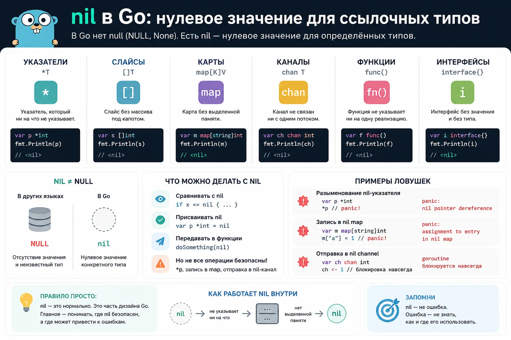
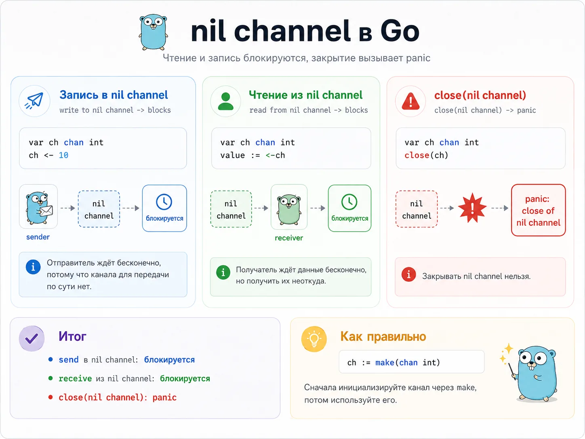
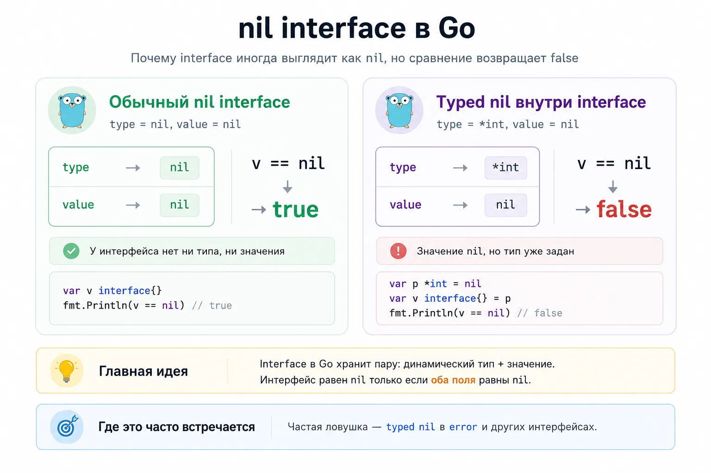
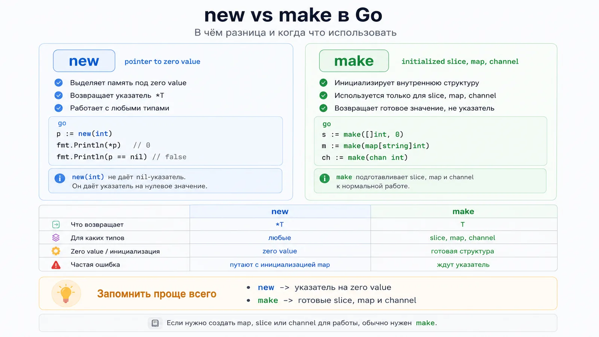
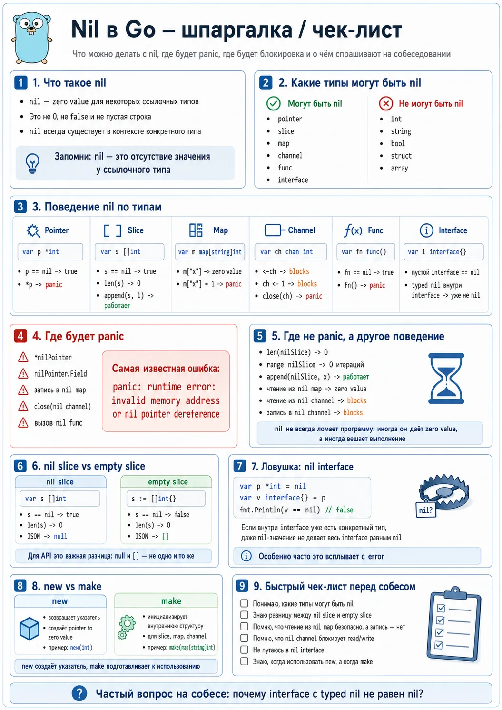

Если вы пришли в Go из Java, C#, JavaScript или Python, где null? В одних языках есть null, в других NULL, в Python есть None, в Go nil.

программа падает с nil pointer dereference
интерфейс выглядит как nil, но сравнение возвращает false
запись в nil map вызывает panic
nil slice работает нормально
nil channel блокирует goroutine навсегда



nil = не отдельный тип данных, а спец нулевое значение, означающее здесь пока нет объекта. может использоваться только для определённых типов.

```go
var ptr *int // указатель ни на что не указывает, значение = nil
fmt.Println(ptr)
<nil>


var users []string
var cache map[string]int
var ch chan int
var fn func()
var v interface{}
```

Все переменные тоже будут иметь значение nil.

nil не универсальным значением для всех типов. Нельзя взять любой тип и присвоить nil.

```go
type User struct {
Name string
}

var user *User
fmt.Println(user.Name)
```

значение nil могут иметь только ссылочные типы:
указатели pointer
срезы slice
карты map
каналы channel
функции func
интерфейсы
var p *int
var s []int
var m map[string]int
var ch chan int
var fn func()
var v interface{}

zero value nil. Если переменная одного из этих типов создана, но не инициализирована, её значение nil.
nil не универсален - zero value только для части типов.

Какие типы не могут быть nil (базовые):
int
float64
bool
string
struct
array

У них есть свои zero values.

var x = nil не компилируется
у nil нет собственного типа по умолчанию. Компилятор не понимает, что именно вы хотели получить: указатель, срез, канал, map или интерфейс.
nil всегда нужен контекст.

```go
var x *int = nil
var y []string = nil
var z map[string]int = nil

var x *int
var y []string
var z map[string]int
```

Go сам поставит zero value nil.

nil не ключевое слово, а предопределённый идентификатор.

```go
func main() {
nil := 123
fmt.Println(nil)
}
```

Go переменная после объявления уже содержит корректное значение.

А у ссылочных типов нулевым значением nil:

```go
var ptr *int
var users []string
var cache map[string]int
```

Некоторые nil-значения уже полезны и безопасны, некоторые нет. И разница зависит от типа.

```go
type User struct {
ID int
Name string
Email *string
}
var u User
fmt.Printf("%+v", u)

{ID:0 Name: Email:<nil>}
```

ID получил 0
Name получил ""
Email получил nil

важно в API и структурах данных. пустой email и отсутствие email, это не одно и то же состояние.

```go
var empty string = ""
var missing *string = nil
```

В Go упор не на один универсальный null, а на нулевые значения каждого типа.
Тип сам подсказывает, возможно ли отсутствие значения вообще.

Где бывает nil: pointer, slice, map, channel, func, interface
nil везде ведёт себя одинаково. Не одинаково вообще.

У pointer, slice, map, channel, func и interface одно и то же значение nil, но работать с ним можно по-разному.

nil pointer нельзя разыменовывать
nil slice можно len, range и append
nil map можно читать, но нельзя писать
nil channel блокирует чтение и запись
nil func нельзя вызывать
nil interface может оказаться не совсем nil

### Nil pointer и panic

Указатель указывает на значение - всё ок:
Pointer не nil - значит указывает на данные. Можно работать.

```go
type User struct {
    Name string
}

var u := &User{Name: "Maks"} // указатель на объект
fmt.Println(u.Name)
```

u *User указывает на значение User{Name: "Maks"}

Указатель = nul - panic:

```go
var age *int
fmt.Println(*age)

var u *User // age == nil
fmt.Println(u.Name) // panic: runtime error: invalid memory address or nil pointer dereference
```

*age - сходи по адресу, который лежит внутри указателя, и достань значение. Но адреса нет.

Pointer == nil. Go не знает куда идти, падает с panic
u *User - nil, не указывает ни на что.

Указатель не хранит само число. Он хранит адрес, где это число лежит.
Если адрес отсутствует, указатель nil.
Разыменование *ptr без адреса, попытка прочитать память по пустому месту. Runtime не разрешает.


```go
if age != nil {
    fmt.Println(*age)
}

// Всгеда проверять указаетль перед использованием
if u != nil {
    ...
}

// Возвращять ошибки вместо nil, где это возможно
if u == nil {
    return errors.New("user not found")
}
```

удобнее использовать ранний выход:

```go
func PrintAge(age *int) {
    if age == nil {
        fmt.Println("Возраст не указан")
        return
    }
    fmt.Println(*age)
}
```

Panic возникает не только на *ptr
разыменование только если явно написана звёздочка. Но это не так.

```go
type User struct {
Name string
}
var user *User
fmt.Println(user.Name)
```

не писали *user, разыменование произошло неявно, доступ к полю через указатель требует обращения к самому объекту.

Живой пример из API

```go
type UpdateUserRequest struct {
Name *string `json:"name"`
Age *int `json:"age"`
}
```

fmt.Println(*req.Name)
а поле name не пришло в JSON, словите ровно тот самый nil pointer dereference.

```go
if req.Name != nil {
fmt.Println(*req.Name)
}
```

### Nil slice vs empty slice

Срезы особенно хорошо показывают, что nil в Go не всегда означает всё плохо.

```go
var a []int // nil slice

b := []int{} // empty slice
c := make([]int, 0)

fmt.Println(a == nil) // true
fmt.Println(b == nil) // false
fmt.Println(c == nil) // false
fmt.Println(len(a)) // 0
fmt.Println(len(b)) // 0
fmt.Println(len(c)) // 0
```

По длине они одинаковы. Но nil-статус разный.

С nil slice можно:
вызывать len
вызывать cap
итерироваться через range
делать append

```go
var nums []int
fmt.Println(len(nums)) // 0
nums = append(nums, 10)
nums = append(nums, 20)
fmt.Println(nums) // [10 20]
```

nil slice вполне рабочий во многих сценариях.

Где разница с empty slice реально важна
В JSON.

```go
type Response struct {
Items []string `json:"items"`
}
```

Если Items == nil, JSON обычно будет таким:

```go
{"items":null} // nil slice. не инициализирован
Если Items == []string{}:

{"items":[]} // empty slice. пустой и уже инициализирован
```

Для фронта и внешнего API важной разницей. Многие клиенты ждут именно массив, пусть и пустой, а не null.

Внутри Go-кода nil slice нормален.

если отдаёте публичный JSON API, часто лучше возвращать именно пустой срез:

Items: []string{}
чтобы наружу уходило [], а не null.

### Nil map: читать можно, писать нельзя

Из неё можно читать:

```go
var scores map[string]int
value, ok := scores["go"] // 0, false
fmt.Println(value) // 0
```

nil map -> чтение по ключу "go" -> результат 0
Если ключа нет или map == nil, для чтения runtime возвращает zero value типа значения. Это безопасно.

```go
value, ok := scores["go"]
fmt.Println(value) // 0
fmt.Println(ok) // false
```

Итерироваться через range тоже можно. будет 0 итераций.

записывать в nil map нельзя:

```go
var scores map[string]int

scores["go"] = 100 // panic - assignment to entry in nil map

// Для записи структура map должна быть инициалаизирована - сущ. в памяти. Если её нет, писать некуда.
scores := make(map[string]int)
```

nil map -> запись по ключу "go" = 100 -> panic

Сначала создаём mape через make, потом читаем и пишем.

```go
type Cache struct {
Values map[string]int
}
func main() {
c := Cache{}
c.Values["x"] = 1
}
```

Cache{} уже готов к работе. Но поле Values внутри равно nil. Поэтому при записи будет panic.

```go
c := Cache{
Values: make(map[string]int),
}
```

### Nil channel: блокировка навсегда



Каналы ещё опаснее, вместо panic вы часто получаете тихий ступор.
var ch chan int

Если попытаться записать:
ch <- 10

горутина заблокируется.

Если попытаться читать:
value := <-ch
fmt.Println(value)
тоже будет блокировка.

Если попытаться закрыть:
close(ch)

будет panic.

код не всегда падает сразу и явно. Иногда он просто зависает, и новичок потом сидит и смотрит в экран с мыслью «да что опять не так-то».

### Где nil channel реально используется

В конкурентном коде его иногда используют осознанно, чтобы выключить ветку select.

канал можно присвоить в nil, и тогда соответствующий case больше не будет участвовать в выборе.

ловушка: nil interface

```go
var v interface{}
fmt.Println(v == nil) // true
```

Интерфейс пустой.

```go
var p *int = nil
var v interface{} = p
fmt.Println(v == nil) // false
```

это не баг.

Как interface устроен под капотом
Упрощённо интерфейс хранит пару:

динамический тип
значение

В первом примере внутри:

```go
type = nil
value = nil
```

Во втором:

```go
type = *int
value = nil
```

значение внутри nil, но тип уже есть. сам интерфейс уже не пустой и не равен nil.

Почему это ломает код
Особенно часто ловушка вылезает с error.

```go
type MyError struct{}
func (e *MyError) Error() string {
return "boom"
}
func run() error {
var err *MyError = nil
return err
}
```

Снаружи:

```go
err := run()
fmt.Println(err == nil)
```

Результат false.

Если ошибки нет, возвращать нужно настоящий nil, а не typed nil внутри интерфейса.

```go
func run() error {
return nil
}
```

Интерфейс равен nil только тогда, когда у него одновременно нет и динамического типа, и значения. Если внутрь положить nil-указатель конкретного типа, значение будет nil, но тип уже задан, значит сам interface не nil.



### New vs Make: где тут nil



многие путают инициализацию.

new(T) выделяет память под zero value типа T и возвращает указатель *T.

```go
p := new(int)
fmt.Println(*p) // 0
fmt.Println(p==nil) // false
```

new(int) не даёт nil-указатель. Он даёт указатель на нулевое значение.

make используется только для:
slice
map
channel

И он создаёт уже готовую внутреннюю структуру для работы.

```go
s := make([]int, 0)
m := make(map[string]int)
ch := make(chan int)
```

с ними можно нормально работать.

важно именно для nil

```go
var m map[string]int
fmt.Println(m == nil) // true

m := make(map[string]int)
fmt.Println(m == nil) // false
```

Во втором случае map уже инициализирована.

```go
var s []int
fmt.Println(s == nil) // true
s2 := make([]int, 0)
fmt.Println(s2 == nil) // false
```

new даёт указатель на zero value
make подготавливает slice, map или channel к нормальной работе

### Nil в JSON, API и реальных задачах

где nil реально бьёт по рукам в работе.

Nil в JSON

```go
type User struct {
Name string `json:"name"`
Telegram *string `json:"telegram"`
}
```

Если в JSON придёт:

```go
{
"name": "Niyaz",
"telegram": null
}
```

то Telegram станет nil.

Это удобно, позволяет отличать:
поле отсутствует
поле есть, но оно пустое
поле есть и у него конкретное значение

### Почему указатели часто используют в DTO

есть PATCH-запрос на обновление профиля.

```go
type UpdateUserRequest struct {
Name *string `json:"name"`
Age *int `json:"age"`
}
```

Если поле равно nil, значит его не передали и обновлять не надо.

Если Age != nil, но внутри 0, значит пользователь сознательно отправил 0.

одна из причин, почему указатели в запросах встречаются часто, а в доменных сущностях уже не всегда.

Где лучше не плодить указатели без нужды
Плохая идея:

```go
type User struct {
ID *int
Name *string
Active *bool
}
```

код быстро превращается в болото из проверок nil. Если поле обязательно по смыслу, чаще лучше обычный тип.

```go
type User struct {
ID int
Name string
Active bool
}
```

Указатели использовать там, где действительно важно состояние «значение отсутствует».


Ошибка 1. Думать, что nil — это просто null из другого языка
грубая стартовая аналогия. В Go nil намного жёстче привязан к типам.

Ошибка 2. Не отличать nil slice от empty slice
В обычном коде разницы почти не видно. Но в JSON и при прямой проверке == nil разница важна.

Ошибка 3. Писать в nil map
Это одна из самых частых panic-ошибок на старте.

Ошибка 4. Не проверять pointer перед разыменованием
Итог всегда один: nil pointer dereference.

Ошибка 5. Возвращать typed nil как error
Подлая история, которую реально спрашивают на собеседованиях.

Ошибка 6. Не понимать поведение nil channel
Вместо ожидаемой panic код просто зависает.

Ошибка 7. Тащить указатели во все поля подряд
Не каждое поле обязано быть *string и *int. Иногда это только усложняет код.


Что такое nil в Go? zero value для указателей, срезов, map, channel, function и interface.

Почему var x = nil не компилируется?  у nil нет собственного типа, и компилятору нужен контекст.

Какие типы могут быть nil? Указатели, slice, map, channel, func, interface.

Что будет при чтении из nil map? Вернётся zero value типа значения.

Что будет при записи в nil map? Panic.

Что можно делать с nil slice? len, cap, range, append.

Что будет при чтении из nil channel? Блокировка.

Почему interface с nil-указателем не равен nil? внутри интерфейса уже есть динамический тип.

Чем nil slice отличается от empty slice? У nil slice == nil true, у empty slice false. Но у обоих длина 0.

Чем new отличается от make? new создаёт zero value и возвращает указатель. make инициализирует slice, map или channel для работы.

Go nil и go null — это одно и то же? Не совсем. nil в Go частично играет роль null, но работает только у определённых типов и не является универсальным пустым значением для всего подряд.

Что такое go нулевое значение? значение по умолчанию, которое переменная получает сразу после объявления. Для int это 0, для string это "", для указателей, map, slice, channel, func и interface это nil.

Почему nil golang вызывает столько ошибок у новичков? в разных типах nil ведёт себя по-разному. Где-то с ним можно работать спокойно, а где-то он приводит к panic или блокировке.

Может ли быть nil у string в Go? Нет. У string zero value — пустая строка, а не nil.

Может ли быть nil у int в Go? Нет. У int zero value — 0.

Что значит panic: invalid memory address or nil pointer dereference? код попытался разыменовать nil-указатель, то есть обратиться по адресу, которого нет.

Чем nil slice отличается от nil map? nil slice можно безопасно использовать с len, range и append. Из nil map можно безопасно читать, но запись в неё вызывает panic.




nil в Go — не универсальный ноль и не буквальная копия null.

Это zero value для ссылочных типов:
pointer
slice
map
channel
func
interface


nil pointer разыменовывать нельзя
nil slice часто ведёт себя как пустой
nil map можно читать, но нельзя менять
nil channel блокирует чтение и запись
nil func нельзя вызывать
nil interface может быть не совсем nil
typed nil в error — классическая ловушка

прогоните руками все короткие примеры из статьи и посмотрите на поведение каждого типа отдельно.
