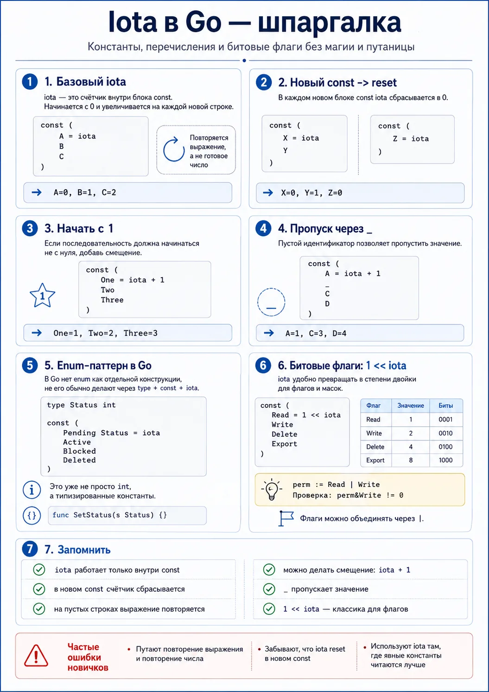

### iota инструмент для работы с константами
Встречается в трёх сценариях:
- когда нужны последовательные значения: статусы и режимы
- когда хочется сделать enum-подобный тип
- когда нужны битовые флаги и маски



iota — предопределённый идентификатор, создавать последовательные константы. Внутренний счётчик компилятора для констант внутри блока const, к которому можно добавить операции.

```go
const (
    Pending = 0
    Active = 1
    Closed = 2
)

// Убирает ручную нумерацию там, где значения и так идут по порядку.
const (
    A = iota // iota == 0
    B // iota == 1
    C // iota == 2
)
func main() {
    fmt.Println(A, B, C) // 0 1 2
}
```

iota — не “тип”, “функция” или “магическая переменная”. Это специальный идентификатор, который имеет смысл только в объявлениях констант (работает даже для одиночной константы).
Компилятор в блоке const на каждой спецификации константы увеличивает iota.

**Iota сбрасывается в каждом новом блоке const**

```go
const (
    A = iota // счётчик 0
    B // = iota // 1
    C // = iota // 2
)

const (
    X = iota // 0
    Y // 1
)

```

### Повторение выражения и автонумерация
Внутри блока const Go повторяет предыдущее **выражение** (не готовое значение) автоматически, но iota в нём уже новое.

Задать правило один раз и дальше просто продолжать последовательность, улучшает читаемость, где констант много.

```go
// Читается хуже:
const (
    A, B = iota + 1, iota + 2
    C, D
    E, F
)

A = 1, B = 2
C = 2, D = 3
E = 3, F = 4
```

**Правило:**
Если статья, библиотека или код пишется для людей, а не для соревнования по краткости, использовать iota так, чтобы смысл считывался почти сразу.

```go
const (
    A = iota + 1 // определяющее выражение. 1
    B // 2
    C // 3
)
```

### Пропуск значения

Во многих прикладных сценариях начинать с 1 читается естественнее:
- уровни
- порядковые номера
- приоритеты
- состояния, где 0 хочется оставить под «неизвестно»

```go
const (
    A = iota + 1
    _ // пустой идентификатор
    C
    D
)

A = 1
C = 3
D = 4
```

Компилятор всё равно вычисляет значение строки, но ты явно говоришь: это значение мне не нужно, не давай ему имя.

#### Когда пропуск полезен:
- зарезервировать значение
- начать enum не с 0
- оставить специальное место под неизвестный статус
- удобно собрать битовые флаги

**Паттерн** с пропуском нуля:
```go
const (
    _ = iota
    Read
    Write
    Execute
)
```

### Enum в Go через iota
В Go нет enum, как в некоторых других языках. type + const + iota позволяет имитировать близко и идиоматично.
enum-подобный пример:

```go
type Status int

const ( // не просто числа, а значения типа Status
    Pending Status = iota
    Active
    Blocked
    Deleted
)

// Чтобы enum красиво печатался
func (d Status) String() string {
    return [...]string{"Pending", "Active", "Blocked", "Deleted"}[d]
}

fmt.Println(Pending) // Pending

func handleStatus(s Stauts) {
    // работает со статусом
    ...
}

Pending -> handleStatus(Pending)
Active  -> handleStatus(Active)
Blocked -> handleStatus(Blocked)
Deleted -> handleStatus(Deleted)
```

Лучше, чем const без типа. Тип делает код безопаснее и выразительнее.

```go
func SetStatus(s Status) // видно, что речь про конкретный набор состояний. говорит больше, чем:
func SetStatus(s int) // случайно передать любое число
```

enum-подобные типы хорошо заходят в:
- статусы заказов
- роли пользователя
- уровни логирования
- направления
- режимы работы
- типы событий

#### Когда лучше быть осторожнее
Если значения должны быть стабильными на уровне внешнего API, базы или протокола, не всегда стоит полагаться на порядок строк.
Если потом кто-то вставит новую константу посередине, численные значения сдвинутся.

Как избежать тихой поломки? Если численные значения уже публичны или зафиксированы контрактом, лучше либо:
- не вставлять новые значения посередине
- либо задавать значения явно

### Битовые флаги и 1 << iota
1 << iota — инструмент для конкретного класса задач.
Иногда нужно хранить несколько булевых состояний в одном числе.
- можно читать;
- можно писать;
- можно удалять;
- можно экспортировать.

Вместо четырёх отдельных bool можно использовать разные биты одного значения.

```go
const (
    Read = 1 << iota // iota = 0, 1 << 0 = 1
    Write // iota = 1, 1 << 1 = 2
    Delete // iota = 2, 1 << 2 = 4
    Export
)

Read = 1   // 2^0 0001
Write = 2  // 2^1 0010
Delete = 4 // 2^2 0100
Export = 8 // 2^3 1000

const (
    Read = 1 << iota // 1 << iota
    Write
    Delete
    Export
)
```

Подход позволяет комбинировать флаги. В одном числе хранится сразу два разрешения:

```go
// маски
permissions := Read | Write // 0001 | 0010 -> 0011

if permissions&Write != 0 {
    fmt.Println("write allowed")
}
```

Где это встречается:
- права доступа
- конфигурационные флаги
- режимы работы
- low-level код
- системные библиотеки
- производительные внутренние структуры

#### Когда не надо использовать битовые флаги
Если задача простая и читабельность важнее компактности, отдельные булевые поля или enum честнее.

### Когда iota уместна, а когда лучше без неё:
iota хороша, когда:
- значения идут по естественной последовательности, порядок значений читается сразу
- нужен enum-подобный набор констант
- нужны битовые флаги
- важно избежать ручной нумерации

iota часто не нужна, лучше задать значения руками если:
- значения не образуют ясной последовательности.
- значения уже фиксированы внешним стандартом. Внешние протоколы, БД или API.
- числа общеизвестны и важны сами по себе. Для HTTP-статусов значения 200 и 404, не 0 и 1.
- формула получается слишком хитрой
- читатель кода без паузы не понимает, что происходит

**Критерий, спроси себя**:
Iota реально делает код короче и понятнее или просто делает его умнее на вид? Если второе, лучше не надо.

### Важная ловушка и Привычка:
- Если значения внутренние и живут только внутри кода, iota подходит.
- Если enum на iota уже используется в БД, логах, API или внешнем контракте, вставка новой константы в середину может сдвинуть все численные значения. Кто-то добавил новый статус и не понял, что поменялся весь числовой смысл.
Если значения уже стали частью внешнего контракта, относись к ним как к публичному API и не двигай бездумно.

###

Упражнение 1. Базовый счётчик
Что тренируем: базовую механику iota.
Задача: Объяви три константы через iota, чтобы они получили значения 0, 1, 2.

Упражнение 2. Начало с единицы
Что тренируем: арифметику с iota.
Задача: Сделай три константы, которые через iota будут равны 1, 2, 3.

Упражнение 3. Пропуск значения
Что тренируем: пустой идентификатор _.
Задача: Создай последовательность, где значения будут 1, 3, 4, а число 2 будет пропущено.

Упражнение 4. Enum-подобный тип
Что тренируем: type + const + iota.
Задача: Создай тип LogLevel и значения Debug, Info, Warn, Error.

Упражнение 5. String для enum
Что тренируем: человекочитаемый вывод.
Задача: Добавь к LogLevel метод String(), чтобы при печати уровни выводились как слова, а не числа.

Упражнение 6. Битовые флаги
Что тренируем: 1 << iota.
Задача: Сделай флаги Read, Write, Delete, объедини Read | Write и проверь, что флаг Write включён.


После практики без подсказки ответить:
Где вообще можно использовать iota?
Почему в новом const она снова становится нулём?
Почему можно не писать выражение на каждой строке?
Когда iota делает код лучше, а когда хуже?

---

https://mentor-niyaz.ru/blog/iota-v-go
