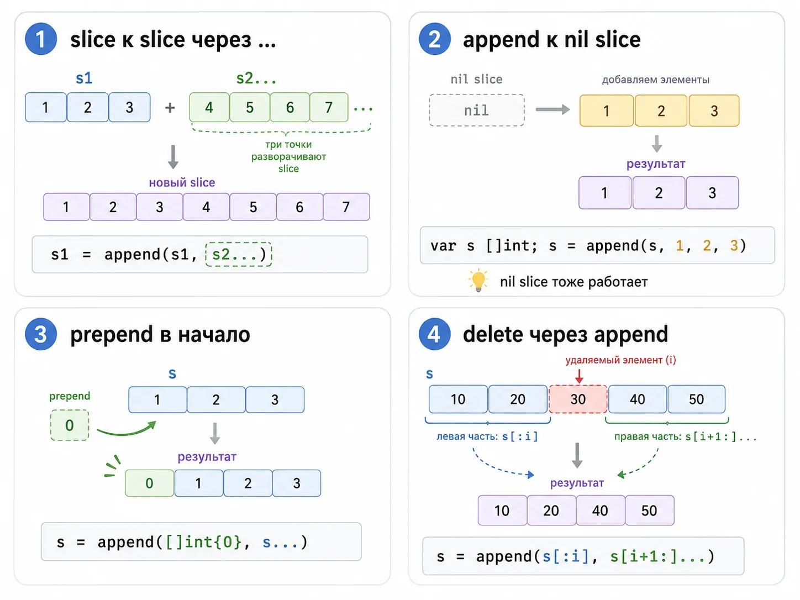
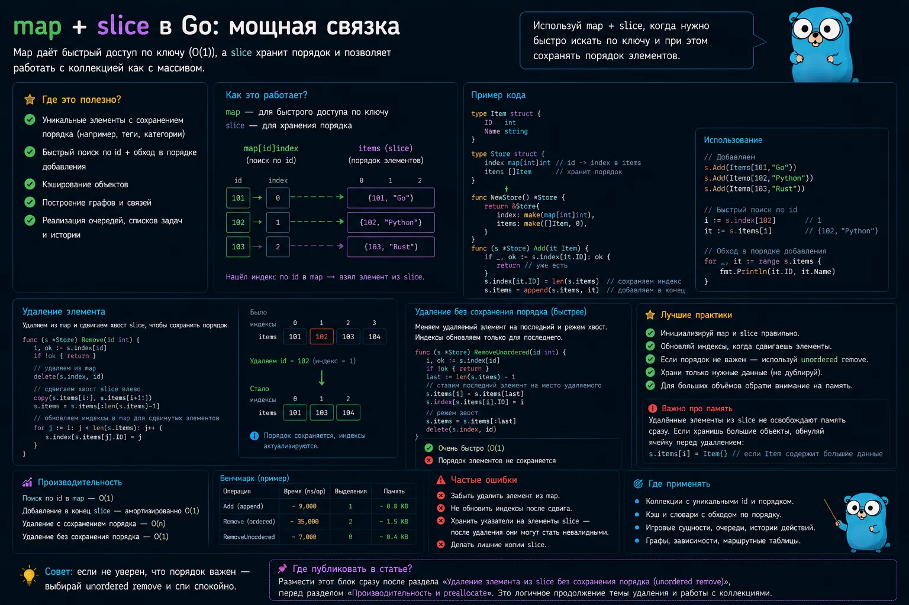
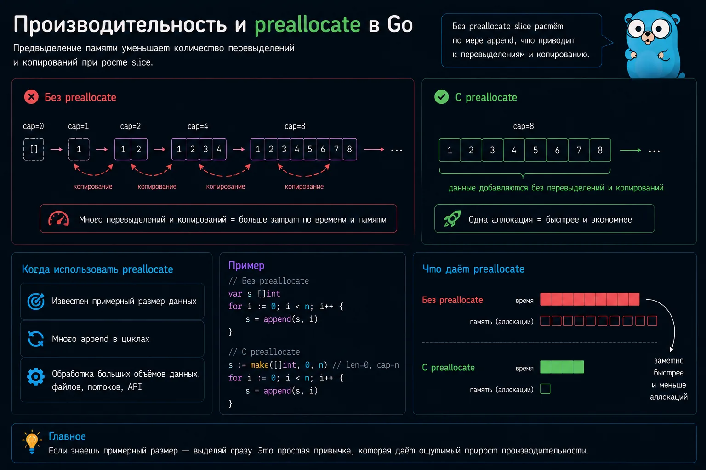
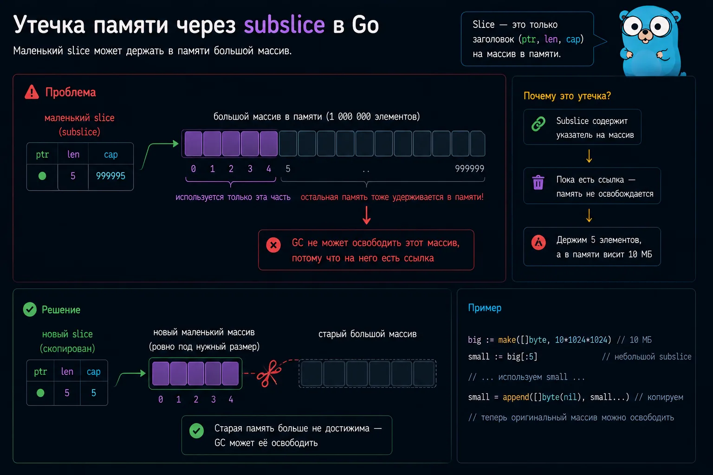
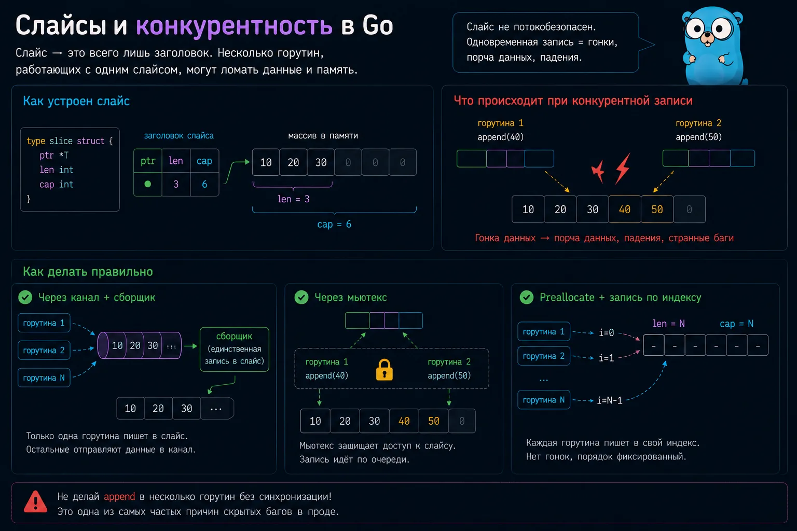
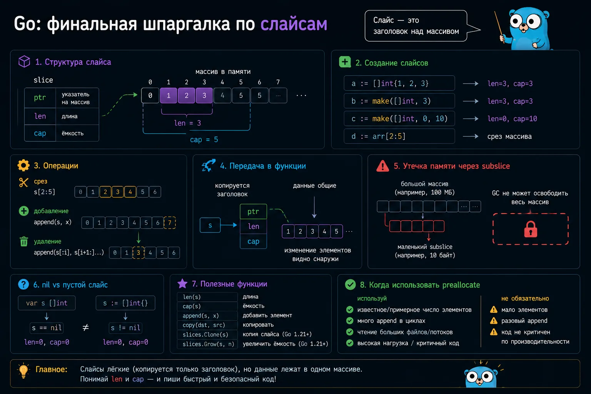
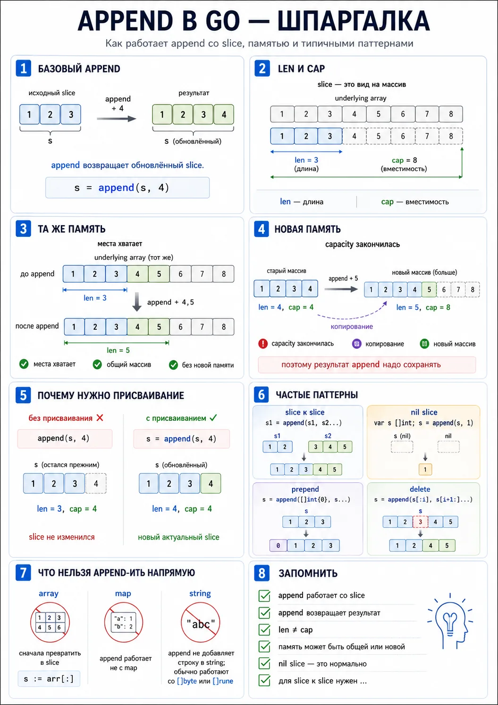

### Массив
Массив – упорядоченная последовательность элементов.
Емкость массива определяется во время его создания, размер не изменяем.

Память выделяется только один раз.
Повышает производительность, используются при оптимизации программ.

```go
coral := [3]string{"blue coral", "staghorn coral", "pillar coral"}
coral[1] = "yellow coral"
```

### Срезы. Slice
Срез (динамический массив. был бы массивов в других ЯП) – упорядоченная последовательность элементов, изменяемой длины. Работает поверх массива.

Если срезу не хватает памяти для хранения при добавлении элемента: создаёт новым массив с большим размером, переносит все элементы и добавляет новый.

variadic append через comma добавление Нескольких элементов

```go
seaCreatures := []string{"shark", "cuttlefish", "squid", "mantis shrimp"}
seaCreatures[4] = "seahorse" // ошибка. пытаемся достучаться в ящик, которого не существует
seaCreatures = append(seaCreatures, "seahorse") // создание нового шкафа с большим количеством полок
```

Изначально создали шкаф с 5 пустыми ящиками. Кол-во ящиков - вместимость, куда можем положить элементы.
Длина - кол-во элементов, которые фактически лежат в ящиках.

- Ящики пустые: capacity, cap(slice) = 5, length, len(slice) = 0
- Ящики заполнены числами: capacity = 5, length = 5
- Добавим в шкаф ящик: capacity = 10, length = 6
- Добавим ещё ящик: capacity = 10, length = 7. Вместимость осталась прежней, в этом случае не создавался новый массив.

Процесс создания нового массива и перенос туда старых элементов дорогостоющуй. Go оптимизирует и создаёт шкаф с большим кол-вом ящиков заранее, когда длина начинает превышать вместимость.

Если заранее знаешь вместимость, чтобы предотвратить многократное создание новых массивов, создать slice с нужной ёмкостью:

```go
slice := make([]int, 0, 500) // []
slice2 := make([]int, 3, 500) // [0 0 0], zero-value
```

Срезы на основе других slice:

```go
s := []int{73, 98, 86, 61, 96}
len(s) = 5, cap(s) = 5
s2 := s[0:2] // срез slice s с элементами под индексами 0-1
len(s2) = 2, cap(s2) = 5
s3 := s[1:] // правая граница не указана = длине массива
s4 := s[:] // левая граница не указана = 0 индексу
```

slice s2 опирается на тот же массив, что slice s - вместимость будет совпадать с изначальным массивом.

```go
s2 := s[0:2:2] // индекс по вместимости
len(s2) = 2, cap(s2) = 2

s2 = append(s2, 444)
```

- s  [73 98 86 61 96]
- s2 [73 98 444]

ограничиваем вместимость урезанного массива до двух и получается массив [73, 98], НО! эти два элемента все еще имеют адрес на элементы исходного массива. append создает копию массива и добавляет кол-во пустых ячеек, если вместимости не хватает. новый массив с элементами, у которых свои адреса [73, 98, 444, кол-во пустых ячеек созданных заранее для оптимизации].

```go
s2 := s[0:2]
s2 = append(s2, 444)
```

- s  [73 98 444 61 96]
- s2 [73 98 444]

урезанный массив, но элементы внутри массива имеют те же адреса в памяти, что и у элементов исходного массива. массив длиной 2, вместимость как у исходного массива 5, получается массив [73, 98, пусто, пусто, пусто]. Когда отрабатывает s2 = append(s2, 444), в конец урезанного массива добавляем 444, НО!! это значение добавляется в пустую ячейку урезанного массива, а сама эта пустая ячейка, имеет тот же адрес, что и ячейка хранящиеся под данным индексом у исходного массива, при изменении этой ячейки в урезанном массиве затронем данную ячейку у исходного массива. урезанный массив [73, 98, 444, пусто, пусто], а исходный так -->  [73, 98, 444, 61, 96].

slice - динамическа "витрина" (представление) над частью массива.

Через slices и append:
- хранят данные. не хранит данные сам, а указывает на них.
- собирают результаты запросов
- работают с JSON
- обрабатывают файлы
- делают очереди
- фильтруют элементы
- сортируют данные
- передают наборы значений между функциями

при сборке списков
в обработке JSON и API
в парсерах
в фоновых задачах
в построении буферов
при объединении данных
в алгоритмах и очередях
при работе с []byte, строками, map-значениями и вложенными структурами

helper-функции, которые принимают slice и что-то в него append-ят
построение буферов
работа с подslice
удаление и вставка элементов
переиспользование временных списков в цикле

```go
[]map[string]any
```

- данные внезапно общие между функциями
- маленький subslice удерживает огромный кусок памяти
- конкурентный append приводит к race condition

Slice — не динамический массив. Slice = ссылка на массив + информация о диапазоне.

```go
array
10 20 30 40 50 60 70 80
начало (index 2) конец (index 6)

slice
30 40 50 60
slice видит только эту часть массива
```

Cтруктура (заголовк) из трёх полей. Ссылается на массив и описывает диапазон элементов.
Внутри - структуру из трёх частей:
- указатель (pointer) на первый доступный элемент базового массива (underlying array) - &arr[2] (0x14008112040)
- length - сколько элементов сейчас доступно (видно) через slice slice (читать и писать в эти индексы) - 4
- ёмкость (capacity) - сколько элементов можно использовать от текущей позиции (ptr) (не с начала базового массива) до конца базового массива - 6 (элементы с 2 по 7). до перераспределения.

Изменение элеметов через slice, изменяет сам массив.
Изменение самого slice (len, cap, ptr) не влияет на другие slice.

```go
s1 := []int{1, 2, 3}
s2 := s1[:2]
s2[0] = 100
fmt.Println(s1) // [100 2 3]
```

s2 независимой копией, но копии нет. Несколько slices могут ссылаться на тот же массив.
это делает slices одновременно очень быстрыми и удобными и иногда очень опасными.

### Чем slice отличается от array

Если данные могут меняется в размере (динамические) - используй slice.

append — встроенная функция, добавляет один или несколько элементов (через , или ...) того же типа в конец slice и возвращает обновлённый slice. работает только со slice

К массиву append не применяют напрямую, потому что размер массива фиксирован и входит в тип.

```go
arr := [3]int{1, 2, 3}
s := arr[:]
s = append(s, 4)
```

напрямую нельзя, сначала массив надо превратить в slice.

Array:
- имеет фиксированную, неизменяемую длину и она является частью его типа. При передаче в функцию или присваивании копируется массив целиком
- Хранит сами данные - значения

Slice:
- []T хранит ссылку на участок массива ("окно") и при передаче slice копируется как маленький дескриптор (slice header) (не сами данные), но смотрит на те же данные

```go
var a [3]int
// разные типы. Их нельзя присвоить друг другу
var b [4]int
// a = b // compile error

var s []int // один тип независимо от длины. slice длину в типе не хранит
```

Сегодня в нём  3 элемента, завтра 300, потом снова 0.

```go
func changeArray(a [3]int) { // Массив скопировался, исходные данные не изменились
    a[0] = 100
}

func changeSlice(s []int) { // slice передался по значению, но внутри у копии и оригинала общий базовый массив
    s[0] = 100
}

func main() {
    arr := [3]int{1, 2, 3}
    changeArray(arr)
    fmt.Println(arr) // [1 2 3]

    nums := []int{1, 2, 3}
    changeSlice(nums)
    fmt.Println(nums) // [100 2 3]
}
```

### Как устроен slice

```go
type sliceHeader struct {
    ptr *T
    len int
    cap int
}

s := make([]int, 3, 6)
fmt.Println(len(s)) // 3. доступны только первые 3 элемента
fmt.Println(cap(s)) // 6. в базовом массиве зарезервировано место под 6
// [0 0 0 _ _ _]

s[1] = 10 // [0 10 0]

// Обращение за пределы len
s[4] = 100 // panic: index out of range
```

Индексировать можно только в пределах len, а не cap.
Ёмкость не даёт права индексировать элементы, нужна для роста через append.

```go
words := []string{"go", "map", "go", "slice", "map", "go"}
counts := make(map[string]int)

for _, word := range words {
    counts[word]++ // работает даже для нового слов
}
// map[go:3 map:2 slice:1]
```

Если ключа ещё нет, чтение вернёт zero value для типа значения.

```go
nums  := []int{1, 2, 3} // Литерал - данные известны сразу
words := []string{"go", "slice", "append"}

s := make([]int, 5) // make slice с длиной
// [0 0 0 0 0]
fmt.Println(cap(s)) // 5

s := make([]int, 0, 100) // make slice с длиной и ёмкостью - сразу задать запас. Заранее известен примерный размер результата, но добавлять элементы удобнее через append

var s []int // конечная длина неизвестна
fmt.Println(s == nil) // true
fmt.Println(len(s)) // 0
s = append(s, 1) // работает с append, len, range.
// [1]
```

Если несколько slice ссылаются на один массив - изменения пересекающихся (по общей памяти) элементов произойдёт во всех slice. Окна разные, смотрят на один массив. Меняем массив - видят все окна.

```go
               {10 20 30 40 50 60 70 80}
s1 := arr[1:4] // {20 30 40}
s2 := arr[2:6] //    {30 40 50 60}
s3 := arr[4:8] //          {50 60 70 80}

s2[0] = 999 // иднекс 2 в исходном массиве
              {10 20 999 40 50 60 70 80}
s1 (arr[1:4]) // {20 999 40}
s2 (arr[2:6]) //    {999 40 50 60}
s3 (arr[4:8]) //           {50 60 70 80}

s1 = append(s1, 111) // в s1 есть свободное место (cap = 7)
              {10 20 999 40 111 60 70 80}
s1 (arr[1:4]) // {20 999 40 111}
s2 (arr[2:6]) //    {999 40 111 60}
s3 (arr[4:8]) //           {111 60 70 80}
```

Если места не хватает (len == cap), append создаст новый массив и скопирует туда данные. Тогда slice перестанут влиять друг на друга (смотрят на разную память).

```go
s := []int{0, 1, 2, 3, 4, 5}
part := s[2:4] // начинается с элемента s[2], до конца базового массива 4 элемента: 2, 3, 4, 5.
fmt.Println(part) // [2 3]
fmt.Println(len(part)) // 2
fmt.Println(cap(part)) // 4
```

### Как работает append

```go
s := []int{1, 2, 3}
s = append(s, 4) // добавляет элементы в конец slice и возвращает новый slice
// [1 2 3 4]

// Присвоение нужно, append может вернуть другой slice (с другим массивов)
append(s, 10) // compile error: value of append is not used
```

append может вернуть slice, который ссылается на тот же массив (ptr не изменился), а может вернуть slice уже с новым массивом (x2 размером) (pte указывает на новый массив).
Ёмкость исчерпана - Go выделяет новый базовый массив, копирует туда старые элементы и добавляет новые.
формула роста capacity —  деталь реализации runtime, и она менялась между версиями Go. не заучивать “всегда удваивается”.

Ёмкость slice удваивается до 1024 элементов, а потом растёт примерно на 25%. В современных версиях Go формула роста сложнее и является деталью runtime.
Не завязываться на коэффициент роста, а заранее задавать capacity, где размер результата понятен.

### Почему append может изменить другой slice

```go
s1 := []int{1, 2, 3}
s2 := s1[1:2] // len = 1, cap = 2
s3 := append(s2, 10) // append увидел свободное место и записал 10 в общий массив

fmt.Println(s1) // [1 2 10]
fmt.Println(s2) // [2]
fmt.Println(s3) // [2 10]
```

Смотрят на один базовый массив.

```go
func addSomething(s []int) { // передача slice в функцию
    _ = append(s, 10)
}

func main() {
    nums := []int{1, 2, 3}
    addSomething(nums[:2]) // функция получила только первые два элемента
    fmt.Println(nums) // [1 2 10]
}
```

Но смогла изменить третий через общий базовый массив.

### Как защититься полным выражением slice

Чтобы изменения не "утекали" в другие slice - делай копию или используй полное выражение.

s[low:high:max]

Ограничить capacity нового slice.

```go
func addSomething(s []int) {
    _ = append(s, 10) // свободной ёмкости уже нет, Go создаёт новый массив, а исходный nums не меняется.
}

func main() {
    nums := []int{1, 2, 3}
    // nums[:2] // длину 2 и ёмкость 3
    addSomething(nums[:2:2]) // длину 2 и ёмкость 2
    fmt.Println(nums) // [1 2 3]
}
```

Полное выражение slice защищает от побочного изменения через append, но не решает проблему удержания большого базового массива в памяти. Для этого нужна копия.

### прикладные паттерны



Как append один slice к другому
оператор ..., разворачивает второй slice в список аргументов.

```go
s1 := []int{1, 2, 3}
s2 := []int{4, 5, 6}
s1 = append(s1, s2...)
fmt.Println(s1)
[1 2 3 4 5 6]
```

Без ... код не скомпилируется, потому что append ждёт элементы типа int, а не один аргумент типа []int.

### Append к nil slice

```go
var nums []int
fmt.Println(nums == nil) // true
nums = append(nums, 1, 2, 3)
[1 2 3]
```

часто можно не делать лишнюю инициализацию заранее. 
map со значениями-слайсами хорошо сочетается с этим паттерном:

```go
m := map[string][]string{}
m["go"] = append(m["go"], "slice", "append")
```

Если ключа ещё не было, m["go"] даст nil slice, а append создаст slice.

### Как добавить элемент в начало slice
Стандартного prepend в Go нет, но можно так:

```go
s := []int{1, 2, 3}
s = append([]int{0}, s...)
fmt.Println(s)
[0 1 2 3]
```

дороже, чем append в конец, требует новый результат и копирование.

### Как удалить элемент через append

```go
s := []int{10, 20, 30, 40, 50}
i := 2
s = append(s[:i], s[i+1:]...)
[10 20 40 50]
```

Мы берём:
кусок до удаляемого индекса
кусок после него
склеиваем их через append

Этот способ может переиспользовать тот же underlying array. Иногда это нормально. Но если ты работаешь с большими объектами, долгоживущими ссылками или чувствительными данными, надо понимать, что старые элементы могут ещё оставаться в памяти underlying array до перезаписи.

### slice copy
Независимая копия данных, а не ещё один slice, который смотрит на тот же базовый массив.

copy - копирует элементы по индексам в уже сущ. фиксированный slice.
Когда уже есть dst нужного размеры и хочешь перезаписать значений.

Если тебе критично нужен отдельный независимый кусок данных, лучше явно сделать копию, а не надеяться на побочный эффект роста capacity.

```go
src := []int{1, 2, 3}
var dst []int
copy(dst, src)
fmt.Println(dst) // []
// copy копирует минимум из len(dst) и len(src).

dst2 := make([]int, len(src)) // длина не меняется, меняются 0 на значения из src
copy(dst2, src)
fmt.Println(dst2) // [1 2 3]

// Скопировать часть. Если длина dst меньше src:
src2 := []int{1, 2, 3, 4}
dst3 := make([]int, 2)
n := copy(dst3, src2) // copy возвращает количество скопированных элементов
fmt.Println(dst3) // [1 2]
fmt.Println(n) // 2

// Альтернатива через append:
dst4 := append([]int(nil), src...)
```

make + copy читается понятнее.

Если нужен именно копирующий append без изменений dst:
```go
append([T]{}, src...)
```

append - добавляет элементы src в конец dst (наращивание, конкатенация) и возвращяет новый slice.
Когда нужно добавить элементы в конец или создать новый slice.

Если ёмкости не хватает - выделяется новый массив, dst может поменяться.

```go
// илл dst = append(dst, copy(src))

src := []int{10 20 30 40 50}
dst := []int{1 2 3} // len = 3, cap = 3

dst = append(dst, src...) // новый slice
1 2 3 10 20 30 40 50 // len = 8, cap = 8
```

Оба способа копируют значения, а не ссылки.

### nil slice и empty slice: в чём разница

Похожие, но не одинаковые ситуации. На практике почти всегда взаимозаменяемы.

```go
var s []int // Nil slice. var s []int = nil

// s[i] // читать нельзя, panic.

for _, v := range s {
    fmt.Println(v) // не выполнится
}
s = append(s, 1) // [1]. создаст новый массив

b := []string{} // Пустые, но не nil slice
c := make([]string, 0)

// b[i] // читать нельзя, panic.

fmt.Println(s == nil) // true
fmt.Println(b == nil) // false
fmt.Println(c == nil) // false
fmt.Println(len(s), cap(s)) // 0 0
fmt.Println(len(b), cap(b)) // 0 0
fmt.Println(len(c), cap(c)) // 0 0. cap == 0, если make с 0

c = append(c, "white") // добавит в тот же массив (если cap > 0)


// Проверить, есть ли элементы
if len(s) == 0 {
    // пусто
}

// Не проверять только s == nil, если важно именно отсутствие элементов:
func handle(items []Item) {
    if items != nil {
        process(items)
    }
}

// Если функция получит пустой, но не nil slice, условие выполнится:
items := []Item{}
handle(items)

// Правильнее:
if len(items) > 0 {
    process(items)
}
```

И для map: если нужно понять, есть ли элементы, проверяй len(m), а не m != nil.


В API и при работе с JSON (encoding) одни клиенты ждут [], другие нормально обрабатывают null, а третьи ломаются от неожиданного формата.

```go
type Response struct {
    Items []string `json:"items"`
}

var nilSlice []string
emptySlice := []string{}

b1, _ := json.Marshal(Response{Items: nilSlice})
b2, _ := json.Marshal(Response{Items: emptySlice})
fmt.Println(string(b1)) // {"items":null}
fmt.Println(string(b2)) // {"items":[]}
```

Проверять, что именно ожидает получатель данных.
Если сомневаешься - возвращяй empty slice.

nil slice:
- указаетль = nil, нет лежащего в основе массива.
- Если собираешь результат в коде.
- проход по range: не заходит
- передача в функцию: как nil

- Нужно показать отуствие данных
- Slice ещё не инициализирован

empty slice ([]T{}):
- указетль = addr, лежащий в основе массиве пустой
- Если отдаёшь JSON и хочешь именно пустой массив, инициализируй []T{} или make([]T, 0).
- проход по range: не заходит
- передача в функцию: как пустой slice

- Вернуть пустой список вместо nil
- Планируешь добавлять элементы в slice

### Нарезка slice: s[a:b] и s[a:b:c]

Нарезка не копирует данные. Создаёт новый slice из сущ. массива или slice. Новый slice смотрит на тот же базовый массив.

```go
s := []int{0, 1, 2, 3, 4}
part := s[1:4] // s[low:high:cap]
// [1 2 3], len = 3, cap = 4

// В part, есть "скрытая" ёмкость. append может изменить исходный массив. append записал в индекс 4, другие slice, ссылающиеся на этот arr, увидят эти изменения.
part = append(part, 10)
fmt.Println(s) // [0, 1, 2, 3, 10]
fmt.Println(part) // [1 2 3 10], len = 4, cap = 4

s := []string{"a", "b", "c", "d"}
fmt.Println(s[:2]) // [a b]
fmt.Println(s[2:]) // [c d]
fmt.Println(s[:]) // [a b c d]

s := []int{1, 2, 3, 4, 5}
part := s[1:]
part[0] = 100
fmt.Println(s) // [1 100 3, 4, 5]
fmt.Println(part) // [100 3, 4, 5]
```

Чтобы защититься от нежелательный append, полное выражение slice:

```go
s := []int{1, 2, 3, 4, 5}
part := s[1:4:4] // Ограничили cap значением 4 (индекс до 4 не включается).
// 2 3 4, len = 3, cap = 3
part = append(part, 10)
fmt.Println(s) // [1 2 3 4 5]
fmt.Println(part) // [2, 3, 4, 10], len = 4, cap = 6. append создал новый массив (когда cap = len), исходный не изменился.

// Формула ёмкости:
cap = max - low
```

Полезно, когда передаёшь часть slice в функцию и не хочешь, чтобы она через append затронула исходный массив.

s[low:high:cap], чтобы явно контролировать cap и избегать непреднамернных изменений данных в общем массиве.

### Удаление элемента из slice

Нет built-in (встроенной) функции (как delete для map) для удаления элемента из slice.
Нужно создать новый slice или сдвинуть элементы внутри.
Slice - динамический массив. При удалении capacity не меняется. Уменьшаем len и/или перемещяаем элементы.

- Удалить (по индексу) без сохранения порядка:
* O(1) - время, O(1) - память. Очень быстро, не сдвигает все элементы. Важна скорость, а не порядок.
* Не выделяет память
* Меньше операций в больших slice

Меняем удаляемый элемент с последний, а затем отрезаем хвост.

```go
func removeUnordered(s []int, i int) []int {
    // заменить удалённый элемент последним
    s[i] = s[len(s)-1] // копируем последний в i
    // последнее значение в конце уже не нужно
    return s[:len(s)-1] // уменьшаем длину на 1
}

nums := []int{10, 20, 30, 40}
nums = removeUnordered(nums, 1) // [10 40 30]
```

Используют там где порядок не важен:
- игровых системах
- очередях задач
- кэшах
- пулах объектов
- внутренних буферах
- Внутренние структуры данных, c, сет, map-подобные задачи

- Удалить (по индексу) с сохранением порядка:
* O(n) - время, O(1) - память. Медленее при больших slice
* Работает для любых типов

```go
func removeOrdered(s []int, i int) []int {
    // return append(s[:i], s[i+1:]...)
    copy(s[i:], s[i+1:]) // сдвигаем после s[i] влево
    return s[:len(s)-1] // len - 1
}

nums := []int{10, 20, 30, 40}
nums = removeOrdered(nums, 1) // [10 30 40]
```

Порядок сохранился, но элементы после i сдвинуты влево на 1 позицию.


Если slice хранит указатели или большие структуры с указателями, при удалении занулять удаляемый элемент, чтобы GC мог освободить память.

Для slice с указателями удаление через append(s[:i], s[i+1:]...) может оставить ссылку в хвосте базового массива. В долгоживущих структурах это превращается в неприятные утечки.

```go
func removePtr(s []*User, i int) []*User {
    copy(s[i:], s[i+1:]) // все элементы левее i не нужны. сдвигаем на 1, чтобы исключить s[i].
    // в s сдвинутый влево slice без s[i] и последним элементов в памяти
    s[len(s)-1] = nil // Без s[len(s)-1] = nil последний элемент может продолжать удерживать объект в памяти через базовый массив.
    return s[:len(s)-1]
}
```

Ошибки:
- забыть уменьшить len - элемент не удалится
- удалять в цикле по возрастанию - пропускаются элементы
- не учитывать порядок элементов

### slice contains: как проверить наличие элемента

```go
func containsInt(s []int, target int) bool {
    for _, v := range s {
        if v == target {
            return true
        }
    }
    return false
}

// В современных версиях пакет slices из стандартной библиотеки:
import "slices"
ok := slices.Contains([]int{1, 2, 3}, 2)
fmt.Println(ok) // true

// Если проверок много, иногда лучше построить set через map:
ids := []int{10, 20, 30}
set := make(map[int]struct{}, len(ids))

for _, id := range ids {
    set[id] = struct{}{}
}
_, ok := set[20]
```

Один поиск по slice — нормально.
Тысячи поисков по большому slice — повод подумать о map.

### Как сортировать slice
Для сортировки пакет sort, в новых версиях ещё пакет slices.

```go
import "sort"

nums := []int{3, 1, 2}
sort.Ints(nums)
// [1 2 3]

words := []string{"go", "append", "slice"}
sort.Strings(words)
// [append go slice]
```

Сортировка структур:

```go
type User struct {
    Name string
    Age int
}
users := []User{
    {Name: "Mark", Age: 24},
    {Name: "Niyaz", Age: 30},
}
// правило сравнения. Алгоритм сортировки (внутри sort.Slice быстрая сортировка) многократно вызывает эту функцию, подставляя разные пары индексов, чтобы решить, нужно ли менять элементы местами.
sort.Slice(users, func(i, j int) bool {
    return users[i].Age < users[j].Age
})
```

Через пакет slices:

```go
import (
    "slices"
    "cmp"
)

slices.Sort(nums)
```

Для структур:

```go
slices.SortFunc(users, func(a, b User) int {
    return cmp.Compare(a.Age, b.Age) // сравнивает два значения и сразу возвращает -1/0/1
})
```

### Преобразование slice string

Преобразование slice, чаще всего []byte в string.

```go
b := []byte{'g', 'o'}
s := string(b) // go

// Обратное преобразование:
b := []byte(s)
b[0] = 'G'
fmt.Println(string(b)) // Go
```

Строка в Go неизменяемая. Когда превращаешь string в []byte, получаешь изменяемую копию данных.

Для Unicode-строк, если в данных есть кириллица часто нужен []rune, а не []byte.

```go
s := "привет"
runes := []rune(s)
fmt.Println(len(s)) // байты
fmt.Println(len(runes)) // символы
```

```go
arr := [3]int{1, 2, 3} // не умеет расти

s := arr[:] // Если хочешь добавить к массиву, надо получить slice
s = append(s, 4)
fmt.Println(s)

m := map[string]int{} // map — другая структура данных. нет понятия «добавить в конец». В map не appendишь, а пишешь по ключу:
m["go"] = 1

m := map[string][]int{"a": {1, 2, 3}} // если значение map — slice, append работает с этим значением.
m["a"] = append(m["a"], 4, 5)
fmt.Println(m)


// К строке append напрямую не применяют как к строковому типу.

// особый случай - []byte, туда можно аппендить строку через ... как байты.
b := []byte{"G", "o"}
_ = b

b := []byte{'G', 'o'}
b = append(b, "lang"...)
fmt.Println(string(b))
Golang
```

Это специальная форма для []byte + string.

### Append строковых значений
Если у тебя slice строк, всё обычным образом работает:

```go
tags := []string{"go", "backend"}
tags = append(tags, "append")
fmt.Println(tags)
```

Append байтов и строки

```go
buf := []byte("Go")
buf = append(buf, "lang"...)
fmt.Println(string(buf))
Golang
```

полезно при работе с буферами, сериализацией и сетевым кодом.

Append string
Если речь о []string, append работает обычно:

```go
s := []string{"a", "b"}
s = append(s, "c")
```

Если речь о типе string, то append не предназначен для работы со string как со slice элементов.

Но специальный и полезный случай есть с []byte:

```go
b := []byte("Hello")
b = append(b, " Go"...)
fmt.Println(string(b))
```

### Как собрать slice из map



Map и slice часто используют вместе: 
- Map даёт быстрый доступ по ключу
- slice удобен для порядка, сортировки и вывода.

собрать ключи map в slice:

m := map[string]int{
"go": 3,
"slice": 2,
"map": 1,
}
keys := make([]string, 0, len(m))
for k := range m {
keys = append(keys, k)
}
sort.Strings(keys)
fmt.Println(keys)

Собрать значения:

values := make([]int, 0, len(m))
for _, v := range m {
values = append(values, v)
}

Собрать пары:

type Pair struct {
Key string
Value int
}
pairs := make([]Pair, 0, len(m))
for k, v := range m {
pairs = append(pairs, Pair{Key: k, Value: v})
}

### Append map
Напрямую append к map неприменим.

Неправильно:

```go
m := map[string]int{"a": 1}
// append(m, ...)
```

Правильно понимать так:

map не растёт через append
map обновляется присваиванием по ключу
но если значение в map — slice, тогда append уже уместен

```go
m := map[string][]int{"a": {1, 2, 3}}
m["a"] = append(m["a"], 4, 5)
Append golang array
```

### Как скопировать map, slice и interface
Запрос как скопировать map slice interface часто появляется из-за одной проблемы: в Go много ссылочных структур, и простое присваивание не всегда делает независимую копию данных.

Со slice:

src := []int{1, 2, 3}
dst := make([]int, len(src))
copy(dst, src)

С map:

src := map[string]int{"a": 1}
dst := make(map[string]int, len(src))
for k, v := range src {
dst[k] = v
}

Если внутри map лежат slice, нужно копировать и их:

src := map[string][]int{
"a": {1, 2, 3},
}

dst := make(map[string][]int, len(src))
for k, v := range src {
copied := make([]int, len(v))
copy(copied, v)
dst[k] = copied
}

С interface{} или any универсального простого ответа нет. Надо знать реальный тип внутри. Если там slice, копируешь как slice. Если map, как map. Если структура с указателями, нужно решать, нужна поверхностная или глубокая копия.

Не пытаться сделать deep copy на все случаи жизни. Безопаснее явно копировать конкретные структуры данных, которые используются в твоём коде.

### Производительность: как правильно инициализировать slice



slice []Foo, и мы хотим получить []Bar такой же длины.

Плохой вариант для большого количества данных:

func convert(foos []Foo) []Bar {
bars := make([]Bar, 0)
for _, foo := range foos {
bars = append(bars, fooToBar(foo))
}
return bars
}

для большого входа Go будет несколько раз расширять базовый массив, выделять новую память и копировать элементы.

Лучше задать ёмкость:

func convert(foos []Foo) []Bar {
bars := make([]Bar, 0, len(foos))
for _, foo := range foos {
bars = append(bars, fooToBar(foo))
}
return bars
}

Ещё быстрее, если длина результата точно равна длине входа:

func convert(foos []Foo) []Bar {
bars := make([]Bar, len(foos))
for i, foo := range foos {
bars[i] = fooToBar(foo)
}
return bars
}

Почему второй вариант иногда всё равно выбирают? append часто проще читать, особенно когда на один входной элемент приходится несколько выходных.

func collectKeys(items []Item) []string {
keys := make([]string, 0, len(items)*2)
for _, item := range items {
keys = append(keys, item.StartKey, item.EndKey)
}
return keys
}

Через индексы это будет быстрее на микробенчмарке, но хуже для чтения:

func collectKeys(items []Item) []string {
keys := make([]string, len(items)*2)
for i, item := range items {
keys[i*2] = item.StartKey
keys[i*2+1] = item.EndKey
}
return keys
}

В реальном коде важен баланс. Если участок не горячий, читаемость часто важнее экономии нескольких процентов.

Если длина результата известна и ты заполняешь каждый элемент один к одному, используй make([]T, len(src)) и запись по индексу. Если количество элементов зависит от условий или на один вход приходится переменное число выходов, используй make([]T, 0, expected) и append.

### Утечка памяти из-за нарезки большого slice



Одна из самых неприятных ловушек со sliceми: маленький slice может удерживать в памяти огромный массив.

читаем сообщение размером 1 МБ, а сохранить хотим только первые 5 байт.

func getMessageType(msg []byte) []byte {
return msg[:5]
}

Возвращаем всего 5 байт.

Но msg[:5] не копирует данные. Новый slice продолжает ссылаться на базовый массив размером 1 МБ. Если сохранить 1000 таких маленьких slice, можно случайно удерживать около 1 ГБ памяти, хотя полезных данных всего 5000 байт.

Правильно делать копию:

func getMessageType(msg []byte) []byte {
msgType := make([]byte, 5)
copy(msgType, msg[:5])
return msgType
}

Или компактно:

func getMessageType(msg []byte) []byte {
return append([]byte(nil), msg[:5]...)
}

Полное выражение slice не решит эту проблему:

return msg[:5:5]

Оно ограничит capacity, но базовый массив всё равно останется в памяти, пока на него есть ссылка через slice.

Это особенно важно в коде, который работает с файлами, сетевыми буферами, бинарными протоколами, логами и большими JSON.

#### Утечки памяти со sliceми указателей
Есть ещё один тип утечек: когда slice содержит указатели или структуры с полями-указателями.

type Foo struct {
Data []byte
}

1000 элементов, и каждый держит по 1 МБ.

func keepFirstTwo(foos []Foo) []Foo {
return foos[:2]
}

оставили только два элемента, но базовый массив всё ещё содержит остальные структуры, а внутри них ссылки на большие []byte. GC видит эти ссылки и не освобождает память.

Если сохраняем маленькую часть, лучше копировать:

func keepFirstTwo(foos []Foo) []Foo {
res := make([]Foo, 2)
copy(res, foos[:2])
return res
}

Если удаляем небольшую часть, а большую оставляем, можно обнулять ненужные ссылки:

func keepFirstTwo(foos []Foo) []Foo {
for i := 2; i < len(foos); i++ {
foos[i].Data = nil
}
return foos[:2]
}

Как выбирать:
оставляешь маленькую часть большого slice — копируй
оставляешь почти всё, но удаляешь несколько элементов — обнуляй ссылки
работаешь с []byte из большого буфера — копируй нужный кусок
держишь slice долго в памяти — особенно внимательно смотри на базовые массивы

Такие вещи появляются в проде, когда сервис долго живёт и обрабатывает много данных.

### Slice в функциях: что меняется, а что нет
slice передаётся в функцию по значению. Копируется не весь массив, а только дескриптор: pointer, len, cap.

Изменение элемента видно снаружи:

func change(s []int) {
s[0] = 100
}
func main() {
nums := []int{1, 2, 3}
change(nums)
fmt.Println(nums) // [100 2 3]
}

А изменение самого дескриптора не видно, если ты не вернул новый slice:

func add(s []int) {
s = append(s, 4)
}
func main() {
nums := []int{1, 2, 3}
add(nums)
fmt.Println(nums) // [1 2 3]
}

Правильно:

func add(s []int) []int {
return append(s, 4)
}
func main() {
nums := []int{1, 2, 3}
nums = add(nums)
fmt.Println(nums) // [1 2 3 4]
}

частая ошибка: функция вызывает append, но результат не возвращает.

append возвращает результат - обновлённый slice, работай уже с ним. Если бы язык делал вид, что ничего возвращать не надо, ты бы не знал, какой именно slice теперь актуален.


неприятный случай — внутри функции

```go
func addValue(s []int) {
    s = append(s, 100)
}

func main() {
    nums := []int{1, 2, 3}
    addValue(nums)
    fmt.Println(nums)
}
```

Многие новички ждут, что nums изменится. Но нет.
внутри addValue переменная s получила новый slice-результат, а снаружи nums о нём не знает.

Либо вернуть новый slice:

```go
func addValue(s []int) []int {
    s = append(s, 100)
    return s
}

func main() {
    nums := []int{1, 2, 3}
    nums = addValue(nums)
    fmt.Println(nums)
}
```

Либо, если нужен совсем другой уровень управления, уже работать через указатель на slice. для новичка правильный путь — возвращать новый slice.

### Фильтрация slice без лишних аллокаций
Фильтрация часто пишется так:

func filterPositive(nums []int) []int {
res := make([]int, 0, len(nums))
for _, n := range nums {
if n > 0 {
res = append(res, n)
}
}
return res
}

Это безопасно и понятно.

Если можно менять исходный slice, можно фильтровать на месте:

func filterPositiveInPlace(nums []int) []int {
res := nums[:0]
for _, n := range nums {
if n > 0 {
res = append(res, n)
}
}
return res
}

nums[:0] создаёт slice нулевой длины, но с той же ёмкостью. Мы переиспользуем старый массив и не выделяем новый.

Но такой подход меняет исходные данные. Его нельзя использовать, если вызывающий код ожидает, что старый slice останется нетронутым.

- in-place фильтрация хороша для внутренних буферов и hot path. Для публичных API и кода, где важна предсказуемость, лучше вернуть новый slice.

### slice и конкурентность в Go



Сам slice не является синхронизированной структурой. Если несколько goroutine одновременно пишут в один и тот же slice или делают append без защиты, будет гонка.

Опасный код:

var nums []int
for i := 0; i < 10; i++ {
go func(i int) {
nums = append(nums, i)
}(i)
}

гонка сразу в двух местах: меняется дескриптор slice и общий базовый массив.

Правильно через mutex:

var (
mu sync.Mutex
nums []int
)
for i := 0; i < 10; i++ {
go func(i int) {
mu.Lock()
defer mu.Unlock()
nums = append(nums, i)
}(i)
}

Или через канал, если это часть pipeline:

ch := make(chan int)
for i := 0; i < 10; i++ {
go func(i int) {
ch <- i
}(i)
}

### ошибки со sliceми
Путать len и cap
s := make([]int, 3, 10)
s[5] = 1 // panic

Можно обращаться только к индексам меньше len(s).

Не сохранять результат append
append(s, 1) // нельзя

Нужно:
s = append(s, 1)

Думать, что нарезка копирует данные

part := s[:2]
part[0] = 100

Изменится общий базовый массив.

Копировать в nil destination

var dst []int
copy(dst, src) // скопирует 0 элементов

Нужно:

dst := make([]int, len(src))
copy(dst, src)

Проверять пустоту через nil

if s != nil {
// не значит, что есть элементы
}

Лучше:

if len(s) > 0 {
// есть элементы
}

Удерживать большой массив маленьким sliceом

return bigData[:5]

Если slice живёт долго, лучше скопировать нужные данные.

Ошибка 1. Не сохранять результат append
append(s, 4)
нельзя, если ты хочешь работать с обновлённым результатом.

Ошибка 5. Пытаться append-ить map
Map обновляют по ключу, а не через append.

Ошибка 6. Забывать про ... при append slice к slice
s1 = append(s1, s2...)
Без ... будет ошибка компиляции.

Ошибка 7. Не понимать, что append к nil slice — нормальный сценарий
Это не баг и не костыль. Это нормальная часть модели slice в Go.

Ошибка 8. Бездумно удалять элементы через append и не думать про underlying array
Для сложных сценариев с памятью и удержанием ссылок уже надо понимать, что происходит.


На собеседовании по slice спрашивают часто, Проверяют понимание памяти:
Что такое slice в Go?
Чем slice отличается от array?
Что такое len и cap?
Как устроен slice под капотом?
Что делает append?
Когда append создаёт новый массив?
Почему append может изменить исходный slice?
Как работает copy?
Чем nil slice отличается от empty slice?
Как удалить элемент из slice?
Как проверить, содержит ли slice значение?
Как отсортировать slice?
Почему маленький slice может удерживать большой массив?
Что такое full slice expression?
Безопасно ли делать append в нескольких goroutine?

### Где slice встречаются в backend-разработке

В HTTP API:

type Response struct {
Items []Item `json:"items"`
}

В работе с базой:

ids := make([]int64, 0, len(rows))

В батчевой обработке:

batch := make([]Event, 0, 1000)

В очередях, буферах и воркерах:

tasks := []Task{}

В алгоритмах:

stack := []Node{root}

В строковых задачах:

runes := []rune(text)



Добавить другой slice:
s = append(s, other...)

Удалить с сохранением порядка:
s = append(s[:i], s[i+1:]...)

Удалить без сохранения порядка:
s[i] = s[len(s)-1]
s = s[:len(s)-1]

slice смотрит на базовый массив, нарезка не копирует данные, append может переиспользовать ёмкость, маленький slice может удерживать большой массив, а nil и empty slice иногда дают разный результат на границах системы.
slice это дескриптор над массивом, а не сам массив
нарезка не копирует данные
для настоящей копии используй copy или append([]T(nil), src...)
пустоту проверяй через len(s), а не через s != nil
для больших буферов копируй нужный кусок, если он будет жить долго
при удалении указателей не забывай про обнуление хвоста
конкурентный append без синхронизации небезопасен


append добавляет элементы в конец slice и возвращает обновлённый slice.

Почему результат append нужно сохранять?
append может вернуть как тот же slice, так и новый slice на другой памяти.


Можно ли append один slice к другому?
Да, через ...

Можно ли append к map?
Нет. Но можно append-ить slice, который лежит внутри map как значение.

Можно ли append к array?
Нет напрямую. Сначала массив нужно превратить в slice.


slice к slice добавляют через ...
массив напрямую append-ить нельзя
map напрямую append-ить нельзя
append в начало и удаление через append возможны, но надо понимать цену и побочные эффекты


удаление элемента через append(left, right...)




Упражнение 3. Append slice к slice
оператор ....
Задача: Объедини два slice в один.

Упражнение 4. Nil slice
работу append с nil slice.
Задача: Объяви var s []int, затем через append добавь в него элементы.

Упражнение 5. len и cap
понимание роста slice.
Задача: Создай slice через make([]int, 0, 2) и по одному добавляй элементы, печатая len и cap после каждого append.

Упражнение 6. Общая память
понимание shared underlying array.
Задача: Сделай slice с запасом capacity, append-ни к нему новый slice и проверь, меняются ли исходные данные после изменения результата.

Упражнение 7. Удаление через append
практический шаблон удаления.
Задача: Удали элемент из середины slice через append(slice[:i], slice[i+1:]...).


Slice к slice:
s1 = append(s1, s2...)

Nil slice:
var s []int
s = append(s, 1, 2, 3)

Prepend:
s = append([]int{0}, s...)

Удаление элемента:
s = append(s[:i], s[i+1:]...)

без подсказки:
Зачем нужен ... при append slice к slice?
Почему append к nil slice работает нормально?
Почему array напрямую append-ить нельзя?
