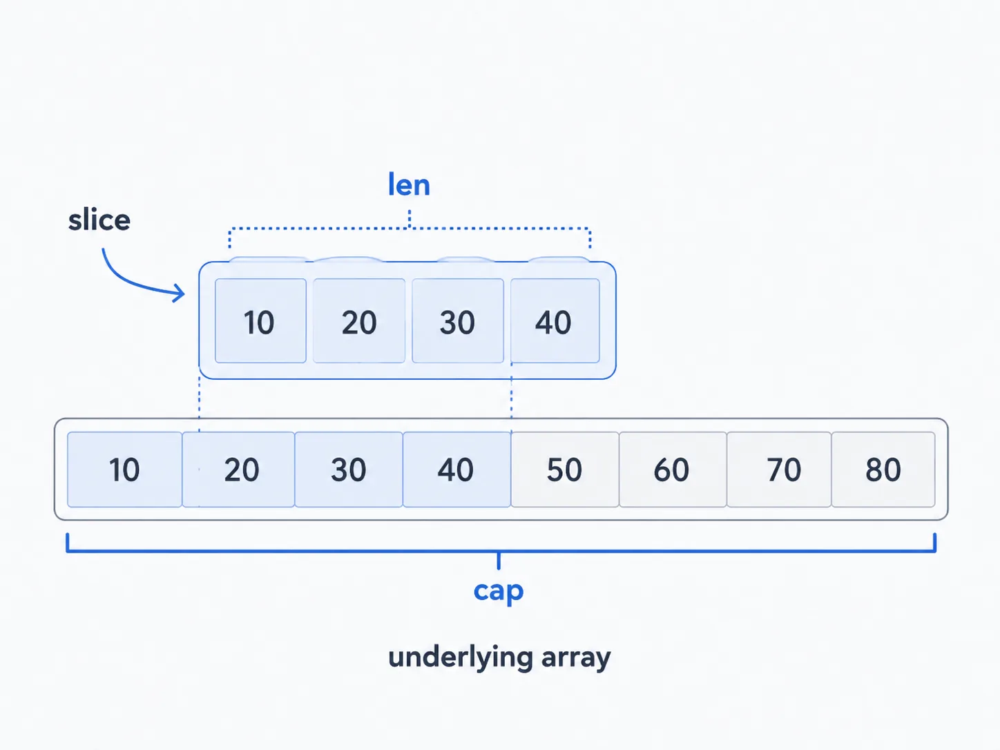
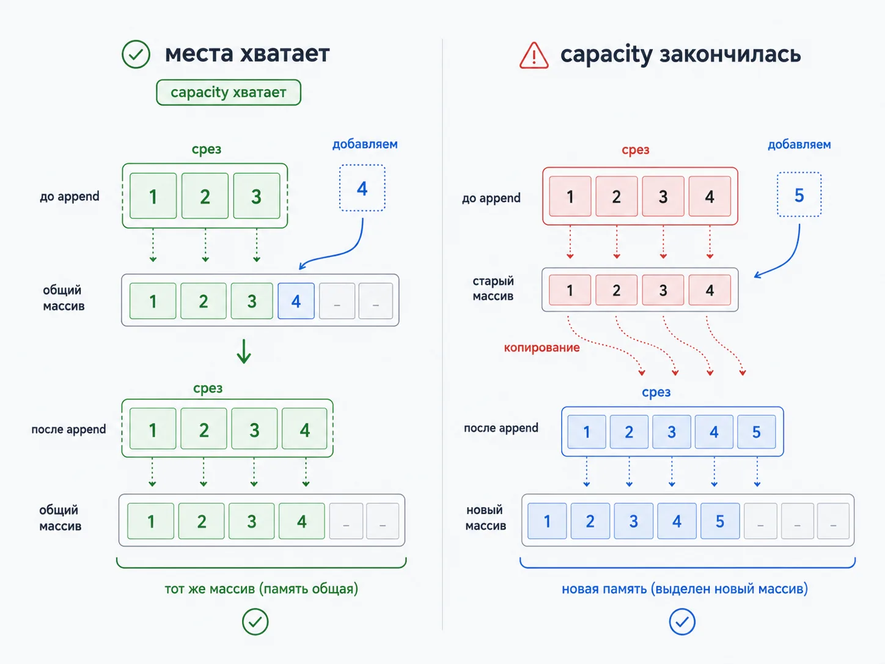
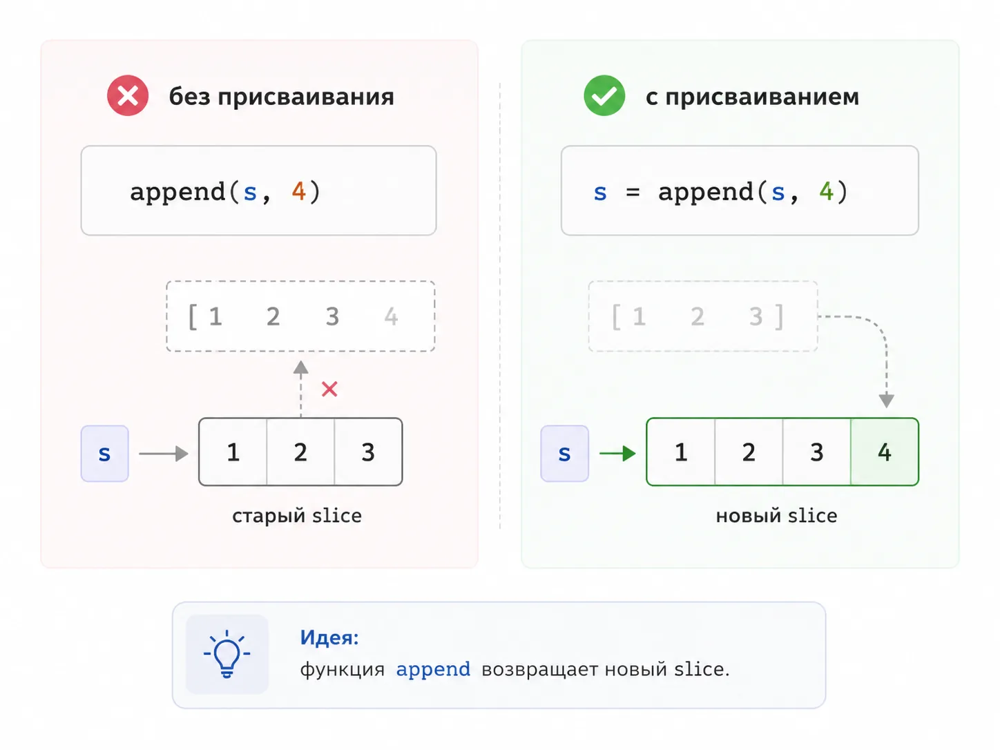
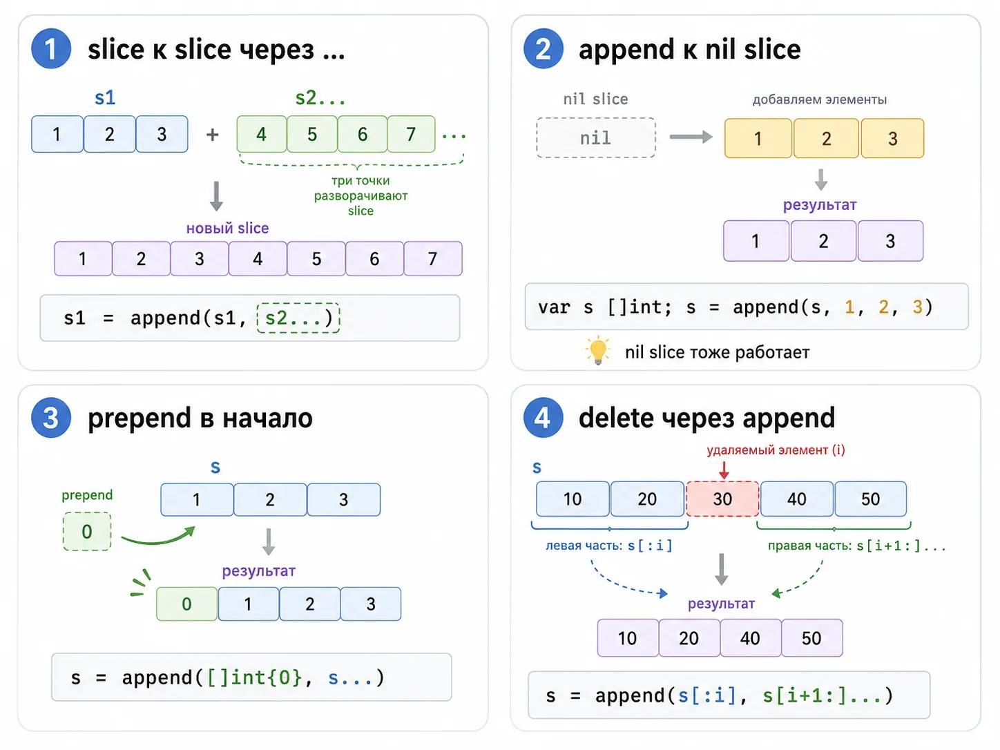
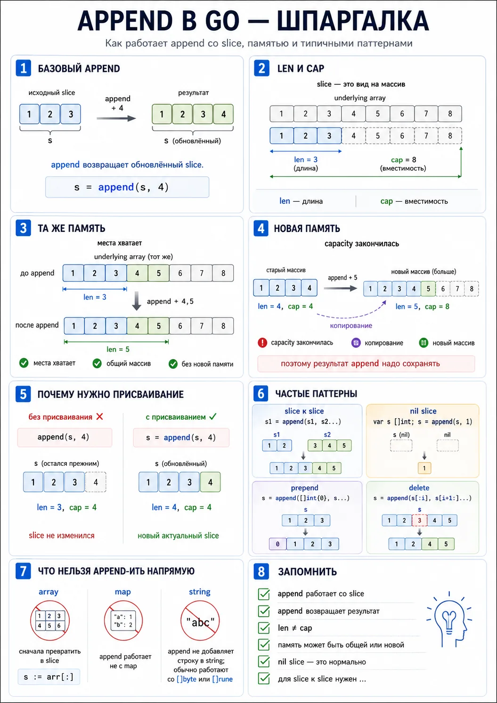

nums := []int{1, 2, 3}
nums = append(nums, 4)
Но дальше начинаются типичные вопросы, на которых новички стабильно спотыкаются:

почему append возвращает новый slice, и зачем результат надо присваивать обратно
почему после append иногда меняется исходный slice, а иногда нет
что такое len и cap, и почему без них тему не понять
когда append использует старый underlying array, а когда создаёт новый
почему append к nil slice работает нормально
как добавить один slice в другой через ...
почему append нельзя применять к map и array напрямую
как удалить элемент через append(slice[:i], slice[i+1:]...) и почему у этого способа есть нюансы
почему append внутри функции может неожиданно не менять исходный slice у вызывающего кода
Становится видно, что append golang — это не просто удобная мелочь, а ключ к пониманию того, как вообще устроены слайсы, память и рост данных в Go.

В реальном коде append встречается постоянно:

при сборке списков
в обработке JSON и API
в парсерах
в фоновых задачах
в построении буферов
при объединении данных
в алгоритмах и очередях
при работе с []byte, строками, map-значениями и вложенными структурами
Поэтому в статье пойдём не от сухого определения, а от нормального практического вопроса:

Что именно происходит в памяти после append?

Что такое функция append в Golang
Если совсем просто, append в Go — это встроенная функция, которая добавляет элементы в конец slice и возвращает обновлённый slice.

Базовый пример:

package main
import "fmt"
func main() {
nums := []int{1, 2, 3}
nums = append(nums, 4)
fmt.Println(nums)
}
Результат:

[1 2 3 4]
Append добавляет элементы в конец slice и возвращает результат.

Почему append в Go встроенная, а не метод
Потому что в Go слайсы — это базовый механизм языка, и append — часть стандартного способа работы с ними.

Сигнатуру удобно держать в голове так:

append(slice, elems...)
То есть первым аргументом идёт slice, дальше — один или несколько элементов того же типа.

Можно добавить сразу несколько элементов
nums := []int{1, 2, 3}
nums = append(nums, 4, 5, 6)
fmt.Println(nums)
Результат:

[1 2 3 4 5 6]

slice   append  result
1 2 3 -> +4 -> 1 2 3 4
append возвращает обновлённый срез

Почему тема append намного важнее, чем кажется
Потому что на самом деле append быстро выводит тебя на понимание трёх базовых вещей в Go:

slice — это не массив
slice имеет длину и вместимость
за slice может стоять общий underlying array
Именно из-за этого append иногда ведёт себя нормально и ожидаемо, а иногда будто ломает мозг.

Практический вывод
Если ты не понял append, значит ты ещё не до конца понял slice. А если не понял slice, дальше начнут сыпаться и copy, и range, и работа с []byte, и куски конкурентного кода.

Почему append работает только со slice
Люди часто ищут append golang map, array, string, массив и т.п. Но сама встроенная функция append работает именно со slice.

Почему не с array
Потому что массив в Go имеет фиксированную длину.

arr := [3]int{1, 2, 3}
У него размер часть типа. Он не умеет расти.

Такой код не скомпилируется:

arr = append(arr, 4)
Если хочешь добавить к массиву, сначала надо получить slice:

arr := [3]int{1, 2, 3}
s := arr[:]
s = append(s, 4)
fmt.Println(s)
Почему не с map
Потому что map — это вообще другая структура данных. У неё нет понятия «добавить в конец».

В map ты не appendишь, а пишешь по ключу:

m := map[string]int{}
m["go"] = 1
Но есть важный прикладной случай: если значение map — slice, тогда append уже работает с этим значением.

m := map[string][]int{"a": {1, 2, 3}}
m["a"] = append(m["a"], 4, 5)
fmt.Println(m)
Почему не со string напрямую
К строке append напрямую не применяют как к строковому типу.

Но есть особый случай в языке: если у тебя []byte, туда можно аппендить строку через ... как байты.

b := []byte{"G", "o"}
_ = b
Корректный практический пример:

b := []byte{'G', 'o'}
b = append(b, "lang"...)
fmt.Println(string(b))
Результат:

Golang
Это специальная форма для []byte + string.

Короткая запоминалка
• append работает со slice
•array надо сначала превратить в slice
•map не аппендят, но можно аппендить slice внутри map
•string напрямую не аппендят, но можно аппендить её байты в []byte

len, cap и underlying array: без этого append не понять
Вот теперь начинается главное.

Если смотреть на slice просто как на “массив, который можно расширять”, тема append будет постоянно вызывать путаницу.

В Go slice — это не сам массив, а небольшая структура-описатель над массивом.

Удобная модель такая:

pointer на underlying array;
len — сколько элементов сейчас видно;
cap — сколько элементов вообще можно вместить до перераспределения.
Что такое len
len(slice) — это текущая длина slice, то есть сколько элементов в нём сейчас доступно.

s := []int{10, 20, 30}
fmt.Println(len(s)) // 3
Что такое cap
cap(slice) — это вместимость, то есть сколько элементов slice может вместить до того, как append придётся искать новую память.

s := make([]int, 0, 5)
fmt.Println(len(s)) // 0
fmt.Println(cap(s)) // 5
Почему это важно для append
Потому что поведение append зависит именно от cap. Если места хватает, append просто дописывает новый элемент в уже существующий underlying array. Если места не хватает, Go создаёт новый массив, копирует туда старые данные и уже туда добавляет новый элемент.

Пример с make
s := make([]int, 0, 3)
fmt.Println(len(s), cap(s))
s = append(s, 1, 2, 3)
fmt.Println(s, len(s), cap(s))
Здесь у slice была вместимость 3, поэтому всё поместилось без перераспределения.

А если добавить ещё один элемент:

s = append(s, 4)
fmt.Println(s, len(s), cap(s))
Вот теперь Go уже, скорее всего, выделит новый underlying array.

Почему скорее всего
Потому что конкретная формула роста capacity — это деталь реализации runtime, и она менялась между версиями Go. На практике важно не заучивать “всегда удваивается”, а понимать сам принцип:

Если cap не хватает, append может выделить новую память

Думай о slice как о виде на полку.

len — сколько книг сейчас стоит на виду
cap — сколько ещё мест на этой полке есть до переезда
append — попытка поставить ещё одну книгу
если полка кончилась, книги переезжают на новую
Когда append использует старую память, а когда создаёт новую
Сценарий 1. Места хватает
Если у slice хватает capacity, append использует тот же underlying array.

package main
import "fmt"
func main() {
s := make([]int, 2, 4)
s[0] = 10
s[1] = 20
t := append(s, 30)
fmt.Println("s:", s, len(s), cap(s))
fmt.Println("t:", t, len(t), cap(t))
}
Здесь очень вероятно, что s и t смотрят на один и тот же underlying array.

Что это значит practically
Если потом изменить элемент в t, может оказаться, что данные изменились и в s, если диапазоны пересекаются по общей памяти.

Например:

s := make([]int, 2, 4)
s[0], s[1] = 10, 20
t := append(s, 30)
t[0] = 999
fmt.Println(s) // [999 20]
fmt.Println(t) // [999 20 30]
Сценарий 2. Места не хватает
Если capacity закончилась, append создаёт новый underlying array.

s := []int{1, 2, 3}
t := append(s, 4)
Так как у s длина и вместимость часто совпадают, очень вероятно, что t уже живёт на новой памяти.

Теперь изменение t уже не обязательно затронет s.

Почему это так важно
Потому что отсюда растёт половина багов по slice в Go:

человек думает, что append создал полностью независимую копию, а память всё ещё общая
или наоборот думает, что всё меняется вместе, а append уже ушёл в новый массив
Правило

Append может как оставить slice на старой памяти, так и перевести его на новую. Если тебе критично нужен отдельный независимый кусок данных, лучше явно сделать копию, а не надеяться на побочный эффект роста capacity.

Когда это всплывает в реальной работе
Очень часто в таких местах:

helper-функции, которые принимают slice и что-то в него append-ят
построение буферов
работа с подslice
удаление и вставка элементов
переиспользование временных списков в цикле

Почему результат append нужно сохранять
Неправильно

s := []int{1, 2, 3}
append(s, 4)
fmt.Println(s)
Многие ожидают увидеть: [1 2 3 4]

Но это неверное ожидание.

Почему так нельзя
Потому что append возвращает результат.

Go прямо говорит: вот тебе обновлённый slice, работай уже с ним.

Правильно

s := []int{1, 2, 3}
s = append(s, 4)
fmt.Println(s)
Почему язык устроен именно так
Потому что append может вернуть slice:

либо на старом массиве
либо уже на новом
Если бы язык делал вид, что ничего возвращать не надо, ты бы не знал, какой именно slice теперь актуален.

Особенно неприятный случай — внутри функции
func addValue(s []int) {
s = append(s, 100)
}
func main() {
nums := []int{1, 2, 3}
addValue(nums)
fmt.Println(nums)
}
Многие новички ждут, что nums изменится. Но нет.

Почему? Потому что внутри addValue переменная s получила новый slice-результат, а снаружи nums о нём ничего не знает.

Как правильно
Либо вернуть новый slice:

func addValue(s []int) []int {
s = append(s, 100)
return s
}
func main() {
nums := []int{1, 2, 3}
nums = addValue(nums)
fmt.Println(nums)
}
Либо, если нужен совсем другой уровень управления, уже работать через указатель на slice. Но для новичка 99% времени правильный путь — просто возвращать новый slice.

Append slice к slice, append nil slice, append в начало и удаление через append
Теперь разберём прикладные паттерны, которые встречаются чаще всего.

Как append один slice к другому
Для этого нужен оператор ..., который разворачивает второй slice в список аргументов.

s1 := []int{1, 2, 3}
s2 := []int{4, 5, 6}
s1 = append(s1, s2...)
fmt.Println(s1)
Результат:

[1 2 3 4 5 6]
Без ... такой код не скомпилируется, потому что append ждёт элементы типа int, а не один аргумент типа []int.

Append к nil slice
Это очень полезная особенность Go: append к nil slice работает нормально.

var nums []int
fmt.Println(nums == nil) // true
nums = append(nums, 1, 2, 3)
fmt.Println(nums)
Результат:

[1 2 3]
Это не костыль, а нормальное штатное поведение.

Почему это удобно
Потому что часто можно не делать лишнюю инициализацию заранее. Например, map со значениями-слайсами хорошо сочетается с этим паттерном:

m := map[string][]string{}
m["go"] = append(m["go"], "slice", "append")
Если ключа ещё не было, m["go"] даст nil slice, а append спокойно создаст рабочий slice.

Как добавить элемент в начало slice
Стандартного prepend в Go нет, но можно сделать так:

s := []int{1, 2, 3}
s = append([]int{0}, s...)
fmt.Println(s)
Результат:

[0 1 2 3]
Работает, но надо понимать: это обычно дороже, чем append в конец, потому что требует новый результат и копирование.

Как удалить элемент через append
Очень популярный паттерн:

s := []int{10, 20, 30, 40, 50}
i := 2
s = append(s[:i], s[i+1:]...)
fmt.Println(s)
Результат:

[10 20 40 50]
Что здесь происходит
Мы берём:

кусок до удаляемого индекса
кусок после него
склеиваем их через append
Важный нюанс
Этот способ может переиспользовать тот же underlying array. Иногда это нормально. Но если ты работаешь с большими объектами, долгоживущими ссылками или чувствительными данными, надо понимать, что старые элементы могут ещё оставаться в памяти underlying array до перезаписи.

Append строковых значений
Если у тебя slice строк, всё обычным образом работает:

tags := []string{"go", "backend"}
tags = append(tags, "append")
fmt.Println(tags)
Append байтов и строки
Очень полезный практический паттерн:

buf := []byte("Go")
buf = append(buf, "lang"...)
fmt.Println(string(buf))
Результат:

Golang
Это особенно полезно при работе с буферами, сериализацией и сетевым кодом.

Append и map, array, string: что можно, а что нельзя
Этот блок нужен, чтобы закрыть длинный хвост поисковых запросов и убрать путаницу.

Append golang map
Напрямую append к map неприменим.

Неправильно:

m := map[string]int{"a": 1}
// append(m, ...)
Правильно понимать так:

map не растёт через append
map обновляется присваиванием по ключу
но если значение в map — slice, тогда append уже уместен
Пример:

m := map[string][]int{"a": {1, 2, 3}}
m["a"] = append(m["a"], 4, 5)
Append golang array
К массиву append не применяют напрямую, потому что размер массива фиксирован и входит в тип.

arr := [3]int{1, 2, 3}
s := arr[:]
s = append(s, 4)
То есть ответ на запрос append golang array такой: напрямую нельзя, сначала массив надо превратить в slice.

Append golang string
Если речь о []string, append работает обычно:

s := []string{"a", "b"}
s = append(s, "c")
Если речь о типе string, то append не предназначен для работы со string как со slice элементов.

Но специальный и очень полезный случай есть с []byte:

b := []byte("Hello")
b = append(b, " Go"...)
fmt.Println(string(b))
Append golang массив
Если пользователь ищет это на русском, почти всегда он имеет в виду ровно ту же путаницу: массив vs slice.

И вот здесь важно написать это прямым текстом:

В Go append работает со slice, а не с массивом.

Частые ошибки новичков и вопросы на собеседовании
Ошибка 1. Не сохранять результат append

Это классика.

append(s, 4)
Так делать нельзя, если ты хочешь работать с обновлённым результатом.

Ошибка 2. Думать, что append всегда делает новую копию

Нет. Если capacity хватает, память может остаться общей.

Ошибка 3. Думать, что append никогда не делает новую копию

Тоже нет. Если capacity закончилась, append может уехать в новый массив.

Ошибка 4. Путать slice и array

Append работает со slice, а не с массивом.

Ошибка 5. Пытаться append-ить map

Map обновляют по ключу, а не через append.

Ошибка 6. Забывать про ... при append slice к slice

s1 = append(s1, s2...)

Без ... будет ошибка компиляции.

Ошибка 7. Не понимать, что append к nil slice — нормальный сценарий

Это не баг и не костыль. Это нормальная часть модели slice в Go.

Ошибка 8. Бездумно удалять элементы через append и не думать про underlying array

Для простого кода это нормально. Для сложных сценариев с памятью и удержанием ссылок уже надо понимать, что происходит.

Что любят спрашивать на собеседовании
Что делает append в Go?

Хороший ответ: append добавляет элементы в конец slice и возвращает обновлённый slice.

Почему результат append нужно сохранять?

Потому что append может вернуть как тот же slice, так и новый slice на другой памяти.

Когда append создаёт новый массив?

Когда capacity текущего slice не хватает для новых элементов.

Что такое len и cap?

len — текущая длина slice, cap — вместимость до перераспределения.

Можно ли append к nil slice?

Да. Это нормальный и рабочий сценарий.

Можно ли append один slice к другому?

Да, через ....

Можно ли append к map?

Нет. Но можно append-ить slice, который лежит внутри map как значение.

Можно ли append к array?

Нет напрямую. Сначала массив нужно превратить в slice.

Почему после append один slice изменил другой?

Потому что они могли разделять один underlying array.

Короткий итог-шпаргалка
append в Go — это встроенная функция для добавления элементов в конец slice.

Самое главное, что нужно унести из статьи:

append работает со slice
append возвращает обновлённый slice
результат append надо сохранять
поведение append зависит от cap
если места хватает, underlying array может остаться тем же
если места не хватает, append может создать новый массив
append(nilSlice, ...) — нормальный сценарий
slice к slice добавляют через ...
массив напрямую append-ить нельзя
map напрямую append-ить нельзя
append в начало и удаление через append возможны, но надо понимать цену и побочные эффекты
Если хочешь реально закрепить тему, не ограничивайся чтением. Лучше руками прогоняй маленькие примеры:

append одного элемента
append нескольких элементов
append slice к slice
nil slice + append
len и cap до и после роста
ситуация, где память общая
ситуация, где append уезжает в новый массив
удаление элемента через append(left, right...)
После этого append golang перестаёт быть магией и становится просто понятным рабочим инструментом.

Шпаргалка по функции append в Golang

Практика: 7 коротких упражнений, чтобы append реально закрепился
Упражнение 1. Один элемент
Что тренируем: базовую механику append.

Задача: Создай slice из трёх чисел и добавь в конец четвёртое.

Упражнение 2. Несколько элементов
Что тренируем: variadic append.

Задача: Добавь к slice сразу три новых числа одним вызовом.

Упражнение 3. Append slice к slice
Что тренируем: оператор ....

Задача: Объедини два slice в один.

Упражнение 4. Nil slice
Что тренируем: работу append с nil slice.

Задача: Объяви var s []int, затем через append добавь в него элементы.

Упражнение 5. len и cap
Что тренируем: понимание роста slice.

Задача: Создай slice через make([]int, 0, 2) и по одному добавляй элементы, печатая len и cap после каждого append.

Упражнение 6. Общая память
Что тренируем: понимание shared underlying array.

Задача: Сделай slice с запасом capacity, append-ни к нему новый slice и проверь, меняются ли исходные данные после изменения результата.

Упражнение 7. Удаление через append
Что тренируем: практический шаблон удаления.

Задача: Удали элемент из середины slice через append(slice[:i], slice[i+1:]...).

Мини-шаблоны, которые стоит унести в работу
Базовый append:

s = append(s, x)
Несколько элементов:

s = append(s, a, b, c)
Slice к slice:

s1 = append(s1, s2...)
Nil slice:

var s []int
s = append(s, 1, 2, 3)
Prepend:

s = append([]int{0}, s...)
Удаление элемента:

s = append(s[:i], s[i+1:]...)
Как самому проверить, что тема реально улеглась
После практики попробуй без подсказки ответить:

Почему append возвращает результат?
Когда append оставляет старую память, а когда создаёт новую?
Чем len отличается от cap?
Почему append(s, x) без присваивания — ошибка мышления?
Зачем нужен ... при append slice к slice?
Почему append к nil slice работает нормально?
Почему array напрямую append-ить нельзя?
Если на всё это отвечаешь спокойно, значит база по теме уже реально села.

Зачем понимать append, если это кажется маленькой функцией
append — отличный пример маленькой темы, которая на деле очень хорошо показывает качество базы.

Если человек не до конца понимает:

что такое slice
чем slice отличается от array
как работают len и cap
что такое underlying array
почему память бывает общей

В реальности важна плотная база и понимание того, что происходит в памяти, а не только на уровне синтаксиса. Именно поэтому тема append маленькая по объёму, но очень важная по смыслу.
